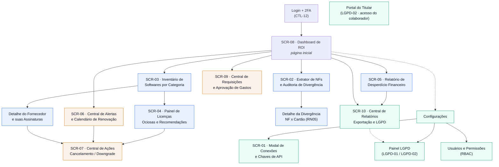

# Entregável 2 — Arquitetura de Informação e Mapa de Navegação

**Projeto:** Auditor e Otimizador de Assinaturas SaaS Corporativas
**Iteração:** Semana 01 (10/08/2026 – 16/08/2026)
**Responsáveis:** D1 / D2 (Designers), com validação de AR1 / AR2
**Versão:** 1.0.0

---

## 1. Objetivo

Definir a **estrutura de informação** do produto antes de qualquer wireframe: quais objetos
existem, como se agrupam, como o usuário se move entre eles e qual vocabulário será usado.
A AI produzida aqui é a base dos wireframes Lo-Fi da Semana 4 e ancora os IDs de tela
`SCR-01` a `SCR-10` já previstos na Matriz de Rastreabilidade do projeto.

---

## 2. Modelo Mental dos Usuários

| Perfil | Pergunta que ele faz ao abrir o app | Objeto de informação prioritário |
|:---|:---|:---|
| **CFO / Gestor Financeiro** | *"Quanto estamos desperdiçando e quanto já economizamos?"* | ROI, Desperdício, Relatório |
| **Administrador de TI** | *"Quais ferramentas existem e quem realmente usa?"* | Inventário, Licença, Log de uso |
| **Gestor de Compras** | *"Posso aprovar esta nova contratação?"* | Requisição, Aprovação, Inventário ocioso |
| **Administrador de RH** | *"Quais dados de colaborador estão sendo tratados?"* | Colaborador, Painel LGPD |
| **Colaborador** | *"O que o sistema sabe sobre mim?"* | Portal do titular (LGPD-02) |

---

## 3. Inventário de Objetos de Informação

> Vocabulário inicial da *Ubiquitous Language* — será formalizado no Modelo de Domínio (Semana 6).

| Objeto | Definição operacional | Atributos exibidos na UI | Origem |
|:---|:---|:---|:---|
| **Fornecedor SaaS** | Empresa que vende o software (ex.: Adobe, Canva) | nome, categoria, site, contato | REQ-03 |
| **Assinatura** | Contrato vigente com um fornecedor | plano, ciclo, valor, data de renovação, status | REQ-01 |
| **Licença (*seat*)** | Posto individual dentro de uma assinatura | titular (pseudônimo), último acesso, status | REQ-04 |
| **Fatura / NF** | Documento fiscal de cobrança | número, valor, data, status de conciliação | REQ-02 |
| **Lançamento de cartão** | Débito no cartão corporativo | valor, data, estabelecimento | RN05 |
| **Divergência** | Diferença > 1% entre NF e lançamento | valor NF, valor cartão, % de variação | RN05 |
| **Recomendação** | Sugestão de consolidação gerada por IA | tipo, economia estimada, confiança | REQ-05 |
| **Alerta de renovação** | Aviso antecipado de cobrança automática | assinatura, dias restantes, valor | REQ-06 / RN03 |
| **Requisição de compra** | Pedido de nova contratação | solicitante, valor, justificativa, status | REQ-09 / RN01 |
| **Relatório** | Documento consolidado exportável | período, escopo, formato, nível de anonimização | REQ-10 |
| **Conexão** | Integração ativa com ERP/e-mail/IdP | tipo, escopo, saúde, última varredura | REQ-01 |

### 3.1. Estados canônicos (base para o Diagrama de Máquina de Estados — Semana 5/6)

| Objeto | Estados |
|:---|:---|
| **Assinatura** | `Mapeada` → `Ativa` → `Ociosa` → `Em Downgrade` → `Cancelada` |
| **Fatura / NF** | `Recebida` → `Extraída (OCR)` → `Conciliada` / `Divergente` |
| **Requisição** | `Rascunho` → `Em Aprovação` → `Aprovada` / `Rejeitada` / `Bloqueada (RN04)` |
| **Alerta** | `Agendado` → `Disparado` → `Tratado` / `Ignorado` |

---

## 4. Taxonomia e Agrupamento (*card sorting* fechado)

Os 11 objetos foram agrupados em **5 áreas funcionais**, refletindo os dois blocos de
trabalho do projeto (Bloco A: captura e diagnóstico · Bloco B: gestão e governança):

```
1. DIAGNOSTICAR  (Bloco A)   → Dashboard ROI, Desperdício, Recomendações
2. DESCOBRIR     (Bloco A)   → Inventário, Fornecedores, Licenças, Ociosidade
3. CONCILIAR     (Bloco A)   → Faturas, NFs, Divergências, Lançamentos
4. AGIR          (Bloco B)   → Alertas, Cancelamento/Downgrade, Aprovações
5. GOVERNAR      (Bloco B)   → Relatórios, Exportação, LGPD, Conexões, Usuários
```

**Justificativa:** a taxonomia é **orientada à tarefa**, não à origem do dado. O usuário não
pensa "quero ver dados do ERP" — ele pensa "quero saber o que cancelar". Isso evita o erro
comum em ferramentas de gestão de SaaS de espelhar a estrutura das integrações na navegação.

---

## 5. Mapa de Navegação



### 5.1. Profundidade de navegação

Nenhuma tarefa crítica pode exceder **3 níveis de profundidade** a partir do Dashboard.
Essa restrição atende diretamente ao critério de aceite do Roteiro de Usabilidade da
Semana 12 ("notifica o setor financeiro em menos de 3 cliques").

| Tarefa crítica | Caminho | Cliques |
|:---|:---|:---:|
| Tratar divergência de NF | Dashboard → SCR-02 → Detalhe → Notificar | 3 |
| Executar downgrade | Dashboard → SCR-03 → SCR-04 → SCR-07 | 3 |
| Aprovar requisição | Dashboard → SCR-09 → Decisão | 2 |
| Exportar relatório anonimizado | Dashboard → SCR-10 → Exportar | 2 |
| Configurar alerta de renovação | Dashboard → SCR-06 → Configurar | 2 |

---

## 6. Estrutura de Layout (*shell* da aplicação)

```
┌───────────────────────────────────────────────────────────────────────────┐
│  TOPBAR: [logo] [seletor de empresa/tenant]        [  3] [  CFO ▾]      │
├──────────────┬────────────────────────────────────────────────────────────┤
│              │  BREADCRUMB: Início › Inventário › Adobe Creative Cloud    │
│  SIDEBAR     ├────────────────────────────────────────────────────────────┤
│              │  TÍTULO DA PÁGINA            [ações primárias da página]   │
│    Início   │                                                            │
│    Inventá. │  ┌──────────────────────────────────────────────────────┐  │
│    Faturas  │  │                                                      │  │
│    Ociosas  │  │              ÁREA DE CONTEÚDO                         │  │
│    Alertas  │  │   (filtros persistentes no topo da tabela)            │  │
│    Aprovaç. │  │                                                      │  │
│    Relatór. │  └──────────────────────────────────────────────────────┘  │
│  ─────────── │                                                            │
│    Config.  │  Ações destrutivas (cancelar/downgrade) sempre em modal    │
│              │  com confirmação explícita — nunca inline.                 │
└──────────────┴────────────────────────────────────────────────────────────┘
```

**Regras estruturais:**

- **Sidebar fixa** com no máximo 7 itens de primeiro nível (limite de carga cognitiva).
- **Breadcrumb obrigatório** em todas as telas de nível 2+ — o produto tem hierarquia
  profunda de objetos (Fornecedor → Assinatura → Licença).
- **Seletor de tenant no topbar**: reforça visualmente o isolamento multi-tenant (CTL-10).
- **Ações destrutivas em modal**: sustenta a RN01 e a exigência de aprovação formal.
- **Responsividade (RNF-09):** em tablet a sidebar colapsa para ícones; tabelas ganham
  rolagem horizontal com a primeira coluna fixada.

---

## 7. Padrões de Nomenclatura na Interface

> A UI é o principal veículo da *Ubiquitous Language*. Termos divergentes entre tela,
> documentação e código são a origem mais comum de retrabalho.

| Usar | Evitar | Motivo |
|:---|:---|:---|
| **Licença ociosa** | Licença inativa, sem uso, morta | "Ociosa" tem definição formal na RN02 (30 dias) |
| **Divergência** | Erro, inconsistência, falha | "Divergência" é o estado formal da RN05 |
| **Assinatura** | Contrato, plano, subscription | "Plano" é atributo da assinatura, não sinônimo |
| **Desperdício** | Perda, prejuízo, gasto extra | Termo do REQ-05 e do relatório mensal |
| **Requisição** | Pedido, solicitação, chamado | Termo do fluxo de aprovação (REQ-09) |
| **Colaborador** | Funcionário, usuário, employee | "Usuário" é quem opera o app; "colaborador" é o titular do dado |

---

## 8. Padrões de Estado Vazio, Carregamento e Erro

Definidos já na AI porque afetam a estrutura da página, não apenas o visual
(detalhamento visual completo fica para a Semana 10):

| Situação | Padrão estrutural |
|:---|:---|
| Nenhuma conexão configurada | Estado vazio **acionável** → CTA direto para SCR-01 |
| Varredura em andamento (RNF-04, < 5 min) | Barra de progresso persistente no topbar, navegação livre |
| Dashboard carregando | *Skeleton* de cards — nunca spinner de página inteira (RNF-06, < 2s) |
| Integração com falha | Banner fixo na página do objeto afetado + badge na sidebar |
| Dado mascarado por LGPD-01 | Badge `Anonimizado` com tooltip explicando o motivo |

---

## 9. Critérios de Aceite

1. Todos os 10 IDs de tela (`SCR-01` a `SCR-10`) da Matriz de Rastreabilidade estão
   posicionados no mapa de navegação.
2. Nenhuma tarefa crítica excede 3 cliques a partir do Dashboard.
3. Todo objeto do inventário (Seção 3) tem ao menos uma tela onde é listado e uma onde é detalhado.
4. A nomenclatura da Seção 7 é a fonte única para os wireframes da Semana 4 e para o
   glossário da *Ubiquitous Language* na Semana 6.

---

## 10. Rastreabilidade

| Item | Consumido em | Entregável de destino |
|:---|:---|:---|
| Seção 3 (objetos) | Semana 6 | Modelo de Domínio DDD — Entidades e VOs |
| Seção 3.1 (estados) | Semana 5/6 | Diagrama de Máquina de Estados |
| Seção 5 (mapa) | Semana 4 | Wireframes Lo-Fi |
| Seção 6 (shell) | Semana 6/7 | Design System — grids e componentes |
| Seção 7 (nomenclatura) | Semana 6 | Glossário da Linguagem Onipresente |
| Seção 8 (estados de UI) | Semana 10 | Pacote de telas de exceção |
