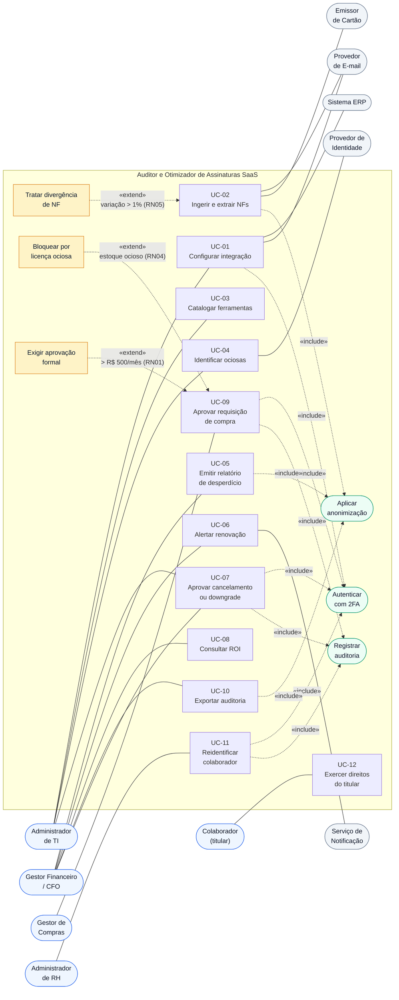
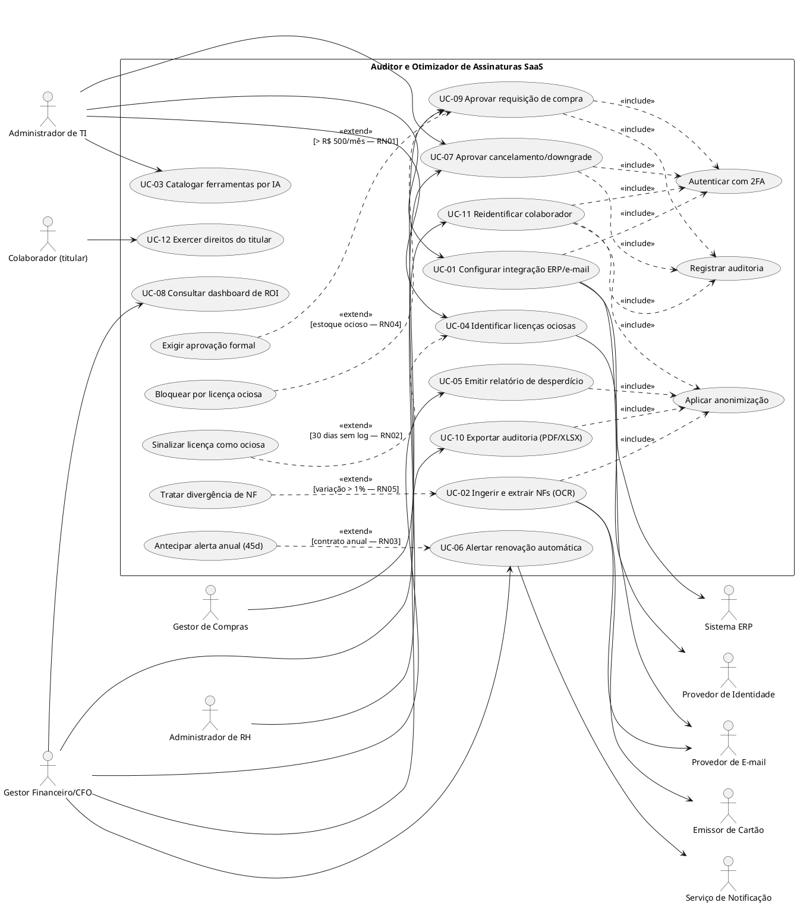

# Entregável 4 — Diagramas UML (Semana 01)

**Projeto:** Auditor e Otimizador de Assinaturas SaaS Corporativas
**Iteração:** Semana 01 (10/08/2026 – 16/08/2026)
**Responsáveis:** AR1 / AR2
**Versão:** 0.1.0 — *rascunho para consolidação*

---

## 1. O que se aplica a esta iteração

Conforme a Matriz de Diagramas UML definida em [`diagramasUML.md`](../diagramasUML.md):

| Diagrama | Janela de trabalho | Entrega formal | Situação na Semana 01 |
|:---|:---|:---|:---|
| **Casos de Uso** | Semanas 1 a 3 | **Semana 2** | Rascunho v0.1 — fronteira e atores fechados |
| **Atividades** | Semanas 2 e 3 | **Semana 3** | Não iniciado (inicia na Semana 2) |
| Sequência | Semanas 4 e 5 | Semana 5 | Fora do escopo desta iteração |
| Máquina de Estados | Semanas 5 e 6 | Semana 6 | Fora do escopo desta iteração |
| Classes de Domínio | Semanas 6 e 7 | Semana 7 | Fora do escopo desta iteração |
| Pacotes / Componentes | Semana 7 | Semana 7 | Fora do escopo desta iteração |
| Implantação | Semanas 10 e 11 | Semana 11 | Fora do escopo desta iteração |

> **Portanto, o entregável desta semana é o rascunho v0.1 do Diagrama de Casos de Uso**,
> cobrindo a delimitação da fronteira do sistema e a identificação completa dos atores —
> pré-condição para a especificação de histórias de usuário da Semana 2.

---

## 2. Catálogo de Atores

### 2.1. Atores primários (humanos)

| Ator | Descrição | Objetivo no sistema | Casos de uso principais |
|:---|:---|:---|:---|
| **Administrador de TI** | Responsável pelo parque de software | Mapear e sanear o inventário de SaaS | UC-01, UC-03, UC-04, UC-07 |
| **Gestor Financeiro / CFO** | Responsável pelo orçamento | Reduzir desperdício e comprovar ROI | UC-05, UC-06, UC-08, UC-09, UC-10 |
| **Gestor de Compras** | Aprova novas contratações | Garantir conformidade com a política (RN01) | UC-09 |
| **Administrador de RH** | Custodia dados de colaboradores | Atender à LGPD-01 e reidentificar quando necessário | UC-11 |
| **Colaborador (titular)** | Usuário das licenças auditadas | Exercer direitos de acesso e portabilidade (LGPD-02) | UC-12 |

### 2.2. Atores secundários (sistemas externos)

| Ator | Papel | Integração |
|:---|:---|:---|
| **Provedor de E-mail** (Google Workspace / Microsoft 365) | Fornece anexos e metadados de faturamento | OAuth 2.0 somente-leitura |
| **Sistema ERP** (Protheus / SAP B1 / Omie) | Fornece lançamentos e notas fiscais | API REST / OData |
| **Emissor de Cartão Corporativo** | Fornece lançamentos para conciliação (RN05) | Open Finance / API do emissor |
| **Provedor de Identidade (IdP)** | Fornece logs de acesso às ferramentas | SSO / SCIM |
| **Motor de IA de Catalogação** | Classifica ferramentas e gera recomendações | Serviço interno de domínio |
| **Serviço de Notificação** | Entrega alertas por e-mail e push | Contexto genérico |

> Justificativa da separação: os atores secundários **não iniciam** casos de uso — eles são
> acionados pelo sistema ou fornecem dados. Isso mantém a fronteira do sistema legível e
> evita o erro comum de desenhar integrações como se fossem usuários.

---

## 3. Casos de Uso Identificados (rastreados aos 10 RFs)

| ID | Caso de uso | RF | Ator primário | Regras vinculadas |
|:---|:---|:---|:---|:---|
| **UC-01** | Configurar integração com ERP e faturamento | REQ-01 | Admin de TI | RNF-01, RNF-08 |
| **UC-02** | Ingerir e extrair dados de notas fiscais (OCR) | REQ-02 | *(disparado pelo sistema)* | RN05, RNF-07, LGPD-01 |
| **UC-03** | Catalogar ferramentas por categoria | REQ-03 | Admin de TI | RNF-10 |
| **UC-04** | Identificar licenças ociosas e duplicadas | REQ-04 | Admin de TI | RN02 |
| **UC-05** | Emitir relatório mensal de desperdício | REQ-05 | Gestor Financeiro | RNF-06 |
| **UC-06** | Receber alerta de renovação automática | REQ-06 | Gestor Financeiro | RN03 |
| **UC-07** | Aprovar cancelamento ou downgrade | REQ-07 | Admin de TI / CFO | RN02 |
| **UC-08** | Consultar dashboard de ROI histórico | REQ-08 | Gestor Financeiro | RNF-06 |
| **UC-09** | Submeter e aprovar requisição de compra | REQ-09 | Gestor de Compras | RN01, RN04 |
| **UC-10** | Exportar relatório de auditoria (PDF/XLSX) | REQ-10 | Gestor Financeiro | LGPD-01, LGPD-02 |
| **UC-11** | Reidentificar colaborador pseudonimizado | LGPD-01 | Admin de RH | CTL-06, CTL-11 |
| **UC-12** | Exercer direito de acesso e portabilidade | LGPD-02 | Colaborador | CTL-07, CTL-08 |

### 3.1. Relacionamentos `<<include>>` e `<<extend>>`

| Origem | Tipo | Destino | Condição |
|:---|:---|:---|:---|
| UC-01, UC-07, UC-09, UC-11 | `<<include>>` | **Autenticar com 2FA** | Sempre (CTL-12) |
| UC-02, UC-05, UC-10, UC-11 | `<<include>>` | **Aplicar anonimização** | Sempre (LGPD-01) |
| UC-07, UC-09, UC-11 | `<<include>>` | **Registrar em trilha de auditoria** | Sempre (CTL-11) |
| UC-02 | `<<extend>>` | **Tratar divergência de NF** | Variação > 1% entre NF e cartão (RN05) |
| UC-09 | `<<extend>>` | **Bloquear por licença ociosa em estoque** | Existe licença idêntica ociosa (RN04) |
| UC-09 | `<<extend>>` | **Exigir aprovação formal** | Valor > R$ 500/mês (RN01) |
| UC-04 | `<<extend>>` | **Sinalizar como ociosa** | 30 dias sem log de atividade (RN02) |
| UC-06 | `<<extend>>` | **Antecipar alerta anual** | Contrato anual → 45 dias (RN03) |
| UC-01 | `<<extend>>` | **Tratar falha de conexão** | Token expirado ou API indisponível |

---

## 4. Diagrama de Casos de Uso — v0.1

### 4.1. Visão geral (Mermaid)

### 4.2. Fonte PlantUML (notação UML 2.5 canônica)

> Arquivo-fonte versionável para geração da imagem oficial na entrega da Semana 2.

---

## 5. Verificação de Cobertura

| Requisito | Coberto por | ✓ |
|:---|:---|:---:|
| REQ-01 … REQ-10 | UC-01 … UC-10 (mapeamento 1:1) | Sim |
| RN01 | `<<extend>>` Exigir aprovação formal (UC-09) | Sim |
| RN02 | `<<extend>>` Sinalizar licença como ociosa (UC-04) | Sim |
| RN03 | `<<extend>>` Antecipar alerta anual (UC-06) | Sim |
| RN04 | `<<extend>>` Bloquear por licença ociosa (UC-09) | Sim |
| RN05 | `<<extend>>` Tratar divergência de NF (UC-02) | Sim |
| LGPD-01 | `<<include>>` Aplicar anonimização + UC-11 | Sim |
| LGPD-02 | UC-12 | Sim |
| RNF-01 | `<<include>>` Autenticar com 2FA (CTL-12) | Sim |

**Cobertura: 10/10 RFs · 5/5 RNs · 2/2 itens de LGPD.**

---

## 6. Pendências para a Semana 2 (entrega formal)

1. Escrever as **descrições textuais completas** de UC-01 a UC-03 (fluxo principal,
   alternativos e de exceção) junto com as histórias US-01 a US-03.
2. Gerar a **imagem oficial** do diagrama a partir do fonte PlantUML da Seção 4.2.
3. Validar com AR2 se **UC-11** e **UC-12** permanecem como casos de uso de primeira classe
   ou migram para um contexto genérico de "Conformidade".
4. Iniciar o **Diagrama de Atividades** do fluxo de OCR com validação de divergência (RN05),
   com entrega prevista para a Semana 3.
