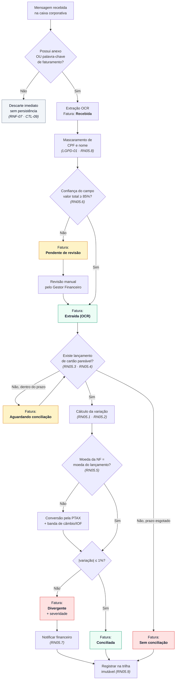

# Entregável 2 — Matriz de Regras de Negócio de OCR e Divergência Financeira (RN05)

**Projeto:** Auditor e Otimizador de Assinaturas SaaS Corporativas
**Iteração:** Semana 02 (17/08/2026 – 23/08/2026)
**Responsável:** AR1 (Analista de Requisitos)
**Versão:** 1.0.0
**Regra-mãe:** RN05 — *"Se os dados extraídos de uma nota fiscal de SaaS via OCR não baterem com o valor cobrado no cartão corporativo integrado (variação maior que 1%), o lançamento deve ser marcado como 'Divergente' e o financeiro deve ser notificado."*

---

## 1. Objetivo

A RN05, tal como enunciada, deixa em aberto seis pontos que impedem sua implementação:
**qual valor** comparar, **contra qual lançamento**, **em que janela de tempo**, **como
arredondar**, **o que fazer com moeda estrangeira** e **o que acontece quando não há par**.
Este documento decompõe a regra-mãe em **10 sub-regras verificáveis** (`RN05.1` a `RN05.10`)
e formaliza a tabela de decisão do motor de conciliação.

---

## 2. Pipeline de OCR e Conciliação



---

## 3. Campos Extraídos e Confiança Mínima

| ID | Campo | Tipo | Obrigatório | Confiança mínima | Uso | Tratamento LGPD |
|:---|:---|:---|:---:|:---:|:---|:---|
| CE-01 | Número do documento | Texto | Sim | 70% | Chave de deduplicação | — |
| CE-02 | **Valor total** | Monetário | Sim | **85%** | Base da RN05 | — |
| CE-03 | Moeda | ISO 4217 | Sim | 90% | Aciona RN05.5 | — |
| CE-04 | Data de emissão | Data | Sim | 80% | Define a janela RN05.3 | — |
| CE-05 | Razão social do emitente | Texto | Sim | 75% | Vincula ao Fornecedor SaaS | — |
| CE-06 | CNPJ do emitente | Texto | Não | 85% | Desambigua fornecedor | — |
| CE-07 | Descrição do serviço | Texto | Não | 60% | Insumo da catalogação (REQ-03) | — |
| CE-08 | Competência / período | Período | Não | 70% | Detecta contrato anual | — |
| CE-09 | Impostos retidos | Monetário | Não | 80% | Explica variação legítima | — |
| CE-10 | Nome do tomador/colaborador | Texto | Não | — | Nenhum | Pseudonimizado (DP-01) |
| CE-11 | CPF constante do documento | Texto | Não | — | Nenhum | Descartado (DP-03) |

> **CE-02 é o único campo cuja baixa confiança bloqueia a conciliação automática** — os demais
> degradam a qualidade da catalogação, mas não invalidam a auditoria financeira.

---

## 4. Matriz de Sub-Regras (RN05.1 a RN05.10)

| ID | Sub-regra | Enunciado formal | Cenário BDD | Criticidade |
|:---|:---|:---|:---|:---:|
| **RN05.1** | **Tolerância** | Uma fatura é `Divergente` quando `\|variação\| > 1,00%`; caso contrário, `Conciliada`. O limite é **exclusivo**: exatamente 1,00% concilia. | CT-02.8 | Alta |
| **RN05.2** | **Base de cálculo** | `variação (%) = ((valor_lançamento − valor_nf) ÷ valor_nf) × 100`, arredondada a 2 casas com `ROUND_HALF_UP`. Se `valor_nf = 0`, a fatura vai para `Pendente de revisão`. | CT-02.4 | Alta |
| **RN05.3** | **Janela de conciliação** | Um lançamento só é pareável com uma NF se ocorrer entre `D−5` e `D+15` dias corridos da data de emissão. Esgotada a janela sem par, a fatura assume `Sem conciliação`. | *(novo — CT-02.9)* | Média |
| **RN05.4** | **Agregação N:1** | Quando um contrato anual é cobrado em parcelas, a comparação é feita entre o **valor da NF** e a **soma dos lançamentos** da mesma assinatura dentro da janela. Parcelamento identificado não gera divergência por si só. | *(novo — CT-02.10)* | Média |
| **RN05.5** | **Câmbio** | NF em moeda estrangeira é convertida pela PTAX de venda da data do lançamento. Sobre a tolerância de 1% aplica-se uma **banda cambial adicional de 6,38%** (IOF) + 4% (spread do emissor). Fora dessa banda, é divergência. | *(novo — CT-02.11)* | Alta |
| **RN05.6** | **Confiança mínima do OCR** | Confiança de CE-02 abaixo de 85% impede a conciliação automática e envia a fatura para `Pendente de revisão` com o documento original ao lado dos campos extraídos. | CT-02.6 | Alta |
| **RN05.7** | **Notificação do financeiro** | Toda transição para `Divergente` notifica o papel *Gestor Financeiro* em até 15 minutos, por e-mail e no sino da plataforma, com valor da NF, valor cobrado e percentual. | CT-02.4 | Alta |
| **RN05.8** | **Mascaramento** | Nenhum dado pessoal (DP-01, DP-03) é persistido a partir do OCR: CPF é descartado e nome é substituído por `COL-{hash}` **antes** da gravação. | CT-02.3 | Alta |
| **RN05.9** | **Trilha imutável** | Todo desfecho de conciliação (`Conciliada`, `Divergente`, `Sem conciliação`) gera registro *append-only* em `audit_log` com os valores comparados no momento da apuração. | — (CTL-11) | Média |
| **RN05.10** | **Reprocessamento** | A correção manual de um campo extraído reexecuta a conciliação e cria **nova** entrada de auditoria; o registro anterior nunca é sobrescrito. | *(novo — CT-02.12)* | Média |

---

## 5. Tabela de Decisão da Conciliação

### 5.1. Classificação por faixa de variação

| Faixa de `\|variação\|` | Estado | Severidade | Ação automática | Prazo de tratamento |
|:---|:---|:---|:---|:---|
| `0,00%` | Conciliada | — | Nenhuma | — |
| `> 0,00%` e `≤ 1,00%` | Conciliada | — | Registrar variação no histórico | — |
| `> 1,00%` e `≤ 5,00%` | **Divergente** | Média | Notificar Gestor Financeiro | 10 dias úteis |
| `> 5,00%` e `≤ 20,00%` | **Divergente** | Alta | Notificar Gestor Financeiro + CFO | 5 dias úteis |
| `> 20,00%` | **Divergente** | Crítica | Notificar CFO + bloquear renovação automática | 2 dias úteis |

> A cobrança **menor** que a NF também é divergência: variação negativa fora da tolerância
> indica NF emitida a maior ou serviço não entregue integralmente. O sinal é preservado na
> interface (`−3,20%`), mas a classificação usa o valor absoluto.

### 5.2. Tabela de decisão completa (condições × ações)

| # | Confiança CE-02 | Par encontrado | Moeda igual | `\|variação\|` | ➜ Estado resultante | Notifica |
|:--|:---|:---|:---|:---|:---|:---|
| D1 | `< 85%` | — | — | — | Pendente de revisão | Gestor Financeiro |
| D2 | `≥ 85%` | Não (janela aberta) | — | — | Aguardando conciliação | — |
| D3 | `≥ 85%` | Não (janela esgotada) | — | — | Sem conciliação | Gestor Financeiro |
| D4 | `≥ 85%` | Sim | Sim | `≤ 1%` | Conciliada | — |
| D5 | `≥ 85%` | Sim | Sim | `> 1%` | Divergente | Conforme severidade |
| D6 | `≥ 85%` | Sim | Não | dentro da banda cambial | Conciliada *(com nota de câmbio)* | — |
| D7 | `≥ 85%` | Sim | Não | fora da banda cambial | Divergente | Conforme severidade |
| D8 | `≥ 85%` | Sim (N:1 agregado) | Sim | `≤ 1%` sobre a soma | Conciliada | — |
| D9 | — | Duplicata de NF já processada | — | — | Descartada (duplicidade) | — |
| D10 | `≥ 85%` | Sim | Sim | `valor_nf = 0` | Pendente de revisão | Gestor Financeiro |

---

## 6. Especificação do Cálculo

```
ENTRADAS
  valor_nf          : Decimal(15,2)   -- CE-02, na moeda CE-03
  moeda_nf          : ISO-4217        -- CE-03
  data_emissao      : Data            -- CE-04
  lancamentos[]     : lista de lançamentos do cartão corporativo

PASSO 1 — Seleção da janela (RN05.3)
  candidatos ← lancamentos onde data ∈ [data_emissao − 5d, data_emissao + 15d]
                            e fornecedor ≈ CE-05/CE-06

PASSO 2 — Agregação (RN05.4)
  SE existir marcação de parcelamento da mesma assinatura na janela
     valor_cobrado ← SOMA(candidatos.valor)
  SENÃO
     valor_cobrado ← candidato com menor |valor − valor_nf|

PASSO 3 — Normalização cambial (RN05.5)
  SE moeda_nf ≠ moeda_lancamento
     valor_nf_convertido ← valor_nf × PTAX_venda(moeda_nf, data_lancamento)
     tolerancia ← 1,00% + 6,38% (IOF) + 4,00% (spread)   -- banda cambial
  SENÃO
     valor_nf_convertido ← valor_nf
     tolerancia ← 1,00%

PASSO 4 — Apuração (RN05.1 · RN05.2)
  variacao ← ARRED(((valor_cobrado − valor_nf_convertido) / valor_nf_convertido) × 100; 2)

PASSO 5 — Classificação
  SE |variacao| ≤ tolerancia  ENTÃO  estado ← "Conciliada"
  SENÃO                              estado ← "Divergente"
                                     severidade ← faixa(|variacao|)
                                     notificar(RN05.7)

PASSO 6 — Auditoria (RN05.9)
  registrar_append_only(fatura, valor_nf, valor_cobrado, variacao, estado, timestamp)
```

---

## 7. Casos de Borda e Tratamento

| ID | Caso de borda | Tratamento | Sub-regra |
|:---|:---|:---|:---|
| BR-01 | NF com valor total igual a zero (bonificação) | `Pendente de revisão` — divisão inválida | RN05.2 |
| BR-02 | Mesma NF chega duas vezes (reenvio do fornecedor) | Deduplicação por `CE-01 + CE-06`; segunda cópia descartada | D9 |
| BR-03 | Cobrança estornada e recobrada no mesmo mês | Estorno e recobrança se anulam na agregação | RN05.4 |
| BR-04 | NF anual cobrada em 12 parcelas iguais | Agregação por competência (CE-08); não é divergência | RN05.4 |
| BR-05 | Fornecedor cobra em USD, NF emitida em BRL | Conversão pela PTAX + banda cambial | RN05.5 |
| BR-06 | Variação decorrente exclusivamente de imposto retido | Impostos (CE-09) somados ao valor da NF antes da comparação | RN05.2 |
| BR-07 | Cobrança sem NF correspondente após 30 dias | Lançamento marcado como `NF ausente` e reportado | RN05.3 |
| BR-08 | Documento em imagem girada ou de baixa resolução | Confiança abaixo do limiar → revisão manual | RN05.6 |
| BR-09 | Correção manual do valor após classificação | Reprocessa e cria nova entrada de auditoria | RN05.10 |
| BR-10 | Cartão corporativo desconectado no momento da apuração | `Aguardando conciliação`, sem falso positivo de divergência | RN05.3 |

---

## 8. Cenários Gherkin Complementares

> Complementam os 23 cenários do Entregável 1, cobrindo as sub-regras novas.

```gherkin
# language: pt
@REQ-02 @RN05 @BlocoA
Funcionalidade: Regras complementares de conciliação financeira

  @CT-02.9 @RN05.3
  Cenário: Encerrar a janela de conciliação sem par
    Dado uma Fatura extraída em "17/08/2026" no valor de "R$ 800,00"
    E que não existe lançamento de cartão correspondente
    Quando se passam 15 dias corridos da data de emissão
    Então a Fatura deve assumir o estado "Sem conciliação"
    E o Gestor Financeiro deve ser notificado

  @CT-02.10 @RN05.4
  Cenário: Conciliar contrato anual cobrado em parcelas
    Dado uma Fatura anual no valor de "R$ 12.000,00"
    E 12 lançamentos mensais de "R$ 1.000,00" da mesma assinatura
    Quando a conciliação agregada é executada
    Então a variação apurada deve ser de "0,00%"
    E a Fatura deve assumir o estado "Conciliada"

  @CT-02.11 @RN05.5
  Cenário: Conciliar nota em moeda estrangeira dentro da banda cambial
    Dado uma Fatura no valor de "USD 100,00"
    E um lançamento de cartão de "R$ 570,00"
    E que a PTAX de venda do dia é "5,20"
    Quando a conciliação é executada
    Então a variação sobre o valor convertido deve ser de "9,62%"
    E a variação deve estar dentro da banda de câmbio e IOF
    E a Fatura deve assumir o estado "Conciliada"
    E deve ser exibida a nota "Variação explicada por câmbio e IOF"

  @CT-02.12 @RN05.10
  Cenário: Reprocessar conciliação após correção manual
    Dado uma Fatura no estado "Divergente" com valor extraído "R$ 1.500,00"
    Quando o Gestor Financeiro corrige o valor para "R$ 1.005,00"
    Então a conciliação deve ser reexecutada automaticamente
    E a Fatura deve assumir o estado "Conciliada"
    E a trilha de auditoria deve conter os dois registros de apuração

  @CT-02.13 @RN05.7
  Esquema do Cenário: Escalonar notificação conforme a severidade
    Dado uma Fatura no valor de "R$ 1.000,00"
    E um lançamento de cartão no valor de "<valor_cartao>"
    Quando a conciliação é executada
    Então a severidade deve ser "<severidade>"
    E os destinatários da notificação devem ser "<destinatarios>"

    Exemplos:
      | valor_cartao | severidade | destinatarios                    |
      | R$ 1.030,00  | Média      | Gestor Financeiro                |
      | R$ 1.100,00  | Alta       | Gestor Financeiro, CFO           |
      | R$ 1.400,00  | Crítica    | CFO                              |
```

---

## 9. Critérios de Aceite da Matriz

1. Toda sub-regra `RN05.x` tem cenário Gherkin correspondente ou justificativa de exclusão.
2. Nenhum caminho da tabela de decisão (D1–D10) fica sem estado resultante definido.
3. Nenhum campo pessoal (CE-10, CE-11) participa do cálculo de conciliação.
4. Os estados usados aqui são exatamente os declarados na Seção 3.1 da AI da Semana 01,
   acrescidos de `Aguardando conciliação`, `Sem conciliação` e `Pendente de revisão` — que
   devem ser incorporados ao Diagrama de Máquina de Estados da Semana 05/06.

---

## 10. Rastreabilidade

| Item | Consumido em | Entregável de destino |
|:---|:---|:---|
| Seção 2 (pipeline) | Semana 3 | Diagrama de Atividades do fluxo de OCR |
| Seção 4 (sub-regras) | Semana 5 | Validação do RNF-10 (falsos positivos < 2%) |
| Seção 5 (faixas de severidade) | Semana 10 | Telas de tratamento de divergência |
| Seção 3 (campos CE-xx) | Semana 6 | Dicionário de Dados e regras de anonimização |
| Estados novos (Seção 9.4) | Semana 5/6 | Diagrama de Máquina de Estados de `Fatura` |
| Seção 5.1 (severidade) | Semana 12 | Tarefa 01 do roteiro de teste de usabilidade |

---

## 11. Parâmetros que Exigem Homologação do Cliente

| Parâmetro | Valor proposto | Origem | Situação |
|:---|:---|:---|:---|
| Tolerância de variação | 1,00% | RN05 (enunciado original) | Definido |
| Janela de conciliação | `D−5` a `D+15` | Proposto pela análise | A homologar |
| Banda cambial (IOF + spread) | 6,38% + 4,00% | Legislação + prática de mercado | A homologar |
| Confiança mínima do OCR | 85% | Proposto pela análise (Q-01) | A homologar na Semana 5 |
| Prazo de notificação | 15 minutos | Proposto pela análise | A homologar |
| Prazo de "NF ausente" | 30 dias | Proposto pela análise | A homologar |
