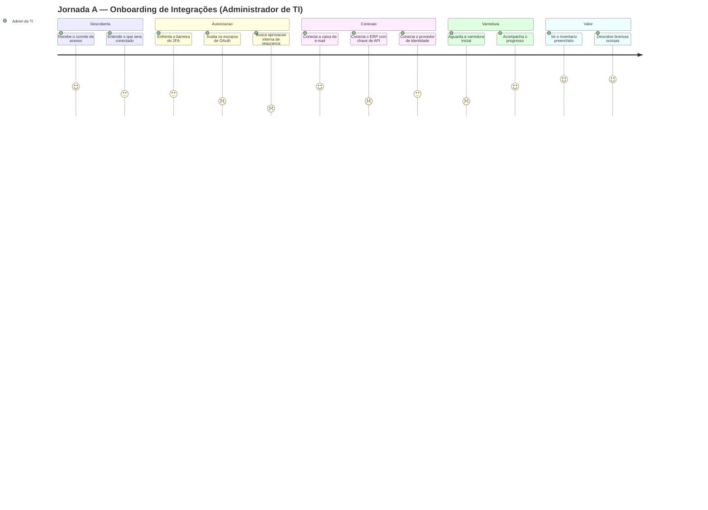
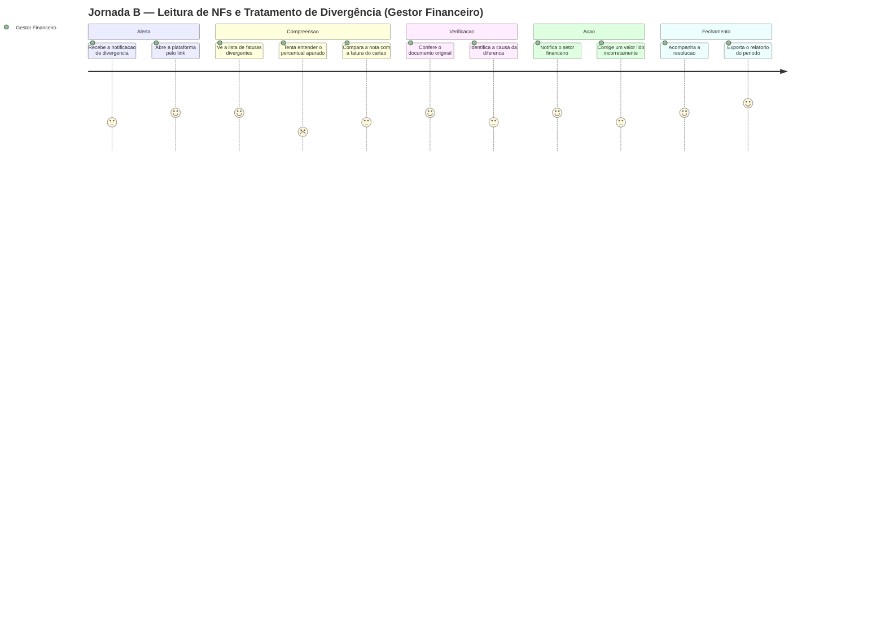

# Entregável 3 — Mapa de Jornada do Usuário: Onboarding de Integrações e Leitura de Notas Fiscais

**Projeto:** Auditor e Otimizador de Assinaturas SaaS Corporativas
**Iteração:** Semana 02 (17/08/2026 – 23/08/2026)
**Responsável:** D1 (Designer)
**Versão:** 1.0.0
**Escopo:** REQ-01 (integração) e REQ-02 (ingestão e OCR) — Bloco A

---

## 1. Objetivo e Método

Mapear as duas jornadas que determinam se o produto entrega ou não valor: **conectar as
fontes de dados** e **enxergar a primeira divergência financeira**. São as jornadas de maior
risco do projeto — se o Administrador de TI abandona o onboarding, nenhuma outra
funcionalidade chega a ser usada.

| Aspecto | Definição |
|:---|:---|
| **Método** | *Customer Journey Map* com raias de ação, pensamento, emoção, ponto de contato e oportunidade |
| **Insumos** | Elicitação da Semana 01 (fontes FT-01 a FT-07), benchmark (PAT-06, ANT-01), mapa de navegação |
| **Escala emocional** | 1 (frustração) a 5 (confiança) |
| **Validação** | Hipóteses a confirmar nos testes de usabilidade da Semana 12 |

> **Status das jornadas:** construídas a partir de elicitação com *stakeholders* e do
> benchmark da Semana 01. As curvas emocionais são **hipóteses de projeto**, não medições —
> serão confrontadas com dados reais na Semana 12.

---

## 2. Jornada A — Onboarding de Integrações

**Persona condutora:** Administrador de TI · **Gatilho:** primeiro acesso após a contratação
**Objetivo do usuário:** *"Provar em uma tarde que essa ferramenta enxerga o que eu não enxergo."*
**Objetivo do negócio:** atingir o *momento de valor* (primeira divergência ou licença ociosa revelada) na primeira sessão.

### 2.1. Curva emocional

### 2.2. Detalhamento por fase

| Fase | Ação do usuário | Pensamento | Emoção | Ponto de contato | Dor identificada | Oportunidade de design |
|:---|:---|:---|:---:|:---|:---|:---|
| **1. Descoberta** | Abre o convite e cria a senha | *"Mais uma ferramenta para configurar."* | 4 | E-mail de convite | Falta de clareza sobre o esforço necessário | Exibir na primeira tela um **checklist de 3 passos com tempo estimado** |
| **2. Autorização** | Configura o 2FA obrigatório | *"Certo, ao menos levam segurança a sério."* | 3 | Tela de 2FA (CTL-12) | Fricção logo no início | Enquadrar o 2FA como **garantia**, não como obstáculo: "Você vai conectar dados financeiros" |
| **2. Autorização** | Lê os escopos de OAuth solicitados | *"Vão ler todos os e-mails da empresa?"* | 2 | Consentimento do provedor (CTL-13) | **Maior ponto de abandono da jornada** | Antes do redirecionamento, mostrar **o que será e o que nunca será lido** (RNF-07), em linguagem simples |
| **2. Autorização** | Precisa de aval do time de segurança | *"Vou ter que abrir um chamado e esperar."* | 1 | Fora do produto | Jornada trava por dias | Gerar **resumo de conformidade exportável** (a partir da Matriz da Semana 01) para o usuário anexar ao chamado |
| **3. Conexão** | Conecta Google Workspace / M365 | *"Isso foi rápido."* | 4 | SCR-01 | — | Manter fluxo OAuth em 2 cliques |
| **3. Conexão** | Conecta o ERP com chave de API | *"Onde eu acho essa chave no Protheus?"* | 2 | SCR-01 | Chave de API exige navegar em sistema de terceiro | **Instrução passo a passo por conector**, com captura de tela do sistema de origem (PAT-06) |
| **3. Conexão** | Conecta o IdP para logs de uso | *"Isso vira controle sobre as pessoas?"* | 3 | SCR-01 | Receio de vigilância de colaborador | Declarar **pseudonimização por padrão** (DEC-03) na própria tela de conexão |
| **4. Varredura** | Espera o processamento inicial | *"Será que está funcionando?"* | 2 | Barra de progresso | **ANT-01** — dashboard zerado sugere produto quebrado | Barra persistente no topo + **resultados parciais em tempo real** ("47 assinaturas encontradas…") |
| **4. Varredura** | Navega enquanto processa | *"Já dá para ver alguma coisa."* | 4 | Shell da aplicação | — | Nunca bloquear a navegação durante a varredura (RNF-04) |
| **5. Valor** | Vê o inventário preenchido | *"Não fazia ideia de que tínhamos tudo isso."* | 5 | SCR-03 | — | Destacar o **contraste com o esperado**: "23 ferramentas que não estavam na sua planilha" |
| **5. Valor** | Descobre licenças ociosas | *"Isso já se pagou."* | 5 | SCR-04 | — | Converter em **card acionável** com economia estimada (PAT-01) |

### 2.3. Pontos críticos da Jornada A

| ID | Momento | Risco | Contramedida | Requisito |
|:---|:---|:---|:---|:---|
| PC-A1 | Leitura dos escopos de OAuth | Abandono por receio de privacidade | Tela de transparência pré-consentimento | RNF-07, CTL-13 |
| PC-A2 | Aval do time de segurança | Jornada paralisada por dias | Resumo de conformidade exportável | RNF-01, RNF-02 |
| PC-A3 | Obtenção da chave de API do ERP | Desistência por atrito técnico | Guia por conector + validação imediata | REQ-01 |
| PC-A4 | Espera da varredura | Percepção de produto quebrado | Progresso + resultados parciais | RNF-04, ANT-01 |

---

## 3. Jornada B — Leitura de Notas Fiscais e Tratamento de Divergência

**Persona condutora:** Gestor Financeiro / CFO · **Gatilho:** notificação de divergência (RN05.7)
**Objetivo do usuário:** *"Entender em minutos se a cobrança está errada e quem precisa agir."*
**Objetivo do negócio:** tratar a divergência em **menos de 3 cliques** (critério da Tarefa 01 do teste de usabilidade da Semana 12).

### 3.1. Curva emocional

### 3.2. Detalhamento por fase

| Fase | Ação do usuário | Pensamento | Emoção | Ponto de contato | Dor identificada | Oportunidade de design |
|:---|:---|:---|:---:|:---|:---|:---|
| **1. Alerta** | Recebe e-mail de divergência | *"Quanto isso me custa?"* | 3 | E-mail (RN05.7) | Alerta sem contexto obriga a abrir o sistema | Incluir na notificação **valor da NF, valor cobrado e percentual** |
| **1. Alerta** | Clica e cai direto na fatura | *"Bom, não precisei procurar."* | 4 | *Deep link* → SCR-02 | — | *Deep link* direto para o detalhe, não para o dashboard |
| **2. Compreensão** | Vê a lista de faturas divergentes | *"São muitas ou é só esta?"* | 4 | SCR-02 | — | Ordenar por **severidade** (Seção 5.1 do Entregável 2), não por data |
| **2. Compreensão** | Tenta entender o "+2,00%" | *"Dois por cento de quê, exatamente?"* | 2 | Badge de divergência | **Dor confirmada no benchmark (USR-01)** — percentual sem base de cálculo | **Tooltip obrigatório** com `valor da NF × valor cobrado × diferença em reais` |
| **2. Compreensão** | Compara NF e lançamento | *"Preciso ver os dois lado a lado."* | 3 | SCR-02 | Alternância entre telas quebra o raciocínio | **Layout de comparação lado a lado**, sem modal sobre modal (ANT-07) |
| **3. Verificação** | Abre o documento original | *"O sistema leu certo?"* | 4 | Visualizador de PDF | — | Documento à esquerda, campos extraídos à direita, com **destaque do campo na imagem** |
| **3. Verificação** | Identifica a causa | *"É câmbio ou é cobrança indevida?"* | 3 | Detalhe da divergência | Causas legítimas parecem erro | Exibir **explicações automáticas**: "Variação explicada por câmbio e IOF" (RN05.5) |
| **4. Ação** | Notifica o setor financeiro | *"Quero registrar e sair daqui."* | 4 | Botão de ação | — | Ação primária **sempre visível**, sem rolagem (≤ 3 cliques) |
| **4. Ação** | Corrige um valor mal lido | *"O OCR errou, deixa eu ajustar."* | 3 | Campo editável | Receio de "estragar" o registro | Deixar explícito que **a correção reprocessa e preserva o histórico** (RN05.10) |
| **5. Fechamento** | Acompanha a resolução | *"Alguém tratou isso?"* | 4 | Timeline da fatura | — | *Timeline* com responsável e prazo (PAT-05) |
| **5. Fechamento** | Exporta o relatório | *"Preciso levar isso para a reunião."* | 5 | SCR-10 | **ANT-06** — export que ignora filtros | Exportação **herda filtros e anonimização** da tela (CTL-15, LGPD-01) |

### 3.3. Pontos críticos da Jornada B

| ID | Momento | Risco | Contramedida | Requisito |
|:---|:---|:---|:---|:---|
| PC-B1 | Interpretação do percentual | Usuário não entende a divergência e ignora o alerta | Tooltip com base de cálculo em reais | RN05.2 |
| PC-B2 | Comparação NF × cartão | Perda de contexto ao alternar telas | Visualização lado a lado | RN05.1 |
| PC-B3 | Causa legítima confundida com erro | Retrabalho e desconfiança no motor | Explicação automática de câmbio/imposto | RN05.5, BR-06 |
| PC-B4 | Correção manual de campo | Medo de corromper a auditoria | Mensagem de histórico preservado | RN05.10, CTL-11 |
| PC-B5 | Exportação | Relatório inconsistente com a tela | Herdar filtros e máscara | REQ-10, LGPD-01 |

---

## 4. Métricas de Sucesso das Jornadas

| ID | Métrica | Jornada | Meta | Como será medida |
|:---|:---|:---|:---|:---|
| M-01 | Tempo até a primeira conexão ativa | A | ≤ 10 min | Telemetria de onboarding |
| M-02 | Taxa de conclusão do onboarding | A | ≥ 80% | Funil de conexões |
| M-03 | Tempo até o *momento de valor* | A | ≤ 1 sessão | Primeira licença ociosa exibida |
| M-04 | Taxa de abandono no consentimento OAuth | A | ≤ 15% | Eventos de redirecionamento |
| M-05 | Cliques para tratar uma divergência | B | ≤ 3 | Teste de usabilidade (Semana 12) |
| M-06 | Tempo de compreensão da divergência | B | ≤ 60 s | Observação na Semana 12 |
| M-07 | Taxa de correção manual de OCR | B | ≤ 10% | Contador de reprocessamentos (RN05.10) |
| M-08 | Nota SUS agregada | A e B | ≥ 75 | Formulário SUS (Semana 13) |

---

## 5. Requisitos de Interface Derivados das Jornadas

> Entradas diretas para os wireframes Lo-Fi da Semana 04.

| ID | Requisito de interface | Origem | Tela |
|:---|:---|:---|:---|
| RI-01 | Checklist de onboarding com 3 passos e tempo estimado | PC-A1 | SCR-01 |
| RI-02 | Tela de transparência pré-OAuth ("o que lemos / o que nunca lemos") | PC-A1 | SCR-01 |
| RI-03 | Resumo de conformidade exportável para o time de segurança | PC-A2 | SCR-01 |
| RI-04 | Guia de obtenção de chave por conector | PC-A3 | SCR-01 |
| RI-05 | Barra de progresso persistente com contagem parcial | PC-A4 | Shell |
| RI-06 | Ordenação por severidade na lista de divergências | PC-B1 | SCR-02 |
| RI-07 | Tooltip com base de cálculo da variação em reais | PC-B1 | SCR-02 |
| RI-08 | Comparação NF × lançamento lado a lado | PC-B2 | SCR-02 |
| RI-09 | Visualizador com destaque do campo extraído sobre a imagem | PC-B3 | SCR-02 |
| RI-10 | Explicação automática de variação legítima | PC-B3 | SCR-02 |
| RI-11 | Aviso de preservação do histórico ao editar campo | PC-B4 | SCR-02 |
| RI-12 | Exportação herdando filtros e anonimização | PC-B5 | SCR-10 |

---

## 6. Rastreabilidade

| Item | Consumido em | Entregável de destino |
|:---|:---|:---|
| Seção 5 (RI-01 a RI-12) | Semana 4 | Wireframes Lo-Fi |
| Seções 2.3 e 3.3 (pontos críticos) | Semana 10 | Telas de exceção e refinamento visual |
| Seção 4 (métricas) | Semana 11 e 12 | Plano e execução dos testes de usabilidade |
| Curvas emocionais | Semana 13 | Comparação hipótese × observação real |
