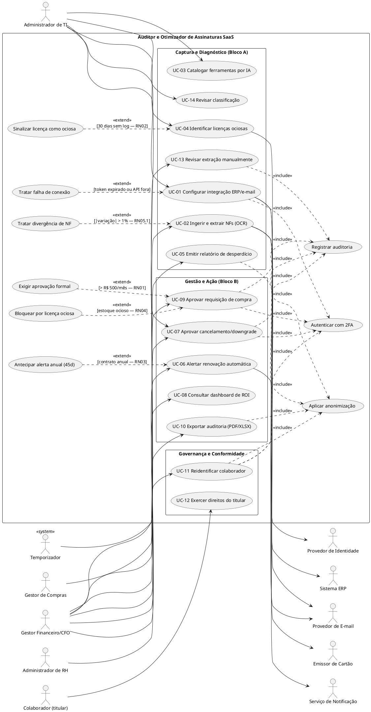
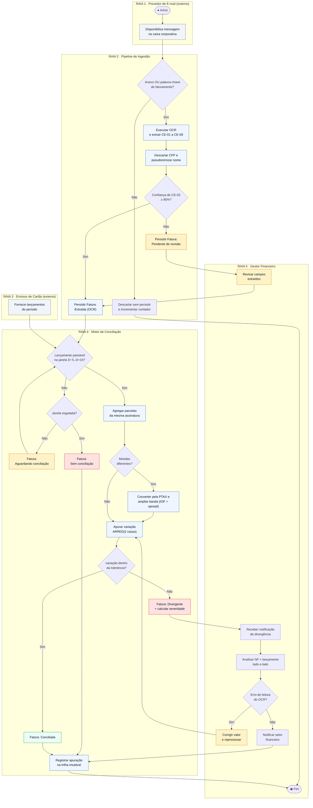
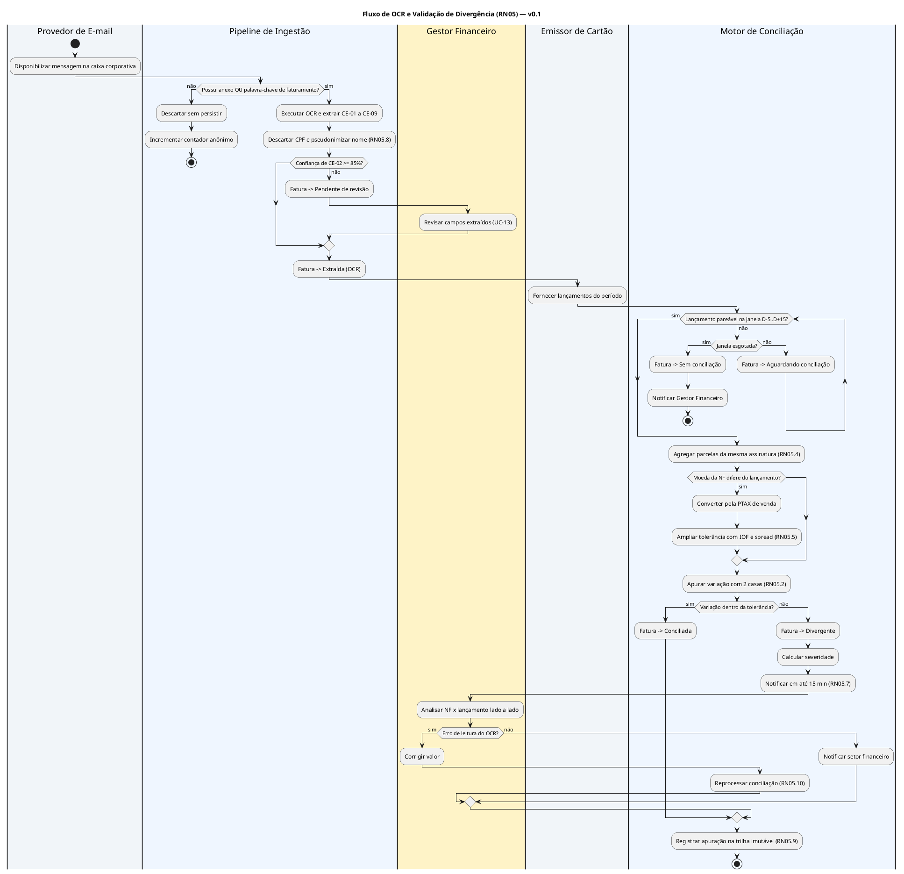

# Entregável 4 — Diagramas UML (Semana 02)

**Projeto:** Auditor e Otimizador de Assinaturas SaaS Corporativas  
**Iteração:** Semana 02 (17/08/2026 – 23/08/2026)  
**Responsáveis:** AR1 / AR2  
**Versão:** 1.0.0 (Casos de Uso) · 0.1.0 (Atividades)

---

## 1. O que se aplica a esta iteração

Conforme a matriz de [`diagramasUML.md`](../diagramasUML.md):

| Diagrama | Janela | Entrega formal | Situação nesta iteração |
|:---|:---|:---|:---|
| **Casos de Uso** | Semanas 1 a 3 | **Semana 2** | **Entrega formal — v1.0** |
| **Atividades** | Semanas 2 e 3 | Semana 3 | Rascunho v0.1 — fluxo de OCR com raias |
| Sequência · Estados · Classes · Pacotes · Implantação | Semanas 4+ | — | Fora do escopo |

---

# PARTE I — Diagrama de Casos de Uso (v1.0 · Entrega Formal)

## 2. Mudanças em relação ao rascunho v0.1 (Semana 01)

| # | Mudança | Motivo |
|:---|:---|:---|
| M-01 | **P-05 resolvida:** UC-11 e UC-12 mantidos como casos de uso de primeira classe, agrupados no pacote *Governança e Conformidade* | Ambos têm ator próprio e valor de negócio autônomo; a LGPD-02 é requisito numerado do cliente, não detalhe técnico |
| M-02 | UC-02 deixa de ter ator primário humano e passa a ser disparado por **temporizador** | A ingestão é contínua, não sob demanda — corrige impropriedade do rascunho |
| M-03 | Incluído `<<include>>` **Aplicar anonimização** também em UC-11 | Mesmo a reidentificação exibe apenas os campos estritamente necessários (CTL-06) |
| M-04 | Incluído UC-13 **Revisar extração manualmente** | Derivado da RN05.6 e do cenário CT-02.6, ausentes no rascunho |
| M-05 | Incluído UC-14 **Revisar classificação de fornecedor** | Derivado da RNF-10 e do cenário CT-03.2/CT-03.3 |
| M-06 | Adicionado `<<extend>>` **Tratar falha de conexão** em UC-01 | Já previsto em texto no rascunho, agora formalizado no diagrama |
| M-07 | Descrições textuais completas de UC-01, UC-02 e UC-03 | Pendência nº 1 registrada na Semana 01 |

---

## 3. Diagrama de Casos de Uso — v1.0

```mermaid
graph LR
    ADMTI(["Administrador<br/>de TI"])
    CFO(["Gestor Financeiro<br/>/ CFO"])
    COMPRAS(["Gestor de<br/>Compras"])
    RH(["Administrador<br/>de RH"])
    COLAB(["Colaborador<br/>(titular)"])
    TIMER(["Temporizador<br/>de varredura"])

    subgraph SISTEMA["Auditor e Otimizador de Assinaturas SaaS"]
        direction TB

        subgraph PA["Captura e Diagnóstico — Bloco A"]
            UC01["UC-01<br/>Configurar integração"]
            UC02["UC-02<br/>Ingerir e extrair NFs"]
            UC03["UC-03<br/>Catalogar ferramentas"]
            UC04["UC-04<br/>Identificar ociosas"]
            UC05["UC-05<br/>Emitir relatório<br/>de desperdício"]
            UC13["UC-13<br/>Revisar extração<br/>manualmente"]
            UC14["UC-14<br/>Revisar classificação<br/>de fornecedor"]
        end

        subgraph PB["Gestão e Ação — Bloco B"]
            UC06["UC-06<br/>Alertar renovação"]
            UC07["UC-07<br/>Aprovar cancelamento<br/>ou downgrade"]
            UC08["UC-08<br/>Consultar ROI"]
            UC09["UC-09<br/>Aprovar requisição<br/>de compra"]
            UC10["UC-10<br/>Exportar auditoria"]
        end

        subgraph PC["Governança e Conformidade"]
            UC11["UC-11<br/>Reidentificar<br/>colaborador"]
            UC12["UC-12<br/>Exercer direitos<br/>do titular"]
        end

        subgraph INC["« include »"]
            AUTH(["Autenticar<br/>com 2FA"])
            ANON(["Aplicar<br/>anonimização"])
            AUDIT(["Registrar<br/>auditoria"])
        end

        subgraph EXT["« extend »"]
            EDIV["Tratar divergência<br/>de NF · RN05"]
            EBLOQ["Bloquear por licença<br/>ociosa · RN04"]
            EAPROV["Exigir aprovação<br/>formal · RN01"]
            EOCIO["Sinalizar licença<br/>ociosa · RN02"]
            EANUAL["Antecipar alerta<br/>anual · RN03"]
            EFALHA["Tratar falha<br/>de conexão"]
        end
    end

    EMAIL(["Provedor<br/>de E-mail"])
    ERP(["Sistema ERP"])
    CARTAO(["Emissor<br/>de Cartão"])
    IDP(["Provedor de<br/>Identidade"])
    NOTIF(["Serviço de<br/>Notificação"])

    ADMTI --- UC01
    ADMTI --- UC03
    ADMTI --- UC04
    ADMTI --- UC07
    ADMTI --- UC14
    CFO --- UC05
    CFO --- UC06
    CFO --- UC07
    CFO --- UC08
    CFO --- UC10
    CFO --- UC13
    COMPRAS --- UC09
    RH --- UC11
    COLAB --- UC12
    TIMER --- UC02

    UC01 --- ERP
    UC01 --- EMAIL
    UC02 --- EMAIL
    UC02 --- CARTAO
    UC04 --- IDP
    UC06 --- NOTIF

    UC01 -.->|"«include»"| AUTH
    UC07 -.->|"«include»"| AUTH
    UC09 -.->|"«include»"| AUTH
    UC11 -.->|"«include»"| AUTH

    UC02 -.->|"«include»"| ANON
    UC05 -.->|"«include»"| ANON
    UC10 -.->|"«include»"| ANON
    UC11 -.->|"«include»"| ANON

    UC07 -.->|"«include»"| AUDIT
    UC09 -.->|"«include»"| AUDIT
    UC11 -.->|"«include»"| AUDIT
    UC13 -.->|"«include»"| AUDIT

    EDIV -.->|"«extend»"| UC02
    EOCIO -.->|"«extend»"| UC04
    EANUAL -.->|"«extend»"| UC06
    EBLOQ -.->|"«extend»"| UC09
    EAPROV -.->|"«extend»"| UC09
    EFALHA -.->|"«extend»"| UC01

    classDef ator fill:#EFF6FF,stroke:#2563EB,color:#0F172A
    classDef externo fill:#F1F5F9,stroke:#64748B,color:#0F172A
    classDef inc fill:#ECFDF5,stroke:#059669,color:#0F172A
    classDef extend fill:#FEF3C7,stroke:#D97706,color:#0F172A
    class ADMTI,CFO,COMPRAS,RH,COLAB,TIMER ator
    class EMAIL,ERP,CARTAO,IDP,NOTIF externo
    class AUTH,ANON,AUDIT inc
    class EDIV,EBLOQ,EAPROV,EOCIO,EANUAL,EFALHA extend
```

### 3.1. Fonte PlantUML (v1.0)

---

## 4. Descrições Textuais dos Casos de Uso (UC-01 a UC-03)

> Pendência nº 1 da Semana 01. Formato: *fully dressed use case* (Cockburn).

### 4.1. UC-01 — Configurar Integração com ERP e Faturamento

| Campo | Conteúdo |
|:---|:---|
| **Ator primário** | Administrador de TI |
| **Atores secundários** | Sistema ERP, Provedor de E-mail |
| **Interessados** | CFO (quer cobertura total das fontes); DPO (quer escopo mínimo) |
| **Pré-condições** | Usuário autenticado com 2FA concluído; tenant provisionado |
| **Garantia de sucesso** | Conexão em estado `Ativo`, credencial cifrada em AES-256-GCM e varredura inicial concluída |
| **Garantia mínima** | Nenhuma credencial parcial ou em texto claro persistida |
| **Gatilho** | Administrador acessa SCR-01 e escolhe um conector |
| **Frequência** | Baixa — uma vez por fonte, com revisões esporádicas |
| **Requisitos** | REQ-01 · RNF-01 · RNF-04 · RNF-08 · CTL-02, CTL-03, CTL-12, CTL-13 |

**Fluxo principal**

1) O Administrador seleciona o conector desejado.
2) O sistema apresenta a tela de transparência declarando o que será e o que **não** será lido (RI-02).
3) O Administrador informa a credencial ou é redirecionado ao consentimento OAuth do provedor.
4) O sistema valida a credencial junto ao provedor e **verifica que o escopo é somente-leitura** (DEC-02).
5) O sistema cifra e armazena a credencial no cofre (CTL-03).
6) O sistema registra a conexão com estado `Ativo`.
7) O sistema dispara a varredura inicial e exibe progresso persistente (RI-05).
8) Concluída a varredura em menos de 5 minutos (RNF-04), o sistema apresenta o total de assinaturas mapeadas.

**Fluxos alternativos**  
**3a.** O Administrador cancela o consentimento → conexão não é criada; nenhum dado é persistido.  
**4a.** A credencial possui escopo de escrita → o sistema recusa a conexão com a mensagem *"Utilize uma credencial somente-leitura"* (CT-01.4).  
**7a.** A varredura excede 5 minutos → o sistema mantém o progresso visível e registra violação de RNF-04 para monitoramento.  

**Fluxos de exceção**  
**4b.** Credencial inválida → conexão registrada com estado `Erro`, exibindo o motivo do provedor e a ação *Tentar novamente* (CT-01.5).  
**Ex-1.** Token OAuth expira e a renovação falha → estado `Token expirado` + alerta na navegação (CT-01.6). Extensão *Tratar falha de conexão*.  
**Ex-2.** Provedor indisponível → *retry* com espera exponencial; após 3 tentativas, estado `Erro`.  

**Regras especiais:** toda revogação de conexão exige nova verificação em duas etapas e gera registro de auditoria (CT-01.7).

---

### 4.2. UC-02 — Ingerir e Extrair Dados de Notas Fiscais e E-mails

| Campo | Conteúdo |
|:---|:---|
| **Ator primário** | Temporizador de varredura *(sistema)* |
| **Atores secundários** | Provedor de E-mail, Emissor de Cartão |
| **Interessados** | Gestor Financeiro (quer divergências detectadas); Colaborador (quer seus dados preservados) |
| **Pré-condições** | Existe conexão de e-mail `Ativa`; existe conexão de cartão `Ativa` |
| **Garantia de sucesso** | Fatura persistida em estado `Conciliada`, `Divergente` ou `Sem conciliação`, com dados pessoais mascarados |
| **Garantia mínima** | Nenhum corpo de e-mail sem indício de faturamento é persistido (RNF-07); nenhum CPF é gravado |
| **Gatilho** | Ciclo periódico de varredura ou chegada de nova mensagem |
| **Frequência** | Alta — contínua |
| **Requisitos** | REQ-02 · RN05 (e sub-regras RN05.1 a RN05.10) · RNF-04 · RNF-07 · LGPD-01 · CTL-05, CTL-09 |

**Fluxo principal**

1) O sistema recupera as mensagens novas da caixa corporativa.
2) Para cada mensagem, verifica presença de anexo **ou** de palavra-chave de faturamento.
3) Extrai os campos CE-01 a CE-09 do documento por OCR.
4) **Descarta CPF e pseudonimiza o nome do colaborador antes de qualquer gravação** (RN05.8).
5) Verifica que a confiança do valor total é de ao menos 85% (RN05.6).
6) Persiste a Fatura no estado `Extraída (OCR)`.
7) Localiza lançamento de cartão pareável dentro da janela `D−5` a `D+15` (RN05.3), agregando parcelas quando aplicável (RN05.4).
8) Normaliza a moeda quando necessário (RN05.5) e apura a variação (RN05.2).
9) Sendo a variação menor ou igual à tolerância, marca a Fatura como `Conciliada`.
10) Registra o desfecho na trilha imutável (RN05.9).

**Fluxos alternativos**  
**2a.** Mensagem sem anexo e sem palavra-chave → descarte imediato, incrementando apenas o contador anônimo (CT-02.2).  
**5a.** Confiança inferior a 85% → estado `Pendente de revisão`; aciona **UC-13**.
**7a.** Nenhum lançamento pareável e janela ainda aberta → estado `Aguardando conciliação`; reavaliação no próximo ciclo.  
**7b.** Janela esgotada sem par → estado `Sem conciliação` e notificação ao Gestor Financeiro (CT-02.9).  
**9a.** Variação acima da tolerância → **extensão *Tratar divergência de NF***: estado `Divergente`, cálculo de severidade e notificação em até 15 minutos (RN05.7).  

**Fluxos de exceção**   
**Ex-1.** Documento ilegível → `Pendente de revisão`, com documento original exibido ao lado dos campos (CT-02.6).  
**Ex-2.** NF duplicada (mesmo `CE-01 + CE-06`) → descartada por duplicidade (BR-02).  
**Ex-3.** Valor total igual a zero → `Pendente de revisão`, pois o cálculo de variação é indefinido (BR-01).  
**Ex-4.** Conexão de cartão indisponível → mantém `Aguardando conciliação`, sem gerar falso positivo (BR-10).  

---

### 4.3. UC-03 — Catalogar Ferramentas Automaticamente por Categoria

| Campo | Conteúdo |
|:---|:---|
| **Ator primário** | Administrador de TI |
| **Atores secundários** | Motor de IA de catalogação *(serviço de domínio)* |
| **Interessados** | CFO (quer ver redundâncias); Administrador de TI (quer inventário confiável) |
| **Pré-condições** | Existem faturas processadas com fornecedor identificado (CE-05/CE-06) |
| **Garantia de sucesso** | Fornecedor SaaS classificado em categoria, com índice de confiança visível |
| **Garantia mínima** | Classificação de baixa confiança não contamina recomendações de consolidação |
| **Gatilho** | Conclusão do processamento de uma fatura de fornecedor ainda não catalogado |
| **Frequência** | Média — a cada novo fornecedor detectado |
| **Requisitos** | REQ-03 · RNF-06 · RNF-10 · LGPD-01 · PAT-01, PAT-10 |

**Fluxo principal**

1) O sistema consolida as grafias do emitente em um único Fornecedor SaaS (CT-03.4).
2) O motor de catalogação atribui categoria e índice de confiança.
3) Sendo a confiança de ao menos 80%, o fornecedor é publicado no inventário.
4) O inventário exibe categoria, índice de confiança e rótulo textual — nunca apenas cor (ANT-03).
5) Havendo três ou mais fornecedores ativos na mesma categoria, o sistema sinaliza possível redundância (CT-03.5).
6) O Administrador de TI navega ao detalhe preservando os filtros aplicados (PAT-10).

**Fluxos alternativos**  
**3a.** Confiança inferior a 70% → estado `Pendente de revisão`; aciona **UC-14**; o fornecedor não entra nas recomendações.  
**6a.** O Administrador corrige a categoria → atualização imediata, origem passa a `Ajuste manual` e a correção alimenta a calibração do motor (CT-03.3).

**Fluxos de exceção**  
**Ex-1.** Emitente sem CNPJ legível e com razão social ambígua → fornecedor criado como `Não identificado`, aguardando revisão.  
**Ex-2.** Inventário com mais de 500 fornecedores excede 2 s de carga → paginação no servidor para preservar o RNF-06.

**Regras especiais:** todas as licenças exibidas no detalhe do fornecedor são identificadas por pseudônimo; o setor é exibido em texto claro (CT-03.7, LGPD-01).

---

## 5. Verificação de Cobertura (v1.0)

| Requisito | Coberto por | ✓ |
|:---|:---|:---:|
| REQ-01 a REQ-10 | UC-01 a UC-10 | Sim |
| RN01 | `<<extend>>` Exigir aprovação formal | Sim |
| RN02 | `<<extend>>` Sinalizar licença ociosa | Sim |
| RN03 | `<<extend>>` Antecipar alerta anual | Sim |
| RN04 | `<<extend>>` Bloquear por licença ociosa | Sim |
| RN05.1 a RN05.10 | UC-02 + `<<extend>>` Tratar divergência + UC-13 | Sim |
| LGPD-01 | `<<include>>` Aplicar anonimização + UC-11 | Sim |
| LGPD-02 | UC-12 | Sim |
| RNF-01 | `<<include>>` Autenticar com 2FA | Sim |
| RNF-10 | UC-03 (fluxo alternativo 3a, ex-UC-14 — decisão P-09, Semana 03) | Sim |

**14 casos de uso · 6 atores humanos + 1 temporizador · 5 sistemas externos · cobertura total dos 10 RFs, 5 RNs e 2 itens de LGPD.**

---

# PARTE II — Diagrama de Atividades (v0.1 · Rascunho)

## 6. Fluxo de OCR com Validação de Divergência (RN05)

> Escopo definido em `diagramasUML.md`: *"Fluxo de OCR com validação de divergência > 1%"*.
> **Entrega formal prevista para a Semana 03.**

### 6.1. Visão com raias (Mermaid)

### 6.2. Fonte PlantUML com raias (v0.1)

### 6.3. Nós de decisão e regras associadas

| Nó | Condição de guarda | Regra |
|:---|:---|:---|
| B1 | `possui_anexo OR contém_palavra_chave` | RNF-07 · CTL-09 |
| B5 | `confiança(CE-02) ≥ 0,85` | RN05.6 |
| D1 | `data_lançamento ∈ [D−5, D+15]` | RN05.3 |
| D2 | `hoje > data_emissão + 15d` | RN05.3 |
| D6 | `moeda_nf ≠ moeda_lançamento` | RN05.5 |
| D9 | `abs(variação) ≤ tolerância` | RN05.1 · RN05.2 |
| E4 | julgamento humano sobre a extração | RN05.10 |

---

## 7. Pendências para a Semana 03

1. **Entrega formal do Diagrama de Atividades** — consolidar a v0.1 acima e acrescentar o
   segundo fluxo previsto: **aprovação de gastos com as travas RN01 e RN04** (Bloco B).
2. Gerar as **imagens oficiais** de ambos os diagramas a partir dos fontes PlantUML.
3. Escrever as descrições textuais de **UC-04 a UC-10**, junto às histórias US-04 a US-10.
4. Validar com AR2 se **UC-13** e **UC-14** permanecem como casos de uso próprios ou são
   absorvidos como fluxos alternativos de UC-02 e UC-03.
5. Confirmar com o cliente os parâmetros ainda pendentes de homologação listados na
   Seção 11 do Entregável 2 (janela de conciliação, banda cambial, limiares de confiança).
