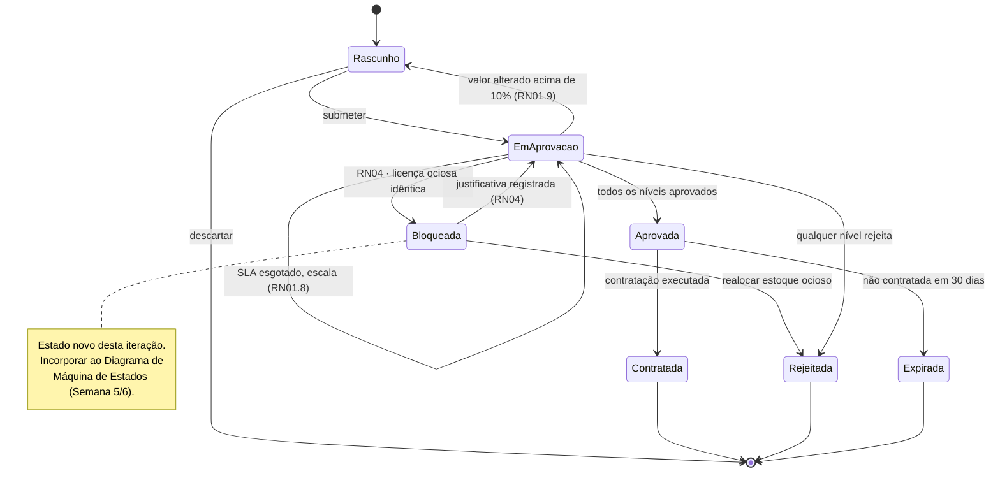
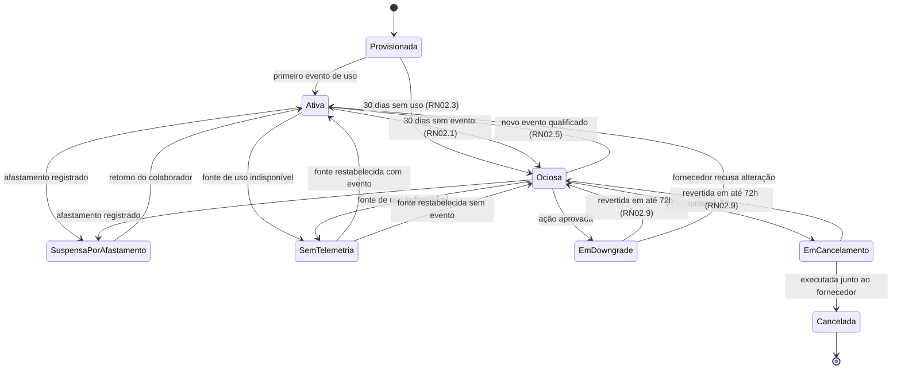

# Entregável 2 — Fluxo de Aprovação de Gastos (RN01) e Trava de Inatividade (RN02)

**Projeto:** Auditor e Otimizador de Assinaturas SaaS Corporativas  
**Iteração:** Semana 03 (24/08/2026 – 30/08/2026)  
**Responsável:** AR2 (Analista de Requisitos)  
**Versão:** 1.0.0  
**Regras-mãe:**
> **RN01** — *"Nenhuma assinatura corporativa acima de R$ 500/mês pode ser contratada sem a aprovação formal de pelo menos um administrador ou gestor financeiro na plataforma."*
> **RN02** — *"Uma licença de software será classificada como 'ociosa' e elegível para cancelamento/downgrade caso o colaborador não registre nenhum log de atividade nela pelos últimos 30 dias consecutivos."*

---

## 1. Objetivo

As duas regras são as **travas operacionais** do produto: a RN01 impede gasto novo sem
governança e a RN02 habilita corte de gasto existente. Ambas, como enunciadas, deixam
lacunas que impedem implementação — *sobre qual valor* incide o teto, *o que conta como
log de atividade*, *o que fazer quando não há telemetria*. Este documento decompõe cada
regra em **10 sub-regras verificáveis** e formaliza as tabelas de decisão correspondentes.

Aplica-se aqui o mesmo método usado na
[Matriz da RN05 (Semana 02)](../semana-02/entregavel-02-matriz-regras-ocr-divergencia-rn05.md).

---

# PARTE I — RN01: Fluxo de Aprovação de Gastos

## 2. Base de Cálculo do Teto

### 2.1. Valor Mensal Equivalente (VME)

O teto de R$ 500,00 incide sobre o **VME da contratação inteira**, não sobre a licença
individual. A escolha é a mais conservadora: impede que uma contratação de 40 licenças de
R$ 40,00 (R$ 1.600,00/mês) escape da governança por ter valor unitário baixo.

```
VME = (valor_total_do_ciclo ÷ meses_do_ciclo) + encargos_recorrentes

  onde:
    valor_total_do_ciclo  inclui todas as licenças da requisição
    encargos_recorrentes  inclui impostos e taxas de plataforma cobrados no ciclo
    arredondamento        2 casas decimais, ROUND_HALF_UP
```

| Cenário de contratação | Cálculo | VME | Alçada exigida |
|:---|:---|:---|:---|
| 1 licença a R$ 320,00/mês | `320 ÷ 1` | R$ 320,00 | Gestor de Compras |
| 40 licenças a R$ 40,00/mês | `1.600 ÷ 1` | R$ 1.600,00 | + Gestor Financeiro |
| Contrato anual de R$ 5.400,00 | `5.400 ÷ 12` | R$ 450,00 | Gestor de Compras |
| Contrato anual de R$ 7.200,00 | `7.200 ÷ 12` | R$ 600,00 | + Gestor Financeiro |
| Contrato bienal de R$ 120.000,00 | `120.000 ÷ 24` | R$ 5.000,00 | + Gestor Financeiro |
| Licença vitalícia de R$ 3.000,00 | amortizada em 36 meses | R$ 83,33 | Gestor de Compras |

---

## 3. Sub-Regras da RN01

| ID | Sub-regra | Enunciado formal | Cenário BDD | Criticidade |
|:---|:---|:---|:---|:---:|
| **RN01.1** | **Base de cálculo** | O teto incide sobre o VME da contratação completa, com impostos e encargos recorrentes, jamais sobre o valor unitário da licença. | CT-09.2 | Alta |
| **RN01.2** | **Normalização de ciclo** | Contratos de ciclo diferente do mensal são convertidos dividindo o valor total pelo número de meses do ciclo. Pagamento único é amortizado em 36 meses. | CT-09.8 | Alta |
| **RN01.3** | **Moeda estrangeira** | Requisição em moeda estrangeira usa a maior cotação PTAX de venda dos últimos 30 dias, acrescida de IOF e spread — critério conservador para não subestimar a alçada. | *(novo — CT-09.9)* | Média |
| **RN01.4** | **Gatilho do teto** | A aprovação formal adicional é exigida quando `VME > R$ 500,00`. O limite é **exclusivo**: exatamente R$ 500,00 não aciona a regra. | CT-09.3 | Alta |
| **RN01.5** | **Alçadas** | Três faixas de alçada, cumulativas e sequenciais, conforme a Seção 4.1. | CT-09.8 | Alta |
| **RN01.6** | **Segregação de funções** | O solicitante nunca pode aprovar a própria requisição, mesmo possuindo alçada. Não havendo outro aprovador na alçada, escala para o nível superior. | CT-09.6 | Alta |
| **RN01.7** | **Delegação** | A alçada pode ser delegada formalmente, com prazo determinado e registro em auditoria. A delegação não altera o número de níveis exigidos. | *(novo — CT-09.10)* | Média |
| **RN01.8** | **SLA e escalonamento** | Cada nível tem 3 dias úteis para decidir. Esgotado o prazo, a requisição escala automaticamente para o nível superior, sem aprovação tácita. | *(novo — CT-09.11)* | Média |
| **RN01.9** | **Revalidação** | Alteração de valor superior a 10% ou mudança de escopo após o início do fluxo **reinicia** todas as aprovações já concedidas. | *(novo — CT-09.12)* | Alta |
| **RN01.10** | **Imutabilidade da decisão** | Decisões não são editáveis. A retificação é registrada como nova decisão, preservando a anterior na trilha (CTL-11). | CT-09.5 | Média |

---

## 4. Tabela de Decisão da Aprovação

### 4.1. Faixas de alçada

| Faixa de VME | Níveis exigidos (sequenciais) | SLA total | Justificativa |
|:---|:---|:---|:---|
| `≤ R$ 500,00` | Gestor de Compras | 3 dias úteis | Abaixo do teto da RN01 |
| `> R$ 500,00` e `≤ R$ 5.000,00` | Gestor de Compras → Gestor Financeiro | 6 dias úteis | Cumpre o "pelo menos um administrador ou gestor financeiro" da RN01 |
| `> R$ 5.000,00` | Gestor de Compras → Gestor Financeiro → CFO | 9 dias úteis | Faixa proposta pela análise; **pendente de homologação** |

### 4.2. Tabela de decisão completa

| # | VME | Licença ociosa idêntica em estoque | Solicitante é aprovador | Justificativa registrada | ➜ Resultado |
|:--|:---|:---|:---|:---|:---|
| A1 | `≤ 500` | Não | Não | — | Aprovável em 1 nível |
| A2 | `≤ 500` | **Sim** | Não | Não | **Bloqueada por RN04** |
| A3 | `≤ 500` | **Sim** | Não | Sim | Escala para Gestor Financeiro |
| A4 | `> 500` | Não | Não | — | Exige 2 níveis (RN01.5) |
| A5 | `> 500` | **Sim** | Não | Não | **Bloqueada por RN04** *(antes da alçada)* |
| A6 | `> 500` | **Sim** | Não | Sim | Exige 2 níveis + justificativa em auditoria |
| A7 | qualquer | — | **Sim** | — | Ações indisponíveis; escala para nível superior (RN01.6) |
| A8 | `> 5.000` | Não | Não | — | Exige 3 níveis |
| A9 | qualquer | — | Não | — | Valor alterado em mais de 10% ➜ reinicia fluxo (RN01.9) |

> **Ordem de avaliação:** a RN04 é verificada **antes** da alçada da RN01. Não faz sentido
> encaminhar para aprovação uma compra que a empresa já possui em estoque ocioso.

---

## 5. Máquina de Estados da Requisição



---

## 6. Casos de Borda da RN01

| ID | Caso de borda | Tratamento | Sub-regra |
|:---|:---|:---|:---|
| BA-01 | Contratação fatiada em 3 requisições de R$ 200,00 para burlar o teto | Requisições do mesmo fornecedor e setor em 30 dias são **somadas** para efeito de alçada | RN01.1 |
| BA-02 | Requisição em USD com câmbio volátil | Maior PTAX dos últimos 30 dias + IOF + spread | RN01.3 |
| BA-03 | Renovação de contrato já existente | Tratada como nova contratação para efeito de alçada | RN01.4 |
| BA-04 | Aumento de licenças em assinatura vigente | Alçada calculada sobre o **acréscimo** de VME | RN01.1 |
| BA-05 | Aprovador de alçada é o próprio solicitante e é o único da alçada | Escala automaticamente para o nível superior | RN01.6 |
| BA-06 | Aprovador em férias sem delegação registrada | SLA corre normalmente; esgotado, escala | RN01.7, RN01.8 |
| BA-07 | Fornecedor reduz o preço após a primeira aprovação | Redução não reinicia o fluxo; apenas aumento acima de 10% reinicia | RN01.9 |
| BA-08 | Requisição aprovada e não contratada por 30 dias | Estado `Expirada`; nova submissão exige novo fluxo | RN01.9 |
| BA-09 | Contratação emergencial fora do fluxo | Não prevista na v1.0; registrada como risco RB-05 | — |

---

# PARTE II — RN02: Trava de Inatividade

## 7. Hierarquia de Evidências de Uso

O enunciado da RN02 fala em *"log de atividade"* sem definir a fonte. Sem essa definição,
a regra é inaplicável para fornecedores que não expõem telemetria — o risco **RB-01**
levantado na Semana 02. Fica estabelecida a seguinte hierarquia:

| Nível | Fonte de evidência | O que comprova | Confiabilidade | Uso |
|:---|:---|:---|:---:|:---|
| **E1** | API de uso do próprio fornecedor | Uso efetivo da funcionalidade | Alta | Preferencial |
| **E2** | Evento de autenticação no IdP (SSO) | Abertura da ferramenta | Média | Usada na ausência de E1 |
| **E3** | Log de proxy corporativo / CASB | Tráfego para o domínio da ferramenta | Baixa | Usada na ausência de E1 e E2 |
| **E4** | Declaração do gestor da área | Afirmação humana de uso | Indicativa | Apenas para **contestar** ociosidade, nunca para confirmá-la |
| **—** | Nenhuma fonte disponível | Nada | Nenhuma | Estado `Sem telemetria` |

> **Decisão:** *abrir a ferramenta* (E2) e *usar a ferramenta* (E1) são coisas distintas.
> Quando só houver E2, o painel exibe explicitamente **"Evidência: apenas login"**, para que
> o Administrador de TI saiba que a ociosidade real pode ser maior que a apurada.

---

## 8. Sub-Regras da RN02

| ID | Sub-regra | Enunciado formal | Cenário BDD | Criticidade |
|:---|:---|:---|:---|:---:|
| **RN02.1** | **Definição de ociosidade** | Licença é `Ociosa` após **30 dias corridos consecutivos** sem evento qualificado de atividade. O 30º dia completo aciona a regra; 29 dias não acionam. | CT-04.1, CT-04.2 | Alta |
| **RN02.2** | **Evento qualificado** | Vale o evento de maior nível disponível na hierarquia E1 → E2 → E3. E4 só serve para contestar. A fonte usada é sempre exibida na interface. | CT-04.8 | Alta |
| **RN02.3** | **Marco inicial** | Licença provisionada e nunca acessada conta a partir da **data de provisionamento**, tornando-se ociosa no 30º dia. | *(novo — CT-04.9)* | Média |
| **RN02.4** | **Cobertura de telemetria** | Sem nenhuma fonte disponível, a licença assume `Sem telemetria` e **nunca** é classificada como ociosa. A cobertura é exibida por assinatura. | CT-04.4 | Alta |
| **RN02.5** | **Reinício do contador** | Qualquer evento qualificado retorna a licença a `Ativa` e zera o contador, inclusive após recomendação de cancelamento. | CT-04.3, CT-07.6 | Alta |
| **RN02.6** | **Exclusões legítimas** | Afastamento, férias e licença registrados no RH suspendem a contagem. A licença assume `Suspensa por afastamento`. | CT-04.5 | Alta |
| **RN02.7** | **Latência da coleta** | Atraso de até 48 h na coleta de telemetria não é computado como inatividade. Atraso superior muda a assinatura para `Telemetria desatualizada`. | *(novo — CT-04.10)* | Média |
| **RN02.8** | **Graduação da elegibilidade** | 30 dias ➜ elegível a downgrade; 60 dias ➜ cancelamento sugerido; 90 dias ➜ cancelamento recomendado com destaque. | *(novo — CT-04.11)* | Média |
| **RN02.9** | **Janela de arrependimento** | Ação de cancelamento ou downgrade permanece reversível por 72 h antes de ser enviada ao fornecedor. | CT-07.4 | Alta |
| **RN02.10** | **Vedação de uso** | Dados de ociosidade são pseudonimizados por padrão e **não podem** compor avaliação de desempenho individual. Agregações abaixo de 5 colaboradores não são exibidas por setor. | CT-04.7 | Alta |

---

## 9. Tabela de Decisão da Ociosidade

| # | Dias sem evento | Fonte disponível | Afastamento registrado | Coleta atualizada | ➜ Estado | Ação oferecida |
|:--|:---|:---|:---|:---|:---|:---|
| O1 | `< 30` | E1, E2 ou E3 | Não | Sim | Ativa | — |
| O2 | `≥ 30` e `< 60` | E1, E2 ou E3 | Não | Sim | **Ociosa** | Downgrade |
| O3 | `≥ 60` e `< 90` | E1, E2 ou E3 | Não | Sim | **Ociosa** | Cancelamento sugerido |
| O4 | `≥ 90` | E1, E2 ou E3 | Não | Sim | **Ociosa** | Cancelamento recomendado |
| O5 | qualquer | Nenhuma | — | — | Sem telemetria | Conectar fonte de uso |
| O6 | qualquer | qualquer | **Sim** | — | Suspensa por afastamento | — |
| O7 | `≥ 30` | qualquer | Não | **Não (> 48 h)** | Telemetria desatualizada | Revisar integração |
| O8 | `≥ 30` | apenas E2 | Não | Sim | **Ociosa** *(evidência: apenas login)* | Downgrade com ressalva |
| O9 | reiniciado | qualquer | Não | Sim | Ativa | — |

---

## 10. Máquina de Estados da Licença



---

## 11. Casos de Borda da RN02

| ID | Caso de borda | Tratamento | Sub-regra |
|:---|:---|:---|:---|
| BI-01 | Licença provisionada e nunca acessada | Contagem a partir do provisionamento | RN02.3 |
| BI-02 | Ferramenta usada sazonalmente (fechamento contábil trimestral) | Licença marcada como sazonal; janela ampliada para 120 dias | RN02.6 |
| BI-03 | Colaborador de férias por 35 dias | Contagem suspensa no período | RN02.6 |
| BI-04 | Fornecedor sem API de uso, mas com SSO | Usa E2 e sinaliza "evidência: apenas login" | RN02.2, O8 |
| BI-05 | Integração de telemetria fora do ar há 5 dias | `Telemetria desatualizada`; não gera ociosidade nova | RN02.7 |
| BI-06 | Colaborador desligado com licença ativa | Licença marcada como `Órfã`; cancelamento imediato sem contar 30 dias | RN02.1 |
| BI-07 | Setor com 3 colaboradores no painel de ociosidade | Agregação não exibida por setor, para evitar reidentificação | RN02.10 |
| BI-08 | Licença volta a ser usada após execução do cancelamento | Sinaliza necessidade de reprovisionamento e registra falso positivo | RNF-10 |
| BI-09 | Assinatura com licenças compartilhadas (*floating*) | Apurada por pool, não por colaborador | RN02.1 |
| BI-10 | Uso registrado por integração automatizada (bot) | Não conta como evento qualificado de uso humano | RN02.2 |

---

## 12. Cenários Gherkin Complementares

```gherkin
# language: pt
@RN01 @RN02 @BlocoB
Funcionalidade: Regras complementares de aprovação e ociosidade

  @CT-09.9 @RN01.3
  Cenário: Calcular alçada de requisição em moeda estrangeira
    Dado uma Requisição de "USD 90,00" mensais
    E que a maior PTAX de venda dos últimos 30 dias é "5,40"
    Quando a alçada é calculada
    Então o VME deve considerar IOF e spread sobre o valor convertido
    E o VME apurado deve ultrapassar "R$ 500,00"
    E deve ser exigida aprovação do "Gestor Financeiro"

  @CT-09.10 @RN01.7
  Cenário: Delegar alçada com prazo determinado
    Dado que o "Gestor Financeiro" registrou delegação de alçada até "15/09/2026"
    Quando uma Requisição de "R$ 900,00" mensais é submetida em "01/09/2026"
    Então o delegado deve poder decidir no lugar do titular
    E a decisão deve registrar titular e delegado na trilha de auditoria
    E o número de níveis exigidos não deve ser alterado

  @CT-09.11 @RN01.8
  Cenário: Escalar requisição por esgotamento de prazo
    Dado uma Requisição no estado "Em Aprovação" aguardando o "Gestor de Compras"
    Quando se passam 3 dias úteis sem decisão
    Então a requisição deve escalar para o nível superior
    E não deve ser considerada aprovada tacitamente
    E o escalonamento deve constar da linha do tempo

  @CT-09.12 @RN01.9
  Cenário: Reiniciar o fluxo após aumento relevante de valor
    Dado uma Requisição de "R$ 800,00" já aprovada pelo "Gestor de Compras"
    Quando o valor é alterado para "R$ 950,00"
    Então todas as aprovações concedidas devem ser invalidadas
    E a requisição deve retornar ao estado "Rascunho"
    E o motivo do reinício deve ser registrado

  @CT-09.13 @RN01.1 @BA-01
  Cenário: Somar requisições fatiadas do mesmo fornecedor
    Dado 2 Requisições aprovadas de "R$ 200,00" para o fornecedor "Notion" no setor "Produto"
    Quando uma terceira Requisição de "R$ 200,00" do mesmo fornecedor e setor é submetida em 30 dias
    Então o VME acumulado deve ser de "R$ 600,00"
    E deve ser exigida aprovação do "Gestor Financeiro"

  @CT-04.9 @RN02.3
  Cenário: Classificar licença nunca acessada
    Dado uma Licença provisionada em "20/07/2026" e nunca acessada
    Quando a apuração de "19/08/2026" é executada
    Então a Licença deve assumir o estado "Ociosa"
    E o motivo exibido deve ser "Nunca acessada desde o provisionamento"

  @CT-04.10 @RN02.7
  Cenário: Não gerar ociosidade com telemetria atrasada
    Dado uma Assinatura cuja última coleta de telemetria ocorreu há 5 dias
    Quando a apuração diária de ociosidade é executada
    Então as Licenças não devem mudar para o estado "Ociosa"
    E a Assinatura deve exibir o estado "Telemetria desatualizada"
    E deve ser oferecida a ação de revisar a integração

  @CT-04.11 @RN02.8
  Esquema do Cenário: Graduar a recomendação conforme o tempo ocioso
    Dado uma Licença sem evento de uso há "<dias>" dias
    Quando a apuração diária de ociosidade é executada
    Então a ação recomendada deve ser "<acao>"

    Exemplos:
      | dias | acao                       |
      | 29   | Nenhuma                    |
      | 30   | Downgrade                  |
      | 60   | Cancelamento sugerido      |
      | 90   | Cancelamento recomendado   |

  @CT-04.12 @RN02.10 @LGPD-01
  Cenário: Suprimir agregação com poucos colaboradores
    Dado um setor com 3 colaboradores possuindo licenças ociosas
    Quando eu acesso o painel agregado por setor
    Então o setor não deve ser exibido isoladamente
    E os dados devem ser agrupados em "Outros setores"
```

---

## 13. Respostas às Questões de Elicitação do Bloco B

> Fecha as 14 questões `EB-01` a `EB-14` levantadas no
> [Anexo A da Semana 02](../semana-02/anexo-a-levantamento-bloco-b-e-personas.md).

| ID | Questão | Resposta adotada | Decisão |
|:---|:---|:---|:---|
| EB-01 | Fontes aceitas como prova de atividade | Hierarquia E1 → E2 → E3; E4 só contesta | DEC-15 |
| EB-02 | Licença provisionada e nunca acessada | Conta a partir do provisionamento | DEC-16 |
| EB-03 | Prazos de 15 e 45 dias: corridos ou úteis? | **Corridos**; caindo em dia não útil, antecipa para o dia útil anterior | DEC-17 |
| EB-04 | Quem é notificado se o responsável sai da empresa | Gestor do centro de custo + Administrador de TI; assinatura marcada `Sem responsável` | DEC-18 |
| EB-05 | Downgrade exige a mesma alçada do cancelamento? | Sim — a alçada segue o VME afetado, não o tipo de ação | DEC-19 |
| EB-06 | Existe janela de arrependimento? | Sim, 72 h antes do envio ao fornecedor | DEC-20 |
| EB-07 | ROI considera economia projetada? | Não no indicador principal; projeção exibida à parte e rotulada | DEC-21 |
| EB-08 | Marco zero do ROI | Data da primeira varredura concluída; linha de base é o custo recorrente daquele momento | DEC-22 |
| EB-09 | Teto de R$ 500 é por licença ou pelo total? | **Pelo VME da contratação completa** | DEC-23 |
| EB-10 | O bloqueio da RN04 admite sobreposição? | Sim, com justificativa registrada e aprovação de nível superior | DEC-24 |
| EB-11 | Quantos níveis de aprovação e em que ordem? | Até 3 níveis, **sequenciais**, conforme faixa de VME | DEC-25 |
| EB-12 | XLSX preserva fórmulas? | Não — apenas valores, com aba de metadados dos filtros | DEC-26 |
| EB-13 | Relatório exige assinatura digital? | Não na v1.0 — hash SHA-256 e carimbo de tempo | DEC-27 |
| EB-14 | Colaborador exporta no mesmo formato corporativo? | Não — formatos interoperáveis JSON e CSV, escopo restrito aos próprios dados | DEC-28 |

---

## 14. Parâmetros Pendentes de Homologação

| Parâmetro | Valor proposto | Origem | Situação |
|:---|:---|:---|:---|
| Teto da RN01 | R$ 500,00/mês | Enunciado original | Definido |
| Prazo de ociosidade | 30 dias corridos | Enunciado original | Definido |
| Faixa de 3º nível de alçada | Acima de R$ 5.000,00 | Proposta da análise | A homologar |
| SLA por nível | 3 dias úteis | Proposta da análise | A homologar |
| Janela de arrependimento | 72 horas | Proposta da análise | A homologar |
| Limiar de revalidação | Aumento acima de 10% | Proposta da análise | A homologar |
| Janela de agrupamento antifatiamento | 30 dias | Proposta da análise | A homologar |
| Amortização de pagamento único | 36 meses | Proposta da análise | A homologar |
| Graduação 30/60/90 dias | Proposta da análise | Proposta da análise | A homologar |
| Supressão de agregação | Menos de 5 colaboradores | Boa prática de anonimização | A homologar com DPO |

---

## 15. Rastreabilidade

| Item | Consumido em | Entregável de destino |
|:---|:---|:---|
| Seções 5 e 10 (máquinas de estado) | Semana 5/6 | Diagrama de Máquina de Estados |
| Seção 4 (tabela de decisão) | Semana 3 | Diagrama de Atividades do fluxo de aprovação |
| Seção 7 (hierarquia de evidências) | Semana 6 | Dicionário de Dados e Linguagem Onipresente |
| Seções 3 e 8 (sub-regras) | Semana 5 | Validação dos parâmetros RNF-10 |
| Seção 13 (decisões) | Semana 3 | User Flows do Bloco B |
| Seção 9 (graduação 30/60/90) | Semana 10 | Estados visuais do painel de ociosidade |
