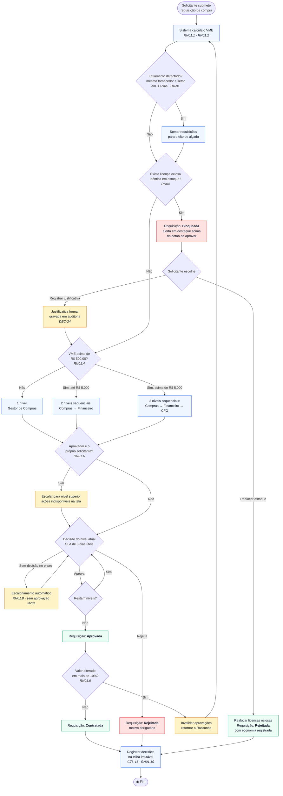
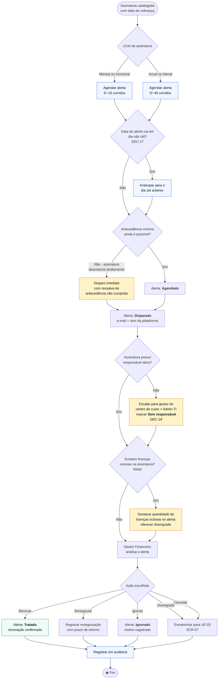
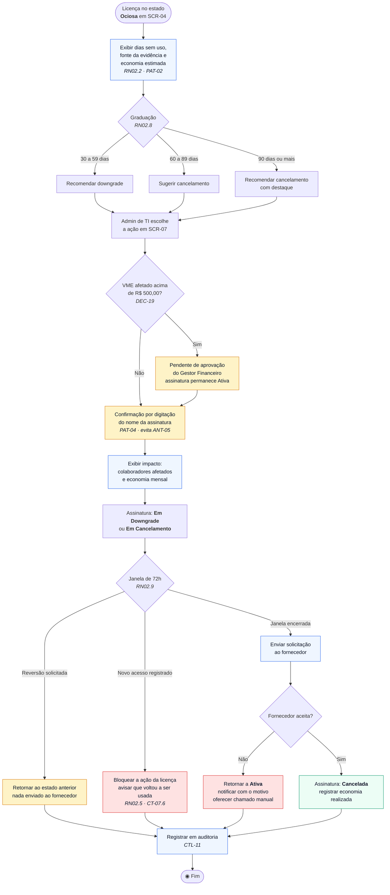

# Entregável 3 — Personas Corporativas e User Flows do Bloco B

**Projeto:** Auditor e Otimizador de Assinaturas SaaS Corporativas  
**Iteração:** Semana 03 (24/08/2026 – 30/08/2026)  
**Responsável:** D2 (Designer)  
**Versão:** 1.0.0  
**Escopo:** Personas P-01 (CFO), P-02 (Administrador de TI), P-03 (Gestor de Compras) · User Flows de aprovação (RN01/RN04), alertas de renovação (RN03) e ação sobre ociosidade (RN02)

---

## 1. Objetivo

Consolidar formalmente as personas esboçadas no
[Anexo A da Semana 02](../semana-02/anexo-a-levantamento-bloco-b-e-personas.md) e traduzir as
regras de negócio do Bloco B em **fluxos de usuário navegáveis**, prontos para virar
wireframes Lo-Fi na Semana 04.

> **Base das personas:** elicitação com *stakeholders* nas Semanas 01 e 02, matriz RBAC da
> Matriz de Conformidade e o benchmark de 11 produtos. São **personas de projeto**,
> fundamentadas em papéis reais mapeados, e serão confrontadas com participantes reais nos
> testes de usabilidade da Semana 12.

---

# PARTE I — Personas Corporativas

## 2. P-01 — Gestor Financeiro / CFO

> ### *"Eu não preciso de mais um painel. Preciso de um número que eu possa levar para o conselho."*

| Dimensão | Descrição |
|:---|:---|
| **Papel** | Diretor financeiro de empresa com 200 a 2.000 colaboradores |
| **Reporta a** | Conselho de administração ou matriz no exterior |
| **Time** | 3 a 8 pessoas em controladoria e contas a pagar |
| **Nível técnico** | Baixo a médio — domina planilha e BI; não domina API nem OAuth |
| **Dispositivos** | Notebook corporativo e tablet em reunião (RNF-09) |
| **Frequência de uso** | Semanal, com pico no fechamento mensal |

### 2.1. Objetivos e dores

| Objetivos | Dores atuais |
|:---|:---|
| Reduzir custo recorrente com número defensável | Gasto com SaaS pulverizado em dezenas de lançamentos sem rastreio |
| Evitar surpresa de renovação automática no orçamento | Descobre a renovação depois que o valor já foi debitado |
| Prestar contas do próprio investimento na ferramenta | Precisa justificar o custo da plataforma que comprou |
| Circular relatórios sem risco de conformidade | Planilhas com nome de colaborador circulando por e-mail |

### 2.2. *Jobs to be Done*

- Quando **fecho o mês**, quero **saber quanto de SaaS foi desperdiçado**, para **cortar antes do próximo ciclo**.
- Quando **recebo um alerta de divergência**, quero **entender a causa em um minuto**, para **decidir se escalo ou ignoro**.
- Quando **vou ao conselho**, quero **um número de economia realizada**, para **defender o investimento**.

### 2.3. Comportamentos observáveis

- Abre o produto pelo **link do alerta**, raramente pela página inicial.
- Confia em número que consegue **rastrear até o documento** — desconfia de caixa-preta.
- **Exporta quase sempre**: o trabalho dela termina fora da plataforma.
- Não lê texto de ajuda; interpreta pelo rótulo e pelo valor.

### 2.4. Critérios de sucesso na interface

| Sucesso | Fracasso |
|:---|:---|
| Economia realizada visível sem rolagem (SCR-08) | Indicador que mistura realizado e projetado (CT-08.2) |
| Percentual de divergência com base de cálculo em reais (RI-07) | Badge "+2%" sem explicação (dor USR-01) |
| Exportação já anonimizada e com filtros preservados | Arquivo que ignora o filtro aplicado (ANT-04) |
| Alerta com valor e prazo no próprio e-mail | Alerta que obriga a abrir o sistema para entender |

**Casos de uso:** UC-05, UC-06, UC-07, UC-08, UC-10, UC-13  
**Requisitos:** REQ-05, REQ-06, REQ-08, REQ-10  
**Jornada associada:** Jornada B (Semana 02)

---

## 3. P-02 — Administrador de TI

> ### *"Eu topo cancelar, mas preciso ter certeza de que ninguém vai abrir chamado amanhã."*

| Dimensão | Descrição |
|:---|:---|
| **Papel** | Responsável por infraestrutura, identidade e parque de software |
| **Reporta a** | Diretoria de TI ou o próprio CFO em empresas menores |
| **Time** | 2 a 10 pessoas em suporte e infraestrutura |
| **Nível técnico** | Alto — lida com OAuth, SCIM, SSO e chave de API sem dificuldade |
| **Dispositivos** | Desktop com múltiplos monitores |
| **Frequência de uso** | Diária no primeiro mês; semanal em regime |

### 3.1. Objetivos e dores

| Objetivos | Dores atuais |
|:---|:---|
| Ter inventário confiável do parque de software | Descobre ferramenta "sombra" só quando alguém pede reembolso |
| Sanear licenças sem interromper o trabalho de ninguém | Cancelou licença e descobriu depois que alguém usava |
| Reduzir superfície de risco de *shadow IT* | Não sabe quantas ferramentas tratam dado corporativo |
| Não virar instrumento de vigilância sobre colegas | Receio de que o dado de uso vire avaliação de desempenho |

### 3.2. *Jobs to be Done*

- Quando **conecto uma fonte nova**, quero **ver resultado ainda na mesma sessão**, para **provar que a ferramenta funciona**.
- Quando **vejo uma licença ociosa**, quero **saber quando foi usada pela última vez e por qual evidência**, para **cancelar com segurança**.
- Quando **executo uma ação**, quero **poder desfazer**, para **não gerar incidente**.

### 3.3. Comportamentos observáveis

- Lê **escopos de permissão** com atenção antes de autorizar (PC-A1).
- Prefere **filtro e busca** a navegação por menu.
- Desconfia de recomendação automática sem **evidência exibida** (PAT-01, PAT-02).
- É quem **bloqueia ou destrava** a adoção do produto na empresa.

### 3.4. Critérios de sucesso na interface

| Sucesso | Fracasso |
|:---|:---|
| Fonte da evidência de uso exibida por licença (RN02.2) | "Ociosa" sem dizer como isso foi apurado |
| Janela de arrependimento de 72 h (RN02.9) | Cancelamento em um clique (ANT-05) |
| Estado `Sem telemetria` explícito (RN02.4) | Presumir ociosidade por ausência de dado |
| Pseudonimização por padrão (DEC-03) | Nome do colaborador exposto no painel (ANT-01) |

**Casos de uso:** UC-01, UC-03, UC-04, UC-07, UC-14 · **Requisitos:** REQ-01, REQ-03, REQ-04, REQ-07
**Jornada associada:** Jornada A (Semana 02)

---

## 4. P-03 — Gestor de Compras

> ### *"Se a política existe, ela tem que aparecer na hora de decidir — não no manual."*

| Dimensão | Descrição |
|:---|:---|
| **Papel** | Conduz contratação, renovação e relacionamento com fornecedores |
| **Reporta a** | Diretoria financeira ou de operações |
| **Time** | 2 a 5 compradores |
| **Nível técnico** | Médio — domina ERP e portal de fornecedores; não domina infraestrutura |
| **Dispositivos** | Notebook corporativo |
| **Frequência de uso** | Diária — é quem mais transaciona no sistema |

### 4.1. Objetivos e dores

| Objetivos | Dores atuais |
|:---|:---|
| Garantir que toda contratação siga a política | Aprovações por e-mail, sem histórico consolidado |
| Não comprar o que a empresa já tem parado | Não enxerga estoque de licença ociosa no momento da compra |
| Ter prazo previsível de aprovação | Requisição parada por dias sem saber com quem está |
| Deixar trilha auditável | Reconstrói decisões garimpando caixa de entrada |

### 4.2. *Jobs to be Done*

- Quando **analiso uma requisição**, quero **ver a política aplicável na própria tela**, para **decidir sem consultar o manual**.
- Quando **uma compra é bloqueada**, quero **entender o motivo e a saída**, para **não travar a área solicitante**.
- Quando **acompanho um pedido**, quero **saber com quem está e há quanto tempo**, para **cobrar quem precisa decidir**.

### 4.3. Critérios de sucesso na interface

| Sucesso | Fracasso |
|:---|:---|
| Política e alçada exibidas na decisão (PAT-08) | Regra descoberta só depois de submeter |
| Alerta de estoque ocioso antes do botão de aprovar (RN04) | Alerta discreto abaixo da dobra (dor USR-02) |
| Linha do tempo com responsável e prazo (PAT-07) | Requisição parada sem indicação de responsável |
| Caminho claro de sobreposição com justificativa (DEC-24) | Bloqueio sem saída, forçando processo paralelo |

**Casos de uso:** UC-09 · **Requisitos:** REQ-09
**Regras críticas:** RN01, RN04

---

## 5. Antipersona

| Perfil | Por que o produto não o atende |
|:---|:---|
| **Gestor que quer monitorar produtividade individual** | Colide com DEC-03 e RN02.10; a pseudonimização é decisão de projeto, não configuração |
| **Empresa sem cartão corporativo nem ERP integrável** | Sem fonte de dados, RN05 e RN02 não são aplicáveis |
| **Comprador que quer automatizar cancelamento sem aprovação** | Colide com DEC-02 (somente-leitura) e com a RN01 |

---

## 6. Matriz Persona × Requisito × Tela

| Requisito | P-01 CFO | P-02 Admin TI | P-03 Compras | Tela |
|:---|:---:|:---:|:---:|:---|
| REQ-01 Integração | — | Principal | — | SCR-01 |
| REQ-02 OCR de NF | Principal | Secundário | — | SCR-02 |
| REQ-03 Catalogação | Secundário | Principal | Secundário | SCR-03 |
| REQ-04 Licenças ociosas | Secundário | Principal | Secundário | SCR-04 |
| REQ-05 Desperdício | Principal | Secundário | — | SCR-05 |
| REQ-06 Alertas | Principal | Secundário | Secundário | SCR-06 |
| REQ-07 Cancelamento | Secundário | Principal | — | SCR-07 |
| REQ-08 ROI | Principal | — | — | SCR-08 |
| REQ-09 Aprovação | Secundário | Secundário | Principal | SCR-09 |
| REQ-10 Exportação | Principal | Secundário | Secundário | SCR-10 |

---

# PARTE II — User Flows do Bloco B

## 7. UF-01 — Fluxo de Aprovação de Gastos (RN01 + RN04)

**Persona condutora:** P-03 — Gestor de Compras · **Tela:** SCR-09
**Regras:** RN01 (teto de R$ 500/mês), RN04 (teto de desperdício), RN01.6 (segregação de funções)

### 7.1. Requisitos de interface derivados

| ID | Requisito de interface | Origem | Persona |
|:---|:---|:---|:---|
| RI-13 | Alerta de estoque ocioso **acima** do botão de aprovar, em destaque | RN04 · dor USR-02 | P-03 |
| RI-14 | Política aplicável e faixa de alçada exibidas na tela de decisão | PAT-08 · RN01.5 | P-03 |
| RI-15 | Linha do tempo com nível, responsável, data e prazo restante | PAT-07 · RN01.8 | P-03 |
| RI-16 | Ações de aprovar/rejeitar desabilitadas com motivo visível na autoaprovação | RN01.6 | P-03 |
| RI-17 | Aviso de invalidação de aprovações ao alterar valor acima de 10% | RN01.9 | P-03 |
| RI-18 | Campo de justificativa obrigatório na sobreposição da RN04 | DEC-24 | P-03 |

---

## 8. UF-02 — Fluxo de Alertas de Renovação (RN03)

**Persona condutora:** P-01 — Gestor Financeiro / CFO · **Tela:** SCR-06
**Regras:** RN03 (15 dias mensal · 45 dias anual), DEC-17 (dias corridos), RN02 (integração com ociosidade)

### 8.1. Requisitos de interface derivados

| ID | Requisito de interface | Origem | Persona |
|:---|:---|:---|:---|
| RI-19 | Calendário de renovações com valor e dias restantes por assinatura | RN03 | P-01 |
| RI-20 | Notificação por e-mail já contendo valor, data e dias restantes | Jornada B, fase 1 | P-01 |
| RI-21 | Selo de ressalva quando a antecedência mínima não pôde ser cumprida | CT-06.4 | P-01 |
| RI-22 | Destaque de licenças ociosas dentro do alerta de renovação | CT-06.6 | P-01 |
| RI-23 | Badge `Sem responsável` na assinatura órfã | DEC-18 | P-01 |
| RI-24 | Registro obrigatório de motivo ao ignorar um alerta | CTL-11 | P-01 |

---

## 9. UF-03 — Fluxo de Ação sobre Licença Ociosa (RN02)

**Persona condutora:** P-02 — Administrador de TI · **Telas:** SCR-04 → SCR-07
**Regras:** RN02 (ociosidade), RN02.8 (graduação), RN02.9 (arrependimento), RN01 (alçada da ação)

### 9.1. Requisitos de interface derivados

| ID | Requisito de interface | Origem | Persona |
|:---|:---|:---|:---|
| RI-25 | Fonte da evidência de uso exibida em cada licença ociosa | RN02.2 | P-02 |
| RI-26 | Recomendação graduada conforme 30/60/90 dias | RN02.8 | P-02 |
| RI-27 | Confirmação por digitação do nome da assinatura | PAT-04 | P-02 |
| RI-28 | Prévia de impacto: colaboradores afetados e economia mensal | ANT-05 | P-02 |
| RI-29 | Contador visível da janela de arrependimento de 72 h | RN02.9 | P-02 |
| RI-30 | Bloqueio automático quando a licença volta a registrar uso | CT-07.6 | P-02 |
| RI-31 | Badge `Sem telemetria` distinto de `Ociosa` | RN02.4 | P-02 |

---

## 10. Consolidação dos Requisitos de Interface

| Origem | IDs | Quantidade |
|:---|:---|:---:|
| Semana 02 — Jornadas A e B | RI-01 a RI-12 | 12 |
| Semana 03 — UF-01 Aprovação | RI-13 a RI-18 | 6 |
| Semana 03 — UF-02 Renovação | RI-19 a RI-24 | 6 |
| Semana 03 — UF-03 Ociosidade | RI-25 a RI-31 | 7 |
| **Total acumulado** | **RI-01 a RI-31** | **31** |

Todos alimentam diretamente os **Wireframes Lo-Fi da Semana 04**.

---

## 11. Rastreabilidade

| Item | Consumido em | Entregável de destino |
|:---|:---|:---|
| Personas P-01 a P-03 | Semana 04 e 12 | Wireframes Lo-Fi e recrutamento de participantes |
| UF-01, UF-02, UF-03 | Semana 04 | Wireframes Lo-Fi do Bloco B |
| RI-13 a RI-31 | Semana 04 e 05 | Wireframes Lo-Fi e Mid-Fi |
| Seção 6 (matriz persona × requisito) | Semana 08 e 09 | Matrizes de rastreabilidade dos Blocos A e B |
| Critérios de sucesso das personas | Semana 11 | Roteiro de teste de usabilidade |
