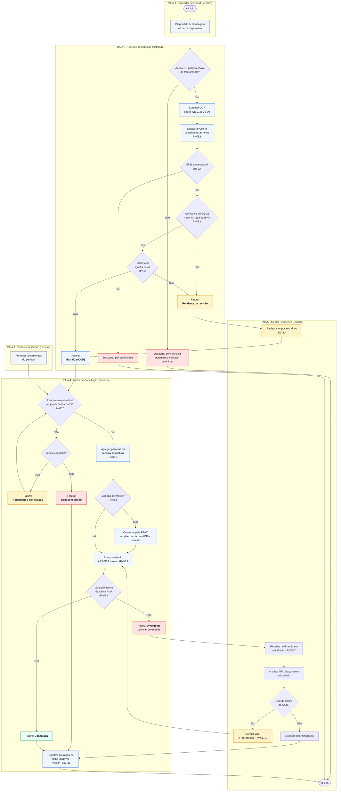
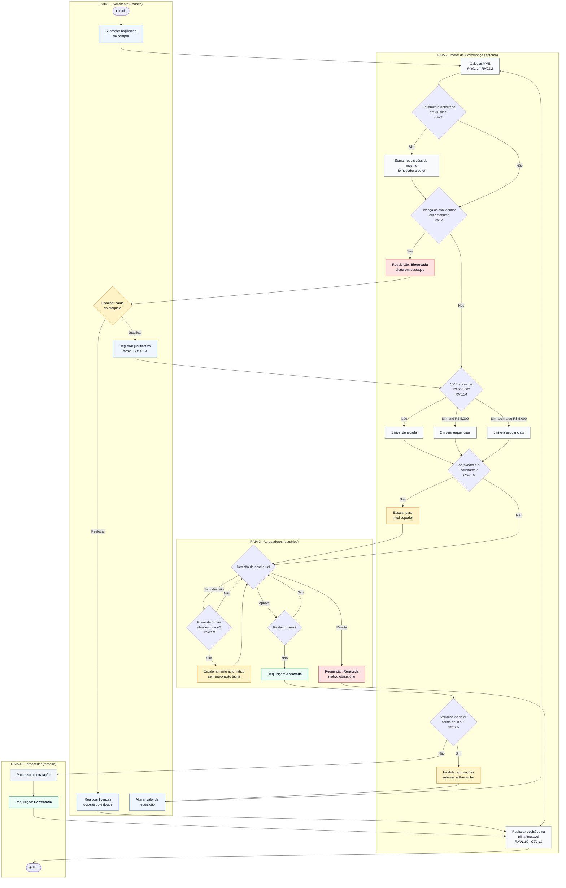
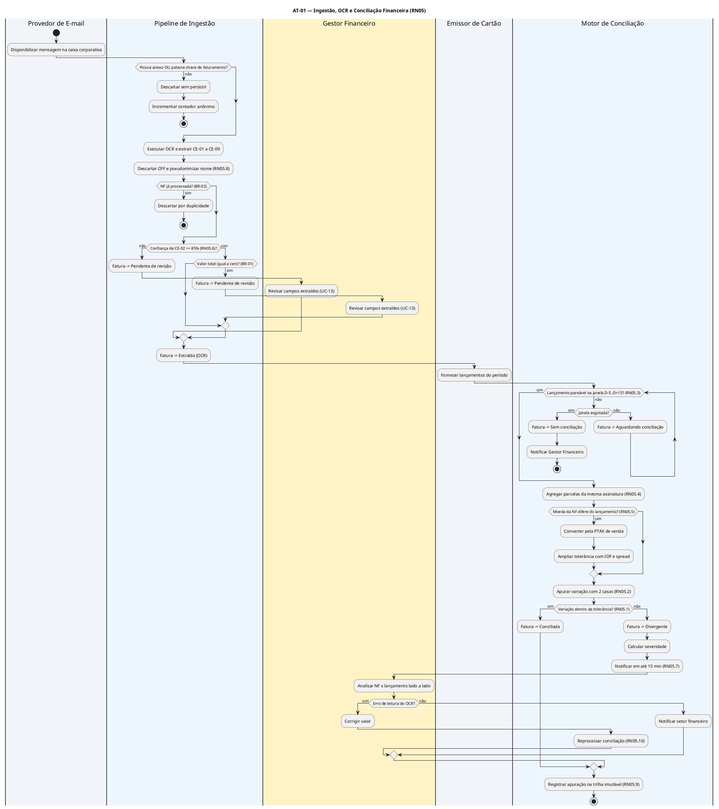
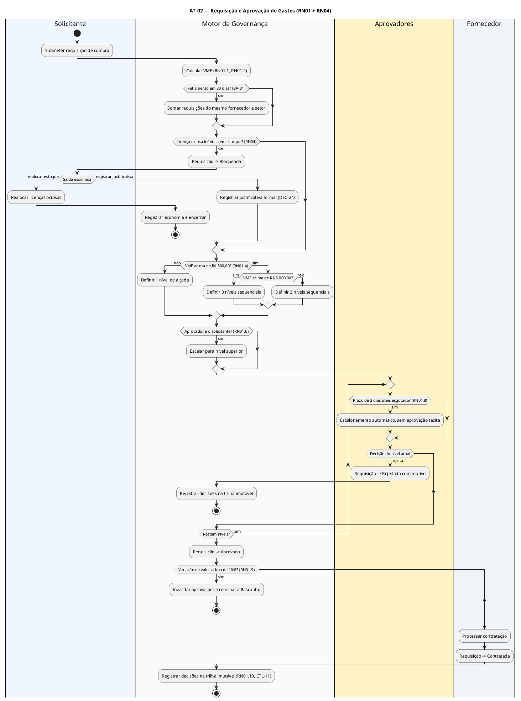

# Entregável 4 — Diagramas UML (Semana 03)

**Projeto:** Auditor e Otimizador de Assinaturas SaaS Corporativas  
**Iteração:** Semana 03 (24/08/2026 – 30/08/2026)  
**Responsáveis:** AR1 / AR2  
**Versão:** 1.0.0 (Atividades) · 1.1.0 (Casos de Uso — revisão de fecho de fase)

---

## 1. O que se aplica a esta iteração

Conforme a matriz de [`diagramasUML.md`](../diagramasUML.md), a Semana 3 encerra a
**Fase 1 — Elicitação e Modelagem de Processos**:

| Diagrama | Janela | Entrega formal | Situação |
|:---|:---|:---|:---|
| Casos de Uso | Semanas 1 a 3 | Semana 2 | Entregue na Semana 02 — **revisão de fecho v1.1 nesta iteração** |
| **Atividades** | Semanas 2 e 3 | **Semana 3** | **Entrega formal — v1.0 com 2 fluxos** |
| Sequência · Estados · Classes · Pacotes · Implantação | Semanas 4+ | — | Fora do escopo |

---

# PARTE I — Diagrama de Atividades (v1.0 · Entrega Formal)

## 2. Escopo

`diagramasUML.md` define para o Diagrama de Atividades o objetivo de *"modelar a lógica de
negócios com raias dividindo as ações do usuário, do sistema e de serviços terceiros"*,
citando como aplicação o *"fluxo de OCR com validação de divergência maior que 1%"*.

A entrega formal cobre **dois fluxos**, correspondendo aos dois blocos funcionais:

| ID | Fluxo | Bloco | Regras modeladas |
|:---|:---|:---|:---|
| **AT-01** | Ingestão, OCR e conciliação financeira | A | RN05 e sub-regras RN05.1 a RN05.10 |
| **AT-02** | Requisição e aprovação de gastos | B | RN01, RN04 e sub-regras RN01.1 a RN01.10 |

---

## 3. AT-01 — Ingestão, OCR e Conciliação Financeira

> Consolidação da v0.1 apresentada na [Semana 02](../semana-02/entregavel-04-diagramas-uml.md).
> **Mudanças em relação ao rascunho:** nó de deduplicação de NF (BR-02), tratamento de valor
> zero (BR-01) e nó explícito de encerramento por `NF ausente` (BR-07).

---

## 4. AT-02 — Requisição e Aprovação de Gastos (RN01 + RN04)

---

## 5. Fontes PlantUML (v1.0)

### 5.1. AT-01 — OCR e conciliação

### 5.2. AT-02 — Requisição e aprovação de gastos

---

## 6. Nós de Decisão e Regras Associadas

| Fluxo | Nó | Condição de guarda | Regra |
|:---|:---|:---|:---|
| AT-01 | B1 | `possui_anexo OR contém_palavra_chave` | RNF-07 · CTL-09 |
| AT-01 | B5 | `existe NF com mesmo CE-01 e CE-06` | BR-02 |
| AT-01 | B7 | `confiança(CE-02) ≥ 0,85` | RN05.6 |
| AT-01 | B8 | `valor_total = 0` | BR-01 |
| AT-01 | D1 | `data_lançamento ∈ [D−5, D+15]` | RN05.3 |
| AT-01 | D6 | `moeda_nf ≠ moeda_lançamento` | RN05.5 |
| AT-01 | D9 | `abs(variação) ≤ tolerância` | RN05.1 · RN05.2 |
| AT-02 | B2 | `soma(requisições 30d, mesmo fornecedor e setor)` | BA-01 · RN01.1 |
| AT-02 | B4 | `existe licença ociosa idêntica em estoque` | RN04 |
| AT-02 | B6 | `VME > 500,00` e `VME > 5.000,00` | RN01.4 · RN01.5 |
| AT-02 | B10 | `aprovador = solicitante` | RN01.6 |
| AT-02 | B12 | `variação_valor > 10%` | RN01.9 |
| AT-02 | C2 | `dias_úteis_sem_decisão ≥ 3` | RN01.8 |

---

# PARTE II — Casos de Uso: Descrições Textuais e Revisão de Fecho

## 7. Revisão v1.1 — Resolução da Pendência P-09

> **P-09 (Semana 02):** *"Definir se UC-13 e UC-14 são casos de uso próprios ou fluxos
> alternativos de UC-02 e UC-03."*

| Caso de uso | Decisão | Justificativa |
|:---|:---|:---|
| **UC-13 — Revisar extração manualmente** | **Mantido como caso de uso próprio** | Tem ator primário distinto de UC-02 (Gestor Financeiro × temporizador), gatilho próprio, produz registro autônomo em auditoria (`<<include>>` Registrar auditoria) e reinicia a conciliação (RN05.10) |
| **UC-14 — Revisar classificação de fornecedor** | **Absorvido como fluxo alternativo 3a e 6a de UC-03** | Mesmo ator, mesma tela, sem trilha de auditoria própria e sem valor de negócio autônomo — modelá-lo à parte fragmentaria o diagrama sem ganho de precisão |

**Efeito:** o modelo passa de **14 para 13 casos de uso**. A verificação de cobertura do
RNF-10 migra de UC-14 para o fluxo alternativo 3a de UC-03 — nenhum requisito perde
rastreabilidade.

### 7.1. Inventário final dos casos de uso (Fase 1 encerrada)

| Pacote | Casos de uso | Total |
|:---|:---|:---:|
| Captura e Diagnóstico (Bloco A) | UC-01, UC-02, UC-03, UC-04, UC-05, UC-13 | 6 |
| Gestão e Ação (Bloco B) | UC-06, UC-07, UC-08, UC-09, UC-10 | 5 |
| Governança e Conformidade | UC-11, UC-12 | 2 |
| **Total** | | **13** |

---

## 8. Descrições Textuais dos Casos de Uso (UC-04 a UC-10)

> Pendência nº 3 registrada na Semana 02. Completa o conjunto iniciado com UC-01 a UC-03.

### 8.1. UC-04 — Identificar Licenças Ociosas e Duplicadas

| Campo | Conteúdo |
|:---|:---|
| **Ator primário** | Administrador de TI |
| **Atores secundários** | Provedor de Identidade, Motor de IA |
| **Pré-condições** | Existe inventário catalogado e ao menos uma fonte de evidência de uso (E1, E2 ou E3) |
| **Garantia de sucesso** | Licenças classificadas em `Ativa`, `Ociosa`, `Sem telemetria` ou `Suspensa por afastamento`, com fonte da evidência exibida |
| **Garantia mínima** | Nenhuma licença é classificada como ociosa sem evidência qualificada (RN02.4) |
| **Gatilho** | Apuração diária automática |
| **Requisitos** | REQ-04 · RN02.1 a RN02.10 · RNF-10 · LGPD-01 |

**Fluxo principal:**  
1) Coleta os eventos de uso pela fonte de maior nível disponível. 
2) Calcula os dias sem evento por licença. 
3) Aplica exclusões de afastamento (RN02.6). 
4) Classifica conforme a tabela de decisão O1–O9. 
5) Gradua a recomendação em 30/60/90 dias (RN02.8). 
6) Exibe pseudônimo, setor, dias sem uso e fonte da evidência.

**Alternativos:**  
**2a.** Coleta atrasada há mais de 48 h → `Telemetria desatualizada`, sem gerar ociosidade nova (RN02.7).  
**4a.** Nenhuma fonte disponível → `Sem telemetria`.  
**6a.** Setor com menos de 5 colaboradores → agregação suprimida (RN02.10).  

**Exceções:**  
**Ex-1.** Colaborador desligado com licença ativa → licença `Órfã`, elegível a cancelamento imediato (BI-06).  
**Ex-2.** Licença de pool compartilhado → apuração por pool, não por colaborador (BI-09).  
**Ex-3.** Uso registrado por automação → não conta como evento qualificado (BI-10).

---

### 8.2. UC-05 — Emitir Relatório Mensal de Desperdício

| Campo | Conteúdo |
|:---|:---|
| **Ator primário** | Gestor Financeiro |
| **Pré-condições** | Mês de referência encerrado; existe apuração de ociosidade e de conciliação no período |
| **Garantia de sucesso** | Relatório com total desperdiçado, detalhamento por categoria e recomendações ordenadas por economia |
| **Garantia mínima** | Economia realizada e potencial nunca somadas em um único total |
| **Gatilho** | Fechamento do mês ou solicitação manual |
| **Requisitos** | REQ-05 · RNF-06 · LGPD-01 · PAT-05, PAT-06 |

**Fluxo principal:**  
1) Consolida licenças ociosas e divergências do período.  
2) Calcula o desperdício por categoria.  
3) Gera recomendações de consolidação com economia estimada.  
4) Apresenta plano atual e plano sugerido lado a lado (PAT-05).  
5) Aplica anonimização (`<<include>>`).

**Alternativos:**  
**2a.** Parte das assinaturas em `Sem telemetria` → exibe percentual de cobertura e apresenta o total como piso (CT-05.4).  
**3a.** Nenhuma recomendação no período → relatório informa manutenção do parque sem oportunidades detectadas.

**Exceções:**  
**Ex-1.** Carga superior a 2 s → paginação no servidor para preservar RNF-06.

---

### 8.3. UC-06 — Alertar sobre Renovação Automática

| Campo | Conteúdo |
|:---|:---|
| **Ator primário** | Gestor Financeiro |
| **Atores secundários** | Serviço de Notificação |
| **Pré-condições** | Assinatura catalogada com ciclo e data de cobrança conhecidos |
| **Garantia de sucesso** | Alerta disparado com 15 dias (mensal) ou 45 dias (anual) de antecedência, contendo valor, data e dias restantes |
| **Garantia mínima** | Assinatura sem responsável nunca fica sem destinatário de alerta |
| **Gatilho** | Agendador diário |
| **Requisitos** | REQ-06 · RN03 · DEC-17, DEC-18 |

**Fluxo principal:**  
1) Determina a antecedência pelo ciclo.  
2) Agenda o alerta em dias corridos.  
3) Antecipa para o dia útil anterior se cair em dia não útil (DEC-17).  
4) Dispara e-mail e notificação na plataforma.  
5) Destaca licenças ociosas da assinatura (CT-06.6).  
6) Registra a ação escolhida.

**Alternativos:**  
**2a.** Assinatura descoberta com prazo inferior ao mínimo → disparo imediato com ressalva (CT-06.4).  
**4a.** Assinatura sem responsável → escala para gestor do centro de custo e Admin de TI (DEC-18).  
**6a.** Alerta ignorado → exige motivo registrado.

**Exceções:**  
**Ex-1.** Data de cobrança desconhecida → assinatura marcada como `Renovação não mapeada`, sem alerta agendado.

---

### 8.4. UC-07 — Aprovar Cancelamento ou Downgrade

| Campo | Conteúdo |
|:---|:---|
| **Ator primário** | Administrador de TI (com CFO em alçada superior) |
| **Atores secundários** | Fornecedor SaaS |
| **Pré-condições** | Usuário autenticado com 2FA; assinatura com licenças elegíveis (RN02.8) |
| **Garantia de sucesso** | Ação executada, economia registrada e trilha de auditoria gravada |
| **Garantia mínima** | Nenhuma ação irreversível é executada sem confirmação explícita nem antes da janela de 72 h |
| **Gatilho** | Administrador escolhe a ação em SCR-07 |
| **Requisitos** | REQ-07 · RN02.8, RN02.9 · RN01 (alçada) · CTL-11, CTL-12 · PAT-04 |

**Fluxo principal:**  
1) Exibe impacto: colaboradores afetados e economia mensal.  
2) Exige confirmação por digitação do nome (PAT-04).  
3) Verifica a alçada pelo VME afetado (DEC-19).  
4) Move para `Em Downgrade` ou `Em Cancelamento`.  
5) Aguarda a janela de 72 h.  
6) Envia a solicitação ao fornecedor.  
7) Registra em auditoria.

**Alternativos:**  
**3a.** VME acima de R$ 500,00 → pendente de aprovação do Gestor Financeiro; assinatura permanece no estado atual.  
**5a.** Reversão solicitada na janela → retorna ao estado anterior sem enviar nada ao fornecedor (CT-07.4).

**Exceções:**  
**Ex-1.** Licença volta a registrar uso na janela → ação bloqueada para aquela licença (CT-07.6).  
**Ex-2.** Fornecedor recusa a alteração → retorna a `Ativa` com motivo e oferta de chamado manual (CT-07.5).

---

### 8.5. UC-08 — Consultar Dashboard de ROI Histórico

| Campo | Conteúdo |
|:---|:---|
| **Ator primário** | Gestor Financeiro / CFO |
| **Pré-condições** | Existe ao menos uma varredura concluída |
| **Garantia de sucesso** | Economia realizada, custo da plataforma e ROI resultante apresentados em menos de 2 s |
| **Garantia mínima** | Economia projetada nunca é apresentada como realizada |
| **Gatilho** | Acesso à página inicial |
| **Requisitos** | REQ-08 · RNF-06 · DEC-21, DEC-22 · ANT-02, ANT-07 |

**Fluxo principal:**
1) Recupera a linha de base do marco zero (DEC-22).  
2) Consolida a economia realizada acumulada.  
3) Apresenta o custo da plataforma no mesmo período.  
4) Calcula e exibe o ROI.  
5) Apresenta a projeção em área visualmente distinta e rotulada.

**Alternativos:**  
**1a.** Histórico insuficiente → exibe custo recorrente mapeado como linha de base e a data prevista do primeiro ROI, sem gráfico zerado (CT-08.3).  
**4a.** Mais de 5 categorias → agrupa o excedente em "Outras" (CT-08.4).

**Exceções:**  
**Ex-1.** Histórico de 24 meses excede 2 s → pré-agregação por mês.

---

### 8.6. UC-09 — Submeter e Aprovar Requisição de Compra

| Campo | Conteúdo |
|:---|:---|
| **Ator primário** | Gestor de Compras |
| **Atores secundários** | Gestor Financeiro, CFO, Fornecedor SaaS |
| **Pré-condições** | Usuário autenticado com 2FA; inventário atualizado |
| **Garantia de sucesso** | Requisição em `Contratada` ou `Rejeitada`, com todas as decisões registradas |
| **Garantia mínima** | Nenhuma contratação acima do teto avança sem aprovação formal registrada; nunca há aprovação tácita |
| **Gatilho** | Submissão de requisição |
| **Requisitos** | REQ-09 · RN01.1 a RN01.10 · RN04 · CTL-11, CTL-12 · PAT-07, PAT-08 |

**Fluxo principal:**
1) Calcula o VME (RN01.1, RN01.2). 
2) Verifica fatiamento em 30 dias (BA-01). 
3) Verifica estoque ocioso idêntico (RN04). 
4) Determina a alçada pela faixa de VME. 
5) Aplica segregação de funções (RN01.6). 
6) Conduz as aprovações sequenciais. 
7) Registra tudo na trilha imutável.

**Alternativos:**  
**3a.** Estoque ocioso encontrado → `Bloqueada`, com opções de realocar ou justificar (DEC-24).  
**5a.** Aprovador é o solicitante → escala para o nível superior.  
**6a.** SLA esgotado → escalonamento automático (RN01.8).  
**6b.** Valor alterado acima de 10% → invalida aprovações e retorna a `Rascunho` (RN01.9).

**Exceções:**  
**Ex-1.** Aprovada e não contratada em 30 dias → `Expirada` (BA-08).  
**Ex-2.** Nenhum aprovador disponível na alçada → escala automaticamente ao nível superior (BA-05).

---

### 8.7. UC-10 — Exportar Relatórios de Auditoria

| Campo | Conteúdo |
|:---|:---|
| **Ator primário** | Gestor Financeiro (também Administrador de RH e Colaborador em fluxos próprios) |
| **Pré-condições** | Relatório apresentado em tela com filtros aplicados |
| **Garantia de sucesso** | Arquivo gerado nos formatos PDF ou XLSX, refletindo os filtros e a anonimização da sessão |
| **Garantia mínima** | Nenhum nome ou CPF consta de arquivo exportado fora do perfil Admin de RH |
| **Gatilho** | Solicitação de exportação |
| **Requisitos** | REQ-10 · LGPD-01, LGPD-02 · CTL-07, CTL-08, CTL-15 · DEC-26, DEC-27, DEC-28 · ANT-04 |

**Fluxo principal:** 
1) Aplica os filtros da tela ao conjunto exportado. 
2) Aplica a anonimização do perfil (`<<include>>`). 
3) Gera o arquivo com período, data e responsável. 
4) Registra os filtros em aba de metadados (DEC-26). 
5) Aplica hash SHA-256 e carimbo de tempo (DEC-27).

**Alternativos:**  
**2a.** Perfil Admin de RH com reidentificação → exige motivo declarado, grava auditoria e aplica marca d'água (CT-10.4).  
**2b.** Solicitante é o Colaborador → exporta apenas os próprios dados em JSON ou CSV (DEC-28, LGPD-02).  
**3a.** Mais de 50.000 linhas → processamento assíncrono com notificação e link válido por 7 dias.  

**Exceções:**  
**Ex-1.** Pedido de titular não atendido automaticamente → escalona para atendimento manual respeitando o teto de 15 dias (CTL-08).

---

## 9. Fecho da Fase 1 — Verificação de Cobertura UML

| Item | Status |
|:---|:---:|
| Diagrama de Casos de Uso entregue (Semana 2, revisado na Semana 3) | Concluído |
| Diagrama de Atividades entregue com 2 fluxos e raias (Semana 3) | Concluído |
| Descrições textuais de UC-01 a UC-10 | Concluído |
| Todos os 10 RFs mapeados a caso de uso | Concluído |
| Todas as 5 RNs modeladas em `<<extend>>` ou em nó de decisão de atividade | Concluído |
| LGPD-01 e LGPD-02 modeladas | Concluído |
| Fontes PlantUML versionadas para geração das imagens | Concluído |

| Regra | Modelada em |
|:---|:---|
| RN01 | AT-02 (nós B6, B10, B12, C2) · UC-09 |
| RN02 | UC-04 · UF-03 · máquina de estados da Licença |
| RN03 | UC-06 · UF-02 |
| RN04 | AT-02 (nó B4) · UC-09 |
| RN05 | AT-01 (nós B7, B8, D1, D6, D9) · UC-02 · UC-13 |

---

## 10. Pendências para a Fase 2 (Semanas 04 a 07)

1. Gerar as **imagens oficiais** dos três diagramas (Casos de Uso, AT-01 e AT-02) a partir dos fontes PlantUML versionados.
2. **Semana 4/5 — Diagrama de Sequência:** priorizar as interações de maior risco técnico — conciliação assíncrona com o emissor de cartão e o fluxo OAuth de ingestão de e-mail.
3. **Semana 5/6 — Diagrama de Máquina de Estados:** consolidar as três máquinas já esboçadas (`Fatura`, `Licença`, `Requisição`) e acrescentar `Assinatura` e `Alerta`.
4. **Semana 6/7 — Diagrama de Classes de Domínio:** derivar entidades e *value objects* do inventário de objetos da Semana 01 e do dicionário de campos `CE-xx`.
5. **Semana 7 — Diagrama de Pacotes:** os três pacotes de casos de uso desta iteração são candidatos naturais a *Bounded Contexts*.
