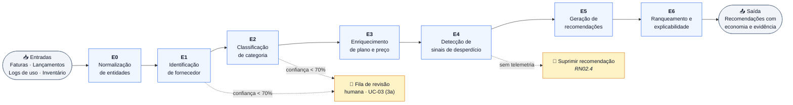
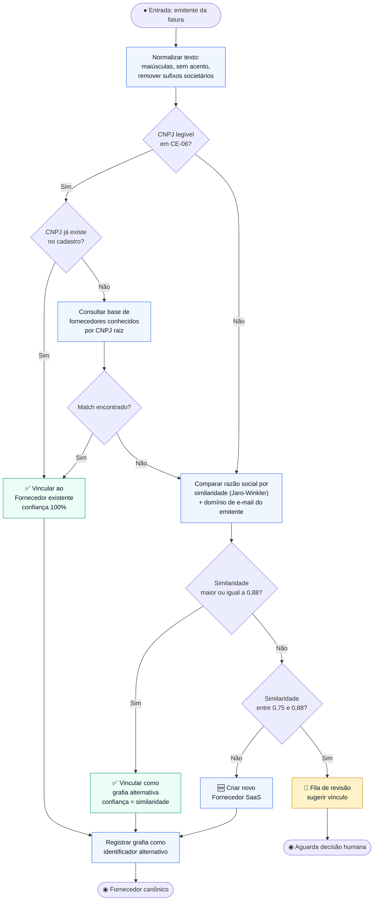
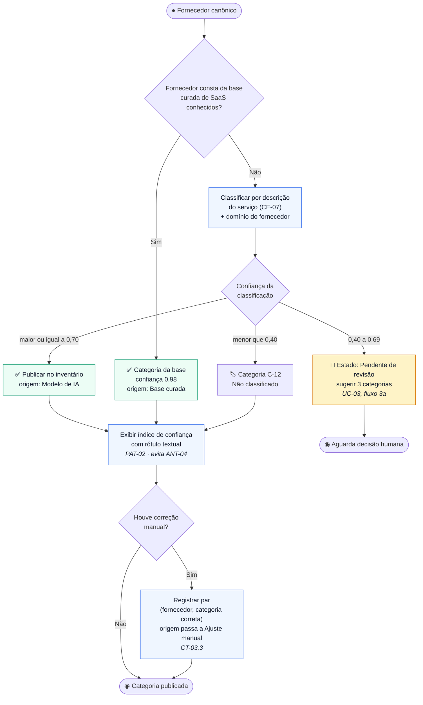
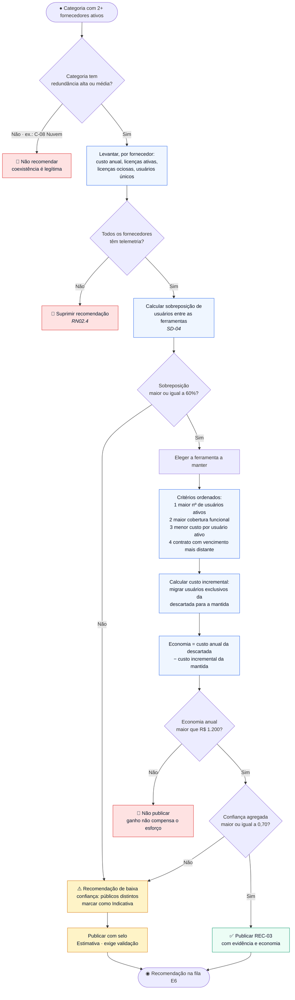
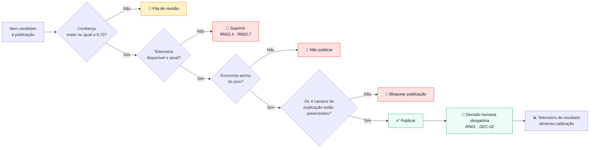

# 🤖 Entregável 1 — Fluxogramas Técnicos do Motor de Análise por IA e Algoritmo de Consolidação

**Projeto:** Auditor e Otimizador de Assinaturas SaaS Corporativas  
**Iteração:** Semana 04 (31/08/2026 – 06/09/2026) — Wireframes de Baixa Fidelidade  
**Responsáveis:** AR1 / AR2  
**Versão:** 1.0.0  
**Escopo:** REQ-03 (catalogação) · REQ-04 (ociosidade) · REQ-05 (recomendações) · RNF-10 (falso positivo < 2%)

---

## 1. 🎯 Objetivo

Especificar o comportamento do **Motor de Análise (MA)** — o componente que transforma
faturas, lançamentos e logs em **recomendações de economia acionáveis**. É o núcleo da
proposta de valor do produto: sem ele, a plataforma seria apenas um inventário.

O documento cobre três blocos:

| Bloco | Conteúdo | Requisito |
|:---|:---|:---|
| **A** | Pipeline de análise em 7 estágios (E0 a E6) | REQ-03, REQ-04, REQ-05 |
| **B** | Algoritmo de consolidação e cálculo de economia | REQ-05 |
| **C** | Controle de falsos positivos e explicabilidade | RNF-10 |

> **Premissa de projeto:** o motor **nunca executa ação**. Ele produz recomendações que só
> se tornam efetivas por decisão humana aprovada (DEC-02, RN01). Toda saída do MA é uma
> sugestão com evidência anexada, jamais um comando.

---

# BLOCO A — Pipeline de Análise

## 2. 🔧 Visão Geral dos Estágios



### 2.1. Contrato de cada estágio

| Estágio | Entrada | Saída | Limiar de confiança | Falha ➜ |
|:---|:---|:---|:---:|:---|
| **E0** Normalização | Razão social, CNPJ, domínio, descrição (CE-05 a CE-07) | Entidade canônica | — | Fornecedor `Não identificado` |
| **E1** Identificação de fornecedor | Entidade canônica | `Fornecedor SaaS` único | 75% | Fila de revisão |
| **E2** Classificação de categoria | Fornecedor + descrição do serviço | Categoria da taxonomia | 70% | Fila de revisão (UC-03, 3a) |
| **E3** Enriquecimento | Fornecedor + valor pago + nº de licenças | Plano inferido, preço unitário, alternativas | 60% | Recomendação sem comparativo de preço |
| **E4** Detecção de sinais | Inventário + telemetria + faturas | Lista de sinais `SD-xx` | — | Sinal suprimido se `Sem telemetria` |
| **E5** Geração de recomendações | Sinais | Recomendações `REC-xx` com economia | 70% | Recomendação não publicada |
| **E6** Ranqueamento | Recomendações | Lista ordenada com explicação | — | — |

---

## 3. 🔤 E0 + E1 — Normalização e Identificação de Fornecedor

Resolve o cenário CT-03.4: *"Adobe Inc.", "ADOBE SYSTEMS" e "Adobe Brasil" devem gerar um
único Fornecedor SaaS.*



> **Reversibilidade (DEC-14):** a consolidação automática de grafias sempre oferece
> "desfazer". O Administrador de TI pode separar fornecedores indevidamente fundidos, e a
> separação alimenta a calibração de E1.

---

## 4. 🏷️ E2 — Classificação de Categoria

### 4.1. Taxonomia base

| # | Categoria | Exemplos de sinal | Redundância típica |
|:---|:---|:---|:---|
| C-01 | Design | Figma, Canva, Adobe CC | 🔴 Alta |
| C-02 | Produtividade e documentos | Notion, Confluence, Google Workspace | 🔴 Alta |
| C-03 | Comunicação | Slack, Teams, Zoom | 🟠 Média |
| C-04 | DevTools | GitHub, GitLab, Jira | 🟠 Média |
| C-05 | CRM e vendas | Salesforce, HubSpot, Pipedrive | 🔴 Alta |
| C-06 | Marketing e automação | RD Station, Mailchimp | 🔴 Alta |
| C-07 | IA e geração de conteúdo | Assistentes, geradores de imagem | 🔴 Alta |
| C-08 | Infraestrutura e nuvem | AWS, GCP, Cloudflare | 🟢 Baixa |
| C-09 | Segurança e identidade | Okta, 1Password | 🟢 Baixa |
| C-10 | RH e financeiro | Gupy, Conta Azul | 🟠 Média |
| C-11 | Dados e BI | Metabase, Power BI | 🟠 Média |
| C-12 | Não classificado | — | — |

### 4.2. Fluxo de classificação



> **Fornecedor `Pendente de revisão` não entra em nenhuma recomendação** (CT-03.2). A regra
> protege o RNF-10: uma classificação incerta não pode gerar sugestão de cancelamento.

---

## 5. 🔍 E4 — Sinais de Desperdício

O motor não "adivinha" desperdício: ele detecta **sinais tipificados**, cada um com evidência
e condição de guarda própria.

| ID | Sinal | Condição de detecção | Evidência exigida | Regra |
|:---|:---|:---|:---|:---|
| **SD-01** | Licenças ociosas | Licenças em estado `Ociosa` na assinatura | Telemetria E1, E2 ou E3 | RN02.1 |
| **SD-02** | Licença nunca acessada | `Ociosa` desde o provisionamento | Data de provisionamento | RN02.3 |
| **SD-03** | Redundância de categoria | 2+ fornecedores ativos na mesma categoria de redundância alta | Catalogação com confiança maior ou igual a 0,70 | REQ-03 |
| **SD-04** | Sobreposição de usuários | O mesmo colaborador possui licença ativa em 2 ferramentas da mesma categoria | Telemetria dos dois lados | REQ-04 |
| **SD-05** | Plano superdimensionado | Recursos do plano contratado sem uso registrado | Telemetria de funcionalidade (E1) | REQ-05 |
| **SD-06** | Ciclo desfavorável | Pagamento mensal com plano anual disponível mais barato | Preço de tabela em E3 | REQ-05 |
| **SD-07** | Contrato duplicado | 2 assinaturas ativas do mesmo fornecedor no mesmo tenant | Inventário | REQ-05 |
| **SD-08** | Preço acima do mercado | Preço unitário acima da faixa de referência | Base de referência em E3 | REQ-05 |
| **SD-09** | Renovação iminente com ociosidade | Alerta RN03 ativo e SD-01 presente | RN03 + RN02 | CT-06.6 |
| **SD-10** | Cobrança sem contrapartida | Fatura `Sem conciliação` recorrente | RN05.3 | RN05 |

### 5.1. Guarda de supressão

```
PARA cada sinal detectado:
  SE cobertura_de_telemetria(assinatura) = "Sem telemetria"  ENTÃO
     suprimir sinal e exibir "Conecte uma fonte de uso"       -- RN02.4
  SE confiança_de_classificação(fornecedor) < 0,70            ENTÃO
     suprimir sinais SD-03, SD-04, SD-05                      -- CT-03.2
  SE telemetria_desatualizada(assinatura) > 48h               ENTÃO
     suprimir sinais SD-01, SD-02, SD-04                      -- RN02.7
  SE colaboradores_no_agregado < 5                            ENTÃO
     suprimir detalhamento por setor                          -- RN02.10
```

---

# BLOCO B — Algoritmo de Consolidação

## 6. 💡 E5 — Tipos de Recomendação

| ID | Recomendação | Sinal(is) que a origina | Fórmula de economia anual estimada |
|:---|:---|:---|:---|
| **REC-01** | Reduzir assentos (downgrade) | SD-01, SD-02 | `licenças_ociosas × preço_unitário_mensal × 12` |
| **REC-02** | Rebaixar plano | SD-05 | `(preço_plano_atual − preço_plano_adequado) × licenças × 12` |
| **REC-03** | Consolidar ferramentas redundantes | SD-03, SD-04 | `custo_anual_ferramenta_descartada − custo_incremental_da_mantida` |
| **REC-04** | Migrar para ciclo anual | SD-06 | `(preço_mensal × 12) − preço_anual` |
| **REC-05** | Renegociar preço | SD-08 | `(preço_pago − preço_referência) × licenças × 12` |
| **REC-06** | Cancelar assinatura | SD-01 com 90+ dias, SD-10 | `custo_anual_total_da_assinatura` |
| **REC-07** | Unificar contratos duplicados | SD-07 | `custo_anual_do_contrato_menor − desconto_perdido_por_volume` |

### 6.1. Fluxograma do algoritmo de consolidação (REC-03)

REC-03 é a recomendação mais valiosa e a mais arriscada: sugere **abandonar uma ferramenta
inteira**. Recebe, por isso, as guardas mais rígidas.



### 6.2. Pseudocódigo do cálculo de economia

```
FUNÇÃO calcular_economia(recomendacao):

  CASO REC-01 (reduzir assentos):
    ociosas       ← licenças no estado "Ociosa" há 30+ dias
    preco_unit    ← custo_mensal_assinatura ÷ total_de_licenças
    economia_ano  ← ociosas × preco_unit × 12
    confianca     ← min(cobertura_telemetria, 1,0)

  CASO REC-03 (consolidar ferramentas):
    manter        ← eleger_ferramenta_a_manter(candidatas)
    descartar     ← candidatas − manter
    exclusivos    ← usuários ativos só em 'descartar'
    custo_incr    ← exclusivos × preco_unit(manter) × 12
    economia_ano  ← custo_anual(descartar) − custo_incr
    confianca     ← media_ponderada(
                       confianca_classificacao(todas),
                       cobertura_telemetria(todas),
                       sobreposicao_usuarios)

  CASO REC-04 (migrar ciclo):
    economia_ano  ← (preco_mensal × 12) − preco_anual_tabela
    confianca     ← qualidade_do_preco_de_referencia

  -- Guarda comum a todos os casos
  SE economia_ano < PISO_DE_PUBLICACAO (R$ 1.200/ano)  ENTÃO
     não publicar
  SE confianca < 0,70                                   ENTÃO
     publicar apenas como "Estimativa · exige validação"

  RETORNAR (economia_ano, confianca)
```

> **Piso de publicação:** recomendações abaixo de R$ 1.200/ano não são publicadas. O objetivo
> é proteger a atenção do usuário — um painel com 200 sugestões de R$ 30,00 destrói a
> credibilidade das sugestões que importam.

---

## 7. 📊 E6 — Ranqueamento e Explicabilidade

### 7.1. Score de priorização

```
score = (economia_anual_normalizada × 0,50)
      + (confiança                  × 0,30)
      + (facilidade_de_execução     × 0,20)

  economia_anual_normalizada ∈ [0,1]  -- escala logarítmica sobre a carteira
  confiança                  ∈ [0,1]  -- saída de E5
  facilidade_de_execução     ∈ [0,1]  -- ver tabela abaixo
```

| Recomendação | Facilidade | Justificativa |
|:---|:---:|:---|
| REC-01 Reduzir assentos | 0,90 | Ação direta na interface do fornecedor |
| REC-04 Migrar ciclo | 0,80 | Alteração contratual simples |
| REC-02 Rebaixar plano | 0,70 | Pode exigir validação funcional |
| REC-07 Unificar contratos | 0,50 | Depende de negociação |
| REC-06 Cancelar | 0,40 | Impacto direto em colaboradores |
| REC-05 Renegociar | 0,30 | Depende do fornecedor |
| REC-03 Consolidar | 0,20 | Exige migração e mudança de hábito |

### 7.2. Estrutura obrigatória da explicação

Toda recomendação publicada carrega, na interface, **quatro campos não opcionais**:

| Campo | Exemplo | Origem |
|:---|:---|:---|
| **O que fazer** | "Reduzir de 25 para 18 licenças do Figma" | REC-01 |
| **Por quê** | "7 licenças sem uso há mais de 30 dias" | SD-01 |
| **Evidência** | "Fonte: API do fornecedor · última coleta em 05/09/2026" | RN02.2 |
| **Quanto economiza** | "R$ 6.048,00 por ano · confiança 94%" | E5 |

> Recomendação sem os quatro campos **não é publicável**. É a contramedida direta ao
> antipadrão ANT-04 e à desconfiança levantada na persona P-02 ("preciso ter certeza de que
> ninguém vai abrir chamado amanhã").

---

# BLOCO C — Controle de Falsos Positivos (RNF-10)

## 8. 🎯 Definição Operacional de Falso Positivo

O RNF-10 exige *"índice de falsos positivos na identificação de ferramentas SaaS não maior
que 2%"*. O enunciado não define o que conta como erro. Fica estabelecido:

| Tipo | Definição operacional | Como é medido |
|:---|:---|:---|
| **FP-A** Identificação | Fornecedor criado que não é um SaaS, ou fusão indevida de fornecedores distintos | Correção manual em E1 |
| **FP-B** Classificação | Categoria corrigida manualmente pelo Administrador de TI | Correção manual em E2 |
| **FP-C** Ociosidade | Licença classificada como `Ociosa` que volta a registrar uso em até 30 dias após o cancelamento | Evento de reprovisionamento (BI-08) |
| **FP-D** Recomendação | Recomendação aceita e revertida na janela de 72 h ou recusada pelo fornecedor | RN02.9, CT-07.5 |

```
taxa_FP = (FP-A + FP-B + FP-C + FP-D) ÷ total_de_itens_publicados_no_período
meta: taxa_FP ≤ 2% ao mês
```

## 9. 🛡️ Guardas de Precisão



### 9.1. Ciclo de calibração

| Evento | Sinal de aprendizado | Estágio calibrado |
|:---|:---|:---|
| Correção manual de categoria (CT-03.3) | Par (fornecedor, categoria correta) | E2 |
| Separação de fornecedores fundidos | Par negativo de similaridade | E1 |
| Reversão na janela de 72 h | Recomendação rejeitada na prática | E5 |
| Recusa do fornecedor (CT-07.5) | Plano alternativo inexistente | E3 |
| Reprovisionamento após cancelamento | Falso positivo de ociosidade | E4 |

> A calibração usa **apenas dados agregados e pseudonimizados** (RN02.10). Nenhum evento de
> aprendizado carrega identificação de colaborador.

---

## 10. 📈 Indicadores do Motor

| ID | Indicador | Meta | Fonte |
|:---|:---|:---|:---|
| MI-01 | Taxa de falso positivo agregada | ≤ 2% ao mês | RNF-10 |
| MI-02 | Cobertura de catalogação automática | ≥ 90% dos fornecedores sem revisão manual | E2 |
| MI-03 | Cobertura de telemetria da carteira | ≥ 80% das licenças com fonte E1 ou E2 | E4 |
| MI-04 | Taxa de aceitação de recomendações | ≥ 40% das publicadas | E5 |
| MI-05 | Economia realizada ÷ economia recomendada | ≥ 50% em 90 dias | DEC-21 |
| MI-06 | Tempo de processamento do pipeline completo | ≤ 5 min por conta (RNF-04) | E0 a E6 |

---

## 11. ⚠️ Parâmetros Pendentes de Homologação

| Parâmetro | Valor proposto | Situação |
|:---|:---|:---|
| Limiar de identificação (E1) | Similaridade 0,88 · zona de revisão 0,75–0,88 | 🟡 A calibrar na Semana 5 |
| Limiar de classificação (E2) | 0,70 para publicar · 0,40 para C-12 | 🟡 A calibrar na Semana 5 (P-08) |
| Sobreposição mínima para REC-03 | 60% de usuários comuns | 🟡 A homologar |
| Piso de publicação de recomendação | R$ 1.200 por ano | 🟡 A homologar |
| Pesos do score de priorização | 0,50 / 0,30 / 0,20 | 🟡 A homologar |
| Definição operacional de FP | FP-A a FP-D | 🟡 A homologar com o cliente |

---

## 12. 🔗 Rastreabilidade

| Item | Consumido em | Entregável de destino |
|:---|:---|:---|
| Seção 7.2 (4 campos de explicação) | Semana 04 | Wireframes Lo-Fi de SCR-04 e SCR-05 |
| Seção 6 (tipos de recomendação) | Semana 05 | Wireframes Mid-Fi do relatório de desperdício |
| Seções 8 e 9 (falsos positivos) | Semana 05 | Relatório de validação do RNF-10 |
| Seção 2.1 (contrato dos estágios) | Semana 07 | Especificação OpenAPI dos endpoints do motor |
| Seção 5 (sinais SD-xx) | Semana 06 | Modelo de Domínio — serviços de domínio |
| Seção 10 (indicadores) | Semana 11 e 12 | Plano de testes e critérios de aceite |
