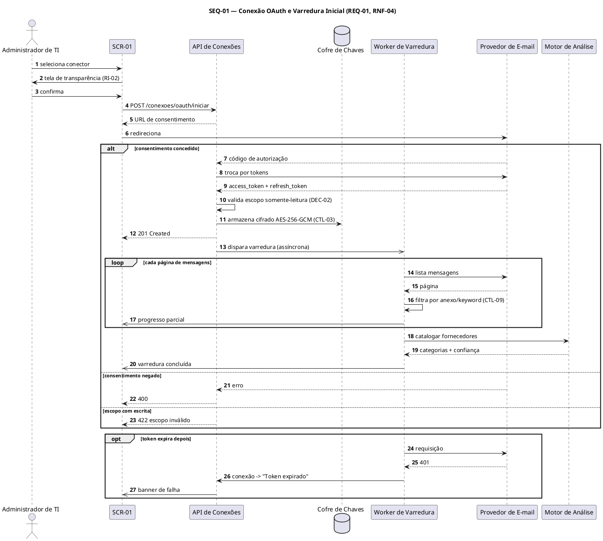
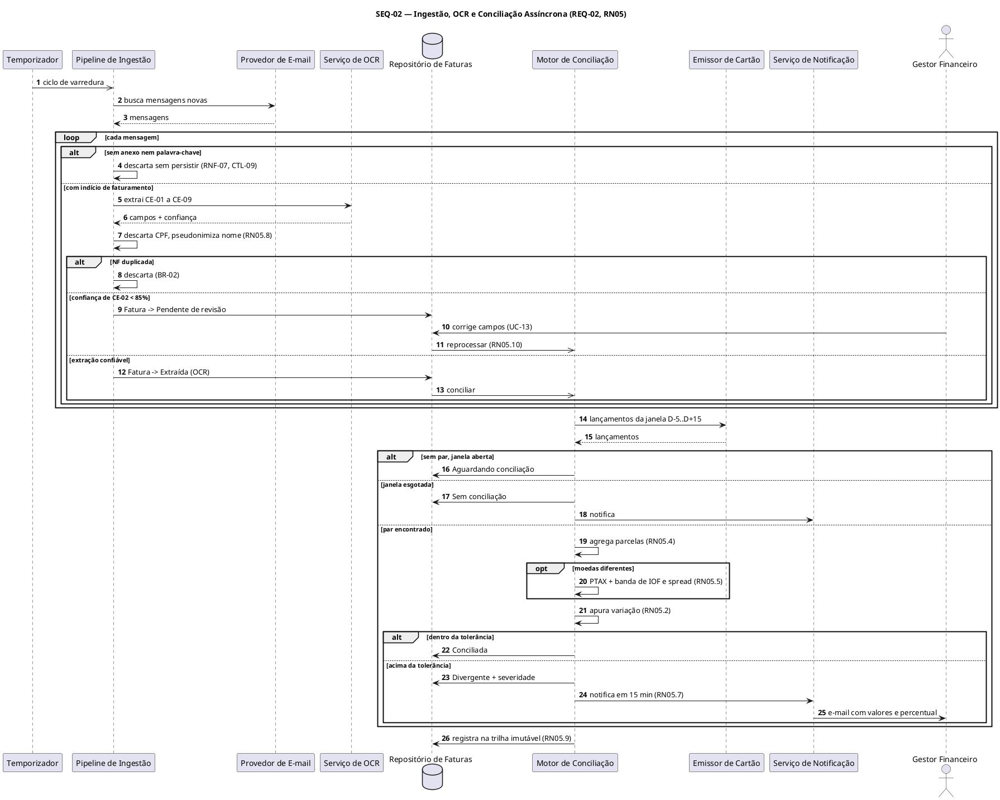

# Entregável 3 — Diagramas UML (Semana 04)

**Projeto:** Auditor e Otimizador de Assinaturas SaaS Corporativas  
**Iteração:** Semana 04 (31/08/2026 – 06/09/2026) — início da Fase 2  
**Responsáveis:** AR1 / AR2  
**Versão:** 0.1.0 (Sequência) — *rascunho*

---

## 1. O que se aplica a esta iteração

Conforme a matriz de [`diagramasUML.md`](../diagramasUML.md), a Fase 2 abre com o Diagrama
de Sequência:

| Diagrama | Janela | Entrega formal | Situação nesta iteração |
|:---|:---|:---|:---|
| **Sequência** | **Semanas 4 e 5** | **Semana 5** | Rascunho v0.1 — 2 interações críticas modeladas |
| Máquina de Estados | Semanas 5 e 6 | Semana 6 | Inicia na Semana 5 (3 máquinas já esboçadas) |
| Classes de Domínio | Semanas 6 e 7 | Semana 7 | Fora do escopo |
| Pacotes / Componentes | Semana 7 | Semana 7 | Fora do escopo |
| Implantação | Semanas 10 e 11 | Semana 11 | Fora do escopo |

### 1.1. Observação sobre a atividade de Casos de Uso

O cronograma atribui a AR1/AR2, nesta semana, *"elaboração dos diagramas de caso de uso e
fluxogramas do motor de otimização por IA"*. O **Diagrama de Casos de Uso já teve entrega
formal na Semana 02** (v1.0) e **revisão de fecho de fase na Semana 03** (v1.1, 13 casos de
uso), conforme a própria matriz de `diagramasUML.md`, que o posiciona nas Semanas 1 a 3.

Não há, portanto, retrabalho a fazer sobre ele. O esforço de AR1/AR2 nesta iteração
concentra-se nos **fluxogramas do motor de IA**
([Entregável 1](entregavel-01-fluxogramas-motor-ia-algoritmo-consolidacao.md)) e na abertura
do **Diagrama de Sequência**, que é o artefato UML da janela atual. O único ajuste no modelo
de casos de uso é o registro de rastreabilidade da Seção 5 deste documento.

---

## 2. Seleção das Interações a Modelar

O Diagrama de Sequência tem por objetivo *"detalhar interações temporais críticas e
integrações de API"*. A priorização segue a pendência registrada no fecho da Fase 1:
**as interações de maior risco técnico primeiro**.

| ID | Interação | Risco técnico | Requisito | Iteração |
|:---|:---|:---|:---|:---|
| **SEQ-01** | Conexão OAuth e varredura inicial | Alto — orquestração de terceiros com teto de 5 min | REQ-01, RNF-04 | **v0.1 nesta semana** |
| **SEQ-02** | Ingestão, OCR e conciliação assíncrona | Alto — pipeline assíncrono com pareamento temporal | REQ-02, RN05 | **v0.1 nesta semana** |
| SEQ-03 | Fluxo de aprovação de gastos com escalonamento | Médio — máquina de estados com SLA | REQ-09, RN01 | Semana 05 |
| SEQ-04 | Exportação e portabilidade do titular | Médio — processamento assíncrono e anonimização | REQ-10, LGPD-02 | Semana 05 |

---

## 3. SEQ-01 — Conexão OAuth e Varredura Inicial

**Requisitos:** REQ-01 · RNF-04 (varredura < 5 min) · CTL-03 (cofre de chaves) · CTL-12 (2FA) · CTL-13 (consentimento)  
**Caso de uso:** UC-01  
**Tela:** SCR-01 (wireframes W-01, W-02, W-03)

```mermaid
sequenceDiagram
    autonumber
    actor ADM as Administrador de TI
    participant UI as SCR-01<br/>(interface)
    participant API as API de Conexões
    participant VAULT as Cofre de Chaves
    participant WORKER as Worker de Varredura
    participant MAIL as Provedor de E-mail<br/>(externo)
    participant MA as Motor de Análise

    ADM->>UI: seleciona conector "Google Workspace"
    UI->>ADM: exibe tela de transparência (W-02)
    Note over UI,ADM: RI-02 · declara o que é e o que nunca é lido (RNF-07)

    ADM->>UI: confirma "Continuar"
    UI->>API: POST /conexoes/oauth/iniciar
    API-->>UI: URL de consentimento + state
    UI->>MAIL: redireciona para consentimento
    MAIL->>ADM: apresenta escopos solicitados

    alt Consentimento concedido
        ADM->>MAIL: autoriza (escopo somente-leitura)
        MAIL-->>API: callback com código de autorização
        API->>MAIL: troca código por tokens
        MAIL-->>API: access_token + refresh_token

        API->>API: valida que o escopo é somente-leitura
        Note over API: DEC-02 · escopo de escrita é recusado

        API->>VAULT: armazena tokens cifrados (AES-256-GCM)
        VAULT-->>API: referência da credencial
        API->>API: conexão -> estado "Ativo"
        API-->>UI: 201 Created
        UI->>ADM: conector "Ativo"; varredura iniciada

        API-)WORKER: dispara varredura inicial (assíncrono)
        Note over WORKER: orçamento de 5 min por conta (RNF-04)

        loop Para cada página de mensagens
            WORKER->>MAIL: lista mensagens do período
            MAIL-->>WORKER: página de mensagens
            WORKER->>WORKER: filtra por anexo ou palavra-chave
            Note over WORKER: sem indício de faturamento -> descarte<br/>sem persistência (CTL-09)
            WORKER-)UI: progresso parcial ("47 assinaturas encontradas")
        end

        WORKER->>MA: solicita catalogação dos fornecedores
        MA-->>WORKER: categorias + índice de confiança
        WORKER-)UI: varredura concluída
        UI->>ADM: exibe inventário preenchido

    else Consentimento negado
        ADM->>MAIL: cancela
        MAIL-->>API: callback de erro
        API-->>UI: 400 consentimento negado
        UI->>ADM: nenhuma conexão criada; nenhum dado persistido

    else Escopo com permissão de escrita
        API-->>UI: 422 escopo inválido
        UI->>ADM: "Utilize uma credencial somente-leitura" (CT-01.4)
    end

    opt Token expira depois e a renovação falha
        WORKER->>MAIL: requisição com token expirado
        MAIL-->>WORKER: 401
        WORKER->>API: marca conexão como "Token expirado"
        API-)UI: banner de falha + badge na navegação (W-08, estado C)
    end
```

### 3.1. Orçamento de tempo (RNF-04)

| Etapa | Orçamento | Observação |
|:---|:---|:---|
| Troca de código por token | 2 s | Depende do provedor |
| Cifragem e gravação no cofre | 200 ms | CTL-03 |
| Listagem e filtragem de mensagens | 3 min 30 s | Etapa dominante; paralelizável por página |
| Catalogação pelo Motor de Análise | 1 min | E0 a E2 do pipeline |
| Consolidação e publicação | 20 s | — |
| **Total** | **≤ 5 min** | Teto do RNF-04, verificado em CT-01.1 |

---

## 4. SEQ-02 — Ingestão, OCR e Conciliação Assíncrona

**Requisitos:** REQ-02 · RN05.1 a RN05.10 · RNF-07 · LGPD-01  
**Casos de uso:** UC-02, UC-13  
**Diagrama de Atividades correspondente:** AT-01

```mermaid
sequenceDiagram
    autonumber
    participant TIMER as Temporizador
    participant ING as Pipeline de Ingestão
    participant MAIL as Provedor de E-mail<br/>(externo)
    participant OCR as Serviço de OCR
    participant DB as Repositório de Faturas
    participant CONC as Motor de Conciliação
    participant CARD as Emissor de Cartão<br/>(externo)
    participant NOTIF as Serviço de Notificação
    actor GF as Gestor Financeiro

    TIMER-)ING: ciclo de varredura
    ING->>MAIL: busca mensagens novas
    MAIL-->>ING: mensagens do período

    loop Para cada mensagem
        ING->>ING: possui anexo ou palavra-chave?
        alt Sem indício de faturamento
            ING->>ING: descarta em memória; incrementa contador anônimo
            Note over ING: RNF-07 · CTL-09 · nada é persistido
        else Com indício de faturamento
            ING->>OCR: extrai campos CE-01 a CE-09
            OCR-->>ING: campos + confiança por campo
            ING->>ING: descarta CPF; pseudonimiza nome (RN05.8)

            alt NF já processada (CE-01 + CE-06)
                ING->>ING: descarta por duplicidade (BR-02)
            else Confiança de CE-02 abaixo de 85%
                ING->>DB: grava Fatura "Pendente de revisão"
                DB-->>GF: aparece na fila de revisão (UC-13)
                GF->>DB: corrige campos
                DB-)CONC: solicita reprocessamento (RN05.10)
            else Extração confiável
                ING->>DB: grava Fatura "Extraída (OCR)"
                DB-)CONC: solicita conciliação
            end
        end
    end

    CONC->>CARD: consulta lançamentos da janela D-5 a D+15
    CARD-->>CONC: lançamentos do período

    alt Nenhum lançamento pareável e janela aberta
        CONC->>DB: Fatura -> "Aguardando conciliação"
        Note over CONC,DB: reavaliada no próximo ciclo (RN05.3)
    else Janela esgotada sem par
        CONC->>DB: Fatura -> "Sem conciliação"
        CONC->>NOTIF: notifica Gestor Financeiro
    else Lançamento pareável encontrado
        CONC->>CONC: agrega parcelas da mesma assinatura (RN05.4)
        opt Moedas diferentes
            CONC->>CONC: converte pela PTAX; amplia banda com IOF e spread (RN05.5)
        end
        CONC->>CONC: apura variação com 2 casas (RN05.2)

        alt Variação dentro da tolerância
            CONC->>DB: Fatura -> "Conciliada"
        else Variação acima da tolerância
            CONC->>DB: Fatura -> "Divergente" + severidade
            CONC->>NOTIF: notifica conforme severidade (RN05.7)
            NOTIF->>GF: e-mail com valor da NF, valor cobrado e percentual
            Note over NOTIF,GF: prazo de 15 min · deep link para SCR-02
            GF->>DB: analisa NF x lançamento lado a lado
            opt Erro de leitura do OCR
                GF->>DB: corrige valor
                DB-)CONC: reprocessa (RN05.10)
            end
        end
    end

    CONC->>DB: registra apuração na trilha imutável (RN05.9 · CTL-11)
```

### 4.1. Natureza das mensagens

| Tipo | Notação | Onde aparece | Motivo |
|:---|:---|:---|:---|
| Síncrona | `->>` | Chamadas de API e consultas a repositório | Resposta necessária para prosseguir |
| Resposta | `-->>` | Retornos de serviço externo | — |
| Assíncrona | `-)` | Disparo de varredura, solicitação de conciliação, progresso parcial | Desacopla o tempo de resposta do usuário do tempo de processamento |

> **Decisão de projeto:** a conciliação **nunca** é síncrona à ingestão. O lançamento do
> cartão pode chegar dias depois da nota (RN05.3), o que torna o pareamento um processo de
> reavaliação periódica, não uma chamada em cadeia.

---

## 5. Rastreabilidade dos Diagramas de Sequência

| Elemento | Caso de uso | Atividade | Regra |
|:---|:---|:---|:---|
| SEQ-01, alt "Consentimento concedido" | UC-01, fluxo principal | — | CTL-13, DEC-02 |
| SEQ-01, alt "Escopo com escrita" | UC-01, alternativo 4a | — | DEC-02 |
| SEQ-01, opt "Token expira" | UC-01, exceção Ex-1 | — | CT-01.6 |
| SEQ-01, loop de varredura | UC-01, passos 7 e 8 | — | RNF-04, CTL-09 |
| SEQ-02, alt "Sem indício" | UC-02, alternativo 2a | AT-01, nó B1 | RNF-07, CTL-09 |
| SEQ-02, alt "Duplicidade" | UC-02, exceção Ex-2 | AT-01, nó B5 | BR-02 |
| SEQ-02, alt "Confiança abaixo de 85%" | UC-02 (5a) e UC-13 | AT-01, nó B7 | RN05.6 |
| SEQ-02, alt "Janela esgotada" | UC-02, alternativo 7b | AT-01, nó D2 | RN05.3 |
| SEQ-02, alt "Variação acima" | UC-02, alternativo 9a | AT-01, nó D9 | RN05.1, RN05.7 |
| SEQ-02, opt "Erro de OCR" | UC-13 | AT-01, nó E4 | RN05.10 |

---

## 6. Fonte PlantUML (v0.1)





---

## 7. Pendências para a Semana 05

1. **Entrega formal do Diagrama de Sequência** — consolidar SEQ-01 e SEQ-02 e acrescentar
   SEQ-03 (aprovação de gastos com escalonamento) e SEQ-04 (exportação e portabilidade).
2. Gerar as **imagens oficiais** a partir dos fontes PlantUML.
3. Validar o **orçamento de tempo da Seção 3.1** contra a medição real prevista para a
   Semana 05 (validação do RNF-04).
4. **Iniciar o Diagrama de Máquina de Estados**, consolidando as três máquinas já esboçadas
   (`Fatura`, `Licença`, `Requisição`) e acrescentando `Assinatura` e `Alerta`.
5. Confirmar se o `Serviço de OCR` é componente interno ou fornecedor externo — a decisão
   altera SEQ-02 e o Diagrama de Componentes da Semana 07.
