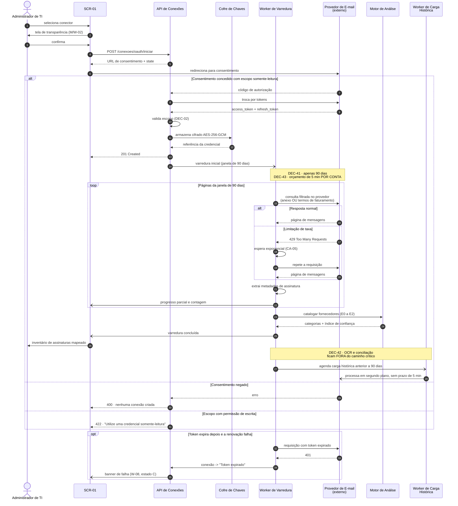
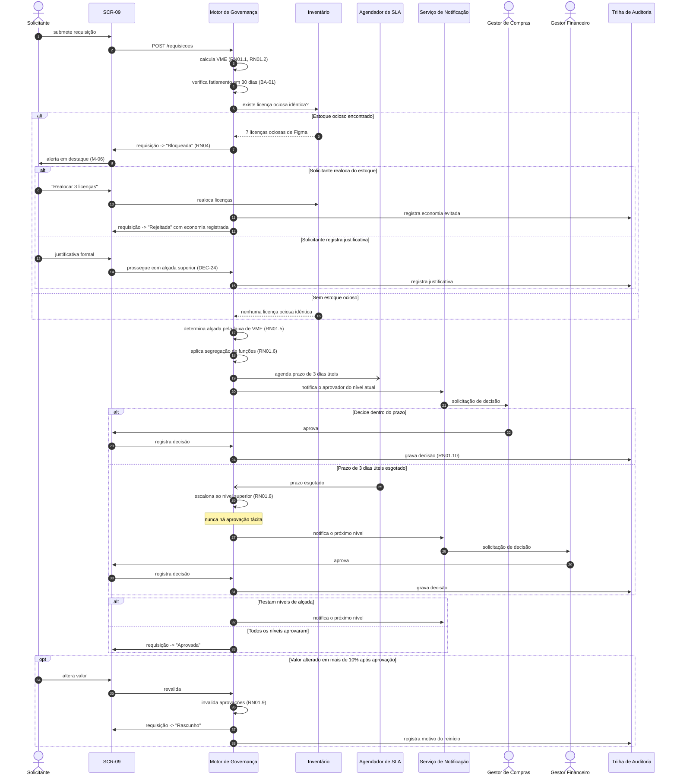
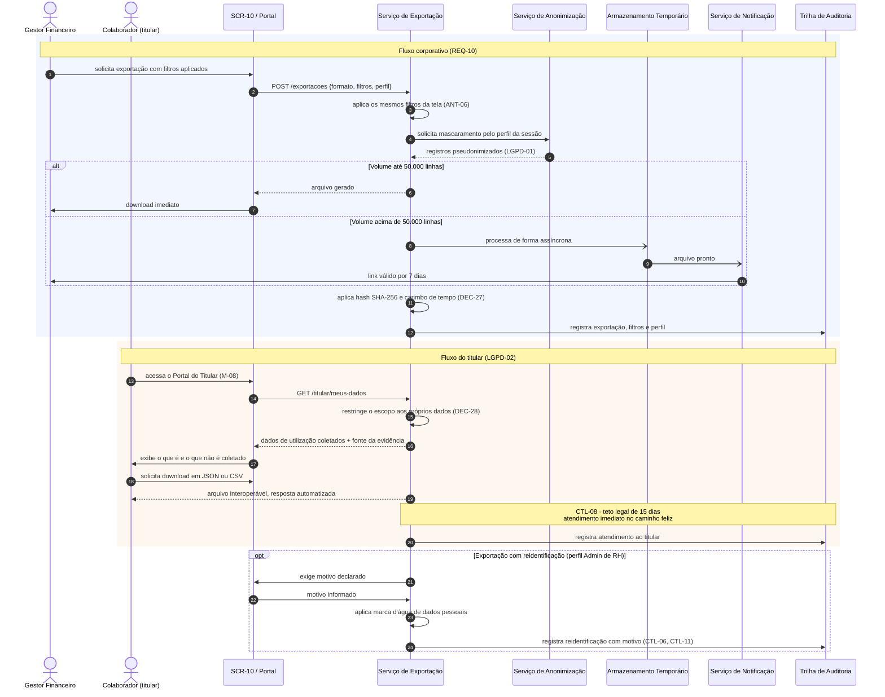
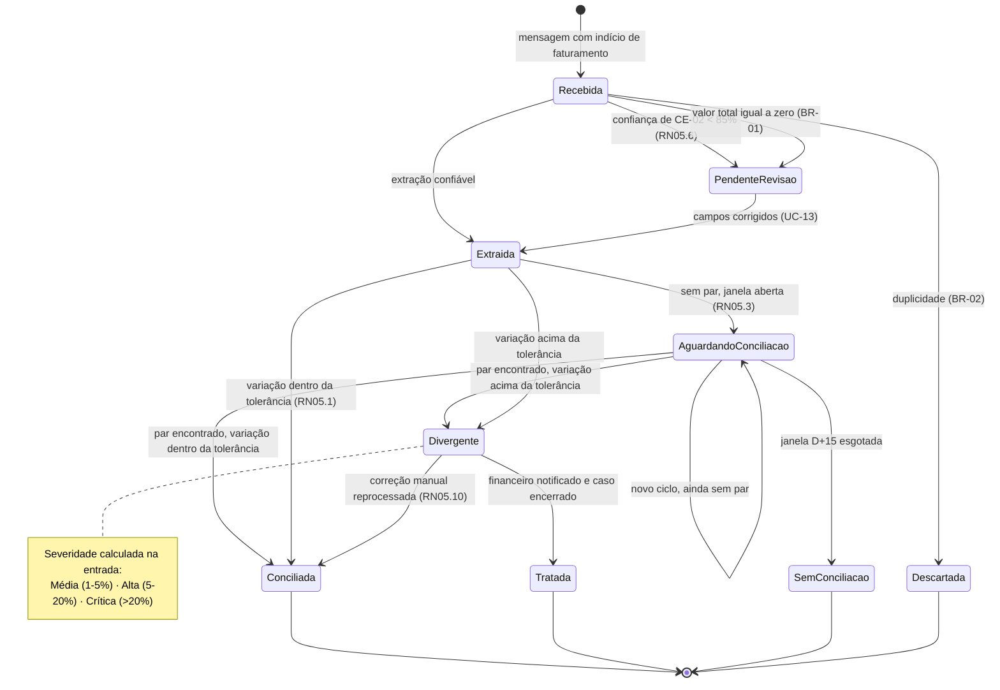
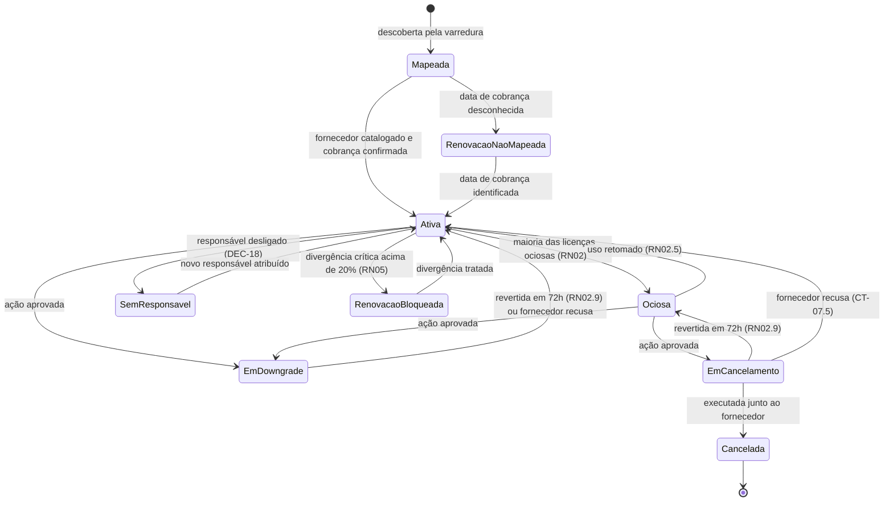
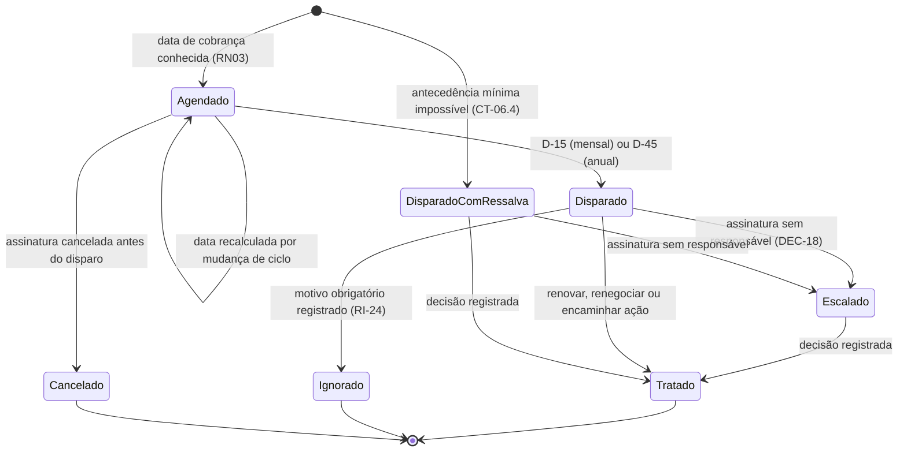

# 📐 Entregável 3 — Diagramas UML (Semana 05)

**Projeto:** Auditor e Otimizador de Assinaturas SaaS Corporativas
**Iteração:** Semana 05 (07/09/2026 – 13/09/2026)
**Responsáveis:** AR1 / AR2
**Versão:** 1.0.0 (Sequência — entrega formal) · 0.1.0 (Máquina de Estados — rascunho)

---

## 1. 📌 O que se aplica a esta iteração

Conforme a matriz de [`diagramasUML.md`](../diagramasUML.md):

| Diagrama | Janela | Entrega formal | Situação |
|:---|:---|:---|:---|
| **Sequência** | Semanas 4 e 5 | **Semana 5** | ✅ **Entrega formal — v1.0 com 4 interações** |
| **Máquina de Estados** | **Semanas 5 e 6** | Semana 6 | 🟡 Rascunho v0.1 — 5 máquinas consolidadas |
| Classes de Domínio | Semanas 6 e 7 | Semana 7 | ⬜ Inicia na Semana 6 |
| Pacotes / Componentes | Semana 7 | Semana 7 | ⬜ Fora do escopo |
| Implantação | Semanas 10 e 11 | Semana 11 | ⬜ Fora do escopo |

---

# PARTE I — Diagrama de Sequência (v1.0 · Entrega Formal)

## 2. 🔀 Mudanças em Relação ao Rascunho v0.1

| # | Mudança | Motivo |
|:---|:---|:---|
| S-01 | **SEQ-01:** listagem limitada à janela de 90 dias; carga histórica passa a mensagem assíncrona posterior | DEC-41 (validação do RNF-04) |
| S-02 | **SEQ-01:** OCR removido do caminho crítico da varredura inicial | DEC-42 |
| S-03 | **SEQ-01:** acrescentado tratamento de `429 Too Many Requests` com espera exponencial | CA-05 |
| S-04 | **SEQ-02:** `Serviço de OCR` passa a ser componente interno com adaptador para provedor externo | **P-19 resolvida — ver Seção 6** |
| S-05 | Acrescentado **SEQ-03** — aprovação de gastos com escalonamento por SLA | Previsto no fecho da Semana 04 |
| S-06 | Acrescentado **SEQ-04** — exportação e portabilidade do titular | Previsto no fecho da Semana 04 |

---

## 3. 🔗 SEQ-01 — Conexão OAuth e Varredura Inicial (v1.0)

**Requisitos:** REQ-01 · RNF-04 · CTL-03, CTL-12, CTL-13 · DEC-41, DEC-42, DEC-43



---

## 4. 🧾 SEQ-02 — Ingestão, OCR e Conciliação Assíncrona (v1.0)

**Requisitos:** REQ-02 · RN05.1 a RN05.10 · RNF-07 · LGPD-01

```mermaid
sequenceDiagram
    autonumber
    participant TIMER as Temporizador
    participant ING as Pipeline de Ingestão
    participant MAIL as Provedor de E-mail<br/>(externo)
    participant OCR as Serviço de OCR<br/>(interno)
    participant ACL as Adaptador de Provedor<br/>de OCR (ACL)
    participant EXT as Provedor de OCR<br/>(externo)
    participant DB as Repositório de Faturas
    participant CONC as Motor de Conciliação
    participant CARD as Emissor de Cartão<br/>(externo)
    participant NOTIF as Serviço de Notificação
    actor GF as Gestor Financeiro

    TIMER-)ING: ciclo de varredura
    ING->>MAIL: busca mensagens novas
    MAIL-->>ING: mensagens do período

    loop Para cada mensagem
        alt Sem anexo nem palavra-chave de faturamento
            ING->>ING: descarta em memória; incrementa contador anônimo
            Note over ING: RNF-07 · CTL-09 · nada persistido
        else Com indício de faturamento
            ING->>OCR: extrair campos do documento
            OCR->>ACL: solicita reconhecimento
            ACL->>EXT: chamada ao provedor
            EXT-->>ACL: texto e caixas delimitadoras
            ACL-->>OCR: modelo canônico (CE-01 a CE-09)
            Note over ACL: P-19 · ACL isola o domínio<br/>do contrato do fornecedor
            OCR-->>ING: campos + confiança por campo
            ING->>ING: descarta CPF; pseudonimiza nome (RN05.8)

            alt NF duplicada (CE-01 + CE-06)
                ING->>ING: descarta (BR-02)
            else Confiança de CE-02 abaixo de 85%
                ING->>DB: Fatura -> "Pendente de revisão"
                GF->>DB: corrige campos (UC-13)
                DB-)CONC: reprocessar (RN05.10)
            else Extração confiável
                ING->>DB: Fatura -> "Extraída (OCR)"
                DB-)CONC: conciliar
            end
        end
    end

    CONC->>CARD: lançamentos da janela D-5 a D+15
    CARD-->>CONC: lançamentos do período

    alt Sem par e janela aberta
        CONC->>DB: "Aguardando conciliação"
    else Janela esgotada sem par
        CONC->>DB: "Sem conciliação"
        CONC->>NOTIF: notifica Gestor Financeiro
    else Par encontrado
        CONC->>CONC: agrega parcelas (RN05.4)
        opt Moedas diferentes
            CONC->>CONC: PTAX + banda de IOF e spread (RN05.5)
        end
        CONC->>CONC: apura variação (RN05.2)
        alt Dentro da tolerância
            CONC->>DB: "Conciliada"
        else Acima da tolerância
            CONC->>DB: "Divergente" + severidade
            CONC->>NOTIF: notifica conforme severidade
            NOTIF->>GF: e-mail com valores e percentual (15 min)
            GF->>DB: analisa NF x lançamento (M-02)
            opt Erro de leitura
                GF->>DB: corrige valor
                DB-)CONC: reprocessa (RN05.10)
            end
        end
    end

    CONC->>DB: registra na trilha imutável (RN05.9 · CTL-11)
```

---

## 5. ✅ SEQ-03 — Aprovação de Gastos com Escalonamento

**Requisitos:** REQ-09 · RN01.1 a RN01.10 · RN04 · CTL-11, CTL-12



---

## 6. 📤 SEQ-04 — Exportação e Portabilidade do Titular

**Requisitos:** REQ-10 · LGPD-01, LGPD-02 · CTL-07, CTL-08, CTL-15 · DEC-26, DEC-27, DEC-28



---

## 7. 🔧 Resolução da Pendência P-19 — Natureza do Serviço de OCR

> **P-19 (Semana 04):** *"Definir se o serviço de OCR é componente interno ou fornecedor externo."*

**Decisão (DEC-46):** o OCR é um **serviço de domínio interno com adaptador para provedor
externo**, implementado como camada anticorrupção (*Anticorruption Layer* — ACL).

| Alternativa | Consequência | Avaliação |
|:---|:---|:---|
| Componente puramente interno | Exige treinar e manter modelo próprio de reconhecimento; alto custo, fora do *core domain* | ❌ Rejeitada |
| Chamada direta ao provedor externo | O contrato do fornecedor vaza para o domínio; trocar de provedor exige mexer no pipeline | ❌ Rejeitada |
| **Serviço interno + adaptador (ACL)** | O domínio conhece apenas `CE-01` a `CE-09`; o adaptador traduz o contrato do fornecedor | ✅ **Adotada** |

**Consequências para os próximos artefatos:**

1. O `Serviço de OCR` é um **Supporting Domain** no Diagrama de Pacotes da Semana 07.
2. O adaptador é a ACL que a Fase 2 de `diagramasUML.md` prevê representar.
3. O provedor externo de OCR entra no Diagrama de Implantação da Semana 11 como dependência
   de terceiro, com sua própria consideração de conformidade (transferência de dados —
   CTL-14, pendência P-04).
4. O modelo canônico `CE-01` a `CE-09` do
   [Entregável 2 da Semana 02](../semana-02/entregavel-02-matriz-regras-ocr-divergencia-rn05.md)
   é o contrato do adaptador.

---

## 8. 🔗 Rastreabilidade dos Diagramas de Sequência

| Diagrama | Casos de uso | Atividade | Regras principais |
|:---|:---|:---|:---|
| SEQ-01 | UC-01 | — | RNF-04, CTL-13, DEC-02, DEC-41 a DEC-43 |
| SEQ-02 | UC-02, UC-13 | AT-01 | RN05.1 a RN05.10, RNF-07, LGPD-01 |
| SEQ-03 | UC-09 | AT-02 | RN01.1 a RN01.10, RN04, CTL-11 |
| SEQ-04 | UC-10, UC-11, UC-12 | — | LGPD-01, LGPD-02, CTL-07, CTL-08, CTL-15 |

**Cobertura:** os 4 diagramas cobrem 6 dos 13 casos de uso — precisamente aqueles com
**interação temporal ou integração externa**. Os 7 restantes (UC-03 a UC-08, UC-14 absorvido)
são operações de leitura ou de estado, mais bem representadas pelos diagramas de Atividades e
de Máquina de Estados.

---

# PARTE II — Diagrama de Máquina de Estados (v0.1 · Rascunho)

## 9. 🎯 Escopo

`diagramasUML.md` define o objetivo de *"mapear estados finitos, gatilhos de transição e
condições de guarda das entidades centrais"*, citando explicitamente a máquina de
`AssinaturaSaaS`. Consolidam-se aqui as **três máquinas já esboçadas** nas iterações
anteriores e acrescentam-se as **duas que faltavam**:

| Entidade | Origem do esboço | Situação |
|:---|:---|:---|
| `Fatura` | Semana 02, AI Seção 3.1 | 🟡 Consolidada abaixo |
| `Licença` | Semana 03, Entregável 2 Seção 10 | 🟡 Já formalizada — referência cruzada |
| `Requisição` | Semana 03, Entregável 2 Seção 5 | 🟡 Já formalizada — referência cruzada |
| **`Assinatura`** | — | 🆕 **Nova nesta iteração** |
| **`Alerta`** | — | 🆕 **Nova nesta iteração** |

## 10. 🧾 Máquina de Estados — `Fatura`



## 11. 📦 Máquina de Estados — `Assinatura` *(nova)*



## 12. 🔔 Máquina de Estados — `Alerta` *(nova)*



## 13. 🔗 Referências Cruzadas das Máquinas já Formalizadas

| Entidade | Documento | Seção |
|:---|:---|:---|
| `Licença` | [Semana 03 — Entregável 2](../semana-03/entregavel-02-fluxo-aprovacao-gastos-rn01-trava-inatividade-rn02.md) | 10 |
| `Requisição` | [Semana 03 — Entregável 2](../semana-03/entregavel-02-fluxo-aprovacao-gastos-rn01-trava-inatividade-rn02.md) | 5 |

## 14. 📊 Consolidação de Estados do Sistema

| Entidade | Estados | Estados terminais | Guardas |
|:---|:---:|:---:|:---:|
| `Fatura` | 9 | 4 | 6 |
| `Licença` | 8 | 1 | 7 |
| `Requisição` | 7 | 4 | 5 |
| `Assinatura` | 9 | 1 | 8 |
| `Alerta` | 7 | 3 | 4 |
| **Total** | **40** | **13** | **30** |

---

## 15. 📋 Pendências para a Semana 06

1. **Entrega formal do Diagrama de Máquina de Estados** — revisar as 5 máquinas, verificar
   alcançabilidade de todos os estados e ausência de estados-armadilha.
2. Gerar as **imagens oficiais** dos 4 diagramas de sequência e das 5 máquinas.
3. Verificar consistência entre a máquina de `Assinatura` e a de `Licença`: uma assinatura
   `Ociosa` exige uma proporção mínima de licenças ociosas que ainda não foi definida.
4. **Iniciar o Diagrama de Classes de Domínio**, derivando entidades e *value objects* do
   inventário de objetos da Semana 01 e dos campos `CE-01` a `CE-09`.
5. Levar à homologação do cliente os **20 parâmetros** consolidados na Seção 10 do
   [Relatório de Validação](entregavel-02-relatorio-validacao-rnf04-rnf10.md).
