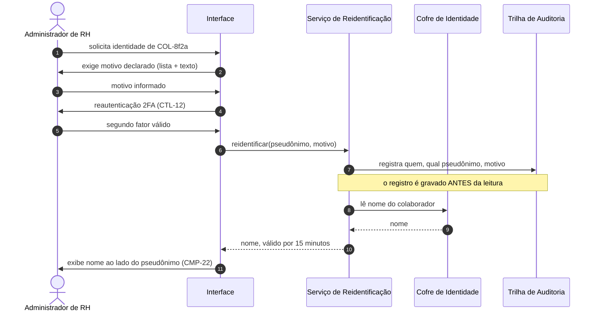

# Entregável 2 — Dicionário de Dados e Regras de Anonimização de Colaboradores (LGPD-01)

**Projeto:** Auditor e Otimizador de Assinaturas SaaS Corporativas  
**Iteração:** Semana 06 (14/09/2026 – 20/09/2026)  
**Responsáveis:** AR1 / AR2 (Analistas de Requisitos)  
**Versão:** 1.0.0  
**Escopo normativo:** LGPD-01 · LGPD-02 · RNF-01 · RNF-02 · RNF-07 · RN02.10 · CTL-01 a CTL-15  

---

## 1. Objetivo

A Matriz de Conformidade da Semana 01 fixou um critério de aceite para esta iteração: *"o
dicionário de dados da Semana 6 (LGPD-01) deve ser gerado a partir do inventário da Seção 3"*.
Este documento cumpre esse critério em quatro partes:

| Parte | Conteúdo | Pergunta que responde |
|:---|:---|:---|
| **A** | Convenções, classificação e inventário de dados pessoais atualizado | *Que dado é sensível e quanto?* |
| **B** | Dicionário das 24 entidades do domínio | *Que campo existe, de onde vem e como é protegido?* |
| **C** | Regras de anonimização e pseudonimização (`AN-01` a `AN-14`) | *Como a LGPD-01 vira comportamento verificável?* |
| **D** | Chaves, retenção, verificações e glossário | *Como se prova que as regras valem?* |

Ficam resolvidas também a **P-02** (política de rotação de chaves, Seção 17) e a **P-14**
(licenças *floating*, Seção 8.3), e é entregue o rascunho que destrava a **P-17** (resumo de
conformidade, Seção 20).

---

# PARTE A — Convenções e Classificação

## 2. Leitura Operacional da LGPD-01

> **LGPD-01:** *"O sistema deve aplicar técnicas de anonimização ou pseudonimização nos nomes e
> CPFs de colaboradores contidos nas notas fiscais e relatórios corporativos, mantendo visíveis
> apenas o setor e o custo da licença, exceto para o administrador de RH indicado."*

| Trecho do enunciado | Leitura adotada | Regra |
|:---|:---|:---|
| *"anonimização ou pseudonimização"* | As duas técnicas, em camadas distintas: **pseudonimização** em toda visão por linha; **anonimização** (agregação com k ≥ 5) nas visões agregadas | AN-05, AN-07 |
| *"nomes e CPFs"* | Nome é pseudonimizado. CPF **não é tratado de forma alguma**: não há finalidade (DP-03), então é descartado antes da persistência — vai além da exigência | AN-01, AN-02 |
| *"contidos nas notas fiscais"* | Inclui a **imagem** da nota, não só os campos extraídos: o arquivo guardado é uma cópia redigida | AN-03 |
| *"e relatórios corporativos"* | Telas, PDF e XLSX herdam a máscara da sessão que os gerou | AN-10 (CTL-15) |
| *"mantendo visíveis apenas o setor e o custo"* | Setor e custo ficam em claro; o setor, porém, é generalizado quando identifica um grupo pequeno | AN-08 |
| *"exceto para o administrador de RH indicado"* | Único papel com reidentificação, mediante motivo declarado, reautenticação e registro | AN-12 (CTL-06) |

**Distinção jurídica que orienta todo o documento (DEC-58).** A LGPD só exclui do seu escopo o
dado **anonimizado** (Art. 12), isto é, aquele que não pode ser revertido por meios razoáveis. A
lei descreve a pseudonimização (Art. 13, §4º, no contexto de estudos em saúde pública) como o
tratamento em que a associação ao titular só é possível com informação adicional mantida em
separado — exatamente o caso do pseudônimo, que quem tem a chave consegue reverter. Dado
pseudonimizado, portanto, continua sendo dado pessoal, sujeito a base legal, retenção e direitos
do titular. Somente o dado anonimizado sai do escopo da lei — no produto, isso vale apenas para agregados que respeitam o
limiar k = 5. Tratar o pseudônimo `COL-8f2a` como "dado anônimo" seria um erro de conformidade.

---

## 3. Convenções do Dicionário

| Aspecto | Convenção |
|:---|:---|
| Nome lógico | Termo da Linguagem Onipresente, em português (`Licença`, `Fatura`) |
| Nome físico | `snake_case` em português, sem acento (`licenca`, `fatura`); a trilha mantém o nome já fixado no CTL-11: `audit_log` |
| Identificador | `UUID` em todas as entidades, exceto as de chave composta natural — `ENT-11`, `ENT-12` (chave `licenca_id` + data) e `ENT-14` (chave `fatura_id` + `campo` + `versao`); `tenant_id` obrigatório em todas, exceto `Tenant` (CTL-10) |
| Monetário | `Decimal(15,2)` + moeda ISO 4217 em campo próprio — nunca ponto flutuante |
| Percentual | `Decimal(7,2)`, arredondamento `ROUND_HALF_UP` (RN05.2) |
| Confiança | `Decimal(4,3)` entre 0 e 1 (exibida como inteiro arredondado para baixo — Entregável 1, Seção 5.1) |
| Data e hora | Armazenada em UTC; exibida em `America/Sao_Paulo` |
| Data de uso | **Resolução diária** (`Date`), nunca instante — regra AN-06 |
| Enumeração de estado | Valores idênticos aos nomes das máquinas de estado v1.0 ([Entregável 3](entregavel-03-diagramas-uml.md)) |
| Imutabilidade | Entidades marcadas *append-only* não admitem `UPDATE` nem `DELETE` pela aplicação |

### 3.1. Classes de dado

| Classe | Nome | Definição | Proteção mínima |
|:---|:---|:---|:---|
| **CLS-0** | Público | Informação disponível publicamente | Nenhuma além do controle de acesso por tenant |
| **CLS-1** | Interno | Metadado operacional sem valor financeiro nem pessoal | Isolamento por `tenant_id` |
| **CLS-2** | Confidencial corporativo | Valores, contratos e documentos fiscais do cliente | Cifra em coluna AES-256-GCM com a DEK do tenant (CTL-01) |
| **CLS-3** | Pessoal pseudonimizado | Dado de colaborador vinculado a pseudônimo | Pseudônimo HMAC (AN-05) + cifra em coluna quando houver data de uso |
| **CLS-4** | Pessoal identificado | Nome e e-mail de colaborador | **Somente no Cofre de Identidade** (ENT-04), com chave própria (CH-04) |
| **CLS-5** | Segredo | Credencial de integração | **Somente no cofre de chaves** (CTL-03); o banco guarda apenas a referência |
| **NP** | Não persistido | Dado sem finalidade | Descartado em memória antes de qualquer gravação |

**Códigos de proteção usados no dicionário:** `CL` em claro · `CR` cifrado em coluna ·
`HM` pseudônimo HMAC · `CI` Cofre de Identidade · `VT` cofre de chaves · `NP` não persistido ·
`AO` *append-only*.

---

## 4. Inventário de Dados Pessoais Atualizado

O inventário `DP-01` a `DP-06` da Semana 01 é mantido e ampliado com **quatro dados que as
iterações seguintes trouxeram** e que o inventário original não previa.

| ID | Dado pessoal | Origem | Finalidade | Base legal | Retenção | Tratamento |
|:---|:---|:---|:---|:---|:---|:---|
| DP-01 | Nome do colaborador | FT-02, FT-03 | Vincular licença a pessoa (apenas Admin de RH) | Art. 7º, IX | 12 meses após o encerramento da última licença ¹ | CLS-4 · Cofre de Identidade |
| DP-02 | E-mail corporativo | FT-02 | Chave de identidade da licença | Art. 7º, IX | Idem DP-01 ¹ | CLS-4 · origem do pseudônimo HMAC (AN-05) |
| DP-03 | CPF em nota fiscal | FT-03, FT-05 | Nenhuma | — | **Não persistido** | NP · AN-01, AN-03 |
| DP-04 | Setor / centro de custo | FT-05 | Rateio de custo | Art. 7º, IX | 60 meses | CL · generalizado por AN-08 |
| DP-05 | Eventos de uso (último acesso) | FT-02 | Apurar ociosidade (RN02) | Art. 7º, IX | 90 dias brutos, depois agregado diário | CLS-3 · AN-06 |
| DP-06 | Corpo de e-mail | FT-03, FT-04 | Nenhuma | — | **Não persistido** (RNF-07) | NP · CTL-09 |
| **DP-07** ● | Período de afastamento | Integração de RH | Suspender a contagem da RN02.6 | Art. 7º, IX | 30 dias após o fim do afastamento | CLS-3 · **sem o motivo** (AN-09) |
| **DP-08** ● | Identidade de usuário operador (nome, e-mail, papel) | Cadastro na plataforma | Autenticação e responsabilização por decisões | Art. 7º, IX | Enquanto a conta existir + trilha | CLS-4 parcial · exibido em decisões (AN-13) |
| **DP-09** ● | Registro de ação de operador na trilha | Aplicação | Auditoria de aprovações, cancelamentos e reidentificações (CTL-11) | Art. 7º, II (obrigação legal) e IX | 60 meses ² | AO · CLS-2 |
| **DP-10** ● | Nome do portador do cartão corporativo | FT-01 | Nenhuma — a conciliação usa valor, data e estabelecimento | — | **Não importado** | NP · AN-04 |

> ¹ A Semana 01 fixou "12 meses" sem marco inicial. Adota-se o encerramento da última licença
> do colaborador, porque antes disso o dado ainda tem finalidade ativa. Validação com o DPO:
> **P-26**.  
> ² Prazo proposto em analogia ao prazo decadencial de documentos fiscais (5 anos), a homologar:
> **P-28**.

---

# PARTE B — Dicionário de Entidades

## 5. Visão Geral das Entidades

| ID | Entidade | Nome físico | Contexto | Classe dominante | Seção |
|:---|:---|:---|:---|:---|:---|
| ENT-01 | Tenant | `tenant` | Governança | CLS-1 | 6.1 |
| ENT-02 | Usuário | `usuario` | Governança | CLS-4 parcial | 6.2 |
| ENT-03 | Colaborador | `colaborador` | Identidade | CLS-3 | 6.3 |
| ENT-04 | Identidade de Colaborador | `identidade_colaborador` | Identidade (cofre) | **CLS-4** | 6.4 |
| ENT-05 | Afastamento | `afastamento` | Identidade | CLS-3 | 6.5 |
| ENT-06 | Conexão | `conexao` | Integração | CLS-1 / CLS-5 ref. | 7.1 |
| ENT-07 | Fornecedor SaaS | `fornecedor_saas` | Catálogo | CLS-0 / CLS-1 | 7.2 |
| ENT-08 | Assinatura | `assinatura` | Inventário | CLS-2 | 8.1 |
| ENT-09 | Licença | `licenca` | Inventário | CLS-3 | 8.2 |
| ENT-10 | Pool de Licenças | `pool_licencas` | Inventário | CLS-2 | 8.3 |
| ENT-11 | Evento de Uso | `evento_uso` | Telemetria | CLS-3 | 8.4 |
| ENT-12 | Uso Diário Agregado | `uso_diario` | Telemetria | CLS-3 | 8.4 |
| ENT-13 | Fatura | `fatura` | Conciliação | CLS-2 | 9.1 |
| ENT-14 | Campo Extraído | `campo_extraido` | Conciliação | CLS-2 | 9.2 |
| ENT-15 | Lançamento de Cartão | `lancamento_cartao` | Conciliação | CLS-2 | 9.3 |
| ENT-16 | Conciliação | `conciliacao` | Conciliação | CLS-2 | 9.4 |
| ENT-17 | Sinal de Desperdício | `sinal_desperdicio` | Motor | CLS-1 | 10.1 |
| ENT-18 | Recomendação | `recomendacao` | Motor | CLS-2 | 10.2 |
| ENT-19 | Alerta de Renovação | `alerta` | Gestão | CLS-2 | 11.1 |
| ENT-20 | Requisição | `requisicao` | Gestão | CLS-2 | 11.2 |
| ENT-21 | Ação sobre Assinatura | `acao_assinatura` | Gestão | CLS-2 | 11.3 |
| ENT-22 | Decisão de Aprovação | `decisao_aprovacao` | Gestão | CLS-2 · AO | 11.4 |
| ENT-23 | Exportação | `exportacao` | Governança | CLS-2 | 12.1 |
| ENT-24 | Solicitação do Titular | `solicitacao_titular` | Governança | CLS-3 | 12.2 |
| — | Trilha de Auditoria | `audit_log` | Governança | CLS-2 · AO | 12.3 |

> O **Contexto** antecipa os *Bounded Contexts* do Diagrama de Pacotes da Semana 07 e é
> coerente com a DEC-46 (OCR como serviço interno com ACL dentro do contexto de Conciliação).

---

## 6. Governança e Identidade

### 6.1. ENT-01 — Tenant

| Campo | Tipo | Obrig. | Domínio / regra | Classe | Proteção | Origem |
|:---|:---|:---:|:---|:---|:---|:---|
| `tenant_id` | UUID | Sim | Chave de isolamento de todas as entidades | CLS-1 | CL | Sistema |
| `razao_social` | Texto(200) | Sim | Empresa cliente (controladora — DEC-01) | CLS-0 | CL | Cadastro |
| `cnpj` | Texto(14) | Sim | Somente dígitos | CLS-0 | CL | Cadastro |
| `regiao_dados` | Enum | Sim | Região de armazenamento selecionada (CTL-14) | CLS-1 | CL | Cadastro |
| `dek_ref` | Texto | Sim | Referência à DEK vigente no KMS (CH-02) | CLS-5 | VT | KMS |
| `chave_pseudonimo_ref` | Texto | Sim | Referência à chave HMAC do tenant (CH-03) | CLS-5 | VT | KMS |
| `limiar_k` | Inteiro | Sim | Limiar de supressão de agregados; padrão **5** (RN02.10) | CLS-1 | CL | Parâmetro |

### 6.2. ENT-02 — Usuário (operador da plataforma)

| Campo | Tipo | Obrig. | Domínio / regra | Classe | Proteção | Origem |
|:---|:---|:---:|:---|:---|:---|:---|
| `usuario_id` | UUID | Sim | — | CLS-1 | CL | Sistema |
| `nome_exibicao` | Texto(120) | Sim | Exibido em decisões e linhas do tempo (AN-13) | CLS-4 | CR | Cadastro (DP-08) |
| `email` | Texto(254) | Sim | Login | CLS-4 | CR | Cadastro (DP-08) |
| `papeis` | Lista de Enum | Sim | `CFO`, `GestorFinanceiro`, `AdminTI`, `AdminRH`, `GestorCompras`, `AuditorExterno` | CLS-1 | CL | Cadastro |
| `doisfa_ativo` | Booleano | Sim | Obrigatório `true` para AdminTI, CFO e AdminRH (CTL-12) | CLS-1 | CL | Sistema |
| `colaborador_id` | UUID | Não | Vínculo com o próprio registro de colaborador, quando houver | CLS-3 | CL | Sistema |

> **Usuário ≠ Colaborador** (AI da Semana 01, Seção 7). *Usuário* opera o app e responde pelas
> próprias decisões; *colaborador* é o titular dos dados de uso. A mesma pessoa pode ser as
> duas coisas — e o vínculo `colaborador_id` **nunca** é exibido a outros papéis.

### 6.3. ENT-03 — Colaborador

| Campo | Tipo | Obrig. | Domínio / regra | Classe | Proteção | Origem |
|:---|:---|:---:|:---|:---|:---|:---|
| `colaborador_id` | UUID | Sim | Chave interna, nunca exibida | CLS-3 | CL | Sistema |
| `pseudonimo_digest` | Texto(64) | Sim | HMAC-SHA-256 completo, em hexadecimal (AN-05) | CLS-3 | HM | Calculado |
| `pseudonimo_exibicao` | Texto(68) | Sim | `COL-` + menor prefixo único, mínimo de 4 caracteres, até os 64 do digest no pior caso; estável após atribuído | CLS-3 | HM | Calculado |
| `setor` | Texto(80) | Sim | Centro de custo (DP-04); exibido conforme AN-08 | CLS-1 | CL | FT-05 |
| `situacao` | Enum | Sim | `Ativo`, `Afastado`, `Desligado` — alimenta `Órfã` (BI-06) | CLS-3 | CL | FT-02 / RH |
| `desligado_em` | Data | Não | Marco da contagem de retenção do DP-01 | CLS-3 | CR | RH |

### 6.4. ENT-04 — Identidade de Colaborador (Cofre de Identidade)

Armazenamento **fisicamente separado** do banco da aplicação, cifrado com chave própria (CH-04)
e acessível **exclusivamente** pelo Serviço de Reidentificação (AN-12).

| Campo | Tipo | Obrig. | Domínio / regra | Classe | Proteção | Origem |
|:---|:---|:---:|:---|:---|:---|:---|
| `colaborador_id` | UUID | Sim | Mesma chave de ENT-03 | CLS-3 | CL | Sistema |
| `nome` | Texto(200) | Não | DP-01 | **CLS-4** | CI | FT-02, FT-03 |
| `email_normalizado` | Texto(254) | Sim | DP-02; minúsculas, sem subendereço `+tag` | **CLS-4** | CI | FT-02 |
| `ultima_reidentificacao_em` | Data/hora | Não | Espelho do último evento em `audit_log` | CLS-1 | CL | Sistema |

### 6.5. ENT-05 — Afastamento

| Campo | Tipo | Obrig. | Domínio / regra | Classe | Proteção | Origem |
|:---|:---|:---:|:---|:---|:---|:---|
| `afastamento_id` | UUID | Sim | — | CLS-1 | CL | Sistema |
| `colaborador_id` | UUID | Sim | — | CLS-3 | CL | RH |
| `inicio` | Data | Sim | Suspende a contagem da RN02.6 | CLS-3 | CR | RH |
| `fim` | Data | Não | Vazio enquanto o afastamento durar | CLS-3 | CR | RH |
| ~~`motivo`~~ | — | — | **Não existe** — ver AN-09 | NP | NP | — |

---

## 7. Integração e Catálogo

### 7.1. ENT-06 — Conexão

| Campo | Tipo | Obrig. | Domínio / regra | Classe | Proteção | Origem |
|:---|:---|:---:|:---|:---|:---|:---|
| `conexao_id` | UUID | Sim | — | CLS-1 | CL | Sistema |
| `fonte` | Enum | Sim | `FT-01` a `FT-07` | CLS-1 | CL | Cadastro |
| `escopo_concedido` | Lista de texto | Sim | Deve ser somente-leitura; escopo de escrita é recusado com 422 (DEC-02, SEQ-01) | CLS-1 | CL | OAuth |
| `credencial_ref` | Texto | Sim | Referência no cofre; **o segredo nunca fica no banco** (CTL-03) | CLS-5 | VT | Cofre |
| `credencial_sufixo` | Texto(4) | Não | Últimos 4 caracteres para exibição `****-3f9a` (CT-01.3) | CLS-1 | CL | Cofre |
| `estado` | Enum | Sim | Máquina `Conexão` v1.0 | CLS-1 | CL | Sistema |
| `ultima_varredura_ok_em` | Data/hora | Não | Exibida no banner de falha (W-08 C) | CLS-1 | CL | Sistema |
| `mensagens_descartadas` | Inteiro | Sim | **Contador anônimo** de mensagens sem indício (RNF-07, IN-08) | CLS-1 | CL | Pipeline |

### 7.2. ENT-07 — Fornecedor SaaS

| Campo | Tipo | Obrig. | Domínio / regra | Classe | Proteção | Origem |
|:---|:---|:---:|:---|:---|:---|:---|
| `fornecedor_id` | UUID | Sim | — | CLS-1 | CL | Sistema |
| `nome_canonico` | Texto(200) | Sim | Resultado de E0/E1 | CLS-0 | CL | Motor |
| `cnpj_raiz` | Texto(8) | Não | Desambiguação (CE-06) | CLS-0 | CL | CE-06 |
| `grafias_alternativas` | Lista de texto | Não | Consolidação com desfazer (DEC-14) | CLS-0 | CL | Motor |
| `categoria` | Enum | Sim | `C-01` a `C-12` | CLS-0 | CL | Motor E2 |
| `origem_categoria` | Enum | Sim | `BaseCurada`, `ModeloIA`, `AjusteManual` | CLS-1 | CL | Motor E2 |
| `confianca_identificacao` | Decimal(4,3) | Sim | Limiar de E1 (0,88) | CLS-1 | CL | Motor E1 |
| `confianca_classificacao` | Decimal(4,3) | Sim | Limiar de publicação de E2: **0,80** (DEC-44) | CLS-1 | CL | Motor E2 |
| `pendente_revisao` | Booleano | Sim | `true` impede entrada em recomendações (CT-03.2) | CLS-1 | CL | Motor |

> **Pessoa física como emitente.** Se o documento do emitente for um CPF (prestador individual
> ou MEI identificado por CPF), ele é tratado como DP-03 e descartado; o fornecedor é catalogado
> apenas pela razão social e marcado para revisão. Regra AN-02.

---

## 8. Inventário e Telemetria

### 8.1. ENT-08 — Assinatura

| Campo | Tipo | Obrig. | Domínio / regra | Classe | Proteção | Origem |
|:---|:---|:---:|:---|:---|:---|:---|
| `assinatura_id` | UUID | Sim | — | CLS-1 | CL | Sistema |
| `fornecedor_id` | UUID | Sim | — | CLS-1 | CL | Motor |
| `plano` | Texto(120) | Não | Atributo, não sinônimo de assinatura (AI, Seção 7) | CLS-2 | CR | E3 / fatura |
| `ciclo` | Enum | Sim | `Mensal`, `Anual`, `Bienal`, `PagamentoUnico` | CLS-2 | CR | CE-08 |
| `valor_ciclo` | Decimal(15,2) | Sim | Valor contratado por ciclo | CLS-2 | **CR** | Fatura |
| `moeda` | ISO 4217 | Sim | — | CLS-2 | CR | CE-03 |
| `proxima_cobranca` | Data | Não | Vazia ⇒ região `RenovacaoNaoMapeada` | CLS-2 | CR | Fatura / ERP |
| `responsavel_usuario_id` | UUID | Não | Vazio ⇒ `SemResponsavel` (DEC-18) | CLS-1 | CL | Cadastro |
| `tipo_licenciamento` | Enum | Sim | `Nominal` ou `Pool` (DEC-56) | CLS-1 | CL | Cadastro / E3 |
| `estado` | Enum | Sim | Estado de topo da máquina `Assinatura` v1.0: `Mapeada`, `Vigente`, `Descartada`, `Cancelada` | CLS-1 | CL | Sistema |
| `estado_uso` · `estado_telemetria` · `estado_renovacao` · `estado_responsavel` | Enum | Não | As quatro regiões ortogonais do estado `Vigente`; preenchidas apenas quando `estado = Vigente` | CLS-1 | CL | Sistema |
| `cobertura_telemetria` | Decimal(5,2) | Sim | % de licenças com fonte E1, E2 ou E3 (RN02.4) | CLS-1 | CL | Calculado |

### 8.2. ENT-09 — Licença (nominal)

| Campo | Tipo | Obrig. | Domínio / regra | Classe | Proteção | Origem |
|:---|:---|:---:|:---|:---|:---|:---|
| `licenca_id` | UUID | Sim | Posto (*seat*) estável; o titular pode mudar por realocação (RN04) | CLS-1 | CL | FT-02 |
| `assinatura_id` | UUID | Sim | Apenas assinaturas com `tipo_licenciamento = Nominal` | CLS-1 | CL | Sistema |
| `colaborador_id` | UUID | Não | Vazio quando o posto está livre | CLS-3 | CL | FT-02 |
| `provisionada_em` | Data | Sim | Marco inicial da RN02.3 | CLS-3 | CR | FT-02 |
| `ultimo_evento_em` | Data | Não | **Resolução diária** (AN-06) | CLS-3 | CR | ENT-12 |
| `nivel_evidencia` | Enum | Sim | `E1`, `E2`, `E3`, `Nenhuma` (DEC-15) | CLS-1 | CL | FT-02 |
| `sazonal` | Booleano | Sim | `true` amplia a janela para 120 dias (BI-02) | CLS-1 | CL | Cadastro |
| `estado` | Enum | Sim | Máquina `Licença` v1.0 | CLS-3 | CL | Sistema |

> `dias_sem_uso` e a ação graduada (RN02.8) são **derivados** de `ultimo_evento_em` na
> consulta — não são armazenados, para não haver dois valores divergentes.

### 8.3. ENT-10 — Pool de Licenças (*floating*) — resolução da P-14

O caso de borda BI-09 (Semana 03) estabeleceu que licenças compartilhadas são *"apuradas por
pool, não por colaborador"*, mas não definiu **como**. Fica definido (**DEC-56**):

| Campo | Tipo | Obrig. | Domínio / regra | Classe | Proteção | Origem |
|:---|:---|:---:|:---|:---|:---|:---|
| `pool_id` | UUID | Sim | — | CLS-1 | CL | Sistema |
| `assinatura_id` | UUID | Sim | Assinatura com `tipo_licenciamento = Pool` | CLS-1 | CL | Sistema |
| `capacidade` | Inteiro | Sim | Número de acessos simultâneos contratados | CLS-2 | CL | Contrato / E3 |
| `pico_concorrente_30d` | Inteiro | Sim | Maior número de sessões simultâneas nos últimos 30 dias | CLS-1 | CL | Telemetria E1 |
| `capacidade_ociosa` | Inteiro | — | Derivado: `capacidade − pico_concorrente_30d` | CLS-1 | — | Calculado |

**Regras de apuração do pool:**

1. A ociosidade é medida em **capacidade**, não em pessoas: um pool de 20 acessos com pico de
   12 tem **8 acessos ociosos**, elegíveis a REC-01 (reduzir assentos).
2. O pool **não tem estado por colaborador**: a máquina `Licença` não se aplica a ele, e
   nenhum dado de uso individual é apurado — a solução é também a mais aderente à LGPD-01.
3. O pool só é avaliado com telemetria de concorrência (E1). Com apenas E2 (login), a
   assinatura fica em `SemTelemetria` para fins de pool: login não informa simultaneidade.
4. A assinatura de pool assume `Ociosa` quando `pico_concorrente_30d = 0` (DEC-61 do
   Entregável 3, aplicada ao pool).
5. A janela de 30 dias acompanha a RN02.1; pools sazonais seguem a janela de 120 dias (BI-02).

### 8.4. ENT-11 e ENT-12 — Evento de Uso e Uso Diário Agregado

| Entidade | Campo | Tipo | Domínio / regra | Classe | Proteção |
|:---|:---|:---|:---|:---|:---|
| ENT-11 Evento de Uso | `licenca_id` | UUID | — | CLS-3 | CL |
| | `ocorrido_em` | Data/hora | Instante bruto do evento | CLS-3 | CR |
| | `nivel_evidencia` | Enum | `E1`, `E2`, `E3` | CLS-1 | CL |
| | `automatizado` | Booleano | `true` não conta como uso humano (BI-10) | CLS-1 | CL |
| | *retenção* | — | **90 dias**, depois apagado (DP-05) | — | — |
| ENT-12 Uso Diário | `licenca_id` | UUID | — | CLS-3 | CL |
| | `dia` | Data | Resolução diária | CLS-3 | CR |
| | `houve_uso_qualificado` | Booleano | Único dado que a RN02 precisa | CLS-3 | CL |
| | *retenção* | — | Enquanto a licença existir + 12 meses | — | — |

> A agregação diária guarda **se** houve uso, não **quanto** nem **a que horas**. Quantidade e
> horário são exatamente o que permitiria avaliar desempenho individual, vedado pela RN02.10.

---

## 9. Conciliação

### 9.1. ENT-13 — Fatura

| Campo | Tipo | Obrig. | Domínio / regra | Classe | Proteção | Origem |
|:---|:---|:---:|:---|:---|:---|:---|
| `fatura_id` | UUID | Sim | — | CLS-1 | CL | Sistema |
| `conexao_id` | UUID | Sim | Fonte de ingestão | CLS-1 | CL | Pipeline |
| `chave_deduplicacao` | Texto(64) | Sim | Hash de `CE-01 + CE-06` (BR-02) | CLS-1 | CL | Calculado |
| `documento_redigido_ref` | Texto | Sim | Arquivo armazenado **já redigido** (AN-03) | CLS-2 | CR | Pipeline |
| `estado` | Enum | Sim | Máquina `Fatura` v1.0 | CLS-1 | CL | Sistema |
| `severidade` | Enum | Não | `Media`, `Alta`, `Critica` (RN05 — Semana 02, Seção 5.1) | CLS-1 | CL | Conciliação |
| `variacao_percentual` | Decimal(7,2) | Não | Sinal preservado (DEC-09) | CLS-2 | CL | Conciliação |
| `assinatura_id` | UUID | Não | Vinculada após E1 | CLS-1 | CL | Motor |

### 9.2. ENT-14 — Campo Extraído (*append-only*)

Uma linha por campo e por versão. A correção manual cria nova versão; a anterior nunca é
sobrescrita (RN05.10, DEC-13).

| Campo | Tipo | Domínio / regra | Classe | Proteção |
|:---|:---|:---|:---|:---|
| `fatura_id` | UUID | — | CLS-1 | CL |
| `campo` | Enum | `CE-01` a `CE-09` — **CE-10 e CE-11 não existem na persistência** | CLS-1 | CL |
| `valor` | Texto | Valor lido ou corrigido | CLS-2 | CR |
| `confianca` | Decimal(4,3) | Vazio quando a origem é correção manual | CLS-1 | CL |
| `versao` | Inteiro | Começa em 1 | CLS-1 | CL |
| `corrigido_por` | UUID | Usuário que corrigiu (DP-08) | CLS-1 | CL · AO |

| Campo CE | Classe | Observação |
|:---|:---|:---|
| CE-01 Número · CE-03 Moeda · CE-04 Emissão · CE-08 Competência | CLS-1 | Metadado fiscal |
| CE-02 Valor total · CE-09 Impostos | CLS-2 | Cifrados em coluna |
| CE-05 Razão social · CE-06 CNPJ | CLS-0 | Dado de pessoa jurídica; exceção AN-02 para emitente pessoa física |
| CE-07 Descrição do serviço | CLS-2 | Pode conter nome de pessoa → passa pelo filtro AN-01 antes de gravar |
| CE-10 Nome do tomador | NP | Substituído por pseudônimo **antes** da gravação (RN05.8) |
| CE-11 CPF | NP | Descartado (DP-03) |

### 9.3. ENT-15 — Lançamento de Cartão

| Campo | Tipo | Obrig. | Domínio / regra | Classe | Proteção | Origem |
|:---|:---|:---:|:---|:---|:---|:---|
| `lancamento_id` | UUID | Sim | — | CLS-1 | CL | Sistema |
| `data` | Data | Sim | Janela D−5 a D+15 (RN05.3) | CLS-2 | CL | FT-01 |
| `valor` · `moeda` | Decimal(15,2) · ISO 4217 | Sim | — | CLS-2 | CR | FT-01 |
| `estabelecimento` · `mcc` | Texto · Texto(4) | Sim | Pareamento com fornecedor | CLS-2 | CL | FT-01 |
| `cartao_sufixo` | Texto(4) | Sim | Únicos dígitos do cartão armazenados | CLS-2 | CL | FT-01 |
| ~~`portador`~~ | — | — | **Não importado** — AN-04 (DP-10) | NP | NP | — |

### 9.4. ENT-16 — Conciliação (*append-only*)

| Campo | Tipo | Domínio / regra | Classe | Proteção |
|:---|:---|:---|:---|:---|
| `conciliacao_id` · `fatura_id` | UUID | Uma fatura tem uma ou mais apurações (RN05.10) | CLS-1 | CL |
| `lancamentos` | Lista de UUID | N:1 permitido (RN05.4) | CLS-1 | CL |
| `valor_nf_convertido` · `valor_cobrado` | Decimal(15,2) | Valores comparados **no momento** da apuração (RN05.9) | CLS-2 | CR |
| `ptax` · `tolerancia_aplicada` | Decimal | 1,00% ou banda cambial (RN05.5) | CLS-1 | CL |
| `variacao` · `resultado` | Decimal(7,2) · Enum | `Conciliada`, `Divergente`, `SemConciliacao` | CLS-2 | CL |
| `apurada_em` | Data/hora | — | CLS-1 | CL · AO |

---

## 10. Motor de Análise

### 10.1. ENT-17 — Sinal de Desperdício

| Campo | Tipo | Domínio / regra | Classe |
|:---|:---|:---|:---|
| `sinal_id` · `assinatura_id` | UUID | — | CLS-1 |
| `tipo` | Enum | `SD-01` a `SD-10` | CLS-1 |
| `evidencia` | Texto | Fonte e data da coleta, **sem identificação de colaborador** | CLS-1 |
| `quantidade` | Inteiro | Ex.: número de licenças ociosas | CLS-1 |
| `suprimido_por` | Enum | Guarda que suprimiu (RN02.4, RN02.7, CT-03.2, RN02.10) | CLS-1 |

### 10.2. ENT-18 — Recomendação

| Campo | Tipo | Obrig. | Domínio / regra | Classe | Proteção |
|:---|:---|:---:|:---|:---|:---|
| `recomendacao_id` | UUID | Sim | — | CLS-1 | CL |
| `tipo` | Enum | Sim | `REC-01` a `REC-07` | CLS-1 | CL |
| `o_que_fazer` · `por_que` · `evidencia` | Texto | **Sim** | Três dos quatro campos obrigatórios (DEC-34) | CLS-1 | CL |
| `economia_anual` | Decimal(15,2) | **Sim** | Quarto campo; piso de publicação R$ 1.200,00 | CLS-2 | CR |
| `confianca` · `score` | Decimal(4,3) | Sim | Abaixo de 0,70 ⇒ `Estimativa` | CLS-1 | CL |
| `sinais` | Lista de UUID | Sim | Sinais de origem (ENT-17) | CLS-1 | CL |
| `estado` | Enum | Sim | Máquina `Recomendação` v1.0 | CLS-1 | CL |

> **Restrição de banco que espelha a DEC-34:** os quatro campos centrais são `NOT NULL`. Uma
> recomendação sem explicação não é apenas impublicável — é **impossível de gravar**.

---

## 11. Gestão e Governança

### 11.1. ENT-19 — Alerta de Renovação

| Campo | Tipo | Domínio / regra | Classe |
|:---|:---|:---|:---|
| `alerta_id` · `assinatura_id` | UUID | — | CLS-1 |
| `data_cobranca` | Data | — | CLS-2 |
| `antecedencia_dias` | Inteiro | 15 (mensal) ou 45 (anual), em dias corridos (DEC-17) | CLS-1 |
| `disparo_previsto_em` | Data | Antecipado para o dia útil anterior | CLS-1 |
| `ressalva` | Booleano | Antecedência mínima impossível (CT-06.4) | CLS-1 |
| `motivo_ignorar` | Texto | Obrigatório no estado `Ignorado` (RI-24) | CLS-1 |
| `estado` | Enum | Máquina `Alerta` v1.0 | CLS-1 |

### 11.2. ENT-20 — Requisição

| Campo | Tipo | Obrig. | Domínio / regra | Classe | Proteção |
|:---|:---|:---:|:---|:---|:---|
| `requisicao_id` | UUID | Sim | — | CLS-1 | CL |
| `codigo` | Texto(16) | Sim | Formato `REQ-aaaa-nnnn` (M-06) | CLS-1 | CL |
| `solicitante_usuario_id` | UUID | Sim | Nunca pode aprovar a própria requisição (RN01.6) | CLS-1 | CL |
| `fornecedor_id` · `setor` | UUID · Texto | Sim | Base do antifatiamento (BA-01) | CLS-1 | CL |
| `quantidade_licencas` | Inteiro | Sim | — | CLS-2 | CL |
| `valor_ciclo` · `ciclo` · `moeda` | Decimal · Enum · ISO | Sim | Entradas do VME | CLS-2 | CR |
| `vme_apurado` | Decimal(15,2) | Sim | RN01.1 a RN01.3, com acumulado de 30 dias | CLS-2 | CR |
| `justificativa` | Texto | Sim | Obrigatória também na sobreposição da RN04 (RI-18) | CLS-2 | CR |
| `estado` | Enum | Sim | Máquina `Requisição` v1.0 | CLS-1 | CL |

### 11.3. ENT-21 — Ação sobre Assinatura

| Campo | Tipo | Domínio / regra | Classe | Proteção |
|:---|:---|:---|:---|:---|
| `acao_id` · `assinatura_id` | UUID | — | CLS-1 | CL |
| `tipo` | Enum | `Downgrade`, `Cancelamento` | CLS-1 | CL |
| `recomendacao_id` | UUID | Opcional — ação pode nascer fora do motor | CLS-1 | CL |
| `licencas_afetadas` | Lista de UUID | Lista exibida em pseudônimo na prévia de impacto (DEC-38) | CLS-3 | CL |
| `vme_afetado` | Decimal(15,2) | Define a alçada (DEC-19) | CLS-2 | CR |
| `janela_ate` | Data/hora | Fim das 72 h (RN02.9) | CLS-1 | CL |
| `solicitante_usuario_id` | UUID | — | CLS-1 | CL |
| `estado` | Enum | Máquina `Ação` v1.0 | CLS-1 | CL |

### 11.4. ENT-22 — Decisão de Aprovação (*append-only*)

| Campo | Tipo | Domínio / regra | Classe |
|:---|:---|:---|:---|
| `decisao_id` | UUID | — | CLS-1 |
| `objeto_tipo` · `objeto_id` | Enum · UUID | `Requisicao` ou `Acao` | CLS-1 |
| `nivel` | Inteiro | 1 a 3 (RN01.5) | CLS-1 |
| `aprovador_usuario_id` · `delegado_de` | UUID | Titular e delegado registrados (RN01.7) | CLS-1 |
| `decisao` · `motivo` | Enum · Texto | `Aprovada`, `Rejeitada`, `Escalada` | CLS-2 |
| `decidida_em` | Data/hora | Retificação = nova decisão (RN01.10) | CLS-1 · AO |

## 12. Exportação, Titular e Auditoria

### 12.1. ENT-23 — Exportação

| Campo | Tipo | Domínio / regra | Classe |
|:---|:---|:---|:---|
| `exportacao_id` · `solicitante_usuario_id` | UUID | — | CLS-1 |
| `formato` | Enum | `PDF`, `XLSX`; `JSON`, `CSV` só para o titular (DEC-28) | CLS-1 |
| `filtros` | JSON | Os mesmos da tela (ANT-04); gravados na aba de metadados do XLSX (DEC-26) | CLS-1 |
| `perfil_mascaramento` | Enum | Herdado da sessão (AN-10) | CLS-1 |
| `reidentificada` · `motivo` | Booleano · Texto | Só Admin de RH; motivo obrigatório | CLS-2 |
| `hash_sha256` · `gerada_em` | Texto · Data/hora | Integridade sem ICP-Brasil (DEC-27) | CLS-1 |
| `expira_em` | Data/hora | Link assíncrono válido por 7 dias (SEQ-04) | CLS-1 |

### 12.2. ENT-24 — Solicitação do Titular

| Campo | Tipo | Domínio / regra | Classe |
|:---|:---|:---|:---|
| `solicitacao_id` · `colaborador_id` | UUID | Escopo restrito aos próprios dados (DEC-28) | CLS-3 |
| `tipo` | Enum | `Consulta`, `Portabilidade` | CLS-1 |
| `formato` | Enum | `JSON`, `CSV` | CLS-1 |
| `recebida_em` · `atendida_em` | Data/hora | Atendimento automatizado | CLS-1 |
| `prazo_legal_ate` | Data | Recebida + 15 dias (CTL-08) | CLS-1 |

### 12.3. Trilha de Auditoria — `audit_log` (*append-only*)

| Campo | Tipo | Domínio / regra | Classe |
|:---|:---|:---|:---|
| `registro_id` · `tenant_id` | UUID | — | CLS-1 |
| `ator_usuario_id` | UUID | Nulo para eventos do sistema (temporizador, motor) | CLS-1 |
| `evento` | Enum | Aprovação, rejeição, escalonamento, cancelamento, downgrade, reversão, reidentificação, exportação, conciliação, correção de campo, rotação de chave | CLS-1 |
| `objeto_tipo` · `objeto_id` | Enum · UUID | — | CLS-1 |
| `dados_evento` | JSON | Valores no momento do evento (RN05.9); **nunca contém CLS-4** | CLS-2 |
| `motivo` | Texto | Obrigatório em reidentificação e reversão | CLS-2 |
| `ocorrido_em` | Data/hora | — | CLS-1 |
| `hash_anterior` | Texto(64) | Encadeamento SHA-256 que torna adulteração detectável | CLS-1 |

> **O encadeamento sozinho não protege o registro mais recente.** Cada linha referencia o hash
> da anterior, então adulterar uma linha **no meio** da trilha quebra visivelmente a cadeia a
> partir dali. Mas a **última** linha não tem sucessora que a referencie — alguém com acesso ao
> banco poderia reescrevê-la e recalcular seu próprio hash sem detecção. Por isso, o hash da
> última linha de cada tenant é exportado periodicamente para um armazenamento externo *WORM*
> (verificação VC-11), fora do alcance de quem tem acesso de escrita ao banco.

> **A trilha não guarda o nome reidentificado.** Uma reidentificação registra *quem* consultou,
> *qual* pseudônimo e *por quê* — se gravasse o nome revelado, a trilha se tornaria uma segunda
> cópia do Cofre de Identidade, acessível a mais papéis que ele.

---

# PARTE C — Regras de Anonimização e Pseudonimização

## 13. Catálogo de Regras

| ID | Regra | Técnica | Momento | Dado | Controle |
|:---|:---|:---|:---|:---|:---|
| **AN-01** | Todo texto extraído por OCR passa por detector de CPF (`ddd.ddd.ddd-dd` e 11 dígitos com dígito verificador válido); ocorrências são removidas **antes** da gravação | Descarte | Ingestão | DP-03 | CTL-05, RN05.8 |
| **AN-02** | Emitente identificado por CPF é tratado como DP-03; o fornecedor é catalogado só pela razão social e vai para revisão | Descarte | Ingestão | DP-03 | CTL-05 |
| **AN-03** | O arquivo da NF é armazenado como **cópia redigida**: as regiões de CE-10 e CE-11 recebem tarja sólida rasterizada; o original existe apenas em memória | Supressão em imagem | Ingestão | DP-01, DP-03 | CTL-05, RSK-05 |
| **AN-04** | O nome do portador do cartão corporativo não é solicitado nem importado da API do emissor | Minimização na origem | Integração | DP-10 | RNF-07 |
| **AN-05** | O colaborador é identificado por `HMAC-SHA-256(chave do tenant, e-mail normalizado)`; a exibição usa o menor prefixo único com pelo menos 4 caracteres | Pseudonimização com chave | Ingestão | DP-01, DP-02 | CTL-05, DEC-53 |
| **AN-06** | Eventos de uso são reduzidos a "houve ou não uso qualificado no dia" após 90 dias; horário e quantidade são descartados | Generalização + agregação | Retenção | DP-05 | RN02.10 |
| **AN-07** | Visões agregadas por setor só exibem grupos com pelo menos k = 5 colaboradores; os demais vão para "Outros setores" | Anonimização (k-anonimato) | Exibição e exportação | DP-04, DP-05 | RN02.10 |
| **AN-08** | Se exatamente um setor for suprimido, o próximo menor também é suprimido (**supressão complementar**); em visões por linha, setor com menos de k colaboradores no tenant é exibido como "Outros setores" | Supressão complementar | Exibição e exportação | DP-04 | DEC-54 |
| **AN-09** | A integração de RH envia apenas início e fim do afastamento; o motivo **não** é recebido | Minimização na origem | Integração | DP-07 | DEC-57 |
| **AN-10** | PDF, XLSX e link assíncrono herdam o perfil de mascaramento da sessão que os gerou | Herança de máscara | Exportação | Todos CLS-3/CLS-4 | CTL-15 |
| **AN-11** | Telemetria do produto, calibração do motor e instrumentação `IN-01` a `IN-08` operam sem `colaborador_id` | Desvinculação | Processamento | DP-05 | RN02.10, IN-xx |
| **AN-12** | Reidentificação exige papel Admin de RH, motivo declarado, reautenticação 2FA e é exibida por no máximo 15 minutos na sessão | Reversão controlada | Exibição | DP-01, DP-02 | CTL-06, CTL-11 |
| **AN-13** | O nome do **usuário operador** aparece em decisões que ele tomou (linha do tempo, M-05, M-06); seus dados como **colaborador** continuam pseudonimizados | Separação de papéis | Exibição | DP-08 | RN01.10 |
| **AN-14** | O Portal do Titular mostra ao colaborador os próprios dados identificados e nada de terceiros | Restrição de escopo | Exibição | DP-01 a DP-07 | LGPD-02, DEC-28 |

## 14. Especificação da Pseudonimização (AN-05)

```
ENTRADAS
  chave_tenant   : chave HMAC exclusiva do tenant, custodiada no KMS (CH-03)
  email          : e-mail corporativo do colaborador (DP-02)

PASSO 1 — Normalização
  identificador ← minúsculas(remover_espaços(email))
  identificador ← remover subendereço "+tag" da parte local

PASSO 2 — Derivação
  digest ← HMAC-SHA-256(chave_tenant, identificador)          -- 64 caracteres hexadecimais

PASSO 3 — Exibição (estável, atômica)
  SE colaborador já possui pseudonimo_exibicao  ENTÃO manter
  SENÃO
     n ← 4
     REPITA
        TENTE inserir ("COL-" + digest[0:n]) sob restrição única (tenant_id, pseudonimo_exibicao)
        SE conflito:  n ← n + 1  -- novo colaborador concorrente já reservou esse prefixo
     ATÉ inserção bem-sucedida
     pseudonimo_exibicao ← valor inserido

PASSO 4 — Persistência
  gravar digest e pseudonimo_exibicao em ENT-03
  gravar e-mail e nome apenas em ENT-04 (Cofre de Identidade)
```

**Por que HMAC com chave, e não "SHA-256 + salt" como previa a Semana 01 (DEC-53).** E-mail
corporativo é enumerável — segue o padrão `nome.sobrenome@empresa`. Com hash e salt
guardados no mesmo banco, quem acessasse o banco poderia testar a lista de funcionários e
reverter todos os pseudônimos em minutos. Com HMAC, o segredo fica no KMS, fora do banco, e
o ataque exige comprometer duas infraestruturas distintas. A chave por tenant mantém a
proteção contra correlação entre clientes (RSK-04).

**Por que prefixo variável, e não 4 caracteres fixos.** Os wireframes usam `COL-8f2a`, com 4
caracteres hexadecimais — 65.536 valores possíveis. Em um tenant com 700 colaboradores, a
probabilidade de ao menos uma colisão é de **cerca de 98%**: duas pessoas diferentes
apareceriam com o mesmo pseudônimo na mesma tabela. O prefixo mínimo de 4 preserva o formato
desenhado; a extensão só ocorre quando há colisão, e um pseudônimo já atribuído nunca muda.

**Por que a reserva é por restrição única, e não por "verificar depois gravar".** Duas
importações concorrentes do mesmo tenant poderiam, ambas, verificar que `COL-xxxx` ainda não
existe e gravá-lo ao mesmo tempo — recriando exatamente a colisão que a DEC-53 elimina. A
restrição única em `(tenant_id, pseudonimo_exibicao)` faz o banco rejeitar a segunda gravação,
que então tenta o próximo prefixo.

## 15. Matriz de Visibilidade — Papel × Classe de Dado

Detalha a Matriz RBAC da Semana 01 (Seção 6) no nível das classes deste dicionário.

| Papel | CLS-2 (valores) | Setor (DP-04) | Pseudônimo | Data de uso | Nome / e-mail (CLS-4) | Reidentifica |
|:---|:---:|:---:|:---:|:---:|:---:|:---:|
| CFO / Gestor Financeiro | Sim | Sim (AN-08) | Sim | Sim | Não | Não |
| Administrador de TI | Sim | Sim (AN-08) | Sim | Sim | Não | Não |
| Gestor de Compras | Sim | Sim (AN-08) | Sim | Não ¹ | Não | Não |
| Administrador de RH | Sim | Sim | Sim | Sim | **Sob demanda** | **Sim (AN-12)** |
| Auditor externo | Sim | Agregado (AN-07) | Não ² | Não | Não | Não |
| Colaborador (Portal) | Não | Próprio | Próprio | Próprios | **Próprios** | n/a |

> ¹ O Gestor de Compras precisa saber **quantas** licenças ociosas existem em estoque para
> aplicar a RN04 (M-06), não **de quem** são nem há quanto tempo.  
> ² O auditor externo valida processo e valores; para isso bastam agregados e a trilha.

## 16. Fluxo de Reidentificação (AN-12)



> **O registro na trilha precede a leitura.** Se a gravação da auditoria falhar, a
> reidentificação não acontece. A ordem inversa permitiria uma revelação sem rastro.

---

# PARTE D — Chaves, Retenção e Verificação

## 17. Política de Rotação de Chaves (CTL-04) — resolução da P-02

| ID | Chave | Função | Custódia | Rotação programada | Rotação por incidente |
|:---|:---|:---|:---|:---|:---|
| CH-01 | **KEK** | Cifra as DEKs (*envelope encryption*) | KMS gerenciado | **Anual** | Imediata; as DEKs são recifradas com a nova KEK, sem tocar nos dados |
| CH-02 | **DEK por tenant** | Cifra colunas CLS-2 e CLS-3 | Encapsulada por uma chave de encapsulamento própria do tenant (não a KEK, compartilhada entre tenants), que por sua vez é cifrada pela KEK | **A cada 90 dias** | Imediata (prazo de 24 h) |
| CH-03 | **Chave de pseudonimização** por tenant | HMAC do AN-05 | KMS, sem exportação | **Nenhuma** (DEC-55) | Só com comprometimento comprovado — ver abaixo |
| CH-04 | **Chave do Cofre de Identidade** | Cifra ENT-04 | KMS, acesso só do Serviço de Reidentificação | **Anual** | Imediata |
| CH-05 | **Tokens OAuth** de e-mail | Acesso somente-leitura a FT-03 e FT-04 | Cofre (CTL-03) | Conforme o provedor (renovação automática) | Revogação junto ao provedor e estado `Revogada` |
| CH-06 | **Chaves de API de ERP** | Acesso somente-leitura a FT-05 a FT-07 | Cofre (CTL-03) | Lembrete ao cliente a cada **180 dias** | Cliente gera nova chave; a antiga é removida do cofre |

**Procedimento de rotação da DEK (CH-02):**

1. Gera-se uma nova versão da DEK; **toda gravação nova** passa a usá-la imediatamente.
2. A versão anterior passa a **somente decifrar**.
3. Um processo em segundo plano recifra os dados antigos em até **30 dias**.
4. Concluída e verificada a recifragem, a versão anterior é destruída.
5. Cada etapa gera evento de `rotação de chave` no `audit_log`.

**Por que a chave de pseudonimização não rota a cada 90 dias (DEC-55).** Rotacionar a CH-03
muda **todos os pseudônimos** do tenant: `COL-8f2a` passaria a ser outra sequência, quebrando
o histórico de ociosidade, as recomendações em curso e qualquer conversa entre usuários que
cite o pseudônimo. Diferentemente da DEK, a CH-03 não cifra dado — ela deriva um
identificador. A proteção dela vem da custódia (não exportável, acesso só do serviço de
ingestão), não da rotação. Em comprometimento comprovado: gera-se nova chave, recalculam-se os
pseudônimos, a correspondência antigo → novo fica no Cofre de Identidade por 30 dias e os
usuários são avisados da troca.

**Fim de contrato (descarte criptográfico).** A KEK (CH-01) é compartilhada entre tenants e
nunca é destruída por encerramento de um deles — destruir só a DEK não basta, porque uma cópia
de segurança antiga da DEK cifrada continuaria decifrável enquanto a KEK existir. O que de fato
torna os dados irrecuperáveis, inclusive em cópias de segurança, é a destruição da **chave de
encapsulamento própria do tenant** (acima, CH-02): sem ela, nenhuma cópia da DEK — nem a atual
nem as de versões anteriores em *backup* — pode ser aberta, o que dispensa localizar e apagar
cada cópia individualmente. A CH-04 (Cofre de Identidade) é destruída da mesma forma.

## 18. Tabela de Retenção e Descarte

| Dado | Retenção | Descarte | Gatilho |
|:---|:---|:---|:---|
| DP-01, DP-02 (Cofre de Identidade) | 12 meses após a última licença (P-26) | Exclusão do registro em ENT-04 | Encerramento da última licença |
| DP-05 bruto (ENT-11) | 90 dias | Exclusão diária em lote | Idade do evento |
| DP-05 agregado (ENT-12) | Vida da licença + 12 meses | Exclusão | Remoção ou cancelamento da licença |
| DP-07 (ENT-05) | 30 dias após o fim | Exclusão | `fim` preenchido |
| Documento redigido da NF | 60 meses | Exclusão | Data de emissão (CE-04) |
| Exportação assíncrona | 7 dias | Exclusão do arquivo; o registro ENT-23 permanece | `expira_em` |
| `audit_log` | 60 meses (P-28) | Arquivamento frio e exclusão | Idade do registro |
| Tenant encerrado | — | Descarte criptográfico (Seção 17) | Fim do contrato |

## 19. Verificações de Conformidade

Cada regra tem uma verificação automatizável — a conformidade deixa de depender de revisão
manual.

| ID | Verificação | Regra verificada | Resultado esperado |
|:---|:---|:---|:---|
| VC-01 | Varredura periódica de todas as colunas de texto pelo padrão de CPF com dígito verificador válido | AN-01, AN-02 | **Zero** ocorrências |
| VC-02 | Reaplicar OCR sobre amostra de documentos redigidos armazenados | AN-03 | Nenhum CPF ou nome de tomador legível |
| VC-03 | Inspeção do esquema: colunas de nome ou e-mail de colaborador fora do Cofre de Identidade | AN-05 | Nenhuma |
| VC-04 | Mesmo e-mail cadastrado em dois tenants de teste | AN-05, RSK-04 | Pseudônimos diferentes |
| VC-05 | Agregado com um setor de 3 colaboradores e demais setores de 6 ou mais | AN-07, AN-08 | Dois setores em "Outros setores" |
| VC-06 | Reidentificação sem motivo, sem 2FA ou com falha de gravação da auditoria | AN-12 | Recusada nos três casos |
| VC-07 | Amostra de exportação de cada perfil não-RH | AN-10, CTL-15 | Nenhum CLS-4 no arquivo |
| VC-08 | Inspeção dos eventos de telemetria e calibração | AN-11 | Nenhum `colaborador_id` |
| VC-09 | Payload da integração de RH em ambiente de homologação | AN-09 | Ausência do campo de motivo |
| VC-10 | Gravação de recomendação com um dos quatro campos nulo | DEC-34 | Rejeitada pelo banco |
| VC-11 | Hash externo exportado × recálculo da cadeia até a última linha do `audit_log` | Integridade do `hash_anterior` | Hashes idênticos |

## 20. Resumo de Conformidade para o Cliente (RI-03) — rascunho para a P-17

Texto do PDF oferecido em W-01 (*"Baixar resumo de conformidade"*) para o time de segurança do
cliente. **Rascunho pendente de revisão do DPO** — a P-17 permanece aberta, agora com o
texto a revisar.

> **Como o Auditor SaaS trata os dados da sua empresa**
>
> 1. **Somente leitura.** Todas as integrações usam credenciais de leitura. O Auditor SaaS não
>    altera e-mails, ERPs nem assinaturas; nenhuma ação é executada sem aprovação humana.
> 2. **E-mails sem fatura não são guardados.** Mensagens sem anexo ou termo de faturamento são
>    descartadas antes de qualquer gravação; registramos apenas quantas foram descartadas.
> 3. **CPF nunca é armazenado.** CPFs presentes em notas fiscais são removidos do texto e da
>    imagem antes da gravação.
> 4. **Colaboradores aparecem por pseudônimo.** Gestores veem um código como `COL-8f2a`, o
>    setor e o custo. Apenas o Administrador de RH indicado pela sua empresa pode revelar a
>    identidade, com motivo declarado e registro conforme a política de retenção vigente.
> 5. **Dados de uso não medem desempenho.** Guardamos apenas se uma licença foi usada em cada
>    dia, não quanto nem a que horas. Esses dados não podem ser usados em avaliação individual.
> 6. **Cifra forte.** Valores financeiros, credenciais e dados pessoais são cifrados com
>    AES-256-GCM, com chaves exclusivas da sua empresa; a chave de dados é trocada a cada 90 dias.
> 7. **Isolamento por cliente.** Os dados da sua empresa são separados logicamente e por chave
>    de cifra dos dados de qualquer outro cliente.
> 8. **Direitos do titular.** Cada colaborador consulta e baixa os próprios dados em JSON ou
>    CSV, com resposta imediata.
> 9. **Trilha imutável.** Aprovações, cancelamentos, exportações e revelações de identidade
>    ficam registrados em trilha à prova de adulteração.
> 10. **Fim do contrato.** Ao encerramento, as chaves da sua empresa são destruídas, o que torna
>     os dados irrecuperáveis.

---

## 21. Glossário da Linguagem Onipresente (v1.0)

Formaliza a Seção 7 da [Arquitetura de Informação](../semana-01/entregavel-02-arquitetura-informacao-mapa-navegacao.md)
e os termos que as Semanas 02 a 05 introduziram. É a fonte de nomes para entidades, telas,
badges e mensagens.

| Termo | Definição | Evitar |
|:---|:---|:---|
| **Ação** | Pedido de downgrade ou cancelamento sobre uma assinatura, com alçada, janela e execução próprias | Operação, tarefa |
| **Alçada** | Nível de aprovação exigido pelo VME afetado (RN01.5) | Permissão, nível de acesso |
| **Alerta de renovação** | Aviso da RN03, disparado com 15 ou 45 dias de antecedência | Lembrete, notificação genérica |
| **Assinatura** | Contrato vigente com um fornecedor; plano e ciclo são atributos dela | Contrato, plano, *subscription* |
| **Colaborador** | Pessoa titular dos dados de uso; aparece por pseudônimo | Funcionário, usuário, *employee* |
| **Cobertura de telemetria** | Fração das licenças com fonte de uso E1, E2 ou E3 | Precisão, confiabilidade |
| **Conciliação** | Comparação entre o valor da NF e o lançamento do cartão (RN05) | Reconciliação, batimento |
| **Confiança** | Probabilidade atribuída pelo motor a uma identificação, classificação ou recomendação | Certeza, nota |
| **Desperdício** | Custo recorrente sem uso correspondente (REQ-05) | Perda, prejuízo, gasto extra |
| **Divergência** | Diferença acima de 1% entre NF e cobrança — um estado, não um erro | Erro, inconsistência, falha |
| **Economia potencial** | Soma estimada das recomendações não aplicadas; nunca somada à realizada | Economia prevista, ganho |
| **Economia realizada** | Redução de custo efetivada e confirmada (DEC-21) | Economia, ganho |
| **Evidência de uso** | Fonte que comprova a atividade, na hierarquia E1 → E2 → E3 | Log, prova |
| **Fatura / NF** | Documento fiscal de cobrança ingerido | Boleto, cobrança |
| **Fornecedor SaaS** | Empresa que vende o software | Vendor, ferramenta |
| **Janela de arrependimento** | 72 horas em que uma ação aprovada pode ser revertida (RN02.9) | Período de carência |
| **Lançamento de cartão** | Débito no cartão corporativo integrado | Transação, compra |
| **Licença** | Posto individual dentro de uma assinatura nominal | Usuário, conta, *seat* |
| **Licença ociosa** | Licença sem evento qualificado por 30 dias consecutivos (RN02.1) | Inativa, sem uso, morta |
| **Órfã** | Licença de colaborador desligado (BI-06) | Abandonada |
| **Pool de licenças** | Capacidade de acessos simultâneos compartilhada, apurada sem vínculo pessoal (DEC-56) | Licenças flutuantes, *floating* |
| **Pseudônimo** | Identificador `COL-xxxx` derivado por HMAC; continua sendo dado pessoal | Anônimo, código anônimo |
| **Recomendação** | Sugestão do motor com os quatro campos de explicação | Dica, sugestão, *insight* |
| **Reidentificação** | Revelação da identidade por trás de um pseudônimo, só pelo Admin de RH | Desanonimização |
| **Requisição** | Pedido de nova contratação (REQ-09) | Pedido, solicitação, chamado |
| **Sem responsável** | Assinatura cujo responsável foi desligado (DEC-18) | Órfã (reservado a licença) |
| **Severidade** | Faixa da divergência: Média, Alta ou Crítica | Prioridade, gravidade |
| **Sinal de desperdício** | Indício tipificado `SD-xx` detectado pelo motor | Alerta, anomalia |
| **Titular** | Pessoa a quem os dados se referem (LGPD, Art. 5º, V) | Dono do dado |
| **Usuário** | Pessoa que opera a plataforma e responde pelas próprias decisões | Colaborador (no sentido de titular) |
| **VME** | Valor Mensal Equivalente de uma contratação ou ação (RN01.1) | Valor mensal, mensalidade |

---

## 22. Decisões e Pendências

| ID | Item | Situação |
|:---|:---|:---|
| DEC-53 | Pseudônimo por **HMAC-SHA-256 com chave por tenant** no KMS, substituindo "SHA-256 + salt"; exibição pelo menor prefixo único com mínimo de 4 caracteres, estável | Decidido |
| DEC-54 | Limiar k = 5 com **supressão complementar** nos agregados e generalização do setor nas visões por linha | Decidido |
| DEC-55 | A chave de pseudonimização não tem rotação programada; rota apenas por comprometimento, com migração controlada | Decidido |
| DEC-56 | Licenças *floating* apuradas por pool: ociosidade = capacidade − pico concorrente em 30 dias, sem estado por colaborador | Decidido · **resolve P-14** |
| DEC-57 | A integração de RH recebe apenas o período do afastamento, nunca o motivo (que pode ser dado de saúde, Art. 11) | Decidido |
| DEC-58 | Pseudonimizado é tratado como dado pessoal; só agregados com k ≥ 5 são considerados anonimizados | Decidido |
| DEC-59 | O documento da NF é armazenado já redigido; o original existe apenas em memória durante a ingestão | Decidido |
| DEC-60 | O nome do portador do cartão corporativo não é importado | Decidido |
| P-02 | Política de rotação de chaves (CTL-04) | **Resolvida** — Seção 17 |
| P-17 | Texto do resumo de conformidade (RI-03) | Rascunho entregue (Seção 20) — **aguarda o DPO** |
| P-26 | Marco inicial da retenção de 12 meses do DP-01 e DP-02 | Aberta — validar com o DPO |
| P-28 | Prazo de 60 meses do `audit_log` e confirmação, pelo DPO, do tratamento do período de afastamento | Aberta — homologar |

---

## 23. Rastreabilidade

| Item | Consumido em | Entregável de destino |
|:---|:---|:---|
| Parte B (entidades) | Semana 06 e 07 | Diagrama de Classes de Domínio (v0.1 neste ciclo, formal na Semana 07) |
| Coluna *Contexto* da Seção 5 | Semana 07 | Diagrama de Pacotes / *Bounded Contexts* |
| Parte B (tipos e obrigatoriedade) | Semana 07 | Esquemas da especificação OpenAPI (RNF-08) |
| Seção 13 (AN-xx) | Semana 09 | Painel LGPD e Central de Relatórios Hi-Fi |
| Seção 15 (visibilidade) | Semana 07 | `security schemes` e escopos da OpenAPI |
| Seção 17 (chaves) | Semana 11 | Diagrama de Implantação (KMS, cofre, Cofre de Identidade) |
| Seção 19 (VC-xx) | Semana 14 | Dossiê de handoff e critérios de aceite técnico |
| Seção 21 (glossário) | Semana 07 em diante | Modelo de Domínio DDD e todos os artefatos de UI |
