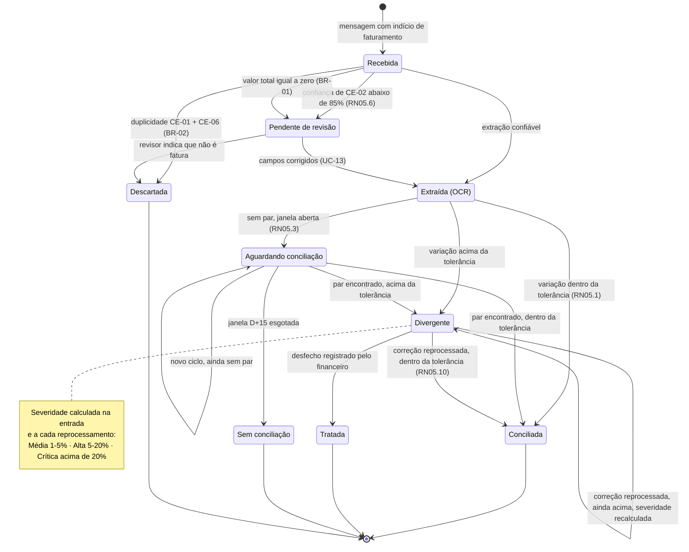
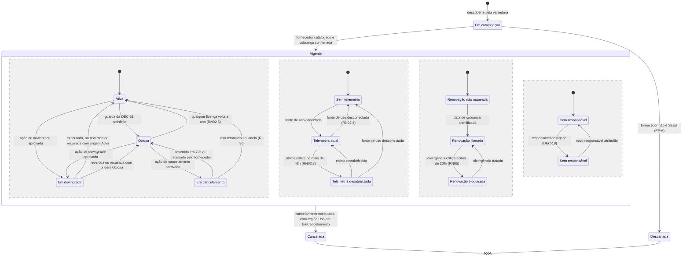
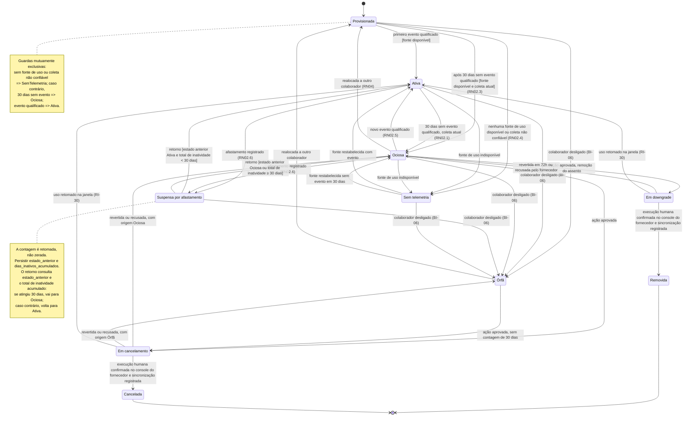
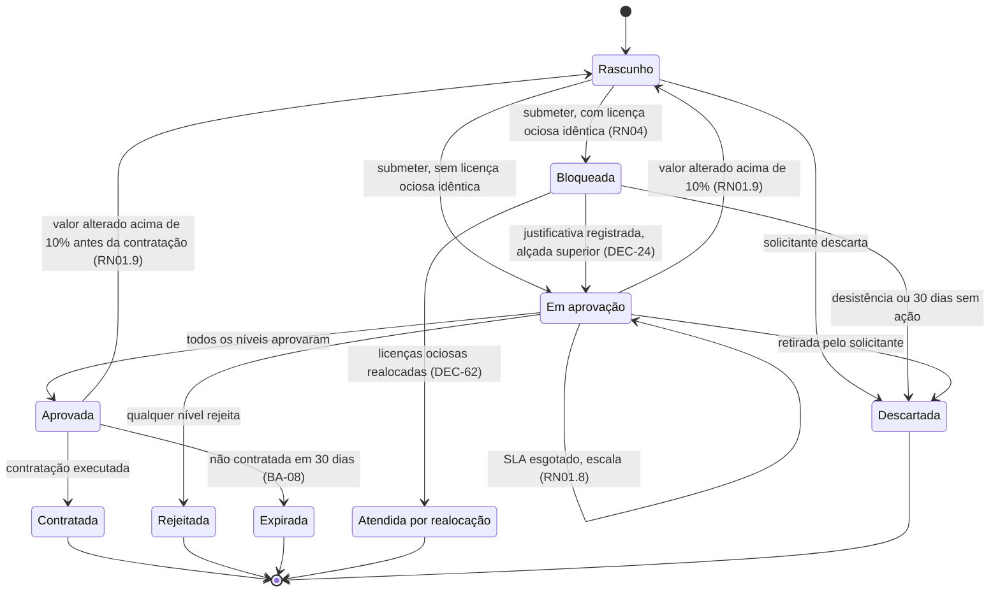
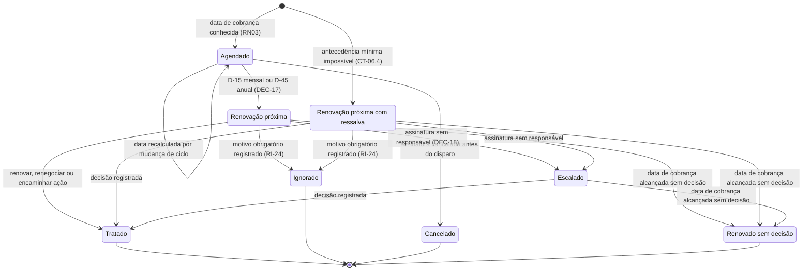
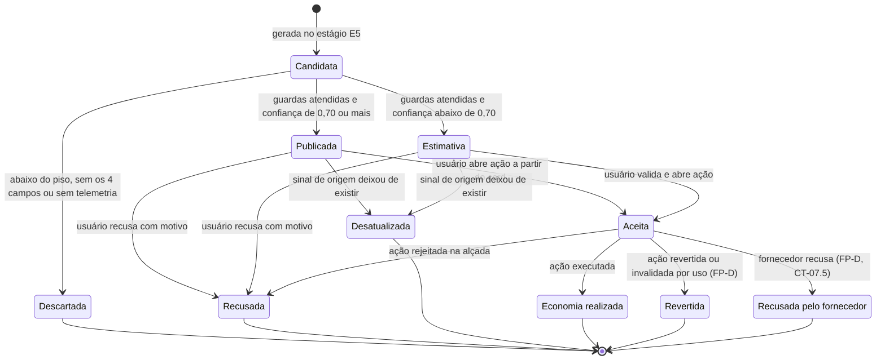
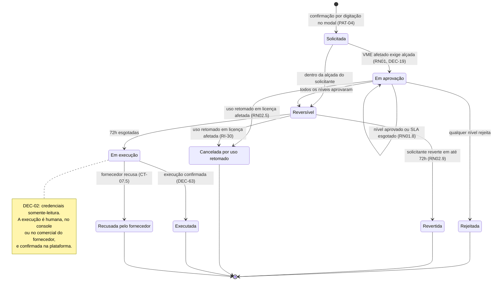
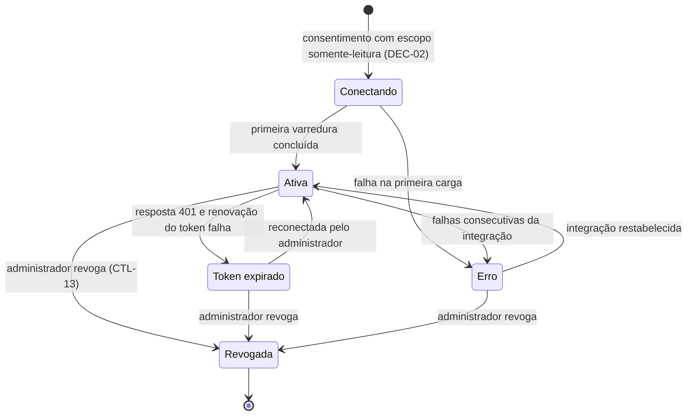
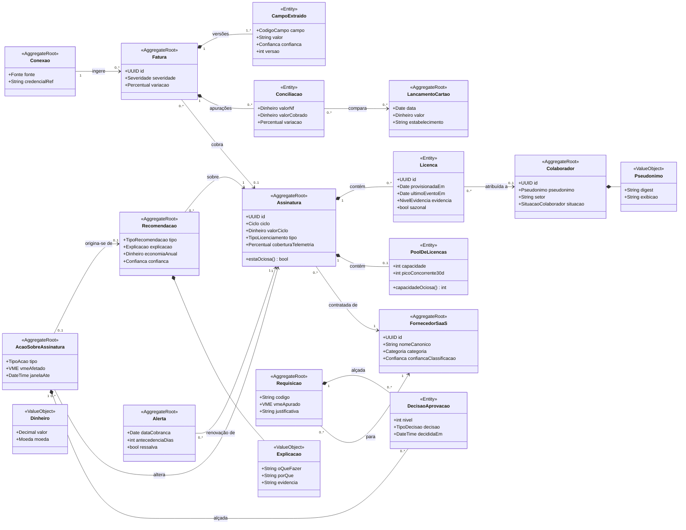

# Entregável 3 — Diagramas UML (Semana 06)

**Projeto:** Auditor e Otimizador de Assinaturas SaaS Corporativas  
**Iteração:** Semana 06 (14/09/2026 – 20/09/2026)  
**Responsáveis:** AR1 / AR2  
**Versão:** 1.0.0 (Máquina de Estados — entrega formal) · 0.1.0 (Classes de Domínio — rascunho)

---

## 1. O que se aplica a esta iteração

Conforme a matriz de [`diagramasUML.md`](../diagramasUML.md):

| Diagrama | Janela | Entrega formal | Situação |
|:---|:---|:---|:---|
| Casos de Uso | Semanas 1 a 3 | Semana 2 | Fechado em v1.1 (Semana 03) |
| Atividades | Semanas 2 e 3 | Semana 3 | Fechado em v1.0 (Semana 03) |
| Sequência | Semanas 4 e 5 | Semana 5 | Fechado em v1.0 (Semana 05) — um trecho desatualizado pela DEC-62 (Seção 13) |
| **Máquina de Estados** | **Semanas 5 e 6** | **Semana 6** | **Entrega formal — v1.0 com 8 máquinas** |
| **Classes de Domínio** | **Semanas 6 e 7** | Semana 7 | **Rascunho v0.1** |
| Pacotes / Componentes | Semana 7 | Semana 7 | Fora do escopo |
| Implantação | Semanas 10 e 11 | Semana 11 | Fora do escopo |

---

# PARTE I — Diagrama de Máquina de Estados (v1.0 · Entrega Formal)

## 2. Método de Revisão

A Seção 15 da [Semana 05](../semana-05/entregavel-03-diagramas-uml.md) deixou como primeira
pendência *"revisar as 5 máquinas, verificar alcançabilidade de todos os estados e ausência de
estados-armadilha"*. Cada máquina v0.1 passou por quatro verificações:

| # | Verificação | Pergunta |
|:--|:---|:---|
| V1 | **Alcançabilidade** | Todo estado é alcançável a partir do estado inicial? |
| V2 | **Estado-armadilha** | Todo estado não terminal tem ao menos uma saída? |
| V3 | **Cobertura de regras** | Toda sub-regra (`RN01.x`, `RN02.x`, `RN03`, `RN04`, `RN05.x`) e todo caso de borda (`BA-xx`, `BI-xx`, `BR-xx`) que muda estado tem transição correspondente? |
| V4 | **Coerência entre artefatos** | A máquina concorda com os diagramas de sequência, os wireframes e as demais máquinas? |

## 3. Achados da Revisão e Correções

A revisão encontrou **20 problemas** nas 5 máquinas da v0.1, e a verificação V4 mostrou que
faltavam máquinas para 3 entidades cujos estados já apareciam nos wireframes.

| ID | Máquina | Verif. | Problema na v0.1 | Correção na v1.0 |
|:---|:---|:---:|:---|:---|
| ME-01 | `Licença` | V2 | `EmDowngrade` só saía por reversão ou recusa — **não havia saída quando o downgrade dava certo** | Novo estado terminal `Removida` |
| ME-02 | `Licença` | V4 | Recusa do fornecedor em `EmDowngrade` levava a `Ativa`, mas a licença continua sem uso | Recusa retorna a `Ociosa` |
| ME-03 | `Licença` | V3 | `EmCancelamento` não tratava a recusa do fornecedor (CT-07.5) | Recusa retorna a `Ociosa` |
| ME-04 | `Licença` | V3 | Uso retomado durante a janela de 72 h (RN02.5, RI-30) não estava modelado | `EmDowngrade` e `EmCancelamento` → `Ativa` |
| ME-05 | `Licença` | V3 | Estado `Órfã` do caso BI-06 ausente | Novo estado `Orfa` |
| ME-06 | `Licença` | V4 | Realocação do estoque ocioso (RN04, transição T-11 do Mid-Fi) ausente | `Ociosa` e `Orfa` → `Provisionada` |
| ME-07 | `Licença` | V3 | Licença provisionada sem fonte de uso ia para `Ociosa` em 30 dias, contrariando a RN02.4 | `Provisionada` → `SemTelemetria` |
| ME-08 | `Assinatura` | V3 | Guarda *"maioria das licenças ociosas"* indefinida (**P-22**) | Guarda formal — DEC-61 (Seção 5.1) |
| ME-09 | `Assinatura` | V3 | `Telemetria desatualizada` (RN02.7, CT-04.10) ausente | Região ortogonal de telemetria — DEC-64 |
| ME-10 | `Assinatura` | V4 | `SemResponsavel` e `RenovacaoBloqueada` só eram alcançáveis a partir de `Ativa`; uma assinatura ociosa nunca ficaria sem responsável | Regiões ortogonais — DEC-64 |
| ME-11 | `Assinatura` | V4 | `EmDowngrade` sempre revertia para `Ativa`, mesmo quando a origem era `Ociosa` | Guardas pela origem |
| ME-12 | `Assinatura` | V3 | Fornecedor reconhecido como não-SaaS (FP-A) deixava a assinatura presa em `Mapeada` | Novo estado terminal `Descartada` |
| ME-13 | `Requisição` | V4 | `Bloqueada` era alcançada a partir de `EmAprovacao`, mas a RN04 é avaliada **antes** da alçada (Semana 03, Seção 4.2) | `Rascunho` → `Bloqueada` na submissão |
| ME-14 | `Requisição` | V4 | Realocação do estoque levava a `Rejeitada`, misturando economia evitada com recusa | Novo estado terminal — DEC-62 |
| ME-15 | `Requisição` | V2 | `Bloqueada` não tinha saída se o solicitante não agisse | `Descartada` por desistência ou 30 dias sem ação |
| ME-16 | `Requisição` | V4 | Alteração de valor acima de 10% **após** a aprovação aparecia no SEQ-03, mas não na máquina | `Aprovada` → `Rascunho` (RN01.9) |
| ME-17 | `Fatura` | V2 | `PendenteRevisao` só saía por correção; documento que não é fatura ficava preso | `PendenteRevisao` → `Descartada` |
| ME-18 | `Fatura` | V3 | Correção de `Divergente` que continua divergente não estava modelada (RN05.10) | Autotransição com severidade recalculada |
| ME-19 | `Alerta` | V2 | `Disparado`, `DisparadoComRessalva` e `Escalado` não tinham saída se ninguém decidisse até a cobrança | Novo estado terminal `Expirado` |
| ME-20 | — | V4 | `Recomendação`, `Ação` e `Conexão` têm estados exibidos em W-03, W-07, M-04 e M-05, mas nenhuma máquina | **Três máquinas novas** (Seções 9 a 11) |

> Também se corrigiu uma assimetria menor em `Alerta`: `DisparadoComRessalva` não podia ser
> `Ignorado`, ao contrário de `Disparado`. Ela está incluída na correção ME-19.

---

## 4. Máquina de Estados — `Fatura` (v1.0)

**Regras:** RN05.1 a RN05.10 · BR-01, BR-02 · DEC-09 a DEC-13 · **Sequência:** SEQ-02

---

## 5. Máquina de Estados — `Assinatura` (v1.0)

**Regras:** RN02.4, RN02.5, RN02.7, RN02.9, RN03, RN05 · DEC-18 · **P-22 resolvida**

A v0.1 tentava expressar em uma única sequência de estados quatro aspectos independentes de
uma assinatura — uso, qualidade da telemetria, situação da renovação e responsável. O
resultado era que combinações legítimas ficavam inalcançáveis: uma assinatura `Ociosa` não
podia ficar `Sem responsável` (ME-10). A v1.0 usa um **estado composto `Vigente` com quatro
regiões ortogonais** (DEC-64), notação UML para aspectos que mudam de forma independente.

**Regras de interação entre regiões** (guardas que leem o estado de outra região):

| Transição | Guarda adicional | Motivo |
|:---|:---|:---|
| `Ativa` → `Ociosa` | Região de telemetria em `TelemetriaAtual` | Sem coleta atual não há ociosidade nova (RN02.7, BI-05) |
| Disparo de `Alerta` | Região de renovação em `RenovacaoLiberada` ou `RenovacaoBloqueada` | Sem data de cobrança não há alerta (`Alerta` nasce de data conhecida) |
| Escalonamento de `Alerta` | Região de responsável em `SemResponsavel` | DEC-18 |

### 5.1. Guarda de ociosidade da assinatura — resolução da P-22

> **P-22 (Semana 05):** *"Proporção mínima de licenças ociosas para uma `Assinatura` assumir o
> estado `Ociosa`."*

**Decisão (DEC-61):** uma assinatura nominal assume `Ociosa` quando **todas as licenças
avaliáveis estão ociosas ou órfãs** e a **cobertura de telemetria é de pelo menos 80%**. Uma
assinatura de pool assume `Ociosa` quando o pico concorrente de 30 dias é zero (DEC-56).

| Alternativa | Consequência | Avaliação |
|:---|:---|:---|
| Maioria (> 50%) das licenças ociosas | Uma assinatura com 40% de usuários ativos seria `Ociosa` e ofereceria **cancelamento integral**, cortando quem usa | Rejeitada — contraria a DEC-32 e alimenta o FP-D |
| Proporção configurável pelo cliente | Desloca para o cliente uma decisão que muda o significado de um estado do domínio | Rejeitada |
| **100% das avaliáveis + cobertura ≥ 80%** | `Ociosa` passa a significar *"ninguém usa"*; ociosidade parcial já é tratada na licença, via REC-01 (reduzir assentos) | **Adotada** |

**Por que exigir cobertura de 80%:** com 18% das licenças sem telemetria (W-07), "todas as
avaliáveis ociosas" poderia significar 82 licenças ociosas e 18 em uso não medido. O piso de
80% acompanha a meta do indicador MI-03 da Semana 04, aqui aplicada à cobertura definida na
RN02.4 (licenças com fonte E1, E2 ou E3); abaixo dele, a assinatura permanece `Ativa` com o
indicador *"n de m licenças ociosas"* e a recomendação cabível é REC-01, nunca REC-06. O
parâmetro entra na lista de homologação (item 21, Seção 15).

---

## 6. Máquina de Estados — `Licença` (v1.0)

**Regras:** RN02.1 a RN02.9 · RN04 · BI-01, BI-05, BI-06 · DEC-15, DEC-16 · Correções ME-01 a ME-07

Aplica-se apenas a licenças **nominais**. Licenças de pool não têm estado individual (DEC-56).

> **Atributo, não estado:** a licença **sazonal** (BI-02) não é um estado — é o atributo
> `sazonal` que amplia a janela de 30 para 120 dias em todas as transições para `Ociosa`. Da
> mesma forma, *"evidência: apenas login"* (O8) é qualificador do badge, não estado.
>
> **Regra de execução (DEC-02 / DEC-63):** `Removida` e `Cancelada` só podem ser alcançados
> depois que uma pessoa autorizada executa a mudança no portal/console do fornecedor e confirma
> o resultado. A plataforma não chama uma API de escrita. Até a confirmação, a ação permanece
> pendente; uma recusa ou divergência de sincronização deve gerar estado de erro/revisão, sem
> marcar a licença como removida/cancelada.

---

## 7. Máquina de Estados — `Requisição` (v1.0)

**Regras:** RN01.1 a RN01.10 · RN04 · BA-08 · DEC-24, DEC-25 · **Sequência:** SEQ-03 · Correções ME-13 a ME-16

**Por que um estado próprio para a realocação (DEC-62).** Na v0.1, a requisição atendida com
licenças do estoque terminava em `Rejeitada`. Mas ela não foi recusada: a necessidade do
solicitante foi atendida, e a empresa **evitou um gasto**. Com estado próprio, a economia
evitada pela RN04 fica mensurável no Dashboard de ROI, e o indicador de requisições rejeitadas
deixa de ser inflado por desfechos positivos.

---

## 8. Máquina de Estados — `Alerta` (v1.0)

**Regras:** RN03 · CT-06.4 · DEC-17, DEC-18 · RI-21, RI-24 · Correção ME-19

> `Renovado sem decisão` não é falha do sistema — é o registro de que a renovação automática
> aconteceu sem que ninguém decidisse. Ele alimenta o relatório de desperdício e é a evidência
> mais direta de que o alerta não cumpriu sua função para aquela assinatura.

---

## 9. Máquina de Estados — `Recomendação` *(nova)*

**Regras:** Motor E5 e E6 (Semana 04, Seções 6, 7 e 9) · DEC-32 a DEC-34 · FP-D (DEC-45) · MI-04, MI-05

**Indicadores derivados diretamente desta máquina:**

| Indicador | Fórmula sobre os estados |
|:---|:---|
| MI-04 Taxa de aceitação | Recomendações distintas que já alcançaram `Aceita` ÷ recomendações distintas que já alcançaram `Publicada` ou `Estimativa` |
| MI-08 Taxa de FP-D | `Revertida + RecusadaPeloFornecedor` ÷ recomendações que chegaram a `Aceita` |
| MI-05 Realizada ÷ recomendada | Economia de `Executada` ÷ economia de todas as publicadas, em 90 dias |

---

## 10. Máquina de Estados — `Ação sobre Assinatura` *(nova)*

**Regras:** RN01, RN01.8, RN02.5, RN02.9 · DEC-02, DEC-19, DEC-20 · CT-07.5 · M-04, M-05

**Por que `Ação` é uma entidade própria e por que a execução é humana (DEC-63).** O M-05 já
desenhava os quatro passos de uma ação (solicitação, aprovação, janela de 72 h e envio), mas
nenhuma máquina os representava; os estados `EmDowngrade` e `EmCancelamento` da licença e da
assinatura eram a sombra desse ciclo de vida sem dono. Além disso, a etapa *"envio ao
fornecedor"* do M-05 colide com a DEC-02: com credenciais somente-leitura, o sistema **não
consegue** cancelar nada no fornecedor. O estado `EmExecucao` torna isso explícito — a
plataforma entrega ao Administrador de TI a instrução pronta, ele executa no fornecedor e
confirma, e a próxima fatura conciliada serve de evidência da execução.

---

## 11. Máquina de Estados — `Conexão` *(nova)*

**Regras:** DEC-02 · CTL-03, CTL-13 · CT-01.6 · W-03, W-08 (estado C) · **Sequência:** SEQ-01

> Consentimento negado e escopo de escrita (SEQ-01, respostas 400 e 422) **não criam** a
> conexão — por isso não aparecem como estados. Em `Revogada`, a credencial é removida do cofre
> imediatamente (CH-05 e CH-06 do Entregável 2).

---

## 12. Sincronização entre Máquinas

As oito máquinas não são independentes. As regras abaixo garantem que estados relacionados
nunca se contradigam.

| ID | Evento | Efeito | Máquinas |
|:---|:---|:---|:---|
| SY-01 | `Recomendação` → `Aceita` | Cria uma `Ação` em `Solicitada` | Recomendação → Ação |
| SY-02 | `Ação` entra em `JanelaArrependimento` | Licenças afetadas vão a `EmDowngrade` ou `EmCancelamento`; a região de uso da assinatura acompanha | Ação → Licença, Assinatura |
| SY-03 | Evento qualificado em licença afetada | `Ação` → `InvalidadaPorUso`; licença → `Ativa`; `Recomendação` → `Revertida` | Licença → Ação → Recomendação |
| SY-04 | `Ação` → `Executada` (downgrade) | Licenças afetadas → `Removida`; região de uso → `Ativa` para reapuração | Ação → Licença, Assinatura |
| SY-05 | `Ação` → `Executada` (cancelamento) | Licenças → `Cancelada`; assinatura → `Cancelada`; alerta `Agendado` → `Cancelado`; alerta já disparado ou escalado → `Tratado` (a decisão foi o cancelamento) | Ação → Licença, Assinatura, Alerta |
| SY-06 | `Ação` → `Revertida` ou `RecusadaPeloFornecedor` | Licenças e região de uso voltam ao estado de origem | Ação → Licença, Assinatura |
| SY-07 | `Fatura` → `Divergente · Crítica` | Região de renovação → `RenovacaoBloqueada` | Fatura → Assinatura |
| SY-08 | `Fatura` crítica → `Tratada` ou `Conciliada` | Região de renovação → `RenovacaoLiberada` | Fatura → Assinatura |
| SY-09 | Colaborador desligado | Licenças → `Orfa`; se for responsável, assinatura → `SemResponsavel` | Colaborador → Licença, Assinatura |
| SY-10 | Todas as licenças avaliáveis em `Ociosa` ou `Orfa`, cobertura ≥ 80% | Região de uso da assinatura → `Ociosa` (DEC-61) | Licença → Assinatura |
| SY-11 | `Requisição` → `AtendidaPorRealocacao` | Licenças realocadas → `Provisionada` | Requisição → Licença |
| SY-12 | `Conexão` → `TokenExpirado`, `Erro` ou `Revogada` | Assinaturas dependentes da fonte → região de telemetria `TelemetriaDesatualizada` ou `SemTelemetria` | Conexão → Assinatura |
| SY-13 | `Ação` → `Executada`, `RecusadaPeloFornecedor`, `Rejeitada` ou `Revertida` | `Recomendação` de origem → `Executada`, `RecusadaPeloFornecedor`, `Recusada` ou `Revertida`, respectivamente (a invalidação por uso já é coberta pela SY-03) | Ação → Recomendação |

## 13. Trechos de Outros Artefatos Desatualizados por esta Entrega

Os documentos anteriores não foram alterados. Prevalece a versão desta entrega:

| Artefato | Trecho | Versão vigente |
|:---|:---|:---|
| [SEQ-03 (Semana 05)](../semana-05/entregavel-03-diagramas-uml.md), Seção 5 | `requisição -> "Rejeitada" com economia registrada` | `"Atendida por realocação"` (DEC-62) |
| [Máquina da Requisição (Semana 03)](../semana-03/entregavel-02-fluxo-aprovacao-gastos-rn01-trava-inatividade-rn02.md), Seção 5 | `Bloqueada --> Rejeitada: realocar estoque ocioso` | Máquina v1.0, Seção 7 |
| [Máquina da Licença (Semana 03)](../semana-03/entregavel-02-fluxo-aprovacao-gastos-rn01-trava-inatividade-rn02.md), Seção 10 | Máquina v0.1 | Máquina v1.0, Seção 6 |

## 14. Consolidação dos Estados

| Máquina | Estados | Terminais | Transições | Situação |
|:---|:---:|:---:|:---:|:---|
| `Fatura` | 9 | 4 | 16 | Revisada |
| `Licença` | 10 | 2 | 29 | Revisada |
| `Assinatura` | 16 ¹ | 2 | 22 | Reestruturada com regiões ortogonais |
| `Requisição` | 9 | 5 | 15 | Revisada |
| `Alerta` | 8 | 4 | 13 | Revisada |
| `Recomendação` | 10 | 6 | 13 | **Nova** |
| `Ação sobre Assinatura` | 9 | 5 | 11 | **Nova** |
| `Conexão` | 5 | 1 | 9 | **Nova** |
| **Total** | **76** | **29** | **128** | V1, V2, V3 e V4 aprovadas |

> ¹ Inclui o estado composto `Vigente` e os 12 estados de suas quatro regiões.
>
> A v0.1 somava 40 estados em 5 máquinas. Os 36 estados a mais vêm das 3 máquinas novas (24),
> da reestruturação da assinatura (+7) e das correções de licença, requisição e alerta (+5).
> Cada um dos 76 tem badge, ou declaração de estado interno, no
> [Design System](entregavel-01-design-system-saas-b2b.md), Seção 10.

**Resultado das verificações:** nenhum estado inalcançável (V1) e nenhum estado-armadilha (V2)
nas 8 máquinas; todas as sub-regras que alteram estado têm transição (V3); e as máquinas
concordam com SEQ-01 a SEQ-04 e com os wireframes `W-xx` e `M-xx` (V4), considerando os
trechos desatualizados listados na Seção 13.

## 15. Parâmetros Novos para Homologação

A lista de 20 parâmetros consolidada na Semana 05 recebe dois novos, nascidos das guardas
desta entrega:

| # | Parâmetro | Valor proposto | Regra | Origem |
|:--|:---|:---|:---|:---|
| 21 | Guarda de ociosidade da assinatura | 100% das licenças avaliáveis + cobertura ≥ 80% | Máquina `Assinatura` | DEC-61 (P-22) |
| 22 | Prazo para a requisição bloqueada ser descartada sem ação | 30 dias | Máquina `Requisição` | ME-15 |

---

# PARTE II — Diagrama de Classes de Domínio (v0.1 · Rascunho)

## 16. Escopo do Rascunho

`diagramasUML.md` define o objetivo de *"traduzir os blocos de construção DDD (Agregados,
Entidades, Value Objects e Enumerations) em uma notação orientada a objetos padronizada com
multiplicidade e visibilidade"*, com entrega formal na Semana 07. Este rascunho deriva as
classes do dicionário de dados do [Entregável 2](entregavel-02-dicionario-dados-anonimizacao-lgpd01.md)
e define as **raízes de agregado**; atributos completos, operações e o detalhamento dos
*Value Objects* ficam para a v1.0.

## 17. Diagrama de Classes v0.1

## 18. Agregados e Invariantes Identificados

| Agregado (raiz) | Entidades internas | Invariante protegida pela raiz | Regra |
|:---|:---|:---|:---|
| `Assinatura` | `Licenca`, `PoolDeLicencas` | Uma assinatura tem licenças nominais **ou** um pool, nunca os dois | DEC-56 |
| `Fatura` | `CampoExtraido`, `Conciliacao` | Versões de campo e apurações são somente acrescentadas | RN05.9, RN05.10 |
| `Requisicao` | `DecisaoAprovacao` | Solicitante nunca decide a própria requisição; níveis são sequenciais | RN01.5, RN01.6 |
| `AcaoSobreAssinatura` | `DecisaoAprovacao` | Não entra em execução antes de 72 h após a última aprovação | RN02.9 |
| `Recomendacao` | — (`Explicacao` é VO) | Não existe sem os quatro campos de explicação | DEC-34 |
| `Colaborador` | — (`Pseudonimo` é VO) | O pseudônimo de exibição, uma vez atribuído, não muda | DEC-53 |

**Decisões de modelagem já tomadas no rascunho:**

1. `Licenca` é entidade **interna** do agregado `Assinatura`, não raiz própria: a regra de
   ociosidade da assinatura (DEC-61) depende do conjunto de licenças, e só a raiz garante
   essa consistência.
2. `DecisaoAprovacao` é compartilhada por dois agregados (`Requisicao` e `AcaoSobreAssinatura`)
   como **tipo**, mas cada instância pertence a um único agregado.
3. `IdentidadeColaborador` (ENT-04) **não aparece** no modelo de domínio: pertence a um
   contexto genérico de identidade, isolado por desenho, e só é acessada pelo Serviço de
   Reidentificação. Colocá-la no diagrama de domínio sugeriria uma navegação
   `Colaborador → nome` que a LGPD-01 proíbe.

---

# PARTE III — Fechamento

## 19. Imagens Oficiais dos Diagramas

A Semana 05 deixou como pendência *"gerar as imagens oficiais dos 4 diagramas de sequência e
das 5 máquinas"*.

**Decisão (DEC-65):** a **fonte Mermaid versionada no repositório é o artefato oficial** de
todos os diagramas UML. A renderização acontece no próprio repositório, sempre a partir da
versão vigente. Imagens estáticas (PNG/SVG) são exportadas **uma única vez**, no dossiê de
handoff da Semana 14.

| Alternativa | Consequência | Avaliação |
|:---|:---|:---|
| Exportar imagens a cada iteração | Imagem e fonte divergem na primeira correção — como teria ocorrido com ME-01 a ME-20 | Rejeitada |
| **Fonte versionada como oficial + exportação no handoff** | Uma única fonte de verdade; histórico de alterações auditável pelo controle de versão | **Adotada** |

## 20. Decisões desta Entrega

| ID | Decisão | Impacto |
|:---|:---|:---|
| DEC-61 | Assinatura `Ociosa` exige 100% das licenças avaliáveis ociosas ou órfãs e cobertura de telemetria ≥ 80% | **Resolve P-22**; cancelamento integral só é oferecido quando ninguém usa |
| DEC-62 | Requisição atendida por realocação tem estado terminal próprio, `Atendida por realocação` | Economia evitada pela RN04 fica mensurável |
| DEC-63 | `Ação sobre Assinatura` é entidade com máquina própria; a execução no fornecedor é humana e confirmada | Coerência com a DEC-02 (somente leitura) |
| DEC-64 | `Assinatura` modelada com estado composto e quatro regiões ortogonais | Elimina combinações inalcançáveis (ME-09, ME-10) |
| DEC-65 | Fonte Mermaid versionada é o artefato oficial; imagens só no handoff | Fecha a pendência 2 da Semana 05 |

## 21. Rastreabilidade

| Diagrama | Casos de uso | Sequência | Regras principais |
|:---|:---|:---|:---|
| `Fatura` | UC-02, UC-13 | SEQ-02 | RN05.1 a RN05.10 |
| `Assinatura` | UC-01, UC-04, UC-06, UC-07 | SEQ-01 | RN02.4, RN02.7, RN03, RN05, DEC-61 |
| `Licença` | UC-04, UC-07 | — | RN02.1 a RN02.9, RN04 |
| `Requisição` | UC-09 | SEQ-03 | RN01.1 a RN01.10, RN04 |
| `Alerta` | UC-06 | — | RN03 |
| `Recomendação` | UC-03, UC-05 | — | Motor E5/E6, FP-D |
| `Ação sobre Assinatura` | UC-07 | SEQ-03 (alçada) | RN01, RN02.9, DEC-63 |
| `Conexão` | UC-01 | SEQ-01 | DEC-02, CTL-13 |

## 22. Pendências para a Semana 07

1. **Entrega formal do Diagrama de Classes de Domínio** (v1.0): atributos completos,
   operações, visibilidade, *Value Objects* restantes (`VME`, `Confianca`, `Periodo`,
   `Percentual`) e enumerações dos 76 estados.
2. **Diagrama de Pacotes / Componentes**: os *Bounded Contexts* antecipados na Seção 5 do
   Entregável 2, com o contexto de identidade isolado e a ACL do OCR (DEC-46).
3. Preencher o `template_modelo_dominio.md` com a Linguagem Onipresente (Entregável 2,
   Seção 21), as invariantes da Seção 18 e os eventos de domínio que disparam as
   sincronizações SY-01 a SY-13.
4. Derivar os esquemas da especificação OpenAPI (RNF-08) a partir do dicionário de dados.
5. Levar à homologação do cliente os **22 parâmetros** (20 da Semana 05 + 2 da Seção 15).
