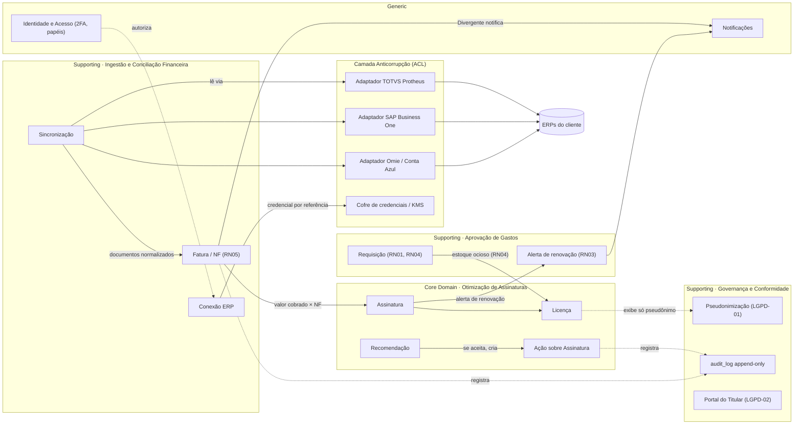
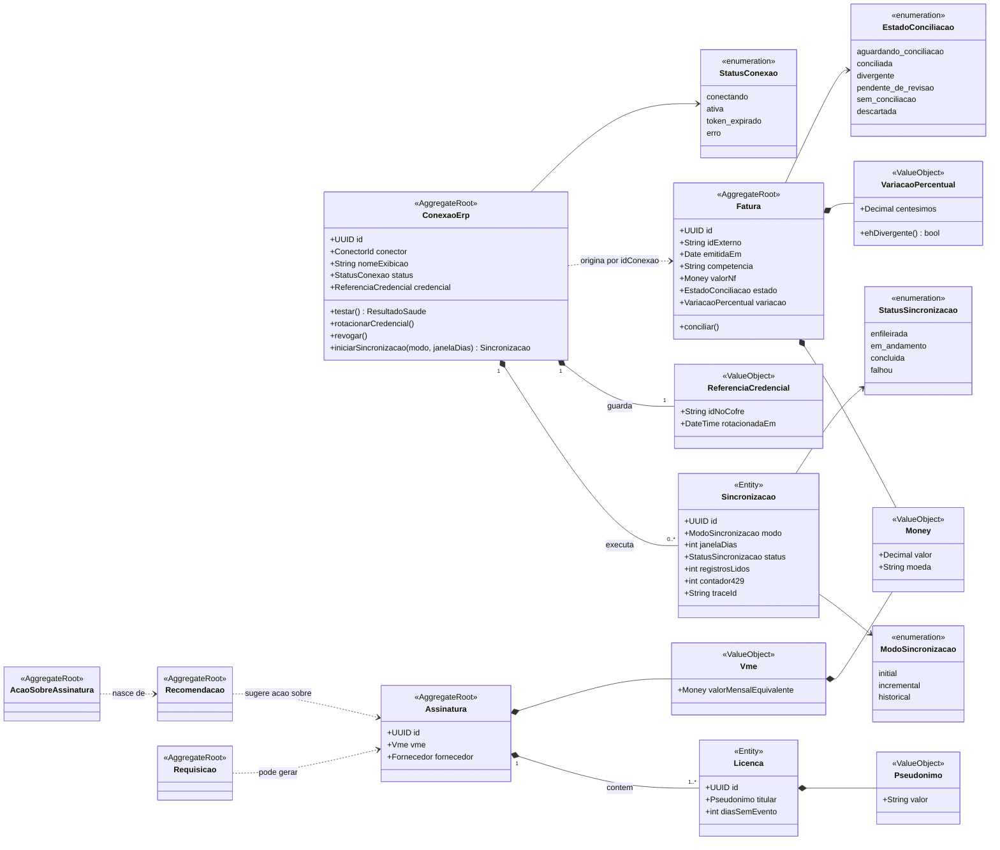
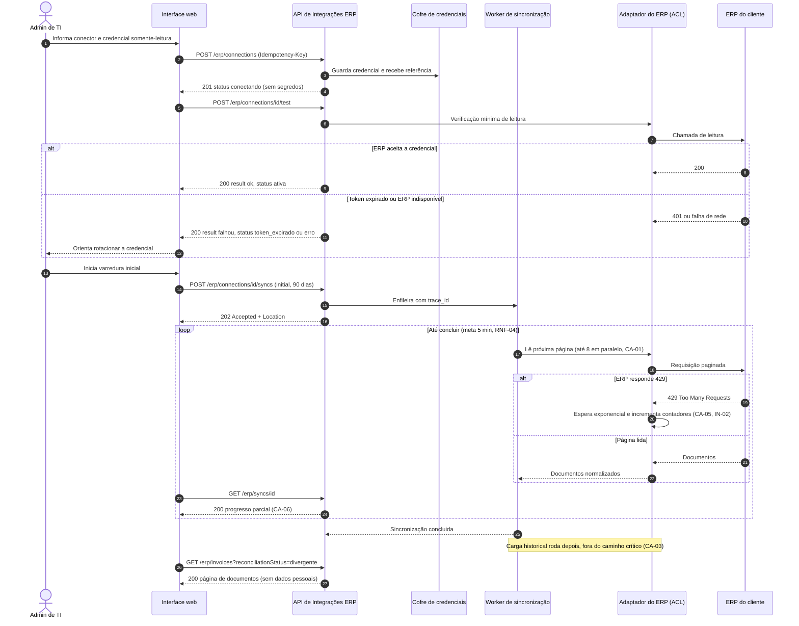

# Entregável 3 — Diagramas UML da Semana 07

**Iteração:** 7 — Consolidação dos Componentes · **Período:** 21/09/2026 a 27/09/2026
**Responsáveis:** AR1 / AR2 · **Matriz-fonte:** [`diagramasUML.md`](../diagramasUML.md) · **Template:** [`template_modelo_dominio.md`](../template_modelo_dominio.md)
**Notação:** Mermaid, com a fonte versionada como artefato oficial (DEC-65). Versão deste documento: **v0.1 (rascunho para revisão da equipe)**.

---

## 1. Aviso de escopo e de fontes

Este documento foi preparado **sem acesso** aos arquivos `semana-06/entregavel-03-diagramas-uml.md` (8 máquinas de estado e rascunho do diagrama de classes com 18 classes) e `semana-06/entregavel-02-dicionario-dados-anonimizacao-lgpd01.md` (entidades `ENT-01` a `ENT-24`, glossário completo e DEC-46). Isso tem três consequências:

1. Os nomes de classes foram extraídos apenas de `definicoes.md`, de `estudo_caso1.md` e do README da Semana 06. Onde um elemento é **proposta**, ele aparece marcado como tal.
2. Não foi possível dizer o que foi **mantido, atualizado ou complementado** em relação à Semana 06. A Seção 7 traz a tabela para a equipe preencher.
3. O diagrama de classes abaixo é um **recorte** voltado à integração ERP e aos agregados citados em `definicoes.md`. Ele **não substitui** a entrega formal v1.0 do Diagrama de Classes de Domínio (18 classes), que deve partir do rascunho v0.1 da Semana 06 (P-30).

## 2. Escopo desta entrega frente à matriz UML

| Diagrama | Previsto em `diagramasUML.md` | Situação nesta entrega | Justificativa |
|:---|:---|:---|:---|
| Pacotes / Componentes | Semana 7 | **Incluído** (Seção 3) | Entrega prevista para esta semana |
| Classes de Domínio | Semanas 6 e 7 | **Incluído como recorte** (Seção 4) | Entrega formal prevista para a Semana 7; v1.0 completa depende do v0.1 da Semana 06 |
| Sequência | Semanas 4 e 5 (SEQ-01 a SEQ-04) | **Incluído como SEQ-05, complementar** (Seção 5) | Esclarece o componente consolidado nesta semana (Entregável 1); não substitui SEQ-01 a SEQ-04 |
| Implantação | Semana 11 | **Não incluído** | Os documentos não definem provedor de nuvem, regiões nem topologia; desenhá-lo agora seria inventar informação |
| Máquina de Estados | Semanas 5 e 6 | **Não repetido** | Já entregue em v1.0 na Semana 06; o Entregável 1 apenas alinha os estados da API a ela (Seção 6) |

---

## 3. Diagrama de Pacotes — Contextos Delimitados (PROPOSTA)

**Objetivo:** representar os limites entre os *Bounded Contexts* (Core, Supporting, Generic) e a camada anticorrupção (ACL) que isola os ERPs, conforme `diagramasUML.md` e o template do modelo de domínio.
**Status:** os nomes dos contextos são **proposta**, derivada da separação por blocos do `estudo_caso1.md` e do pacote *Governança e Conformidade* da Semana 02 (M-01). A coluna *Contexto* e a DEC-46 do dicionário da Semana 06 **não foram consultadas** e prevalecem sobre este desenho (P-30).



**Explicação.** O Core concentra a lógica de ociosidade, recomendação e ação (REQ-04, REQ-05, REQ-07). A ingestão fica num contexto de suporte e só conversa com os ERPs por adaptadores (ACL), de modo que mudanças em Protheus, SAP ou Omie não vazem para o domínio. Credenciais nunca entram no banco da aplicação (CTL-03): `Conexão ERP` guarda apenas a referência ao cofre. A execução de ações é humana e confirmada na plataforma (DEC-63, coerente com a DEC-02).
**Relação com requisitos:** REQ-01, REQ-04, REQ-05, REQ-06, REQ-07, REQ-09; RNF-01, RNF-08; RN01 a RN05; CTL-03, CTL-10, CTL-11; LGPD-01 e LGPD-02.

---

## 4. Diagrama de Classes de Domínio — recorte da integração ERP

**Objetivo:** traduzir para notação UML os blocos DDD (agregados, entidades, *value objects* e enumerações) que sustentam o Entregável 1, incluindo os agregados mencionados em `definicoes.md`.
**Legenda de procedência:** `[D]` documentado em `definicoes.md` ou `estudo_caso1.md` · `[P]` proposta desta entrega, a validar.



**Explicação.** `ConexaoErp` é a raiz do agregado de integração: só ela cria e muda `Sincronizacao`, o que garante a invariante de **uma sincronização em andamento por conexão** (resposta `409` do Entregável 1). `Fatura` guarda o estado da RN05 e a variação já arredondada em centésimos (ROUND_HALF_UP). `Licenca` expõe somente `Pseudonimo`, nunca nome ou CPF (LGPD-01).

| Elemento | Procedência | Observação |
|:---|:---|:---|
| `Assinatura`, `Licenca`, `Requisicao`, `Recomendacao`, `AcaoSobreAssinatura`, `Fatura`, `ConexaoErp` | **[D]** nomes de entidades com máquina de estados citadas em `definicoes.md` (ME-20, DEC-63, SY-01 a SY-10) | `Fatura` é inferida dos estados de RN05; `Conexao` aparece como máquina nova (ME-20) |
| `Pseudonimo`, `Vme` | **[D]** glossário (DEC-53, RN01.1) | Atributos internos são **[P]** |
| `StatusConexao` | **[D]** PAT-03 | Alinhar à máquina `Conexão` da Semana 06 (P-30) |
| `EstadoConciliacao` | **[D]** RN05, tabela DX | — |
| `Sincronizacao`, `ModoSincronizacao`, `StatusSincronizacao`, `ReferenciaCredencial`, `VariacaoPercentual`, `Money` | **[P]** | Derivam do Entregável 1; DEC-41 e CA-03 justificam janela e modo `historical` |
| Agregado `Assinatura` contendo `Licenca` | **[P]** | Hipótese de fronteira; pode divergir do rascunho de 18 classes |
| Multiplicidades e visibilidade (`+`) | **[P]** | Visibilidade pública apenas para legibilidade do recorte |

**Relação com requisitos:** REQ-01 (integração), REQ-02/RN05 (conciliação), REQ-04/RN02 (licença), LGPD-01; DEC-56, DEC-61, DEC-63, DEC-64.
**Atributos das raízes `Recomendacao`, `AcaoSobreAssinatura` e `Requisicao` foram omitidos de propósito:** não há fonte consultada para eles nesta entrega.

---

## 5. Diagrama de Sequência SEQ-05 — Conexão e sincronização com ERP (PROPOSTA)

**Objetivo:** mostrar as interações temporais do Entregável 1: criação segura da conexão, validação imediata, varredura assíncrona com progresso parcial, tratamento de `429` e carga histórica posterior.
**Numeração:** SEQ-01 a SEQ-04 já existem (Semanas 04 e 05). `SEQ-05` é um identificador **proposto**.



**Explicação.** O cliente nunca recebe credenciais de volta. Falhas do ERP aparecem como `200` com `result = falhou` no teste e como `status = falhou` na sincronização, preservando códigos HTTP de erro para problemas da própria API. O progresso parcial evita o antipadrão ANT-02 (tela com "0" enquanto a varredura roda).
**Relação com requisitos:** REQ-01, RNF-04, RNF-08, RNF-01 (cofre), CTL-03, CA-01, CA-03, CA-05, CA-06, IN-01, IN-02, DEC-41. O limite de 5 minutos é meta; **não há medição** que o comprove.

---

## 6. Alinhamento entre a API (Entregável 1) e as máquinas de estado da Semana 06

| Campo da API | Valores | Máquina da Semana 06 | Situação do alinhamento |
|:---|:---|:---|:---|
| `Connection.status` | `conectando`, `ativa`, `token_expirado`, `erro` | `Conexão` (ME-20) | **A conferir**: valores vêm de PAT-03; a máquina v1.0 não foi consultada |
| `Reconciliation.status` | seis estados da tabela DX | `Fatura` | **A conferir**: a máquina v1.0 não foi consultada |
| `Sync.status` | `enfileirada`, `em_andamento`, `concluida`, `falhou` | — | Proposta nova; sem máquina correspondente |

## 7. Comparação com a Semana 06 (a preencher pela equipe)

| Elemento | Mantido | Atualizado | Complementado | Observação |
|:---|:---:|:---:|:---:|:---|
| Máquinas de estado (8) | Pendente de conferência | — | — | Não repetidas aqui |
| Rascunho de classes (18) | Pendente de conferência | — | Recorte da Seção 4 | Reconciliar nomes e fronteiras (P-30) |
| Diagrama de Pacotes | — | — | Proposta da Seção 3 | Conferir com a DEC-46 |
| Sequências SEQ-01 a SEQ-04 | Pendente de conferência | — | SEQ-05 | — |

## 8. Como visualizar e verificar

1. **No GitHub:** os blocos ```` ```mermaid ```` são renderizados automaticamente ao abrir este arquivo.
2. **Editor online:** copie um bloco para <https://mermaid.live> para editar e exportar imagem (a fonte versionada é o artefato oficial, DEC-65).
3. **Verificação sintática:** os três blocos foram processados pelo *parser* do Mermaid no ambiente de preparação (resultado em `semana-07/README.md`, Seção 12). Isso confirma a sintaxe, **não** a fidelidade ao modelo de domínio, que depende de revisão da equipe.
