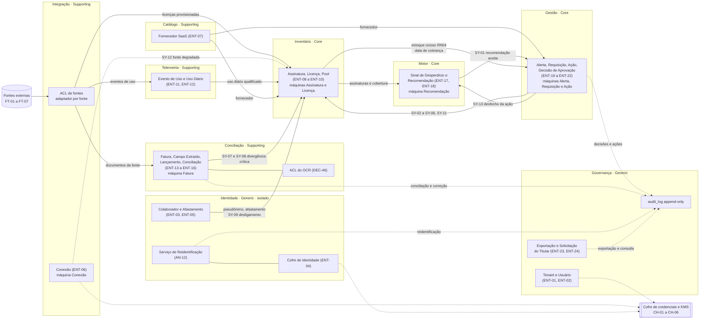
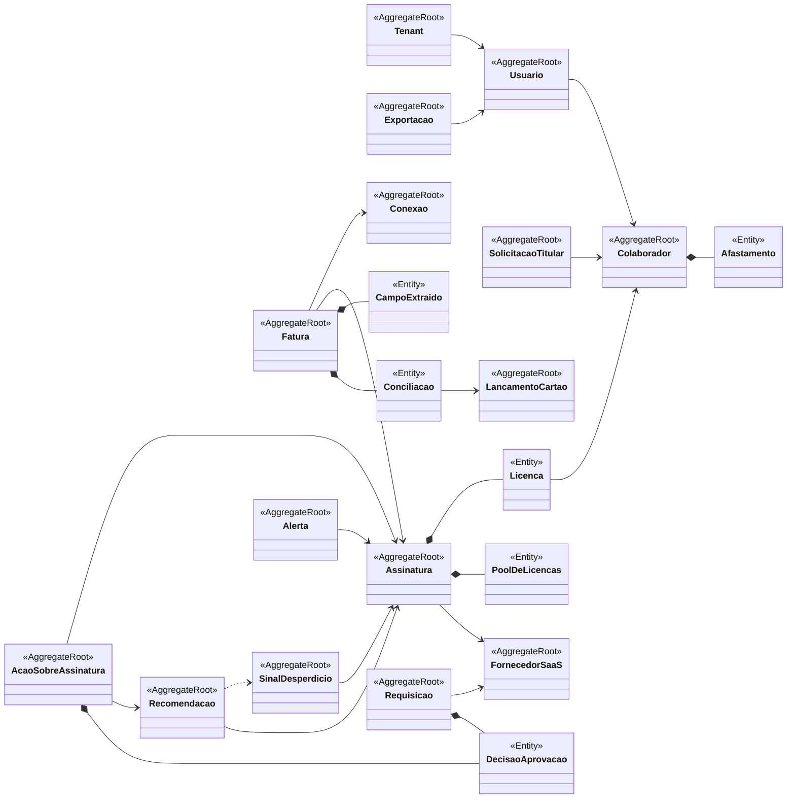
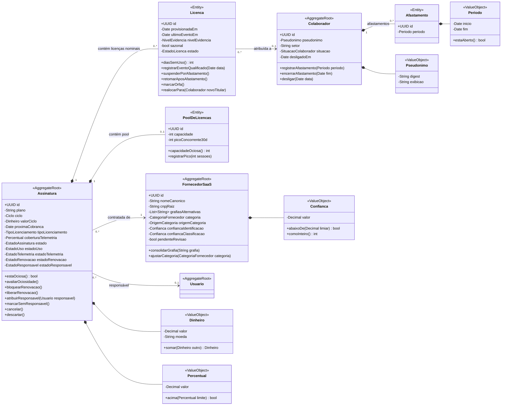
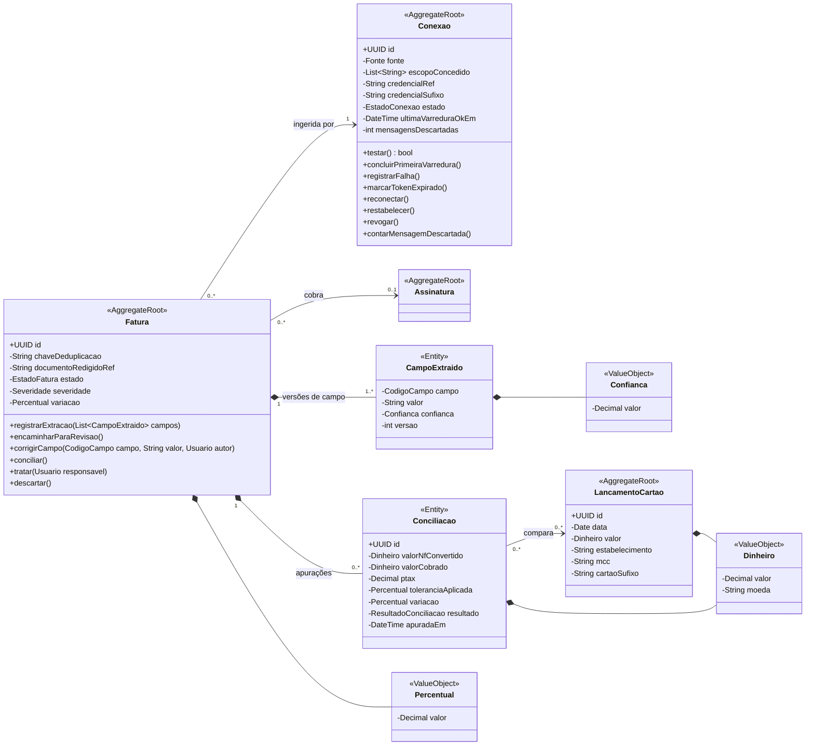
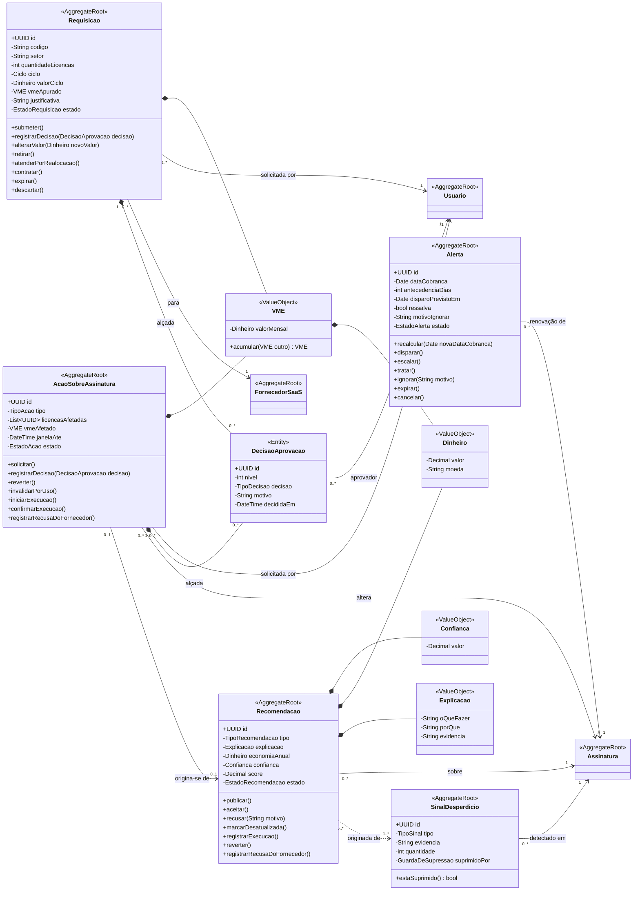
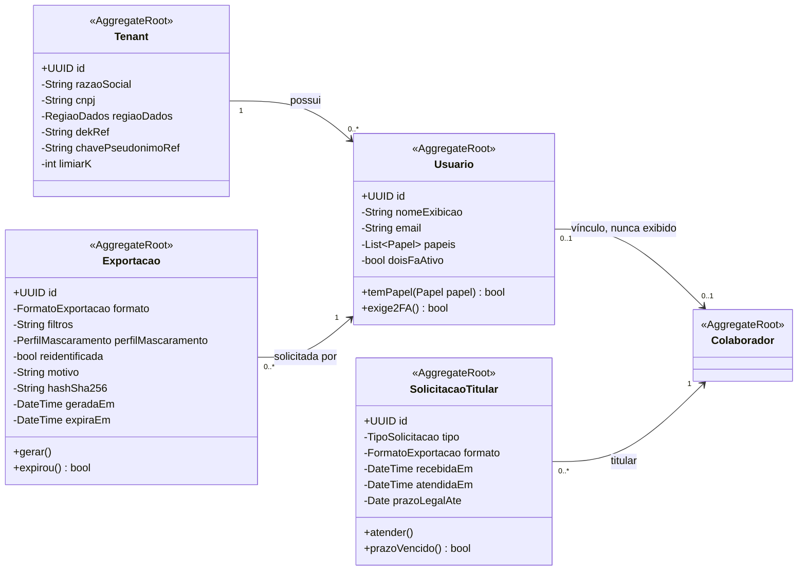
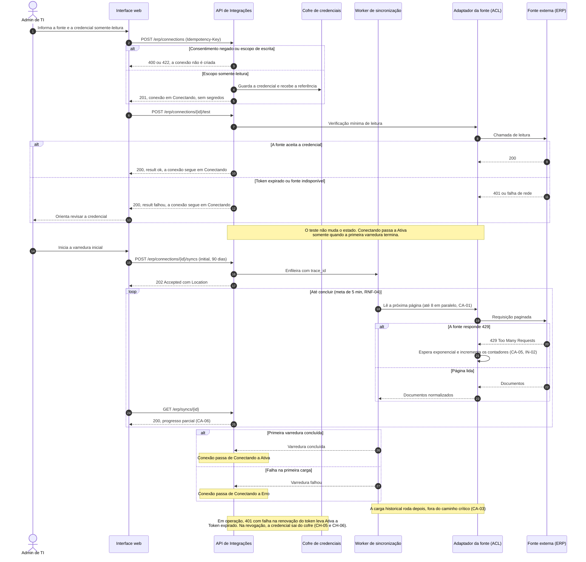

# Entregável 3 — Diagramas UML (Semana 07)

**Projeto:** Auditor e Otimizador de Assinaturas SaaS Corporativas  
**Iteração:** Semana 07 (21/09/2026 – 27/09/2026)  
**Responsáveis:** AR1 / AR2  
**Versão:** 1.0.0 (Classes de Domínio e Pacotes — entrega formal) · 1.0.0 (SEQ-05 — complementar)

---

## 1. O que se aplica a esta iteração

Conforme a matriz de [`diagramasUML.md`](../diagramasUML.md):

| Diagrama | Janela | Entrega formal | Situação |
|:---|:---|:---|:---|
| Casos de Uso | Semanas 1 a 3 | Semana 2 | Fechado em v1.1 (Semana 03) |
| Atividades | Semanas 2 e 3 | Semana 3 | Fechado em v1.0 (Semana 03) |
| Sequência | Semanas 4 e 5 | Semana 5 | Fechado em v1.0 (Semana 05); **SEQ-05 entra como complemento** (Seção 16) |
| Máquina de Estados | Semanas 5 e 6 | Semana 6 | Fechado em v1.0 (Semana 06) — **não repetido**; seus 76 estados viram enumerações (Seção 13) |
| **Classes de Domínio** | **Semanas 6 e 7** | **Semana 7** | **Entrega formal — v1.0, partindo do rascunho v0.1 de 18 classes** |
| **Pacotes / Componentes** | **Semana 7** | **Semana 7** | **Entrega formal — v1.0, a partir da coluna *Contexto* do dicionário** |
| Implantação | Semanas 10 e 11 | Semana 11 | Fora do escopo |

> O Diagrama de Implantação continua fora desta iteração: os artefatos até aqui não definem
> provedor de nuvem, regiões nem topologia, e desenhá-lo agora seria inventar informação.

---

## 2. Fontes e Método de Verificação

Este entregável parte de dois artefatos da [Semana 06](../semana-06/README.md):

| Fonte | O que foi aproveitado |
|:---|:---|
| [Entregável 3 — Diagramas UML (Semana 06)](../semana-06/entregavel-03-diagramas-uml.md) | As 8 máquinas de estado (76 estados), as regras de sincronização `SY-01` a `SY-13`, o rascunho v0.1 do Diagrama de Classes (18 classes), os agregados e invariantes da Seção 18 e as pendências da Seção 22 |
| [Entregável 2 — Dicionário de Dados (Semana 06)](../semana-06/entregavel-02-dicionario-dados-anonimizacao-lgpd01.md) | As 24 entidades `ENT-01` a `ENT-24` e o `audit_log` (atributos, tipos, obrigatoriedade), a coluna *Contexto* da Seção 5, a coerência com a DEC-46 e o glossário da Linguagem Onipresente (31 termos) |

Cada diagrama passou por quatro verificações:

| # | Verificação | Pergunta |
|:--|:---|:---|
| C1 | **Cobertura das entidades** | Toda entidade `ENT-01` a `ENT-24` e o `audit_log` tem classe, ou exclusão justificada? |
| C2 | **Cobertura dos estados** | Os 76 estados das 8 máquinas existem como valores de enumeração, sem acréscimo nem perda? |
| C3 | **Coerência das fronteiras** | Cada classe pertence a um único contexto, e toda dependência entre contextos nasce de uma chave estrangeira do dicionário ou de uma regra `SY-xx`? |
| C4 | **Coerência com a LGPD-01** | Nenhuma navegação a partir do domínio chega a nome, e-mail ou CPF de um titular? |

---

## 3. Comparação com a Semana 06

| Elemento | Mantido | Atualizado | Complementado | Observação |
|:---|:---:|:---:|:---:|:---|
| 8 máquinas de estado (76 estados) | Sim | — | Sim | Não foram redesenhadas; ganham enumerações no Diagrama de Classes (Seção 13) |
| Regras de sincronização `SY-01` a `SY-13` | Sim | — | Sim | Mapeadas para eventos de domínio entre contextos (Seção 6) |
| Rascunho de classes (18) | Sim | Sim | Sim | Mantidos nomes e raízes; atributos completos, operações e visibilidade (Seções 9 a 12) |
| Value Objects (`Dinheiro`, `Pseudonimo`, `Explicacao`) | Sim | Sim | Sim | Detalhados; somam-se `VME`, `Confianca`, `Periodo` e `Percentual` (pendência 1 da Semana 06) |
| Agregados e invariantes (6) | Sim | — | Sim | Ampliados para os 15 agregados (Seção 14) |
| Decisões de modelagem 1 a 3 do rascunho | Sim | — | — | Em especial: `IdentidadeColaborador` continua fora do domínio |
| Classes novas (10) | — | — | Sim | `Tenant`, `Usuario`, `Afastamento`, `SinalDesperdicio`, `Exportacao`, `SolicitacaoTitular` e os 4 VOs acima |
| `StatusConexao` do recorte ERP | — | Sim | — | Passa a `EstadoConexao`, com os 5 estados da máquina `Conexão` (inclui `Revogada`) |
| `EstadoConciliacao` do recorte ERP | — | Sim | — | Passa a `EstadoFatura`, com os 9 estados da máquina `Fatura` |
| Sequências `SEQ-01` a `SEQ-04` | Sim | — | — | Intactas; o trecho desatualizado do SEQ-03 segue listado na Seção 13 da Semana 06 |
| Diagrama de Pacotes | — | — | Sim | Novo; 9 contextos derivados da coluna *Contexto* (Seção 5) |
| `SEQ-05` | — | — | Sim | Complementar; alinhada à máquina `Conexão` v1.0 (Seção 16) |
| Parâmetros para homologação (22) | Sim | — | — | Nenhum parâmetro novo nesta entrega |

Situação das pendências que a Semana 06 deixou para esta iteração (Seção 22 daquele documento):

| # | Pendência da Semana 06 | Situação |
|:--|:---|:---|
| 1 | Entrega formal do Diagrama de Classes de Domínio (v1.0) | **Atendida** — Seções 7 a 15 |
| 2 | Diagrama de Pacotes / Componentes com o contexto de identidade isolado e a ACL do OCR | **Atendida** — Seções 4 a 6 |
| 3 | Preencher o `template_modelo_dominio.md` | **Insumos prontos** — glossário (Seção 21 do dicionário), invariantes (Seção 14) e eventos de domínio (Seção 6); a transposição para o arquivo do template segue com a equipe |
| 4 | Derivar os esquemas OpenAPI (RNF-08) | Fora deste entregável; as classes da Parte II são a base |
| 5 | Levar à homologação os 22 parâmetros | Segue aberta, sem acréscimos |

> Esta entrega não altera nenhuma máquina nem sequência anterior. A Seção 13 da Semana 06,
> com os trechos de outros artefatos que ela desatualiza, continua vigente.

---

# PARTE I — Diagrama de Pacotes (v1.0 · Entrega Formal)

## 4. Contextos Delimitados

A coluna *Contexto* da Seção 5 do dicionário define nove contextos. A tabela abaixo os consolida;
a **camada** (*Core*, *Supporting* ou *Generic*) é proposta desta entrega, porque o dicionário
não classifica os contextos.

| Contexto | Camada (proposta) | Entidades | Responsabilidade | Máquinas |
|:---|:---|:---|:---|:---|
| **Governança** | Generic | `ENT-01`, `ENT-02`, `ENT-23`, `ENT-24`, `audit_log` | Isolamento por tenant, operadores e papéis, exportação, direitos do titular e trilha de auditoria | — |
| **Identidade** | Generic (isolado) | `ENT-03`, `ENT-04`, `ENT-05` | Pseudônimo do colaborador, afastamento e desligamento; o Cofre de Identidade guarda nome e e-mail | — |
| **Integração** | Supporting | `ENT-06` | Conexões com as fontes `FT-01` a `FT-07`; credencial só por referência | `Conexão` |
| **Catálogo** | Supporting | `ENT-07` | Fornecedor canônico, categoria e confiança de classificação | — |
| **Inventário** | **Core** | `ENT-08`, `ENT-09`, `ENT-10` | Assinatura, licença nominal e pool; ociosidade (DEC-56 e DEC-61) | `Assinatura`, `Licença` |
| **Telemetria** | Supporting | `ENT-11`, `ENT-12` | Evidência de uso (E1 a E3) e agregação diária sem horário | — |
| **Conciliação** | Supporting | `ENT-13` a `ENT-16` | Fatura, campos extraídos, lançamento de cartão e apuração (RN05); OCR atrás de uma ACL (DEC-46) | `Fatura` |
| **Motor** | **Core** | `ENT-17`, `ENT-18` | Sinais de desperdício e recomendações | `Recomendação` |
| **Gestão** | **Core** | `ENT-19` a `ENT-22` | Alerta de renovação, requisição, ação sobre assinatura e alçada de aprovação | `Alerta`, `Requisição`, `Ação` |

Regras de fronteira, herdadas da Semana 06:

1. **Identidade é isolada por desenho.** O Cofre de Identidade (`ENT-04`) fica em armazenamento
   fisicamente separado e só é acessado pelo Serviço de Reidentificação (AN-12). Nenhum outro
   contexto navega de `Colaborador` até nome, e-mail ou CPF.
2. **Segredos nunca entram no banco da aplicação.** `Conexão` guarda apenas `credencial_ref`
   (CTL-03); chaves ficam no KMS (`dek_ref`, `chave_pseudonimo_ref` em `ENT-01`).
3. **O OCR é serviço interno atrás de uma ACL**, dentro do contexto de Conciliação (DEC-46); o
   domínio recebe campos extraídos, nunca o formato do motor de OCR.
4. **A plataforma não escreve no fornecedor.** A execução de downgrade e cancelamento é humana
   e confirmada na plataforma (DEC-02 e DEC-63).

## 5. Diagrama de Pacotes

**Como ler.** Setas contínuas são dependências de dados ou de comando; setas tracejadas são
eventos auditáveis ou referências a infraestrutura. Toda aresta entre contextos nasce de uma
chave estrangeira do dicionário ou de uma regra `SY-xx`, conforme a tabela da Seção 6.

**Relação com requisitos:** REQ-01, REQ-02, REQ-04, REQ-05, REQ-07, REQ-09; RN01 a RN05; RNF-01,
RNF-07, RNF-08; CTL-03, CTL-13; LGPD-01 e LGPD-02; DEC-02, DEC-46, DEC-56, DEC-61 e DEC-63.

## 6. Relações entre Contextos e Eventos de Domínio

A coluna *Padrão* é uma proposta de relacionamento entre contextos (DDD); a coluna *Fundamento*
indica de onde vem a dependência.

| # | De → Para | O que atravessa a fronteira | Padrão (proposta) | Fundamento |
|:--|:---|:---|:---|:---|
| 1 | Integração → Conciliação | Documentos ingeridos; `Fatura` guarda `conexao_id` | Cliente-fornecedor | `ENT-13` |
| 2 | Integração → Telemetria | Eventos brutos de uso, com nível de evidência | ACL por fonte | `ENT-11` |
| 3 | Integração → Inventário | Licenças provisionadas; degradação da fonte (SY-12) | Evento publicado | `ENT-09` (FT-02), SY-12 |
| 4 | Telemetria → Inventário | `houve_uso_qualificado` por dia | Linguagem publicada | `ENT-12` |
| 5 | Catálogo → Inventário e Gestão | `fornecedor_id` | Conformista | `ENT-08`, `ENT-20` |
| 6 | Conciliação → Inventário | `assinatura_id`; divergência crítica (SY-07 e SY-08) | Evento publicado | `ENT-13` |
| 7 | Identidade → Inventário | `colaborador_id` e pseudônimo; afastamento; desligamento (SY-09) | Linguagem publicada, sem nome | `ENT-09`, `ENT-05` |
| 8 | Inventário → Motor | Assinaturas, cobertura de telemetria e ociosidade | Cliente-fornecedor | `ENT-17` |
| 9 | Motor → Gestão | Recomendação aceita (SY-01) | Evento publicado | SY-01 |
| 10 | Gestão → Inventário | Ação em janela, executada ou desfeita; realocação (SY-02 a SY-06, SY-11) | Evento publicado | SY-02 a SY-06, SY-11 |
| 11 | Inventário → Gestão | Estoque ocioso (RN04) e data de cobrança | Consulta | RN04, `ENT-19` |
| 12 | Gestão → Motor | Desfecho da ação (SY-13) | Evento publicado | SY-13 |
| 13 | Gestão, Conciliação, Identidade e Governança → `audit_log` | Eventos auditáveis | Registro *append-only* | `audit_log` |
| 14 | Integração, Governança e Identidade → KMS | Referências de chave e de credencial | Infraestrutura | `ENT-01`, `ENT-06`, `ENT-04` |

As 13 regras de sincronização da Semana 06 viram os eventos abaixo. Doze cruzam fronteiras de
contexto e uma é interna ao agregado `Assinatura`.

| Regra | Evento de domínio | Emissor (contexto · agregado) | Consumidor | Natureza |
|:---|:---|:---|:---|:---|
| SY-01 | `RecomendacaoAceita` | Motor · `Recomendacao` | Gestão · `AcaoSobreAssinatura` | Entre contextos |
| SY-02 | `AcaoEntrouEmJanela` | Gestão · `AcaoSobreAssinatura` | Inventário · `Assinatura` | Entre contextos |
| SY-03 | `UsoQualificadoDetectado` | Inventário · `Assinatura` | Gestão · `AcaoSobreAssinatura`; Motor · `Recomendacao` | Entre contextos |
| SY-04 | `AcaoExecutada` (downgrade) | Gestão · `AcaoSobreAssinatura` | Inventário · `Assinatura` | Entre contextos |
| SY-05 | `AcaoExecutada` (cancelamento) | Gestão · `AcaoSobreAssinatura` | Inventário · `Assinatura`; Gestão · `Alerta` | Entre contextos |
| SY-06 | `AcaoRevertidaOuRecusada` | Gestão · `AcaoSobreAssinatura` | Inventário · `Assinatura` | Entre contextos |
| SY-07 | `FaturaDivergenteCritica` | Conciliação · `Fatura` | Inventário · `Assinatura` | Entre contextos |
| SY-08 | `FaturaCriticaResolvida` | Conciliação · `Fatura` | Inventário · `Assinatura` | Entre contextos |
| SY-09 | `ColaboradorDesligado` | Identidade · `Colaborador` | Inventário · `Assinatura` | Entre contextos |
| SY-10 | — (regra interna) | Inventário · `Assinatura` (`Licenca`) | Inventário · `Assinatura` | **Interna ao agregado** |
| SY-11 | `RequisicaoAtendidaPorRealocacao` | Gestão · `Requisicao` | Inventário · `Assinatura` | Entre contextos |
| SY-12 | `ConexaoDegradada` | Integração · `Conexao` | Inventário · `Assinatura` | Entre contextos |
| SY-13 | `AcaoDesfechada` | Gestão · `AcaoSobreAssinatura` | Motor · `Recomendacao` | Entre contextos |

> Como emissor e consumidor ficam em agregados diferentes, a consistência entre eles é
> **eventual**: o evento é publicado depois que o agregado emissor confirma a própria transição.
> A SY-10 é a exceção, pois `Licenca` e `Assinatura` pertencem ao mesmo agregado e a raiz
> reapura a ociosidade dentro da mesma transação.

---

# PARTE II — Diagrama de Classes de Domínio (v1.0 · Entrega Formal)

## 7. Escopo e Convenções

O rascunho v0.1 da Semana 06 tinha 18 classes (10 raízes, 5 entidades e 3 *Value Objects*) e
deixou para a v1.0 os atributos completos, as operações, a visibilidade, os *Value Objects*
restantes e as enumerações dos 76 estados. A v1.0 cobre as 24 entidades do dicionário e
fecha em **28 classes** (15 raízes, 6 entidades e 7 *Value Objects*).

| Convenção | Significado |
|:---|:---|
| `<<AggregateRoot>>`, `<<Entity>>`, `<<ValueObject>>`, `<<enumeration>>` | Bloco de construção DDD |
| `+` em atributo | Identidade, exposta somente para leitura |
| `-` em atributo | Estado encapsulado, alterado apenas por operações da raiz |
| `+` em operação | Comportamento público do agregado |
| `*--` (composição) | Pertence ao agregado; nasce e morre com a raiz |
| `-->` (associação) | Referência a outro agregado **por identidade** (UUID) |
| `..>` (dependência) | Origem ou derivação, sem posse |

Outras convenções:

- Os identificadores não têm acento, e os nomes seguem o glossário da Linguagem Onipresente
  (`Licenca` é *Licença*; `Colaborador` é o titular dos dados; `Usuario` é quem opera a
  plataforma).
- Toda classe pertence a um tenant (`tenant_id`, `ENT-01`). Essa relação não é desenhada, para
  não ligar as 28 classes a `Tenant`.
- Os diagramas das Seções 9 a 12 repetem, como caixas vazias, as classes de outros contextos
  que aparecem em uma associação.

## 8. Visão Geral dos Agregados

Os atributos e as operações de cada classe estão nas Seções 9 a 12, agrupados por contexto.

## 9. Inventário e Identidade

**Pontos de modelagem:**

- `Licenca` é entidade interna de `Assinatura` e só existe quando `tipoLicenciamento` é
  `Nominal`; o pool só existe quando é `Pool` (DEC-56).
- `diasSemUso()` é calculado na consulta a partir de `ultimoEventoEm`, como o dicionário
  determina (`ENT-09`): não há atributo armazenado.
- Os quatro atributos `estadoUso`, `estadoTelemetria`, `estadoRenovacao` e `estadoResponsavel`
  são as regiões ortogonais do estado `Vigente` (DEC-64) e ficam vazios nos demais estados.
- `Afastamento` não tem motivo: o dado pode ser de saúde (Art. 11) e a integração de RH só
  recebe o período (DEC-57, AN-09).
- `Pseudonimo` guarda o digest HMAC-SHA-256 completo e o texto de exibição `COL-xxxx`; este é o
  único identificador do titular que o domínio conhece (DEC-53).

## 10. Integração e Conciliação

**Pontos de modelagem:**

- `Conexao` guarda só a referência da credencial e os quatro últimos caracteres para exibição;
  o segredo fica no cofre (CTL-03). O escopo concedido precisa ser somente-leitura, ou a
  conexão não é criada (DEC-02).
- `CampoExtraido` e `Conciliacao` são **somente acrescentados**: uma correção cria nova versão ou
  nova apuração, e a anterior nunca é sobrescrita (RN05.9 e RN05.10).
- `Fatura` guarda `documentoRedigidoRef`: o documento é armazenado já redigido e o original
  existe apenas em memória durante a ingestão (DEC-59). Os campos CE-10 (nome do tomador) e CE-11
  (CPF) não existem na persistência.
- `LancamentoCartao` não tem portador: o nome do portador do cartão não é importado (DEC-60).
- O OCR e os adaptadores de fonte ficam na ACL do Diagrama de Pacotes; o domínio só enxerga
  `CampoExtraido`, nunca o formato do motor de OCR (DEC-46).

## 11. Motor de Análise e Gestão

**Pontos de modelagem:**

- `Recomendacao` guarda `Explicacao` (os campos *o que fazer*, *por que* e *evidência*) e
  `economiaAnual`: juntos são os quatro campos obrigatórios da DEC-34. No banco, os quatro são
  `NOT NULL`.
- `SinalDesperdicio` não traz identificação de colaborador: `evidencia` guarda só a fonte e a
  data da coleta (`ENT-17`).
- `DecisaoAprovacao` é um **tipo** compartilhado por dois agregados, mas cada instância
  pertence a um só: a `Requisicao` ou a `AcaoSobreAssinatura`. No dicionário isso é o par
  `objeto_tipo` e `objeto_id` (`ENT-22`).
- `AcaoSobreAssinatura` não tem operação que escreva no fornecedor: `iniciarExecucao()` abre a
  etapa `Em execução` e `confirmarExecucao()` registra o que uma pessoa autorizada fez no
  console do fornecedor (DEC-02 e DEC-63).
- `Recomendacao` e `AcaoSobreAssinatura` seguem o desfecho um do outro pelos eventos SY-01,
  SY-03 e SY-13, não por navegação direta entre as raízes.

## 12. Governança

**Pontos de modelagem:**

- *Usuário* e *Colaborador* são conceitos distintos (glossário): a mesma pessoa pode ser os dois,
  mas o vínculo `Usuario → Colaborador` nunca é exibido a outros papéis. A navegação inversa
  não existe.
- `Usuario` guarda `nomeExibicao` e `email` por ser o operador da plataforma, não o titular dos
  dados de uso (DP-08). `exige2FA()` é verdadeiro para `AdminTI`, `CFO` e `AdminRH` (CTL-12).
- `Exportacao` registra o perfil de mascaramento herdado da sessão e `reidentificada` só é
  verdadeiro para o Admin de RH, com motivo obrigatório (AN-10 e AN-12).
- `SolicitacaoTitular` calcula o prazo legal como o recebimento mais 15 dias (CTL-08).

## 13. Enumerações

### 13.1. Enumerações de estado — as 8 máquinas da Semana 06

```mermaid
classDiagram
    direction LR

    class EstadoFatura {
        <<enumeration>>
        Recebida
        PendenteRevisao
        Extraida
        AguardandoConciliacao
        Conciliada
        Divergente
        Tratada
        SemConciliacao
        Descartada
    }
    class EstadoLicenca {
        <<enumeration>>
        Provisionada
        Ativa
        Ociosa
        SuspensaPorAfastamento
        SemTelemetria
        Orfa
        EmDowngrade
        EmCancelamento
        Removida
        Cancelada
    }
    class EstadoAssinatura {
        <<enumeration>>
        Mapeada
        Vigente
        Descartada
        Cancelada
    }
    class EstadoUso {
        <<enumeration>>
        Ativa
        Ociosa
        EmDowngrade
        EmCancelamento
    }
    class EstadoTelemetria {
        <<enumeration>>
        SemTelemetria
        TelemetriaAtual
        TelemetriaDesatualizada
    }
    class EstadoRenovacao {
        <<enumeration>>
        RenovacaoNaoMapeada
        RenovacaoLiberada
        RenovacaoBloqueada
    }
    class EstadoResponsavel {
        <<enumeration>>
        ComResponsavel
        SemResponsavel
    }
    class EstadoRequisicao {
        <<enumeration>>
        Rascunho
        EmAprovacao
        Bloqueada
        Aprovada
        Rejeitada
        Contratada
        Expirada
        AtendidaPorRealocacao
        Descartada
    }
    class EstadoAlerta {
        <<enumeration>>
        Agendado
        Disparado
        DisparadoComRessalva
        Escalado
        Tratado
        Ignorado
        Cancelado
        Expirado
    }
    class EstadoRecomendacao {
        <<enumeration>>
        Candidata
        Descartada
        Publicada
        Estimativa
        Aceita
        Recusada
        Obsoleta
        Executada
        Revertida
        RecusadaPeloFornecedor
    }
    class EstadoAcao {
        <<enumeration>>
        Solicitada
        EmAprovacao
        Rejeitada
        JanelaArrependimento
        Revertida
        InvalidadaPorUso
        EmExecucao
        Executada
        RecusadaPeloFornecedor
    }
    class EstadoConexao {
        <<enumeration>>
        Conectando
        Ativa
        TokenExpirado
        Erro
        Revogada
    }
```

| Enumeração | Atributo | Máquina da Semana 06 | Valores |
|:---|:---|:---|:---:|
| `EstadoFatura` | `Fatura.estado` | `Fatura` | 9 |
| `EstadoLicenca` | `Licenca.estado` | `Licença` | 10 |
| `EstadoAssinatura` | `Assinatura.estado` | `Assinatura` (nível de topo) | 4 |
| `EstadoUso` | `Assinatura.estadoUso` | `Assinatura` (região de uso) | 4 |
| `EstadoTelemetria` | `Assinatura.estadoTelemetria` | `Assinatura` (região de telemetria) | 3 |
| `EstadoRenovacao` | `Assinatura.estadoRenovacao` | `Assinatura` (região de renovação) | 3 |
| `EstadoResponsavel` | `Assinatura.estadoResponsavel` | `Assinatura` (região de responsável) | 2 |
| `EstadoRequisicao` | `Requisicao.estado` | `Requisição` | 9 |
| `EstadoAlerta` | `Alerta.estado` | `Alerta` | 8 |
| `EstadoRecomendacao` | `Recomendacao.estado` | `Recomendação` | 10 |
| `EstadoAcao` | `AcaoSobreAssinatura.estado` | `Ação sobre Assinatura` | 9 |
| `EstadoConexao` | `Conexao.estado` | `Conexão` | 5 |
| | | **Total** | **76** |

Os 76 valores coincidem, um a um, com os estados da Seção 14 da Semana 06 (`Assinatura` conta
16: os 4 do topo, incluindo o composto `Vigente`, e os 12 das quatro regiões). O atributo
`Assinatura.estado` aceita apenas `Mapeada`, `Vigente`, `Descartada` e `Cancelada`; as
quatro regiões são preenchidas somente quando o estado é `Vigente`.

### 13.2. Demais enumerações

| Enumeração | Usada em | Valores |
|:---|:---|:---|
| `Ciclo` | `Assinatura`, `Requisicao` | `Mensal`, `Anual`, `Bienal`, `PagamentoUnico` |
| `TipoLicenciamento` | `Assinatura` | `Nominal`, `Pool` |
| `NivelEvidencia` | `Licenca` | `E1`, `E2`, `E3`, `Nenhuma` |
| `SituacaoColaborador` | `Colaborador` | `Ativo`, `Afastado`, `Desligado` |
| `Severidade` | `Fatura` | `Media`, `Alta`, `Critica` |
| `ResultadoConciliacao` | `Conciliacao` | `Conciliada`, `Divergente`, `SemConciliacao` |
| `CodigoCampo` | `CampoExtraido` | `CE-01` a `CE-09` (CE-10 e CE-11 não existem na persistência) |
| `TipoSinal` | `SinalDesperdicio` | `SD-01` a `SD-10` |
| `GuardaDeSupressao` | `SinalDesperdicio` | Uma por regra que suprime o sinal: RN02.4, RN02.7, CT-03.2 e RN02.10 |
| `TipoRecomendacao` | `Recomendacao` | `REC-01` a `REC-07` |
| `TipoAcao` | `AcaoSobreAssinatura` | `Downgrade`, `Cancelamento` |
| `TipoDecisao` | `DecisaoAprovacao` | `Aprovada`, `Rejeitada`, `Escalada` |
| `CategoriaFornecedor` | `FornecedorSaaS` | `C-01` a `C-12` |
| `OrigemCategoria` | `FornecedorSaaS` | `BaseCurada`, `ModeloIA`, `AjusteManual` |
| `Fonte` | `Conexao` | `FT-01` a `FT-07` |
| `Papel` | `Usuario` | `CFO`, `GestorFinanceiro`, `AdminTI`, `AdminRH`, `GestorCompras`, `AuditorExterno` |
| `FormatoExportacao` | `Exportacao`, `SolicitacaoTitular` | `PDF`, `XLSX`; `JSON` e `CSV` só para o titular (DEC-28) |
| `PerfilMascaramento` | `Exportacao` | Herdado da sessão (AN-10) |
| `TipoSolicitacao` | `SolicitacaoTitular` | `Consulta`, `Portabilidade` |
| `RegiaoDados` | `Tenant` | Regiões de armazenamento do contrato (CTL-14) |

## 14. Agregados e Invariantes

A Semana 06 identificou 6 agregados com invariante. A v1.0 cobre as 15 raízes.

| Agregado (raiz) | Entidades internas | Invariante protegida pela raiz | Regra |
|:---|:---|:---|:---|
| `Assinatura` | `Licenca`, `PoolDeLicencas` | Tem licenças nominais **ou** um pool, nunca os dois | DEC-56 |
| `Assinatura` | `Licenca`, `PoolDeLicencas` | As quatro regiões de estado só existem quando o estado é `Vigente` | DEC-64 |
| `Assinatura` | `Licenca`, `PoolDeLicencas` | Só é `Ociosa` com 100% das licenças avaliáveis ociosas ou órfãs e cobertura de telemetria de pelo menos 80% | DEC-61 |
| `Fatura` | `CampoExtraido`, `Conciliacao` | Versões de campo e apurações são somente acrescentadas | RN05.9, RN05.10 |
| `Requisicao` | `DecisaoAprovacao` | O solicitante nunca decide a própria requisição; os níveis são sequenciais | RN01.5, RN01.6 |
| `AcaoSobreAssinatura` | `DecisaoAprovacao` | Não entra em execução antes de 72 h após a última aprovação | RN02.9 |
| `AcaoSobreAssinatura` | `DecisaoAprovacao` | `Executada` só é alcançado com execução humana confirmada na plataforma | DEC-02, DEC-63 |
| `Recomendacao` | — (`Explicacao` é VO) | Não existe sem os quatro campos de explicação; abaixo de 0,70 de confiança é `Estimativa` | DEC-34 |
| `Colaborador` | `Afastamento` | O pseudônimo de exibição, uma vez atribuído, não muda; o afastamento não tem motivo | DEC-53, DEC-57 |
| `Conexao` | — | O escopo concedido é somente-leitura; o segredo nunca é persistido, só a referência | DEC-02, CTL-03 |
| `FornecedorSaaS` | — | Fornecedor com `pendenteRevisao` verdadeiro não entra em recomendações; CPF de emitente é descartado | CT-03.2, AN-02 |
| `Alerta` | — | Nasce de uma data de cobrança conhecida; só pode ser `Ignorado` com motivo registrado | RN03, RI-24 |
| `LancamentoCartao` | — | O portador do cartão não é importado; só o sufixo é armazenado | DEC-60, AN-04 |
| `SinalDesperdicio` | — | Não carrega identificação de colaborador | RN02.10 |
| `Usuario` | — | AdminTI, CFO e AdminRH exigem 2FA ativo | CTL-12 |
| `Exportacao` | — | `JSON` e `CSV` só para o titular; reidentificação só pelo Admin de RH, com motivo | DEC-28, AN-12 |
| `SolicitacaoTitular` | — | O prazo legal é o recebimento mais 15 dias | CTL-08 |
| `Tenant` | — | Todo agregado carrega o `tenant_id`; o limiar de supressão é 5 por padrão | RN02.10 |

**Decisões de modelagem herdadas do rascunho** (Semana 06, Seção 18), todas mantidas:

1. `Licenca` é entidade **interna** do agregado `Assinatura`: a regra de ociosidade (DEC-61)
   depende do conjunto de licenças, e só a raiz garante essa consistência.
2. `DecisaoAprovacao` é compartilhada por dois agregados como **tipo**, mas cada instância
   pertence a um só.
3. `IdentidadeColaborador` (`ENT-04`) **não aparece** no modelo de domínio: pertence ao contexto
   de Identidade, isolado por desenho. Colocá-la no diagrama sugeriria uma navegação
   `Colaborador → nome` que a LGPD-01 proíbe.

## 15. Cobertura do Dicionário de Dados

| Entidade | Classe | Papel | Contexto |
|:---|:---|:---|:---|
| `ENT-01` Tenant | `Tenant` | Raiz | Governança |
| `ENT-02` Usuário | `Usuario` | Raiz | Governança |
| `ENT-03` Colaborador | `Colaborador` | Raiz | Identidade |
| `ENT-04` Identidade de Colaborador | — | **Fora do domínio** (decisão 3 acima) | Identidade (cofre) |
| `ENT-05` Afastamento | `Afastamento` | Entidade de `Colaborador` | Identidade |
| `ENT-06` Conexão | `Conexao` | Raiz | Integração |
| `ENT-07` Fornecedor SaaS | `FornecedorSaaS` | Raiz | Catálogo |
| `ENT-08` Assinatura | `Assinatura` | Raiz | Inventário |
| `ENT-09` Licença | `Licenca` | Entidade de `Assinatura` | Inventário |
| `ENT-10` Pool de Licenças | `PoolDeLicencas` | Entidade de `Assinatura` | Inventário |
| `ENT-11` Evento de Uso | — | **Fora dos agregados** (decisão D7-03) | Telemetria |
| `ENT-12` Uso Diário Agregado | — | **Fora dos agregados** (decisão D7-03) | Telemetria |
| `ENT-13` Fatura | `Fatura` | Raiz | Conciliação |
| `ENT-14` Campo Extraído | `CampoExtraido` | Entidade de `Fatura` | Conciliação |
| `ENT-15` Lançamento de Cartão | `LancamentoCartao` | Raiz | Conciliação |
| `ENT-16` Conciliação | `Conciliacao` | Entidade de `Fatura` | Conciliação |
| `ENT-17` Sinal de Desperdício | `SinalDesperdicio` | Raiz | Motor |
| `ENT-18` Recomendação | `Recomendacao` | Raiz | Motor |
| `ENT-19` Alerta de Renovação | `Alerta` | Raiz | Gestão |
| `ENT-20` Requisição | `Requisicao` | Raiz | Gestão |
| `ENT-21` Ação sobre Assinatura | `AcaoSobreAssinatura` | Raiz | Gestão |
| `ENT-22` Decisão de Aprovação | `DecisaoAprovacao` | Entidade de `Requisicao` e de `AcaoSobreAssinatura` | Gestão |
| `ENT-23` Exportação | `Exportacao` | Raiz | Governança |
| `ENT-24` Solicitação do Titular | `SolicitacaoTitular` | Raiz | Governança |
| — Trilha de Auditoria (`audit_log`) | — | **Fora do domínio**: registro técnico transversal, alimentado pelos eventos da Seção 6 | Governança |

Das 24 entidades, 21 viram classes (15 raízes e 6 entidades), e 3 ficam de fora com
justificativa: `ENT-04`, `ENT-11` e `ENT-12`. O `audit_log` também fica fora. Os 7 *Value
Objects* (`Dinheiro`, `Pseudonimo`, `Explicacao`, `VME`, `Confianca`, `Periodo` e
`Percentual`) completam as 28 classes.

---

# PARTE III — Diagrama de Sequência SEQ-05 (Complementar)

## 16. SEQ-05 — Conexão e Sincronização com a Fonte

**Objetivo:** mostrar o ciclo de uma conexão com uma fonte de dados: criação segura, teste,
varredura assíncrona com progresso parcial, tratamento de `429` e carga histórica posterior.  
O diagrama é **complementar**: não substitui `SEQ-01` a `SEQ-04` e o identificador `SEQ-05` é
novo.

Os nomes de recurso (`/erp/connections` e derivados) e os códigos HTTP vêm do Entregável 1 desta
iteração (especificação da API). Os **estados** da conexão seguem a máquina `Conexão` v1.0 da
Semana 06.

**Como ler.** O cliente nunca recebe a credencial de volta. Falhas da fonte aparecem como `200`
com `result = falhou` no teste, e como falha da varredura na sincronização, e os códigos HTTP
de erro ficam reservados a problemas da própria API. O progresso parcial evita o antipadrão
ANT-02 (tela com "0" enquanto a varredura roda).

**Relação com requisitos:** REQ-01, RNF-01, RNF-04, RNF-08; CTL-03, CTL-13; DEC-02, DEC-41;
CA-01, CA-03, CA-05, CA-06; IN-01, IN-02. O limite de 5 minutos é uma meta; não há medição que
o comprove.

**Alinhamento com a Semana 06:**

| Item do SEQ-05 | Máquina ou regra da Semana 06 | Situação |
|:---|:---|:---|
| Conexão nasce em `Conectando` | `Conexão`: consentimento com escopo somente-leitura | Alinhado |
| 400 e 422 não criam conexão | Nota da Seção 11 da Semana 06 (SEQ-01) | Alinhado |
| `Conectando` → `Ativa` ao fim da primeira varredura | `Conexão`: primeira varredura concluída | Alinhado |
| `Conectando` → `Erro` na falha da primeira carga | `Conexão`: falha na primeira carga | Alinhado |
| `Ativa` → `Token expirado` por 401 sem renovação | `Conexão`: resposta 401 e renovação falha | Alinhado |
| Falha do **teste** enquanto `Conectando` | Não modelada na máquina v1.0 | **Lacuna L-01** (Seção 20) |

---

# PARTE IV — Fechamento

## 17. Consolidação

| Diagrama | Elementos | Situação |
|:---|:---|:---|
| Pacotes | 9 contextos (3 *Core*, 4 *Supporting*, 2 *Generic*), 2 ACLs, 14 relações | v1.0 — entrega formal |
| Classes de Domínio | 28 classes: 15 raízes, 6 entidades e 7 *Value Objects* | v1.0 — entrega formal |
| Enumerações de estado | 12 enumerações, 76 valores | v1.0 |
| Demais enumerações | 20 | v1.0 |
| Agregados e invariantes | 15 raízes, 18 invariantes | v1.0 |
| Eventos de domínio | 13 regras `SY` mapeadas: 12 entre contextos e 1 interna ao agregado | v1.0 |
| `SEQ-05` | 1 sequência, alinhada à máquina `Conexão` | v1.0 — complementar |

**Resultado das verificações:** todas as 24 entidades e o `audit_log` têm classe ou exclusão
justificada (C1); os 76 estados coincidem com as enumerações (C2); toda dependência entre
contextos tem origem em uma chave estrangeira ou em uma regra `SY-xx` (C3); e nenhuma
navegação a partir de `Colaborador` ou `Licenca` alcança nome, e-mail ou CPF de um titular
(C4).

## 18. Decisões desta Entrega

Os identificadores abaixo são provisórios (`D7-xx`). A numeração `DEC-` segue a do README da
Semana 07; a última decisão da Semana 06 é a DEC-65.

| ID | Decisão | Impacto |
|:---|:---|:---|
| D7-01 | Nove contextos delimitados, tomados da coluna *Contexto* do dicionário | Fecha a pendência 2 da Semana 06 |
| D7-02 | Camadas *Core* (Inventário, Motor, Gestão), *Supporting* (Integração, Catálogo, Telemetria, Conciliação) e *Generic* (Governança, Identidade) | Proposta: o dicionário não classifica os contextos |
| D7-03 | `Evento de Uso` e `Uso Diário Agregado` (`ENT-11` e `ENT-12`) ficam fora dos agregados: são registros de telemetria de alto volume; `Licenca` guarda só `ultimoEventoEm` | Evita um agregado `Assinatura` carregando eventos diários |
| D7-04 | `Afastamento` é entidade do agregado `Colaborador`; o intervalo é o VO `Periodo` | Mantém o afastamento sem motivo (DEC-57) |
| D7-05 | `SinalDesperdicio` é raiz própria do contexto Motor, referenciada por `Recomendacao` por identidade | `Recomendacao` e sinais têm ciclos de vida independentes |
| D7-06 | Atributos de estado privados (`-`); identidade e operações públicas (`+`) | Atende o requisito de visibilidade da matriz UML |
| D7-07 | Não há entidade `Sincronizacao` no domínio até existir uma `ENT-25` no dicionário | O progresso da varredura é, por ora, recurso da API |
| D7-08 | O teste de conexão não muda o estado: só a primeira varredura leva `Conectando` a `Ativa` | `SEQ-05` coerente com a máquina `Conexão` v1.0 |

## 19. Rastreabilidade

| Diagrama | Casos de uso | Sequência | Regras principais |
|:---|:---|:---|:---|
| Pacotes | UC-01 a UC-07, UC-09, UC-13 | SEQ-01 a SEQ-05 | DEC-02, DEC-46, DEC-56, DEC-61, DEC-63; CTL-03; LGPD-01 e LGPD-02 |
| Classes de Domínio | UC-01 a UC-07, UC-09, UC-13 | SEQ-01 a SEQ-03 | RN01 a RN05, DEC-34, DEC-53, DEC-56, DEC-61, DEC-62, DEC-63, DEC-64 |
| `SEQ-05` | UC-01 | SEQ-01 | DEC-02, CTL-03, CTL-13, CA-01, CA-03, CA-05, CA-06 |

## 20. Pendências

| ID | Item | Encaminhamento |
|:---|:---|:---|
| L-01 | A máquina `Conexão` v1.0 não diz o que acontece quando o **teste** falha enquanto a conexão está em `Conectando` (hoje, `SEQ-05` a mantém em `Conectando`) | Decidir com a equipe se a falha do teste mantém `Conectando` ou leva a `Erro`, e atualizar a máquina na próxima versão |
| L-02 | Camadas *Core*, *Supporting* e *Generic* são proposta (D7-02) | Validar com a equipe de domínio e, se houver mudança, redesenhar só os rótulos do Diagrama de Pacotes |
| L-03 | `Sincronizacao` não tem entidade no dicionário (D7-07) | Decidir entre criar a `ENT-25` ou manter a sincronização só como recurso da API |
| L-04 | Transposição para o `template_modelo_dominio.md` | Usar o glossário, as invariantes (Seção 14) e os eventos (Seção 6) |
| L-05 | Esquemas OpenAPI (RNF-08) a partir das classes e dos tipos do dicionário | Próxima etapa da Semana 07 |
| L-06 | 22 parâmetros de homologação | Aguardam o cliente; nenhum acréscimo nesta entrega |
| L-07 | Diagrama de Implantação (KMS, cofre de credenciais e Cofre de Identidade) | Semanas 10 e 11 |
