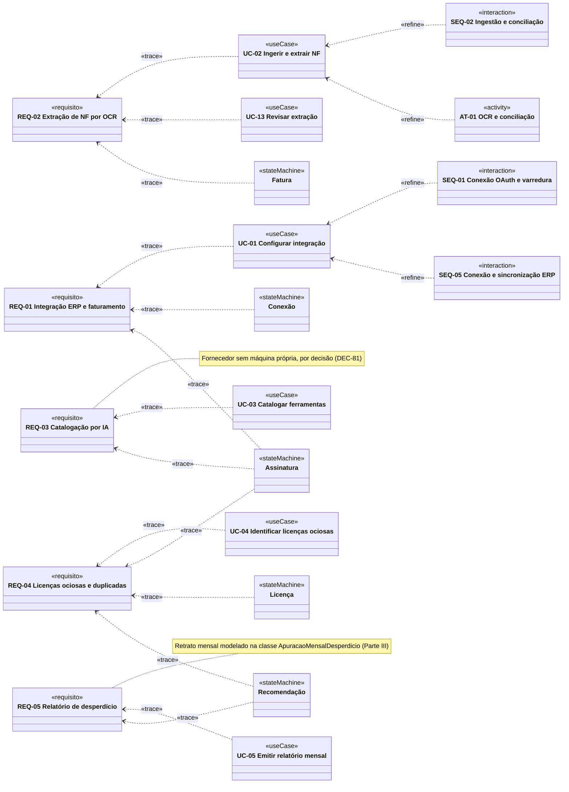
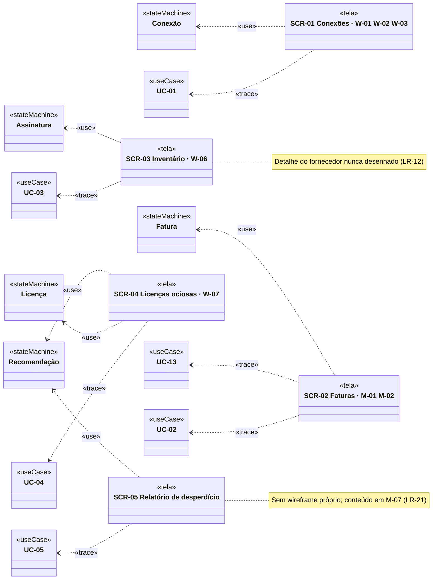
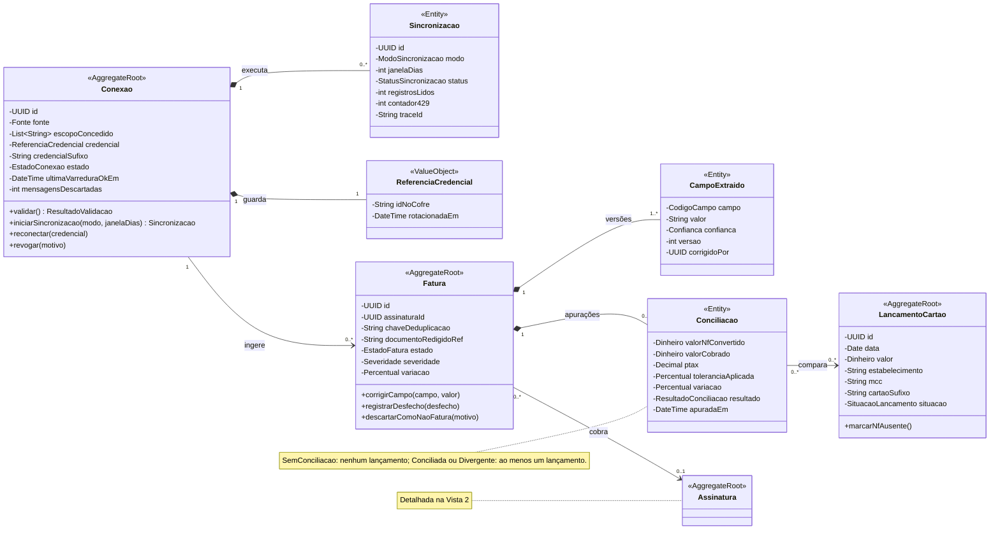
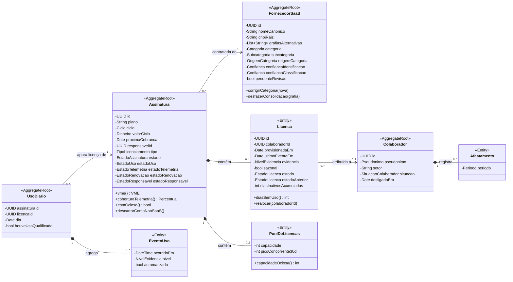
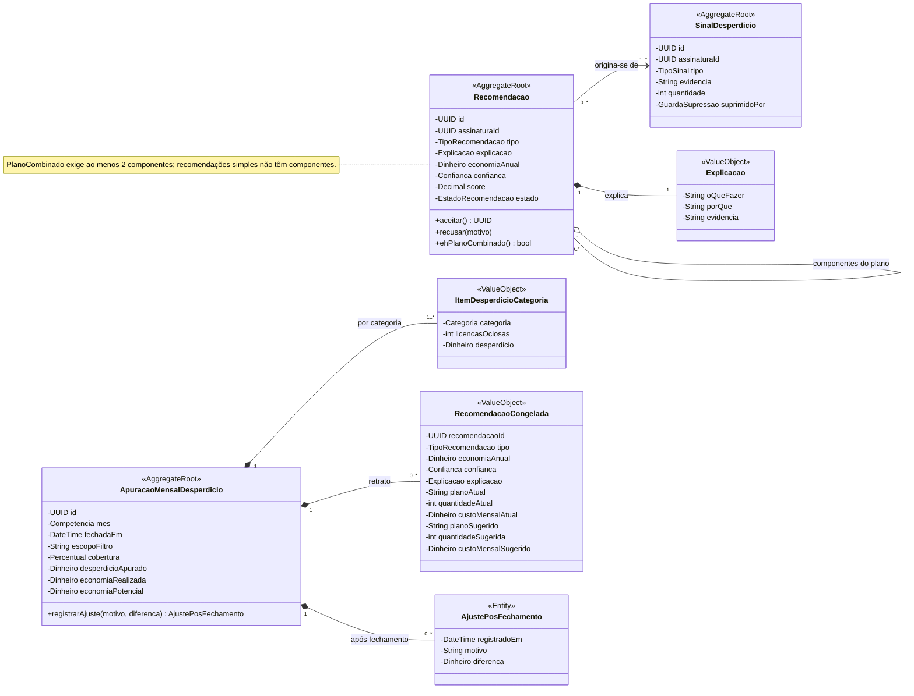
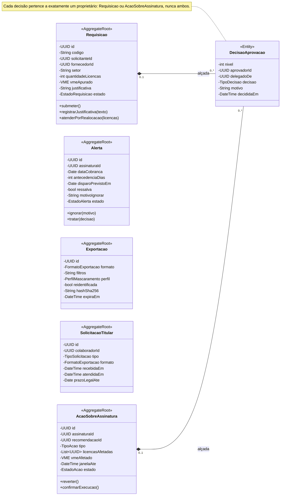
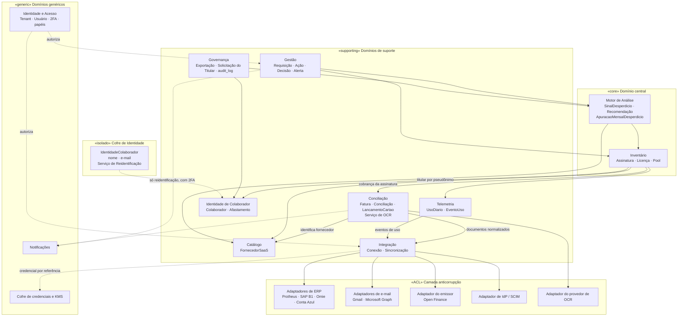

# Entregável 3 — Diagramas UML (Semana 08)

**Projeto:** Auditor e Otimizador de Assinaturas SaaS Corporativas  
**Iteração:** Semana 08 (28/09/2026 – 04/10/2026)  
**Responsável:** AR1 — a Vista 4 (Bloco B) aguarda revisão da AR2 (Seção 22)  
**Versão:** 1.0.0 — Diagrama de Classes de Domínio (entrega formal) · Diagrama de Pacotes (entrega formal) · Dependências de rastreabilidade do Bloco A  
**Situação das decisões:** DEC-76 a DEC-86 são **propostas** até a ratificação da equipe; o modelo as aplica para que possam ser avaliadas

---

## 1. O que se aplica a esta iteração

Conforme a matriz de [`diagramasUML.md`](../diagramasUML.md):

| Diagrama | Janela | Entrega formal | Situação |
|:---|:---|:---|:---|
| Casos de Uso | Semanas 1 a 3 | Semana 2 | Fechado em v1.1 (Semana 03) |
| Atividades | Semanas 2 e 3 | Semana 3 | Fechado em v1.0 (Semana 03) |
| Sequência | Semanas 4 e 5 | Semana 5 | Fechado em v1.0 (Semana 05); SEQ-05 acrescentado na Semana 07 |
| Máquina de Estados | Semanas 5 e 6 | Semana 6 | Fechado em v1.0 (Semana 06); `Conexão` ajustada pela DEC-85 (CU-14) |
| **Classes de Domínio** | Semanas 6 e 7 | Semana 7 | **Entrega formal v1.0 nesta iteração (Parte III)** — a Semana 07 entregou um recorte v0.1 e declarou que ele não substitui a v1.0 |
| **Pacotes / Componentes** | Semana 7 | Semana 7 | **Entrega formal v1.0 nesta iteração (Parte IV)** — a Semana 07 entregou uma proposta que pede conferência com o dicionário |
| Implantação | Semanas 10 e 11 | Semana 11 | Fora do escopo |

**Por que as duas entregas formais estão aqui.** A Semana 07 foi preparada sem acesso aos
entregáveis da Semana 06 e deixou as duas versões finais como pendência (P-30 da Semana 07).
A matriz de rastreabilidade do Bloco A precisa de uma coluna de estrutura confiável — sem a
v1.0, as células de classe continuariam apontando para um rascunho e para um recorte que
divergem entre si (Entregável 1, RS-04 a RS-08).

| Parte | Conteúdo |
|:---|:---|
| I | Dependências `«trace»` e `«refine»` do Bloco A |
| II | Verificação transição × interface das máquinas do Bloco A |
| III | **Diagrama de Classes de Domínio v1.0** |
| IV | **Diagrama de Pacotes v1.0** |
| V | Correções em artefatos anteriores (CU-01 a CU-14) |

---

# PARTE I — Dependências de Rastreabilidade do Bloco A

## 2. Notação

A UML 2.5 define `«trace»` e `«refine»` como estereótipos de **abstração** do perfil padrão:
uma dependência entre elementos que representam o mesmo conceito em níveis diferentes. A seta
vai do elemento mais concreto (cliente) para o mais abstrato (fornecedor).

| Estereótipo | Uso neste documento | Exemplo |
|:---|:---|:---|
| `«trace»` | O elemento realiza ou exibe o requisito | `UC-01 ..> REQ-01` |
| `«refine»` | O elemento detalha o comportamento de outro | `SEQ-01 ..> UC-01` |
| `«use»` | A tela depende dos estados de uma máquina para seus badges | `SCR-02 ..> Fatura` |

## 3. Diagrama 1 — Comportamento → Requisito



## 4. Diagrama 2 — Tela → Caso de Uso e Máquina



## 5. Cobertura das Dependências

| Req | Caso de uso | Detalhamento comportamental | Máquinas | Classes v1.0 | Tela | Situação UML |
|:---|:---|:---|:---|:---|:---|:---:|
| REQ-01 | UC-01 | SEQ-01, SEQ-05 | `Conexão`, `Assinatura` | `Conexao`, `Sincronizacao` | SCR-01 | ✓ |
| REQ-02 | UC-02, UC-13 | AT-01, SEQ-02 | `Fatura` | `Fatura`, `CampoExtraido`, `Conciliacao`, `LancamentoCartao` | SCR-02 | ✓ — `NF ausente` agora no `LancamentoCartao` (DEC-86) |
| REQ-03 | UC-03 | — | `Assinatura` (`Em catalogação`) | `FornecedorSaaS` | SCR-03 | ◐ — UC-03 desatualizado (CU-03) |
| REQ-04 | UC-04 | — | `Licença`, `Assinatura`, `Recomendação` | `Licenca`, `PoolDeLicencas`, `UsoDiario`, `Colaborador` | SCR-04 | ◐ — contestação E4 sem transição (P-41) |
| REQ-05 | UC-05 | — | `Recomendação` | `Recomendacao`, `SinalDesperdicio`, `ApuracaoMensalDesperdicio` | SCR-05 | ✓ |

> REQ-03, REQ-04 e REQ-05 não têm diagrama de sequência ou de atividades. Isso **não é
> lacuna**: a Semana 04 escolheu as interações a modelar por risco técnico (seleção SEQ-01 a
> SEQ-04), e as regras desses requisitos estão nas máquinas e nos fluxogramas do motor.

---

# PARTE II — Verificação Transição × Interface

## 6. Método

Cada transição das cinco máquinas que tocam o Bloco A foi classificada pelo gatilho:

- **Disparada por pessoa** — precisa de um controle desenhado em alguma tela (`W-xx` ou `M-xx`).
- **Disparada pelo sistema** — precisa que o estado resultante tenha badge e apareça em pelo
  menos um exemplo de tela.

As transições cujo gatilho humano está em tela do Bloco B (aprovação de ação, realocação,
atribuição de responsável) ficam para a matriz da Semana 09.

## 7. Transições Disparadas por Pessoa (GI-xx)

| ID | Máquina | Transição | Controle esperado | Onde está | Situação |
|:---|:---|:---|:---|:---|:---:|
| GI-01 | `Conexão` | `[*]` → `Conectando` (OAuth) | *"Continuar para o Google"* | W-02 | ✓ |
| GI-02 | `Conexão` | `[*]` → `Conectando` (chave de ERP) | Formulário de chave de API | W-01 só tem *"Conectar"*; a OpenAPI da S7 já tem `POST /erp/connections` | ✗ HF-01 |
| GI-03 | `Conexão` | `TokenExpirado` → `Ativa` | *"Reconectar"* | W-08 C | ✓ |
| GI-04 | `Conexão` | `Erro` → `Ativa` | *"Tentar novamente"* (CT-01.5) | — (a OpenAPI tem `POST /test`) | ✗ HF-03 |
| GI-05 | `Conexão` | `Ativa` / `TokenExpirado` / `Erro` → `Revogada` | *"Revogar conexão"* com 2FA (CT-01.7) | — (a OpenAPI tem `DELETE`, sem o estado `revogada` — CU-10) | ✗ HF-02 |
| GI-06 | `Fatura` | `PendenteRevisao` → `Extraida` (UC-13) | *"Corrigir leitura"* | M-02, desenhado só para `Divergente` | ◐ HF-06 |
| GI-07 | `Fatura` | `PendenteRevisao` → `Descartada` | *"Não é uma fatura"* | — | ✗ HF-06 |
| GI-08 | `Fatura` | `Divergente` → `Conciliada` / `Divergente` (RN05.10) | *"Corrigir leitura"* | M-02 · T-03 | ✓ |
| GI-09 | `Fatura` | `Divergente` → `Tratada` | *"Registrar desfecho"* | — (`NOTIFICAR` não muda estado) | ✗ HF-05 |
| GI-10 | `Assinatura` | `Mapeada` → `Descartada` (FP-A) | *"Não é SaaS"* | — | ✗ HF-09 |
| GI-11 | `Recomendação` | `Publicada` → `Aceita` | *"Aplicar downgrade"* | W-07 · T-07 | ✓ |
| GI-12 | `Recomendação` | `Estimativa` → `Aceita` | *"Validar recomendação"* | Só no CMP-07 do Design System | ◐ HF-13 |
| GI-13 | `Recomendação` | `Publicada` / `Estimativa` → `Recusada` | *"Recusar"* com motivo | — | ✗ HF-13 |
| GI-14 | `Licença` | Contestação por E4 (RN02.2) | *"Contestar ociosidade"* | — e sem transição na máquina | ✗ P-41 |
| GI-15 | *(fornecedor)* | Corrigir categoria (CT-03.3) | *"Corrigir categoria"* | — (`[...]` de W-06 sem conteúdo) | ✗ HF-09 |
| GI-16 | *(fornecedor)* | Desfazer consolidação de grafias (DEC-14) | *"Desfazer"* | — | ✗ HF-09 |

**Resultado: dos 16 gatilhos humanos do Bloco A, 4 têm controle desenhado, 2 estão parciais e
10 não têm controle em nenhuma tela.** Os wireframes desenharam o caminho feliz de cada
máquina — conectar, corrigir, aplicar — e pararam antes das saídas que encerram o ciclo de
vida (`Tratada`, `Descartada`, `Revogada`, `Recusada`). São as transições que alimentam
auditoria e calibração: sem *"Recusar"*, o MI-04 e o ciclo de calibração do motor
(S4·E1 §9.1) não recebem o sinal de rejeição.

> **O caso mais grave é o GI-09.** Sem *"Registrar desfecho"*, uma fatura `Divergente · Crítica`
> só sai de `Divergente` se alguém corrigir a leitura até que ela concilie — o que falsificaria
> a auditoria quando a divergência é real. E a região de renovação da assinatura, bloqueada pela
> SY-07, só é liberada pela SY-08, que depende de `Tratada`. Hoje, uma renovação bloqueada por
> divergência crítica **nunca seria liberada pela interface** — nem pela API da Semana 07, que
> também não tem o estado `tratada` (CU-11).

## 8. Estados Visíveis × Exemplos em Tela

Badges da Seção 10.1 do Design System (versão íntegra do commit `c13f5dd` — ver P-37) contra os exemplos que os wireframes efetivamente
mostram.

| Máquina | Estados com badge | Exemplificados nos wireframes | Mínimo a acrescentar no Hi-Fi |
|:---|:---:|:---|:---|
| `Fatura` | 8 | 4 — `Pendente de revisão`, `Conciliada`, `Divergente`, `Sem conciliação` (M-01) | `Aguardando conciliação`, `Tratada` (HF-07) |
| `Licença` | 10 | 3 — `Ativa`, `Ociosa`, `Sem telemetria` (W-07) | `Órfã`, `Suspensa por afastamento`, `Ociosa · apenas login` (HF-14) |
| `Assinatura` | 11 | 0 — W-06 não tem coluna de estado; *"renovação bloqueada"* aparece só como texto em M-01 | `Ativa`, `Ociosa`, `Em catalogação`, `Sem telemetria`, `Renovação bloqueada` (HF-11) |
| `Recomendação` | 8 | 1 — `Publicada`, implícita no card de W-07 | `Estimativa` (HF-13), `Economia realizada` (HF-18) |
| `Conexão` | 5 | 4 — `Ativa`, `Token expirado`, `Conectando`, `Erro` (W-03) | `Revogada` (HF-03) |
| **Total** | **42** | **12 (29%)** | **13** |

> `Recebida` e `Extraída (OCR)` são estados transitórios do pipeline e dispensam exemplo.
> `Em downgrade`, `Em cancelamento`, `Removida` e `Cancelada` da licença resultam de ações do
> Bloco B e entram nos exemplos da Semana 09. O protótipo da Semana 07 implementa três desses
> badges (`Divergente`, `Ociosa`, `Pendente de revisão`), com ícones e tons que divergem do
> Design System (CU-12).

---

# PARTE III — Diagrama de Classes de Domínio v1.0

## 9. Fontes e Convenções

| Fonte | O que entra na v1.0 |
|:---|:---|
| Rascunho v0.1 (Semana 06, 18 classes) | Raízes de agregado, composições e invariantes |
| Dicionário de dados (Semana 06, ENT-01 a ENT-24) | Atributos, tipos e regras de domínio |
| Máquinas de estado v1.0 (Semana 06) | Enumerações de estado — os 76 estados |
| Recorte v0.1 (Semana 07) | `Sincronizacao`, `ReferenciaCredencial` e os modos de sincronização |
| Decisões desta iteração | `ApuracaoMensalDesperdicio` (DEC-84), plano combinado (DEC-82), `SituacaoLancamento` (DEC-86), atributo `pendenteRevisao` (DEC-81), `subcategoria` (DEC-79) |

**Convenções.** Atributos são privados (`-`) e só mudam pelas operações públicas (`+`) da raiz
do agregado — é assim que a raiz protege as invariantes. Referência entre agregados é por
identificador (seta simples); composição (`*--`) só dentro do agregado. O diagrama foi
dividido em quatro vistas por contexto para continuar legível; as enumerações estão na
Seção 14, em tabela.

## 10. Vista 1 — Integração e Conciliação (REQ-01, REQ-02)



| Invariante | Origem |
|:---|:---|
| `escopoConcedido` só contém escopos de leitura; escopo de escrita impede a criação da conexão | DEC-02 · CT-01.4 |
| No máximo uma `Sincronizacao` em andamento por conexão | Recorte da S7 (resposta `409`) |
| `janelaDias` ≤ 90 nos modos `initial` e `incremental`; períodos anteriores só em `historical` | DEC-41 · DEC-71 da S7 |
| `revogar()` exige reautenticação 2FA, remove a credencial do cofre e leva a `Revogada`; a conexão continua consultável | CT-01.7 · CH-05 · CU-10 |
| `CampoExtraido` e `Conciliacao` são somente acrescentados; nunca há duas versões ativas do mesmo campo | RN05.9 · RN05.10 |
| `registrarDesfecho()` só é aceito em `Divergente` e, com severidade `Crítica`, dispara a SY-08 | GI-09 · CT-02.14 |
| `descartarComoNaoFatura()` só é aceito em `PendenteRevisao` | GI-07 · CT-02.15 |
| `marcarNfAusente()` só após 30 dias sem nota pareável | BR-07 · DEC-86 |
| A `Fatura` referencia no máximo uma `Assinatura` (`assinaturaId`, vazio enquanto o fornecedor não é vinculado); é por essa referência que a SY-07 bloqueia e a SY-08, via `registrarDesfecho()`, libera a renovação da assinatura certa | ENT-13 (`assinatura_id`) · v0.1 da S6 · SY-07 · SY-08 |
| `Conciliacao` com resultado `SemConciliacao` não referencia lançamento (a janela terminou sem lançamento pareável, regra D3); `Conciliada` e `Divergente` referenciam ao menos um | RN05 · D3 · v0.1 da S6 |

## 11. Vista 2 — Catálogo, Inventário e Telemetria (REQ-03, REQ-04)



| Invariante | Origem |
|:---|:---|
| Uma assinatura tem licenças nominais **ou** um pool, nunca os dois | DEC-56 · RS-07 |
| `estadoUso`, `estadoTelemetria`, `estadoRenovacao` e `estadoResponsavel` só existem com `estado = Vigente` | DEC-64 |
| `estaOciosa()` exige 100% das licenças avaliáveis ociosas ou órfãs e cobertura ≥ 80% | DEC-61 |
| O pseudônimo pertence ao `Colaborador`, não à `Licenca`; uma vez atribuído, não muda | DEC-53 · RS-05 |
| `diasSemUso()` é derivado de `ultimoEventoEm`; não existe atributo armazenado com esse valor | ENT-09 · RS-06 |
| `realocar()` só é aceito com a licença em `Ociosa` ou `Orfa` e leva a `Provisionada` | RN04 · SY-11 |
| `Afastamento` guarda só o período, nunca o motivo | AN-09 · DEC-57 |
| `UsoDiario` referencia a raiz `Assinatura` (`assinaturaId`) e identifica a licença só por `licencaId`, como chave interna do agregado: `Licenca` é entidade interna e não é alvo de associação vinda de fora dele | Convenção da Seção 9 |
| `EventoUso` com `automatizado = true` não altera `houveUsoQualificado` | BI-10 |
| `pendenteRevisao = true` impede a geração dos sinais SD-03, SD-04 e SD-05 | DEC-81 · S4·E1 §5.1 |
| SD-03 exige categoria de redundância alta, ou a mesma `subcategoria` em categoria de redundância média | DEC-79 |

> **`IdentidadeColaborador` (ENT-04) continua fora do modelo de domínio**, como decidido na
> v0.1: nome e e-mail ficam no Cofre de Identidade, num contexto isolado (Parte IV), acessível
> só pelo Serviço de Reidentificação. Uma navegação `Colaborador → nome` no diagrama sugeriria
> exatamente o acesso que a LGPD-01 proíbe.

## 12. Vista 3 — Motor de Análise e Relatório Mensal (REQ-04, REQ-05)



| Invariante | Origem |
|:---|:---|
| Recomendação não existe sem os quatro campos de explicação e economia | DEC-34 |
| Confiança abaixo de 0,70 ⇒ `Estimativa`; economia abaixo de R$ 1.200,00/ano ⇒ não publicada, exceto como componente de plano combinado | S4·E1 §6.2 · DEC-82 |
| Componentes de um plano combinado (`tipo = PlanoCombinado`) não são publicados isoladamente; nenhuma licença é contada em mais de um componente | DEC-82 · CT-05.7 |
| `tipo = PlanoCombinado` ⇔ dois ou mais componentes; recomendação simples e componente de plano não têm componentes (o plano não tem ciclos) | DEC-82 |
| `RecomendacaoCongelada` guarda, além de tipo, economia e confiança, a explicação e o comparativo (plano, quantidade e custo mensal atuais e sugeridos) vigentes no fechamento; o relatório histórico nunca consulta a assinatura atual | DEC-84 · HF-18 · CMP-12 |
| `recusar()` exige motivo não vazio | GI-13 |
| Depois de `fechadaEm`, nenhum valor da apuração muda; correção só por `AjustePosFechamento`, somente acrescentado | DEC-84 · CT-05.6 |
| `economiaRealizada` e `economiaPotencial` são campos separados; não existe atributo de total que os some | DEC-21 · CT-05.3 |
| `escopoFiltro` é gravado com o retrato, e todo total declara o escopo | IC-06 · ANT-04 |

## 13. Vista 4 — Gestão e Governança (Bloco B)

Incluída para a v1.0 ficar completa. Atributos vêm do dicionário (ENT-19 a ENT-24); o
refinamento das operações é da AR2, na Semana 09.



| Invariante | Origem |
|:---|:---|
| Cada `DecisaoAprovacao` tem exatamente um proprietário — `Requisicao` **ou** `AcaoSobreAssinatura` (restrição `{xor}`) | ENT-22 · S6·E2 §11.4 |
| O solicitante nunca decide a própria requisição; níveis de alçada são sequenciais | RN01.5 · RN01.6 |
| `DecisaoAprovacao` é somente acrescentada; retificação é nova decisão | RN01.10 |
| Alteração de valor acima de 10% após o início do fluxo volta a requisição a `Rascunho` | RN01.9 |
| A ação não entra em execução antes de 72 h da última aprovação | RN02.9 |
| `ignorar()` exige motivo | RI-24 |
| Exportação herda o perfil de mascaramento da sessão | AN-10 · CTL-15 |

## 14. Value Objects e Enumerações

### 14.1. Value Objects

| VO | Atributos | Regra de validação |
|:---|:---|:---|
| `Dinheiro` | `valor: Decimal(15,2)`, `moeda: ISO 4217` | Duas casas; na API, texto decimal (DEC-70 da S7) |
| `VME` | `valorMensal: Dinheiro` | Normalização de ciclo (RN01.2) e câmbio conservador (RN01.3) |
| `Percentual` | `valor: Decimal(7,2)` | `ROUND_HALF_UP`; sinal preservado (DEC-09) |
| `Confianca` | `valor: Decimal(4,3)` | Entre 0 e 1 |
| `Periodo` | `inicio: Date`, `fim: Date?` | `fim` vazio enquanto vigente; `fim ≥ inicio` |
| `Competencia` | `ano`, `mes` | Mês fechado só depois do último dia |
| `Pseudonimo` | `digest`, `exibicao` | HMAC-SHA-256 com chave do tenant; prefixo único ≥ 4 (DEC-53) |
| `Explicacao` | `oQueFazer`, `porQue`, `evidencia` | Nenhum campo vazio (DEC-34) |
| `ReferenciaCredencial` | `idNoCofre`, `rotacionadaEm` | O segredo nunca está no domínio (CTL-03) |
| `ItemDesperdicioCategoria` · `RecomendacaoCongelada` | Ver Vista 3 | Imutáveis após o fechamento (DEC-84) |

### 14.2. Enumerações de estado — os 76 estados das 8 máquinas

| Enumeração | Valores | Máquina |
|:---|:---|:---|
| `EstadoConexao` | `Conectando`, `Ativa`, `TokenExpirado`, `Erro`, `Revogada` | `Conexão` (5) |
| `EstadoFatura` | `Recebida`, `PendenteRevisao`, `Extraida`, `AguardandoConciliacao`, `Conciliada`, `Divergente`, `Tratada`, `SemConciliacao`, `Descartada` | `Fatura` (9) |
| `EstadoLicenca` | `Provisionada`, `Ativa`, `Ociosa`, `SuspensaPorAfastamento`, `SemTelemetria`, `Orfa`, `EmDowngrade`, `EmCancelamento`, `Removida`, `Cancelada` | `Licença` (10) |
| `EstadoAssinatura` | `Mapeada`, `Vigente`, `Descartada`, `Cancelada` | `Assinatura` (16, com as quatro regiões abaixo) |
| `EstadoUso` | `Ativa`, `Ociosa`, `EmDowngrade`, `EmCancelamento` | `Assinatura` · região de uso |
| `EstadoTelemetria` | `SemTelemetria`, `TelemetriaAtual`, `TelemetriaDesatualizada` | `Assinatura` · região de telemetria |
| `EstadoRenovacao` | `RenovacaoNaoMapeada`, `RenovacaoLiberada`, `RenovacaoBloqueada` | `Assinatura` · região de renovação |
| `EstadoResponsavel` | `ComResponsavel`, `SemResponsavel` | `Assinatura` · região de responsável |
| `EstadoRecomendacao` | `Candidata`, `Descartada`, `Publicada`, `Estimativa`, `Aceita`, `Recusada`, `Obsoleta`, `Executada`, `Revertida`, `RecusadaPeloFornecedor` | `Recomendação` (10) |
| `EstadoRequisicao` | `Rascunho`, `EmAprovacao`, `Bloqueada`, `Aprovada`, `Rejeitada`, `Contratada`, `Expirada`, `AtendidaPorRealocacao`, `Descartada` | `Requisição` (9) |
| `EstadoAcao` | `Solicitada`, `EmAprovacao`, `Rejeitada`, `JanelaArrependimento`, `Revertida`, `InvalidadaPorUso`, `EmExecucao`, `Executada`, `RecusadaPeloFornecedor` | `Ação` (9) |
| `EstadoAlerta` | `Agendado`, `Disparado`, `DisparadoComRessalva`, `Escalado`, `Tratado`, `Ignorado`, `Cancelado`, `Expirado` | `Alerta` (8) |

Total: 5 + 9 + 10 + 16 + 10 + 9 + 9 + 8 = **76**, igual à consolidação da Semana 06.

### 14.3. Demais enumerações

| Enumeração | Valores | Origem |
|:---|:---|:---|
| `ResultadoConciliacao` | `Conciliada`, `Divergente`, `SemConciliacao` | ENT-16 — resultado da apuração, distinto do estado da fatura (RS-08) |
| `SituacaoLancamento` | `AguardandoPareamento`, `Pareado`, `NfAusente` | DEC-86 |
| `Severidade` | `Media`, `Alta`, `Critica` | S2·E2 §5.1 |
| `StatusSincronizacao` · `ModoSincronizacao` | `enfileirada`, `em_andamento`, `concluida`, `falhou` · `initial`, `incremental`, `historical` | OpenAPI da S7 |
| `Fonte` | `FT-01` a `FT-07` | S1·E1 |
| `NivelEvidencia` | `E1`, `E2`, `E3`, `Nenhuma` | DEC-15 |
| `TipoLicenciamento` · `Ciclo` | `Nominal`, `Pool` · `Mensal`, `Anual`, `Bienal`, `PagamentoUnico` | ENT-08 |
| `Categoria` · `Subcategoria` · `OrigemCategoria` | `C-01` a `C-12` · a definir (P-44) · `BaseCurada`, `ModeloIA`, `AjusteManual` | S4·E1 · DEC-79 |
| `TipoSinal` · `TipoRecomendacao` | `SD-01` a `SD-10` · `REC-01` a `REC-07`, `PlanoCombinado` | S4·E1 · DEC-82 |
| `SituacaoColaborador` | `Ativo`, `Afastado`, `Desligado` | ENT-03 |
| `TipoAcao` · `TipoDecisao` | `Downgrade`, `Cancelamento` · `Aprovada`, `Rejeitada`, `Escalada` | ENT-21, ENT-22 |

## 15. O que Mudou em Relação ao v0.1 da Semana 06 e ao Recorte da Semana 07

Preenche a tabela que a Semana 07 deixou para a equipe (Seção 7 do Entregável 3 da S7).

| Elemento | v0.1 (S6) | Recorte (S7) | v1.0 | Situação |
|:---|:---|:---|:---|:---|
| `Assinatura`, `Licenca`, `PoolDeLicencas` | Sim | `Assinatura` e `Licenca`, sem pool | Atributos do dicionário e das quatro regiões; pseudônimo e dias sem uso fora da licença | Atualizado (RS-05 a RS-07) |
| `FornecedorSaaS` | Sim | Não | `subcategoria`, `pendenteRevisao`, operações de correção | Complementado |
| `Colaborador` + `Pseudonimo` | Sim | Pseudônimo na licença | Pseudônimo no colaborador; `Afastamento` como entidade | Mantido e complementado |
| `Fatura`, `CampoExtraido`, `Conciliacao` | Sim | `Fatura` com `EstadoConciliacao` | `EstadoFatura` (9) e `ResultadoConciliacao` (3) separados; `Fatura → Assinatura` (0..1) e `Conciliacao → LancamentoCartao` (0..*) mantidos da v0.1 | Atualizado (RS-08) |
| `LancamentoCartao` | Sim | Não | `SituacaoLancamento` | Complementado (DEC-86) |
| `Conexao` / `ConexaoErp` | `Conexao` | `ConexaoErp` + `Sincronizacao` + `ReferenciaCredencial` | `Conexao` com `fonte`, mais `Sincronizacao` e `ReferenciaCredencial` da S7 | Reconciliado (RS-04) |
| `Recomendacao` + `Explicacao` | Sim | Raiz sem atributos | Plano combinado (agregação recursiva) | Complementado (DEC-82) |
| `AcaoSobreAssinatura`, `Requisicao`, `DecisaoAprovacao`, `Alerta` | Sim | Raízes sem atributos | Atributos do dicionário | Complementado |
| `Dinheiro` / `Money`, `Vme` | `Dinheiro` | `Money`, `Vme`, `VariacaoPercentual` | `Dinheiro`, `VME`, `Percentual`, `Confianca`, `Periodo`, `Competencia` | Reconciliado — nome em português (Linguagem Onipresente) |
| `SinalDesperdicio`, `UsoDiario`, `EventoUso` | Não | Não | Novos | Complementado (ENT-11, ENT-12, ENT-17) |
| `ApuracaoMensalDesperdicio` e componentes | Não | Não | Novos | Complementado (DEC-84) |
| `Exportacao`, `SolicitacaoTitular` | Não | Não | Novos | Complementado (ENT-23, ENT-24) |

**Contagem:** 18 classes na v0.1 → **35 na v1.0** — 15 raízes de agregado, 9 entidades
internas e 11 *value objects* —, além de 12 enumerações de estado e 17 de apoio (Seção 14.3).
Tipos auxiliares citados nos atributos, como `CodigoCampo` e `FormatoExportacao`, seguem os
domínios já definidos no dicionário de dados.

---

# PARTE IV — Diagrama de Pacotes v1.0

## 16. Contextos Delimitados

A proposta da Semana 07 partia dos blocos do cronograma. A v1.0 parte da coluna *Contexto* do
dicionário (S6·E2, Seção 5) e da DEC-46 (OCR como serviço interno com ACL), que prevalecem
por decisão da própria Semana 07.



| Contexto | Tipo | Requisitos | Por que está nesse tipo |
|:---|:---|:---|:---|
| Inventário | Core | REQ-04 | A ociosidade (RN02) é o diferencial do produto |
| Motor de Análise | Core | REQ-03 a REQ-05 | Recomendações e relatório são o valor vendido |
| Catálogo | Supporting | REQ-03 | Necessário ao motor, mas classificar fornecedor não é o diferencial |
| Telemetria | Supporting | REQ-04 | Alimenta o Inventário; isolada para aplicar a retenção de 90 dias (DP-05) |
| Conciliação | Supporting | REQ-02 | Regra rica (RN05), mas subordinada ao diagnóstico; contém o OCR com ACL (DEC-46) |
| Integração | Supporting | REQ-01 | Específica do produto; fala com o mundo externo só pela ACL |
| Gestão | Supporting | REQ-06, 07, 09 | Fluxos de decisão humana sobre o que o core apontou |
| Identidade de Colaborador | Supporting | LGPD-01 | Regras próprias de pseudonimização (AN-05) |
| Governança | Supporting | REQ-10, LGPD-02 | Exportação, titular e trilha imutável |
| Identidade e Acesso, Notificações, KMS | Generic | RNF-01, CTL-12 | Resolvidos por soluções de mercado |
| Cofre de Identidade | Isolado | LGPD-01 | Fisicamente separado; acesso só pelo Serviço de Reidentificação (AN-12) |

## 17. Diferenças em Relação à Proposta da Semana 07

| Ponto | Proposta da S7 | v1.0 | Motivo |
|:---|:---|:---|:---|
| `Ação sobre Assinatura` | Core | Gestão | Dicionário: contexto Gestão; a ação é decisão humana sobre o que o core recomendou |
| Catálogo e Telemetria | Ausentes | Contextos próprios | Dicionário (ENT-07, ENT-11, ENT-12) |
| Conciliação | Junto com a ingestão | Separada da Integração | A ACL isola o formato externo; a RN05 opera sobre documento já normalizado |
| ACL | Só ERP | ERP, e-mail, cartão, IdP e OCR | REQ-01, REQ-02, REQ-04 e DEC-46 |
| Identidade de colaborador | Dentro de Governança | Contexto próprio + Cofre isolado | ENT-04 e AN-12 exigem isolamento físico |
| Alerta | Supporting de aprovação | Gestão | Mesmo contexto do dicionário |

---

# PARTE V — Correções em Artefatos Anteriores

## 18. Correções (CU-xx)

Seguindo a convenção da Semana 06 (Seção 13 do Entregável 3), **os documentos anteriores não
foram alterados por esta entrega**: as correções ficam registradas aqui para que os responsáveis
de cada semana as apliquem. **Nenhuma CU está aplicada**; por isso as lacunas que dependem delas
seguem abertas na matriz (Entregável 1, Seção 9.1). As CU-10 a CU-14 tocam a Semana 07, que
está em revisão na PR própria dela, e devem ser aplicadas lá.

| ID | Artefato | Trecho vigente | Versão corrigida | Origem |
|:---|:---|:---|:---|:---|
| CU-01 | [S2·E1](../semana-02/entregavel-01-especificacao-bdd-gherkin-req01-req03.md), CT-01.1, 01.2, 01.6, 01.7, 01.8 e Contexto de US-02; [S2·E4](../semana-02/entregavel-04-diagramas-uml.md), UC-01 | estado `"Ativo"` | estado `"Ativa"` — nome de exibição da máquina `Conexão` (regra BD-1) | LR-03 |
| CU-02 | S2·E1, CT-01.1 e CT-02.7 | *"concluída em menos de 5 minutos (por conta conectada)"* | *"a varredura da janela de 90 dias deve ser concluída em menos de 5 minutos no percentil 95 da conexão, com o OCR processado fora desse prazo"* | LR-04 · DEC-41, 42, 43 |
| CU-03 | S2·E4, UC-03, fluxo 3a | *"Confiança inferior a 70% → … aciona UC-14"* | *"Confiança inferior a 80% (DEC-44) → fornecedor marcado como pendente de revisão; não entra nas recomendações; o Administrador confirma ou corrige a categoria neste mesmo fluxo"* | LR-13 · P-09 |
| CU-04 | S2·E1, CT-03.2 | *"deve assumir o estado 'Pendente de revisão'"* | *"deve ser marcado como pendente de revisão"* | LR-15 · DEC-81 |
| CU-05 | [S4·E1](../semana-04/entregavel-01-fluxogramas-motor-ia-algoritmo-consolidacao.md), Seção 2 (diagrama e contrato de E1) | E1: *"confiança < 70%"* e limiar *"75%"* | E1: vincula a partir de 0,88; revisão entre 0,75 e 0,88; novo fornecedor abaixo de 0,75 | LR-14 · DEC-80 |
| CU-06 | S2·E4 UC-03 passo 5; S2·E1 CT-03.5; [S4·E2](../semana-04/entregavel-02-kit-wireframes-lofi.md) anotação (22); S4·E1 SD-03 e fluxograma do REC-03 | *"três ou mais fornecedores"*; *"redundância alta ou média"* | 2 ou mais fornecedores ativos em categoria de redundância alta; média só com a mesma subcategoria funcional | LR-16 · DEC-79 |
| CU-07 | S4·E1, Seção 6.2, caso REC-03 | `custo_incr ← exclusivos × preco_unit(manter) × 12` | `excedentes ← max(0, exclusivos − ociosas(manter))` · `custo_incr ← excedentes × preco_unit(manter) × 12` · REC-01 sobre a ferramenta mantida passa a ser residual do plano | LR-25 · DEC-82 |
| CU-08 | [S5·E1](../semana-05/entregavel-01-wireframes-midfi-visualizador-nf-modais.md), Seção 6 (M-07) | *"SCR-10 — Central de Relatórios e Exportação"* | Corpo do relatório: **SCR-05**; botão de exportação: SCR-10 | LR-21 · DEC-83 |
| CU-09 | [S3·E1](../semana-03/entregavel-01-especificacao-bdd-gherkin-req04-req10.md), US-04 e US-05 | *tag* `@BlocoB` | *tag* `@BlocoA` | LR-26 · DEC-77 |
| CU-10 | [S7·E1](../semana-07/entregavel-01-openapi-integracoes-erp.yaml), `ConnectionStatus` e `DELETE /erp/connections/{connectionId}` | `enum: [conectando, ativa, token_expirado, erro]`; revogação devolve 204 e a conexão some | Acrescentar `revogada`; `DELETE` muda o estado para `revogada`, apaga a credencial do cofre e mantém a conexão consultável por `GET` (dados já importados permanecem) | RS-01 · CT-01.7 |
| CU-11 | S7·E1, `ReconciliationStatus` | Seis valores, sem `tratada` | Acrescentar `tratada` (estado terminal da máquina `Fatura`); `recebida` e `extraida` ficam fora por serem transitórias | RS-02 · GI-09 |
| CU-12 | [S7·E2](../semana-07/entregavel-02-biblioteca-componentes-ui.md) e `ui-components/` | `Divergente` com triângulo; `Ociosa` com relógio; `Pendente de revisão` azul com interrogação; bordas tracejada e pontilhada | `Divergente`: círculo com X, tom `danger`; `Ociosa` e `Pendente de revisão`: triângulo, tom `warning`; borda contínua para todos (anatomia fixa da DEC-49) | RS-09 |
| CU-13 | S7·E2, Seção 7, e gráfico do protótipo | *"desperdício em aberto (potencial)"* | *"Desperdício apurado"* (fato, R3 da DEC-78) ao lado de *"Economia realizada"*; potencial só como estimativa, em outro bloco | RS-10 |
| CU-14 | [S6·E3](../semana-06/entregavel-03-diagramas-uml.md), máquina `Conexão`; S2·E1, CT-01.8; S4·E2, W-03 | `Conectando --> Ativa: primeira varredura concluída` · `Conectando --> Erro: falha na primeira carga` · exemplo *"Omie · aguardando primeira carga · Conectando"* | `Conectando --> Ativa: credencial validada` · `Conectando --> Erro: validação falhou`; a primeira carga é acompanhada pela `Sincronizacao`; exemplo passa a *"Omie · primeira carga em andamento · Ativa"* | RS-11 · DEC-85 |

**Efeito da CU-07 no exemplo de consolidação.** Com o algoritmo vigente, consolidar o Canva Pro
no Figma geraria um custo incremental de 6 × R$ 86,00 × 12 = R$ 6.192,00 — o preço de **seis
licenças novas**, que a RN04 bloquearia na requisição porque o Figma tem 7 ociosas idênticas.
Com a correção, os 6 exclusivos ocupam licenças ociosas, o custo incremental é zero e a
economia do plano é R$ 20.232,00/ano (Entregável 1, Seção 10.5).

### 18.1. Trechos prontos para aplicar (CU-10 a CU-14)

Os responsáveis por cada semana aplicam as correções nos próprios arquivos; esta seção entrega
o texto exato. **Três verificações automatizadas da Semana 07 dependem dos valores corrigidos**
e precisam mudar no mesmo commit, ou passarão a falhar:

| Verificação da S7 | Por que quebra | Ajuste |
|:---|:---|:---|
| `tests/validar_openapi.py`, bloco 7: `ConnectionStatus = PAT-03` | Compara a enumeração com a lista antiga, de 4 valores | Comparar com a lista de 5 valores (CU-10) |
| `tests/dom.test.js`: `assert.equal(kpis[1], 'Desperdício em aberto')` | O rótulo muda (CU-13) | `'Desperdício apurado'` |
| `tests/contraste.test.js`: par `botão secundário hover` usa `pendente-bg` | O fundo do botão deixa de ser o tom de `Pendente de revisão` (CU-12) | Usar a nova variável `info-bg` |

**CU-10 — `semana-07/entregavel-01-openapi-integracoes-erp.yaml`**

```yaml
    ConnectionStatus:
      type: string
      enum: [conectando, ativa, token_expirado, erro, revogada]
      description: Estados da máquina `Conexão` v1.0 (Semana 06), com a semântica da DEC-85 (Semana 08).
```

No `delete` de `/erp/connections/{connectionId}`:

```yaml
      description: |
        Muda o estado para `revogada`, remove a credencial do cofre e interrompe novas sincronizações (CTL-13).
        A conexão continua consultável por `GET`, porque os dados já importados permanecem (CT-01.7).
        `revogada` é estado terminal: reconectar exige nova conexão. Repetir a revogação responde `409`.
        Registra evento em `audit_log` (CTL-11).
      responses:
        '204':
          description: Conexão revogada; o recurso permanece consultável com `status = revogada`.
```

No `patch` do mesmo caminho e no `post` de `/test`, acrescentar
`'409': {$ref: '#/components/responses/Conflict'}`, porque uma conexão revogada não aceita
alteração nem teste. Na resposta `Conflict`, acrescentar *"conexão revogada"* à descrição.

No `tests/validar_openapi.py`, bloco 7:

```python
check("ConnectionStatus = máquina Conexão (S6) + DEC-85",
      spec["components"]["schemas"]["ConnectionStatus"]["enum"] == ["conectando","ativa","token_expirado","erro","revogada"])
```

**CU-11 — mesmo arquivo**

```yaml
    ReconciliationStatus:
      type: string
      enum: [aguardando_conciliacao, conciliada, divergente, tratada, pendente_de_revisao, sem_conciliacao, descartada]
      description: Estados da máquina `Fatura` v1.0 expostos pela API; `recebida` e `extraida` são transitórios e ficam fora.
```

```python
check("ReconciliationStatus contém tratada (máquina Fatura)",
      "tratada" in spec["components"]["schemas"]["ReconciliationStatus"]["enum"])
```

**CU-12 — `semana-07/ui-components/`**

`app.js`, objeto `ICONES`:

```js
  var ICONES = {
    divergente: '<circle cx="12" cy="12" r="9"/><path d="m9 9 6 6M15 9l-6 6"/>',
    ociosa: '<path d="M12 3 2 20h20L12 3Z"/><path d="M12 10v4M12 17.5v.01"/>',
    pendente: '<path d="M12 3 2 20h20L12 3Z"/><path d="M12 10v4M12 17.5v.01"/>'
  };
```

`styles.css` — o azul atual de `Pendente de revisão` passa para variáveis próprias, ainda usadas
pelo banner e pelo *hover* do botão secundário; `Pendente de revisão` assume o tom `warning`:

```css
  --pendente-fg: #92400e;   --pendente-bg: #fffbeb;   --pendente-bd: #b45309;
  --info-fg: #1e40af;       --info-bg: #eff6ff;       --info-bd: #1d4ed8;

.demo-banner { /* … */ background: var(--info-bg); color: var(--info-fg); border-bottom: 1px solid var(--info-bd); }
.btn--secondary:hover { background: var(--info-bg); color: var(--primary-hover); }
.badge--ociosa { /* … */ border-style: solid; }
.badge--pendente { color: var(--pendente-fg); background: var(--pendente-bg); border-color: var(--pendente-bd); border-style: solid; }
```

`index.html`, catálogo de espécimes: os mesmos SVG e as legendas *"círculo com X"* (Divergente)
e *"triângulo"* (Pendente de revisão e Ociosa), sem menção a borda. `contraste.test.js`: o par
`botão secundário hover` passa a `['primary-hover', 'info-bg']`, e entra o par
`['banner informativo', 'info-fg', 'info-bg']`. No Entregável 2 da S7, Seção 5, as colunas
*Ícone*, *Borda* e *Tom* seguem estes valores. Os pares de contraste de `Pendente de revisão`
passam a ser os mesmos de `Ociosa`, que já são aprovados pelo teste da própria Semana 07.

**CU-13 — `semana-07/ui-components/`**

| Arquivo | Trecho vigente | Novo texto |
|:---|:---|:---|
| `app.js`, `renderKpis` | `['Desperdício em aberto', …, 'potencial, não somado ao realizado', '']` | `['Desperdício apurado', …, 'licenças ociosas; não somado ao realizado', '']` |
| `app.js`, `renderGrafico` | `linha('open', 'Em aberto', g.aberto)` · `'/mês em aberto e '` | `linha('open', 'Desperdício apurado', g.aberto)` · `'/mês de desperdício apurado e '` |
| `index.html`, `figcaption` e legenda | *"Em aberto" é potencial* · *Em aberto (hachurado)* | *"Desperdício apurado" é fato medido nas licenças ociosas* · *Desperdício apurado (hachurado)* |
| `tests/dom.test.js` | `'Desperdício em aberto'` | `'Desperdício apurado'` |

A chave interna `aberto` dos dados pode ficar como está: o `regras.test.js` a usa
(`t.aberto`), e renomeá-la não muda o que o usuário vê.

**CU-14 — máquina `Conexão` e exemplos**

[S6·E3](../semana-06/entregavel-03-diagramas-uml.md), Seção 11:

```text
    [*] --> Conectando: credencial somente-leitura informada (DEC-02)
    Conectando --> Ativa: credencial validada (DEC-85)
    Conectando --> Erro: validação da credencial falhou
```

[S2·E1](../semana-02/entregavel-01-especificacao-bdd-gherkin-req01-req03.md), CT-01.8, linha
do Omie: `| Omie | primeira carga em andamento | Ativo |` — o rótulo `Ativo` muda junto com os
demais pela CU-01. [S4·E2](../semana-04/entregavel-02-kit-wireframes-lofi.md), W-03, linha do
Omie: `| Omie | (o) Ativo | primeira carga 40% | [...] |`.

## 19. Eventos de Domínio Exigidos pelos Novos Gatilhos

Insumo para a Seção 4 do [`template_modelo_dominio.md`](../template_modelo_dominio.md).

| Evento | Gatilho | Dados | Reação |
|:---|:---|:---|:---|
| `DivergenciaTratada` | GI-09 *"Registrar desfecho"* | `faturaId`, `desfecho`, `severidade` | SY-08: região de renovação → `RenovacaoLiberada` |
| `DocumentoDescartado` | GI-07 *"Não é uma fatura"* | `faturaId`, `motivo` | Registro em `audit_log`; calibração do OCR |
| `ConexaoRevogada` | GI-05 *"Revogar conexão"* | `conexaoId`, `motivo` | SY-12: assinaturas dependentes → `SemTelemetria` |
| `RecomendacaoRecusada` | GI-13 *"Recusar"* | `recomendacaoId`, `motivo` | MI-04; calibração de E5 |
| `CategoriaCorrigida` | GI-15 *"Corrigir categoria"* | `fornecedorId`, `anterior`, `nova` | FP-B; calibração de E2 (IN-04) |
| `ConsolidacaoDesfeita` | GI-16 *"Desfazer"* | `fornecedorId`, `grafia` | FP-A; calibração de E1 (IN-05) |
| `CobrancaSemNota` | `marcarNfAusente()` | `lancamentoId`, `valor` | Notificação ao Gestor Financeiro; entra no relatório mensal |
| `MesDeDesperdicioFechado` | Fechamento do mês (UC-05) | `mes`, `apuracaoId` | Notificação ao Gestor Financeiro; retrato imutável |

## 20. Questões em Aberto

| Pendência | Decisão de modelagem que depende dela |
|:---|:---|
| P-41 — efeito da contestação por E4 | Atributo `contestadaAte` em `Licenca`, sem estado novo, **ou** estado `Contestada` na máquina |
| P-44 — subcategorias funcionais | Valores da enumeração `Subcategoria` |
| Dicionário de dados | Entradas novas para `ApuracaoMensalDesperdicio` (ENT-25) e `Sincronizacao` (ENT-26), e o campo `situacao` em ENT-15 |

---

## 21. Rastreabilidade

| Item | Consumido em | Destino |
|:---|:---|:---|
| Parte I (dependências) | Semana 14 | Matriz de rastreabilidade final do dossiê |
| Parte II (GI-xx) | Semana 08 | Itens HF-xx do Entregável 1 e Hi-Fi da D1 |
| Parte II, método | Semana 09 | Verificação das máquinas do Bloco B |
| Parte III (classes v1.0) | Semanas 09 e 14 | Matriz do Bloco B; OpenAPI consolidada e handoff |
| Parte IV (pacotes v1.0) | Semana 10 | Diagrama de Implantação v0.1 |
| Parte V (CU-xx) | Semana 13 | Atualização da especificação funcional |

## 22. Pendências para as Próximas Iterações

1. Revisão da AR2 nas classes do Bloco B (Vista 4) e aplicação do método da Parte II às
   máquinas `Requisição`, `Alerta` e `Ação` na Semana 09.
2. Os responsáveis aplicam CU-10 a CU-14 com os trechos da Seção 18.1, ajustando no mesmo
   commit as três verificações automatizadas da Semana 07 que dependem dos valores corrigidos,
   e rodam a suíte dela (`npm test` e `validar_openapi.py`).
3. Iniciar o **Diagrama de Implantação** (v0.1 na Semana 10) a partir dos pacotes da Parte IV,
   cobrindo os dois RNFs sem validação: RNF-03, uptime de 99,9% (P-43), e RNF-05, 50.000
   transações/min (P-39).
