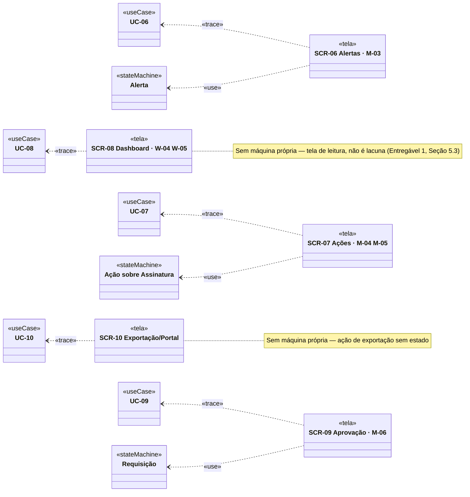

# Entregável 3 — Diagramas UML (Verificação Transição × Interface do Bloco B)

**Projeto:** Auditor e Otimizador de Assinaturas SaaS Corporativas
**Iteração:** Semana 09 (05/10/2026 – 11/10/2026)
**Responsável:** AR2 (Analista de Requisitos)
**Versão:** 1.0.0

---

## 1. O que se aplica a esta iteração

Conforme a matriz de [`diagramasUML.md`](../diagramasUML.md), todos os diagramas estruturais
e comportamentais já foram fechados em versão formal até a Semana 08 (Casos de Uso, Atividades,
Sequência, Máquina de Estados, Classes de Domínio v1.0, Pacotes v1.0). O próximo diagrama
agendado é o **de Implantação**, com entrega formal na **Semana 11** — fora do escopo aqui.

| Diagrama | Janela | Entrega formal | Situação |
|:---|:---|:---|:---:|
| Classes de Domínio / Pacotes | Semanas 6 e 7 | Semana 7 | Fechados em v1.0 (Semana 08) |
| Implantação | Semanas 10 e 11 | Semana 11 | Fora do escopo |

**Por que este documento existe mesmo assim.** O Entregável 3 da Semana 08 (Seção 6) deixou
explícito que *"as transições cujo gatilho humano está em tela do Bloco B... ficam para a
matriz da Semana 09"*, e a Seção 8 do mesmo documento apontou que os estados de `Licença`
acionados pelo Bloco B (`EmDowngrade`, `EmCancelamento`, `Removida`, `Cancelada`) *"entram nos
exemplos da Semana 09"*. Este entregável fecha essas duas pendências: não cria diagrama novo,
verifica os já existentes (máquinas `Requisição`, `Ação sobre Assinatura` e `Alerta`, Semana 06)
contra o Hi-Fi que acabou de ser construído (Entregável 2).

---

## 2. Transições Disparadas por Pessoa (GI-xx)

Numeração contínua a partir do GI-16 (última usada na Semana 08).

| ID | Máquina | Transição | Controle esperado | Onde está | Situação |
|:---|:---|:---|:---|:---|:---:|
| GI-17 | `Requisição` | `[*]` → `Rascunho` → `EmAprovacao` (submeter) | Formulário de nova requisição | Não desenhado — o Entregável 2 cobre a tela de decisão (HF-32, HF-33), não a de criação | ✗ fora do escopo |
| GI-18 | `Requisição` | `Bloqueada` → `Rejeitada` (realocar estoque) | *"Realocar 3 licenças do estoque"* | SCR-09 | ✓ |
| GI-19 | `Requisição` | `Bloqueada` → `EmAprovacao` (sobrepor) | *"Registrar justificativa"* | SCR-09 | ✓ |
| GI-20 | `Requisição` | `EmAprovacao` → `Aprovada` / `Rejeitada` | *"Aprovar"* / *"Rejeitar"* | SCR-09 — `Rejeitar` desenhado; `Aprovar` corretamente desabilitado enquanto a RN04 está ativa, mas nenhuma tela mostra o clique habilitado | ◐ |
| GI-21 | `Requisição` | `EmAprovacao` → `Rascunho` (RN01.9) | Reinício por alteração de valor acima de 10% | SCR-09b | ✓ — fecha a LR-29 da Semana 09 |
| GI-22 | `Ação sobre Assinatura` | `[*]` → `Solicitada` (downgrade) | *"Aplicar Downgrade"* | SCR-07a | ✓ |
| GI-23 | `Ação sobre Assinatura` | `[*]` → `Solicitada` (cancelamento) | *"Solicitar Aprovação"* | SCR-07b | ✓ |
| GI-24 | `Ação sobre Assinatura` | `JanelaArrependimento` → `Revertida` | *"Reverter"* | SCR-07 mostra o badge `Reversível · faltam 60h`, mas não desenha o botão de reverter em si | ◐ |
| GI-25 | `Alerta` | `Disparado` → tratado via downgrade | *"Avaliar downgrade antes de renovar"* | SCR-06 | ✓ |
| GI-26 | `Alerta` | qualquer → `Ignorado` | *"[ ... ] ignorar"* com motivo obrigatório (RI-24) | SCR-06 | ✓ — controle estava faltando na primeira versão do Hi-Fi; corrigido nesta iteração antes do fechamento do Entregável 2 |

**Resultado: dos 10 gatilhos humanos do Bloco B, 7 têm controle desenhado, 2 estão parciais e 1
está fora do escopo desta iteração (criação de requisição, não decisão sobre ela).**

> **GI-26 por pouco ficaria aberto.** A checagem desta seção encontrou, antes da redação final,
> que a SCR-06 prometia a RI-24 na lista do Entregável 2 (HF-25) mas não desenhava o controle de
> ignorar — mesmo problema de método que a Semana 08 descreveu na Seção 6 do seu próprio
> Entregável 3: wireframe cobrindo o caminho feliz e esquecendo a saída do ciclo. Foi corrigido
> no Figma antes deste documento ser fechado, não apenas anotado.

---

## 3. Estados Visíveis × Exemplos em Tela

Badges da Seção 10.2 do Design System contra os exemplos que o Hi-Fi do Bloco B efetivamente
mostra.

| Máquina | Estados com badge | Exemplificados no Hi-Fi | Mínimo a acrescentar |
|:---|:---:|:---|:---|
| `Requisição` | 9 | 2 — `Bloqueada` (SCR-09a), `Rascunho` (SCR-09b) | `EmAprovacao`, `Aprovada`, `Rejeitada`, `Contratada`, `Expirada`, `AtendidaPorRealocacao`, `Descartada` |
| `Ação sobre Assinatura` | 9 | 6 — `JanelaArrependimento`, `EmAprovacao`, `Executada`, `RecusadaPeloFornecedor`, `Revertida`, `InvalidadaPorUso` (SCR-07) | `Solicitada`, `Rejeitada`, `EmExecucao` |
| `Alerta` | 8 | 4 — `Disparado` (`Renovação próxima`), `DisparadoComRessalva`, `Escalado` (SCR-06) | `Agendado`, `Tratado`, `Ignorado`, `Cancelado`, `Expirado` |
| **Total** | **26** | **12 (46%)** | **15** |

> A cobertura (46%) é maior que a da Semana 08 no mesmo ponto do processo (29%, antes do
> Hi-Fi) — não por exigência menor, mas porque o Bloco B já nasceu com o Design System v1.0
> pronto (Semana 06), sem o período de protótipo paralelo que a Semana 07 trouxe para o Bloco A.

> **Nota de correção (adicionada na revisão da Semana 10).** Quando este documento foi
> escrito, a linha `Requisição` contava a `Bloqueada` (SCR-09a) como já exemplificada — mas a
> instância real do componente `Badge/Risco` (Design System, Seção 10.2) só foi construída
> durante a revisão completa da Semana 10: até então, o estado era representado só por texto
> colorido manualmente, sem o componente formal de badge. A mesma revisão adicionou o badge
> `Rascunho` (`Badge/Neutro`) à SCR-09b, que também não existia antes. A tabela acima já
> reflete o estado corrigido (12 exemplos, 46%); os números originais (1 exemplo, 42%)
> estiveram incorretos entre a publicação deste documento e essa correção. Ver Semana 10,
> Entregável 2, Seção 5.

### 3.1. Estados de `Licença`/`Assinatura` acionados pelo Bloco B

A Seção 8 do Entregável 3 da Semana 08 apontou que `EmDowngrade`, `EmCancelamento`, `Removida`
e `Cancelada` — estados que só uma ação do Bloco B provoca — ficariam para esta semana.

| Estado | Máquina | Onde aparece no Hi-Fi | Situação |
|:---|:---|:---|:---:|
| `EmDowngrade` | `Licença` / `Assinatura` | Nenhuma tela mostra a licença individual mudando para este estado — a SCR-07 mostra a **ação** (`Ação sobre Assinatura`), não o reflexo no inventário (SCR-03/SCR-04) | ✗ |
| `EmCancelamento` | `Assinatura` | Mesma lacuna — a SCR-09a/SCR-07b mostram a requisição/ação bloqueada, não a assinatura em si mudando de estado na SCR-03 | ✗ |
| `Removida` | `Licença` | Não exemplificada | ✗ |
| `Cancelada` | `Assinatura` | Não exemplificada | ✗ |

> **Lacuna genuína, não fechada nesta iteração (LR-36).** Fechar isso exigiria editar a SCR-03
> (Semana 08) para refletir o resultado de uma ação do Bloco B — por exemplo, a Adobe CC
> aparecer como `Em downgrade` no inventário depois que a SCR-07a é usada. Como a SCR-03 é
> entregável de outra semana e já foi aceito, a correção fica registrada como pendência
> (Seção 5) em vez de reabrir o Entregável 2 da Semana 08.

---

## 4. Diagrama — Tela → Caso de Uso e Máquina (Bloco B)

### 4.1. Cobertura das Dependências

| Req | Caso de uso | Máquina | Classes v1.0 (Semana 08) | Tela | Situação UML |
|:---|:---|:---|:---|:---|:---:|
| REQ-06 | UC-06 | `Alerta` | `AlertaRenovacao` | SCR-06 | ✓ |
| REQ-07 | UC-07 | `Ação sobre Assinatura` | `AcaoSobreAssinatura` | SCR-07 | ✓ — exemplo do Figma corrigido para Adobe CC (DEC-87) |
| REQ-08 | UC-08 | — | `UsoDiarioAgregado` | SCR-08 | ✓ — sem Mid-Fi anterior (LR-32), Hi-Fi evolui do Lo-Fi |
| REQ-09 | UC-09 | `Requisição` | `Requisicao`, `DecisaoDeAprovacao` | SCR-09 | ✓ |
| REQ-10 | UC-10 | — | `Exportacao`, `SolicitacaoDoTitular` | SCR-10 | ✓ — sem o conteúdo financeiro do M-07 (DEC-88) |

---

## 5. Decisões e Pendências

### 5.1. Pendências abertas nesta entrega

| ID | Item | Encaminhamento |
|:---|:---|:---|
| P-47 | `Licença`/`Assinatura` não mostram `EmDowngrade`/`EmCancelamento`/`Removida`/`Cancelada` em nenhuma tela do Bloco A ou B (LR-36) | Resolver na Semana 10 (Pacote de Telas de Tratamento de Exceções), revisando a SCR-03/04 |
| P-48 | GI-20 (`Aprovar` habilitado) e GI-24 (`Reverter`) sem tela própria — ambos são o "caminho feliz oposto" ao que já está desenhado | Avaliar se entram no pacote de estados de exceção da Semana 10 |

---

## 6. Rastreabilidade deste Documento

| Este documento é consumido por | Entregável |
|:---|:---|
| Pacote de Telas de Tratamento de Exceções (P-47, P-48) | Semana 10, Entregável 1 |
| Diagrama de Implantação | Semana 11, Entregável 3 |
