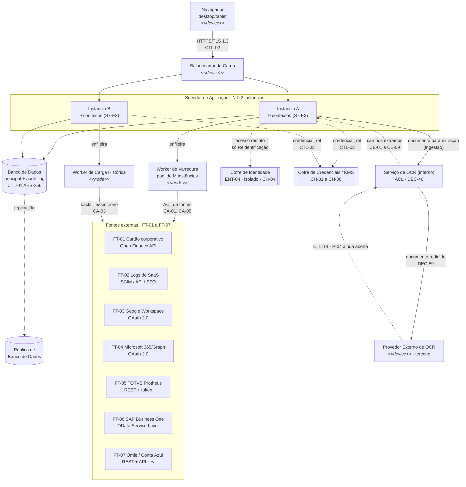

# Entregável 3 — Diagrama de Implantação (Deployment Diagram)

**Projeto:** Auditor e Otimizador de Assinaturas SaaS Corporativas
**Iteração:** Semana 11 (19/10/2026 – 25/10/2026)
**Responsável:** AR1 / AR2
**Versão:** 1.0.0 — **entrega formal**

---

## 1. O que se aplica a esta iteração

Conforme [`diagramasUML.md`](../diagramasUML.md), linha 61: o Diagrama de Implantação é devido
agora. A Semana 07 deixou isso registrado explicitamente — *"os artefatos até aqui não
definem provedor de nuvem, regiões nem topologia, e desenhá-lo agora seria inventar
informação"* ([S7·E3](../semana-07/entregavel-03-diagramas-uml.md), linha 24-25). Essa
informação continua sem existir: **nenhum artefato de nenhuma semana anterior nomeia um
provedor de nuvem**. Por isso os nós abaixo ficam em nível de infraestrutura genérica
(servidor, balanceador, banco), nunca "AWS EC2" ou equivalente — nomear um provedor aqui seria
inventar, não modelar o que já foi decidido.

---

## 2. Fontes

| Fonte | O que foi aproveitado |
|:---|:---|
| [Semana 01, Entregável 1](../semana-01/entregavel-01-matriz-conformidade-seguranca-privacidade.md) | Fontes externas FT-01 a FT-07 com protocolo de cada uma; CTL-01 a CTL-03 (criptografia e cofre), CTL-10 (segregação multi-tenant), CTL-12 (2FA), CTL-14 (transferência internacional) |
| [Semana 05, Entregável 3](../semana-05/entregavel-03-diagramas-uml.md), Seção 7 (DEC-46) | Natureza do serviço de OCR (interno + ACL para provedor externo) e a reserva explícita do **Provedor Externo de OCR** para este diagrama |
| [Semana 05, Entregável 2](../semana-05/entregavel-02-relatorio-validacao-rnf04-rnf10.md), Seção CA-01 a CA-06 | Arquitetura de varredura: paginação concorrente, janela de 90 dias + carga histórica assíncrona, *backoff* em `429` |
| [Semana 07, Entregável 3](../semana-07/entregavel-03-diagramas-uml.md), Seções 4–5 | Os 9 contextos delimitados e o Cofre de Credenciais/KMS — base dos artefatos hospedados em cada nó |
| [Semana 08, README](../semana-08/README.md), P-43 | RNF-03 (99,9% de disponibilidade) sem rastro em nenhum artefato — este diagrama precisa endereçá-la |
| [Semana 08, Entregável 1](../semana-08/entregavel-01-matriz-rastreabilidade-bloco-a.md), LR-05/P-39, Seção 9.2 (`CT-01.9`) | RNF-05 (50.000 transações/min) sem validação — critério de aceite formal para quando houver implementação a medir |

---

## 3. Nós de Implantação

| Nó | Estereótipo | O que hospeda | Fundamento |
|:---|:---|:---|:---|
| Navegador (desktop/tablet) | `<<device>>` | Cliente web da plataforma | RNF-09, DEC-07 (sem mobile) |
| Balanceador de Carga | `<<device>>` | Distribuição entre instâncias | Proposto nesta entrega para endereçar P-43 |
| Servidor de Aplicação (N ≥ 2 instâncias) | `<<node>>` | Os 9 contextos do Diagrama de Pacotes (S7·E3, Seção 4) | S7·E3; redundância proposta para P-43 |
| Worker de Varredura (pool de M instâncias) | `<<node>>` | Varredura periódica das fontes (janela de 90 dias) | CA-01, CA-05 (S5·E2); pool proposto para P-39 |
| Worker de Carga Histórica | `<<node>>` | Carga histórica assíncrona (*backfill*) | CA-03 (S5·E2) |
| Banco de Dados (principal) | `<<node>>` | As 23 entidades do dicionário (todas exceto `ENT-04`) + `audit_log` *append-only* | S6·E2; CTL-01 (AES-256 em repouso) |
| Réplica de Banco de Dados | `<<node>>` | Cópia de leitura/contingência do banco principal | Proposta nesta entrega para P-43 |
| Cofre de Identidade | `<<node>>`, isolado | `ENT-04` (nome/e-mail de colaborador) — armazenamento fisicamente separado, acesso exclusivo do Serviço de Reidentificação | S6·E2, Seção 6.4; CH-04 |
| Cofre de Credenciais / KMS | `<<node>>` | `credencial_ref`, `dek_ref`, `chave_pseudonimo_ref` (CH-01 a CH-06) | S7·E3, Seção 4, regra 2; CTL-03 |
| Serviço de OCR (interno) | `<<node>>` | ACL de OCR (DEC-46); modelo canônico `CE-01` a `CE-09` | S5·E3, Seção 7 |
| Provedor Externo de OCR | `<<device>>`, terceiro | Reconhecimento de documento (fora do domínio) | S5·E3, Seção 7, item 3 (reserva explícita para este diagrama) |
| Fontes externas FT-01 a FT-07 | `<<device>>`, terceiros | Cartão corporativo, SaaS, ERP (ver Seção 4) | S1·E1, linhas 29-35 |

---

## 4. Diagrama

**Como ler.** Setas contínuas são chamadas síncronas; setas tracejadas são referência/réplica
sem chamada direta de domínio. O balanceador e a segunda instância de aplicação, a réplica de
banco e os dois *workers* assíncronos não existiam em nenhum artefato anterior — são a
proposta desta entrega para a Seção 5. O Cofre de Identidade aparece como nó próprio, separado
do Banco de Dados principal: a Semana 06 (Seção 6.4) já exige que `ENT-04` fique em
armazenamento fisicamente isolado, acessível só pelo Serviço de Reidentificação — colocá-lo
dentro das "24 entidades do dicionário" do banco principal reabriria essa fronteira de
privacidade no handoff.

---

## 5. Resolução da Pendência P-43 (RNF-03 — 99,9% de disponibilidade)

Nenhuma semana anterior tinha desenhado redundância para a plataforma (P-43, registrada desde
a Semana 08). Este diagrama propõe o mínimo genérico capaz de sustentar RNF-03 sem fixar
mecanismo de SLA ou provedor:

| Elemento proposto | Risco que mitiga |
|:---|:---|
| Balanceador de Carga + ≥ 2 instâncias de aplicação | Indisponibilidade de uma única instância derruba a plataforma inteira |
| Réplica de Banco de Dados | Perda do banco principal interrompe toda a aplicação |

**O que este diagrama não decide:** número exato de instâncias, política de *failover*,
RPO/RTO ou qualquer SLA numérico — nenhuma semana anterior definiu esses parâmetros e
inventá-los agora extrapolaria o Diagrama de Implantação para uma decisão de operação que não
foi pedida nesta iteração. **P-43 fica parcialmente endereçada:** a lacuna de rastreabilidade
(nenhum artefato tratava RNF-03) está fechada; o dimensionamento fica como pendência nova.

---

## 6. Resolução Parcial da Pendência P-39 (RNF-05 — 50.000 transações/min)

A Semana 08 já reservava esta validação para o Diagrama de Implantação (P-39, LR-05) e propôs o
critério de aceite formal `CT-01.9` ("sustentar o volume de transações por cliente corporativo"
— S8·E1, Seção 9.2). A RNF-04 (Semana 05) também **nunca foi medida empiricamente** — o
próprio Entregável 2 daquela semana afirma que "não há medição empírica neste relatório, e não
poderia haver", já que nenhuma semana do cronograma tem sistema implementado. O que a Semana 05
fez foi diferente: um **modelo analítico de viabilidade**, com toda premissa numérica marcada
como estimativa de engenharia (`[P]`) e condições de arquitetura explícitas (`CA-01` a `CA-06`)
— não medições, mas também não números soltos. A RNF-05 nunca recebeu esse mesmo tratamento:
nenhuma semana modelou analiticamente a vazão agregada do sistema. `CA-01` (mínimo de 8
requisições concorrentes por conta) é uma **condição de arquitetura da varredura por conta**,
não uma medida de vazão total — são grandezas diferentes.

**O que este diagrama propõe:** o Worker de Varredura passa a ser um *pool* de M instâncias
(Seção 3), mesmo padrão de redundância horizontal já usado para o Servidor de Aplicação —
pré-condição necessária para sustentar qualquer volume, mas não suficiente sozinha.

**O que este diagrama não decide:** o valor de M nem a vazão por instância — nenhum artefato
anterior sequer projetou isso analiticamente (diferente da RNF-04), e inventar um número aqui
sem modelo nem premissas declaradas seria menos rigoroso que o que a Semana 05 fez para a
RNF-04. `CT-01.9` já é o critério de aceite para quando houver medição empírica real — que,
como a RNF-04, ainda não existe para nenhum RNF deste projeto. **P-39 fica parcialmente
endereçada:** a arquitetura passa a ser compatível com escala horizontal; o dimensionamento
numérico vira pendência nova (Seção 8).

---

## 7. Pendência Já Existente que Este Diagrama Não Fecha (P-04)

A Semana 05 já previa que o **Provedor Externo de OCR** entraria aqui "com sua própria
consideração de conformidade (transferência de dados — CTL-14, pendência P-04)"
([S5·E3](../semana-05/entregavel-03-diagramas-uml.md), Seção 7). O nó está desenhado (Seção
4), mas **P-04 segue aberta** desde a Semana 01: é pendência contratual/jurídica (anexo de
transferência internacional), não uma decisão de arquitetura — resolvê-la aqui estaria fora do
escopo deste entregável.

---

## 8. Pendências Novas Desta Iteração

| ID | Pendência | Observação |
|:--|:---|:---|
| P-49 | Dimensionamento de redundância (número de instâncias, RPO/RTO) para RNF-03 | Proposta conceitual nesta entrega; parâmetro numérico não definido |
| P-51 | Vazão por instância do Worker de Varredura, necessária para validar numericamente RNF-05 (`CT-01.9`) | Falta até o modelo analítico (RNF-04 tem; RNF-05 não) — depois, medição empírica quando houver implementação |

---

## 9. Rastreabilidade deste Documento

| Este documento é consumido por | Entregável |
|:---|:---|
| Handoff técnico de infraestrutura | Semana 14 (Fase 4) |
| P-04 (transferência internacional, ainda aberta) | Decisão jurídica/contratual, fora do cronograma de UI |
| P-51 (vazão do Worker de Varredura, `CT-01.9`) | Modelo analítico primeiro, depois medição empírica quando houver implementação |
